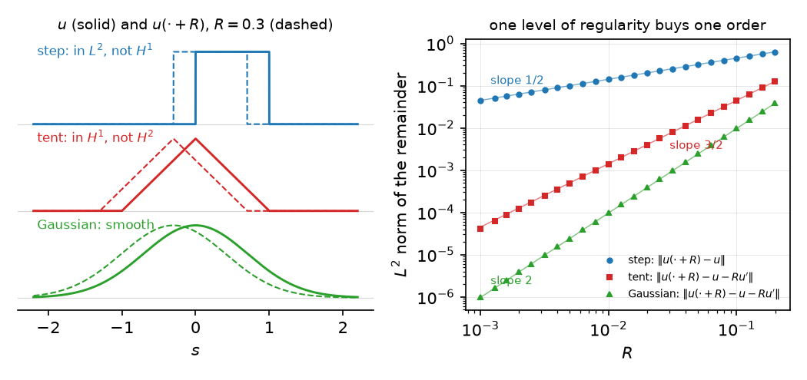

# Chapter 1. Smooth one level down: the sc-calculus (HWZ Part I, Chapter 1, pp. 5–20 (preprint pp. 6–17))

*Hofer–Wysocki–Zehnder, "Polyfold and Fredholm Theory", Part I, Chapter 1 (2014 preprint, arXiv
1407.3185, pp. 6–17), with the motivating example from their "Sc-smoothness, retractions and new
models for smooth spaces" (2010, arXiv 1002.3381, §1.1 and §4.1), rewritten for a first-year
graduate student who wants to know what the definitions are for. Every proof is complete. The
proofs that the preprint delegates to the 2010 paper (Propositions 1.2.1–1.2.4 (preprint 1.16–1.19)) are given in full
and are formalized.
Statement numbers and pages are those of the book (Springer 2021), with the preprint's in parentheses (see `BookConcordance.md`); places where the preprint and the book may differ, once marked "check against the book",
were checked against the book's arXiv version, arXiv 1707.08941 (2017), before the Springer edition was
available; each is annotated (book 2017: …) with "unchanged",
"corrected", or the 2017 statement number and page.*

---

## 0. Sliding a profile along a neck

A soap film spanning two rings far apart is, away from the rings, a long thin cylinder; so is the
neck of a surface about to pinch off, and so is a pseudoholomorphic curve in symplectic field
theory near a breaking: a map $u$ from the cylinder $\mathbb R\times S^1$ into the target, with
coordinates $(s,t)$, $s$ along the neck and $t$ around it. Nothing singles out an origin on the
neck. If $u$ is a solution of the equation, so is the translated profile
$$u(\cdot + R,\cdot+\vartheta),\qquad (R,\vartheta)\in\mathbb R\times S^1,$$
and when two such necks are glued the gluing formula contains exactly this shift of one piece
against the other by the gluing parameter. So the configuration space of profiles carries an
action of $\mathbb R\times S^1$, and every chart of a moduli space built from such necks has
transition maps in which the shift appears.

Here is the difficulty that this chapter resolves. Let $E = L^2(\mathbb R\times S^1)$ and
$\Phi(R,\vartheta,u) = u(\cdot+R,\cdot+\vartheta)$. Each $\Phi(R,\vartheta,\cdot)$ is an isometry
of $E$, and $(R,\vartheta)\mapsto\Phi(R,\vartheta,u)$ is continuous for every $u$. But it is not
differentiable: if it were, its derivative at $R = 0$ would be $\partial_su$, which for a general
$u\in L^2$ does not exist. For the step function $u = \mathbf 1_{[0,1]}$ one computes
$\|u(\cdot+R)-u\|_{L^2} = \sqrt{2R}$, so the difference quotient grows like $R^{-1/2}$. The same
happens on every Sobolev space $H^m$: the derivative in $R$ costs one derivative in $s$, and
$\partial_s$ does not map $H^m$ to $H^m$. In the classical sense the shift is *not* $C^1$ on any
fixed Sobolev space, although every physicist would call the sliding of a profile along a neck a
smooth operation.

The sc-calculus takes the loss of one derivative seriously. Instead of one Banach space it keeps
a whole decreasing *scale* $E_0\supset E_1\supset E_2\supset\cdots$ (here $H^{m,\delta_m}$,
Sobolev spaces with growing weights), and a map is called $\mathrm{sc}^1$ if it is differentiable
*from level $1$ into level $0$*, with a derivative that acts on level $0$ and depends continuously
on the point in a weak sense (§3). The shift is then differentiable at every $u\in H^1$ with
derivative $(R_1,\vartheta_1,v)\mapsto R_1\partial_su + \vartheta_1\partial_tu + v$, and iterating
makes it smooth: each further derivative costs one more level, and there are infinitely many
levels. The surprise, and the reason the theory works, is the chain rule (Theorem 1.3.1 (preprint 1.21)): one would
expect a composition of two maps that each lose a level to lose two, but it loses only one. The
reason is the one structural hypothesis on the scale, that the inclusions $E_{m+1}\to E_m$ are
compact (Remark 1.3.2 (preprint 1.22)). Every proof in this chapter that is more than bookkeeping is a compactness
argument of the same shape: a sequence $h_n/|h_n|_1$ bounded in $E_1$ has a subsequence converging
in $E_0$.

The chapter follows the preprint: §1 scales, §2 their linear algebra (sc-operators, quotients,
sc-Fredholm operators and their stability under $\mathrm{sc}^+$-perturbations), §3
sc-differentiability and its relation to classical differentiability, §4 the chain rule, §5 the
degeneracy index of a point of a quadrant, which later measures how deep in the corner of a
polyfold a point lies. The application (§6) proves what the opening claimed: the shift map is
sc-smooth, and it is not $C^1$ on any level.

---

## 1. Sc-Banach spaces (pp. 5–7 (preprint pp. 6–7))

**Definition 1.1.1 (preprint 1.1).** An *sc-structure* (scale structure) on a Banach space $E$ is a sequence of
Banach spaces $(E_m,|\cdot|_m)_{m\ge0}$ with $E = E_0\supset E_1\supset E_2\supset\cdots$ as sets,
such that

1. each inclusion $E_{m+1}\to E_m$ is a compact operator;
2. $E_\infty := \bigcap_{m\ge0}E_m$ is dense in every $E_m$.

A Banach space with an sc-structure is an *sc-Banach space*. Points of $E_\infty$ are *smooth
points*; points of $E_m$ have *regularity $m$*.

A compact operator is bounded, so each inclusion $E_{m+1}\to E_m$ is continuous:
$|x|_m\le c_m|x|_{m+1}$. Nothing is said about *how* the norms compare beyond this; in the
examples $|\cdot|_{m+1}$ is strictly stronger. The name comes from interpolation theory
(Triebel, *Interpolation Theory, Function Spaces, Differential Operators*, 1978, cited as [41]),
where such nested scales are standard; the new point of view is to read the scale as a smooth
structure.

> **A hidden hypothesis made explicit.** Definition 1.1.1 (preprint 1.1) speaks of one Banach space $E$ with
> subspaces $E_m$. For the formalization the convenient object is an *indexed family* of Banach
> spaces $E_m$ with injective compact linear maps $E_{m+1}\to E_m$; "$E_m\subset E_0$" is then the
> composite of the inclusions. The two are equivalent (the family is the sets, the subspace
> picture is recovered by identifying $E_m$ with its image in $E_0$), and nothing below uses more
> than the family. The Lean files of this project take the family as the definition.

**Lemma 1.A (first consequences).** Let $E$ be an sc-Banach space.

1. $E_\infty$ is dense in $E_0$, and $E_m$ is dense in $E_k$ for $m\ge k$.
2. A finite-dimensional Banach space has exactly one sc-structure, the constant one $E_m = E$.
3. If $E$ is infinite-dimensional, the constant sequence $E_m = E$ is not an sc-structure.
4. For $k\ge0$ the sequence $(E^k)_m := E_{k+m}$ is an sc-structure on $E_k$; $E^k$ denotes
   $E_k$ with this structure (the *level shift*). Its smooth points are those of $E$.

*Proof.* (1) $E_\infty\subset E_m$ and $E_\infty$ is dense in $E_k$. (2) If $E_m = E$ for all $m$
as sets, each $E_m$ is finite-dimensional, so all norms on it are equivalent and the inclusions
are compact (bounded sets of a finite-dimensional space are relatively compact), and
$E_\infty = E$ is dense. Conversely, given any sc-structure, $E_\infty$ is dense in $E_0$ and is a
subspace of a finite-dimensional space, hence closed, hence equal to $E_0$; so $E_m = E$ for all
$m$, and the norms are equivalent to the given one. (3) The identity of an infinite-dimensional
Banach space is not compact (Riesz: the closed unit ball is compact only in finite dimension).
(4) The inclusions $E_{k+m+1}\to E_{k+m}$ are compact, and $\bigcap_m E_{k+m} = E_\infty$ is dense
in every $E_{k+m}$. $\square$

*Checked by machine.* With sc-Banach spaces as indexed families (the blockquote above): (1) is
`Polyfold.ScBanach.denseRange_inclK` (the image of $E_{m+k}$ is dense in $E_m$). (2) is proved in
the form: if $E_0$ is finite-dimensional, every point is smooth
(`Polyfold.ScBanach.smooth_eq_top_of_finiteDimensional`), every inclusion $E_m\to E_0$ is bijective
(`Polyfold.ScBanach.toBase_bijective_of_finiteDimensional`), and these inclusions form an
sc-isomorphism of $E$ onto $E_0$ with the constant structure
(`Polyfold.ScBanach.isoConstOfFiniteDimensional`), so all the norms $|\cdot|_m$ are equivalent; the
constant structure itself is `Polyfold.ScBanach.const`. (3) is proved in the form: if an inclusion
$E_{m+1}\to E_m$ is onto, then $E_m$ is finite-dimensional
(`Polyfold.ScScale.finiteDimensional_of_surjective_incl`), by the open mapping theorem and Riesz's
theorem as above. (4) is `Polyfold.ScBanach.shift` with `Polyfold.ScBanach.shift_smoothLvl`, and
$E^k$ is the iterate `Polyfold.ScBanach.shiftK`.

**Lemma 1.B (direct sums).** If $E$ and $F$ are sc-Banach spaces, $(E\oplus F)_m := E_m\oplus F_m$
(with the norm $|(x,y)|_m = |x|_m + |y|_m$) is an sc-structure on $E\oplus F$, with
$(E\oplus F)_\infty = E_\infty\oplus F_\infty$.

*Proof.* The inclusion $(E\oplus F)_{m+1}\to(E\oplus F)_m$ is the product of two compact
operators: the image of a bounded set lies in a product of two relatively compact sets, which is
relatively compact. $E_\infty\oplus F_\infty$ is dense in $E_m\oplus F_m$ since each factor is
dense. $\square$ *(Checked by machine: `Polyfold.ScBanach.prod`, `Polyfold.ScBanach.prod_smoothLvl`.)*

A subset $A\subset E$ inherits the filtration $A_m := A\cap E_m$, and $A^k$ denotes $A_k$ with
the filtration $(A^k)_m = A_{k+m}$; $A_\infty = A\cap E_\infty$ may be empty.

**Example 1.1.3 (preprint 1.2) (weighted Sobolev spaces on the cylinder; pp. 5–7 (preprint pp. 6–7)).** Fix a strictly
increasing sequence $0 = \delta_0 < \delta_1 < \delta_2 < \cdots$. For $m\ge0$ and $\delta\ge0$
let $H^{m,\delta} = H^{m,\delta}(\mathbb R\times S^1)$ be the space of $u\in L^2(\mathbb R\times
S^1)$ whose weak partial derivatives $D^\alpha u$, $|\alpha|\le m$, exist in $L^2_{\mathrm{loc}}$
and satisfy $e^{\delta|s|}D^\alpha u\in L^2$, with the norm
$$|u|_{m,\delta}^2 = \sum_{|\alpha|\le m}\int_{\mathbb R\times S^1}|D^\alpha u(s,t)|^2e^{2\delta|s|}\,ds\,dt .$$
Put $E_m := H^{m,\delta_m}$, so $E_0 = L^2(\mathbb R\times S^1)$.

**Proposition 1.C.** $(E_m)_{m\ge0}$ is an sc-structure on $L^2(\mathbb R\times S^1)$, and
$C^\infty_c(\mathbb R\times S^1)\subset E_\infty$.

The preprint says that "one sees" this from Sobolev's compact embedding theorem for bounded
domains and the strict monotonicity of $(\delta_m)$. The proof uses three standard facts.

(S1) *Completeness.* $H^{m,\delta}$ is a Banach space. (If $(u_k)$ is Cauchy, each
$e^{\delta|s|}D^\alpha u_k$ converges in $L^2$ to some $v_\alpha$; since $e^{-\delta|s|}\le1$,
$D^\alpha u_k\to e^{-\delta|s|}v_\alpha$ in $L^2$, and weak derivatives pass to $L^2_{\rm loc}$
limits, so $D^\alpha u = e^{-\delta|s|}v_\alpha$ for $u = e^{-\delta|s|}v_0$.)

(S2) *Rellich–Kondrachov.* For a bounded Lipschitz domain $\Omega\subset\mathbb R^2$, the inclusion
$H^{m+1}(\Omega)\to H^m(\Omega)$ is compact (Adams–Fournier, *Sobolev Spaces*, 2nd ed., Theorem
6.3). We use it on $\Omega_N = (-N,N)\times S^1$, which is covered by two Lipschitz domains in
$\mathbb R^2$ after unrolling $S^1$; compactness on each piece gives compactness on $\Omega_N$.

(S3) *Density.* $C_c^\infty(\mathbb R\times S^1)$ is dense in $H^m(\mathbb R\times S^1)$ (Adams–Fournier,
Theorem 3.22).

*Proof of Proposition 1.C.* *Inclusions.* Since $\delta_m\le\delta_{m+1}$, $e^{2\delta_m|s|}\le
e^{2\delta_{m+1}|s|}$, so $E_{m+1}\subset E_m$ with $|u|_m\le|u|_{m+1}$ (we write $|\cdot|_m$ for
$|\cdot|_{m,\delta_m}$).

*Compactness.* Let $(u_k)$ be bounded in $E_{m+1}$, $|u_k|_{m+1}\le1$. For $|s|\ge N$,
$$e^{2\delta_m|s|} = e^{2\delta_{m+1}|s|}e^{-2(\delta_{m+1}-\delta_m)|s|}\le
e^{-2(\delta_{m+1}-\delta_m)N}e^{2\delta_{m+1}|s|},$$
so the tails satisfy
$$\sum_{|\alpha|\le m}\int_{|s|\ge N}|D^\alpha u_k|^2e^{2\delta_m|s|}\le
e^{-2(\delta_{m+1}-\delta_m)N}|u_k|_{m+1}^2\le e^{-2(\delta_{m+1}-\delta_m)N}. \tag{1.1}$$
This is where $\delta_{m+1}>\delta_m$ is used. On $\Omega_N$ the restrictions $u_k|_{\Omega_N}$
are bounded in $H^{m+1}(\Omega_N)$ (the weight is bounded above and below on $\Omega_N$), so by
(S2) a subsequence converges in $H^m(\Omega_N)$. A diagonal argument over $N = 1,2,\dots$ gives a
subsequence $(u_{k_j})$ converging in $H^m(\Omega_N)$ for every $N$. It is Cauchy in $E_m$: given
$\varepsilon>0$ choose $N$ with $e^{-2(\delta_{m+1}-\delta_m)N}<\varepsilon^2$; then by (1.1)
$|u_{k_i}-u_{k_j}|_m^2\le 4\varepsilon^2 + C_N|u_{k_i}-u_{k_j}|_{H^m(\Omega_N)}^2$ (the tails of
the difference are bounded by $|a-b|^2\le2|a|^2+2|b|^2$ and (1.1), and the weight is bounded by
$C_N$ on $\Omega_N$), which is $<5\varepsilon^2$ for $i,j$ large. $E_m$ is complete by (S1), so
the subsequence converges in $E_m$.

*Density.* $C_c^\infty\subset E_m$ for every $m$ (the weight is bounded on a compact support),
so $C_c^\infty\subset E_\infty$; it suffices to show $C_c^\infty$ is dense in $E_m$. Let
$u\in E_m$ and let $\chi_N(s) = \chi(s/N)$ with $\chi\in C_c^\infty(\mathbb R)$, $\chi = 1$ on
$[-1,1]$ and $\chi = 0$ outside $[-2,2]$. By the Leibniz rule $D^\alpha(\chi_Nu)-D^\alpha u = (\chi_N-1)D^\alpha u + \sum_{\beta<\alpha}
\binom\alpha\beta D^{\alpha-\beta}\chi_N\,D^\beta u$, and $|D^{\gamma}\chi_N|\le C N^{-|\gamma|}
\le C$ for $|\gamma|\ge1$ with support in $|s|\ge N$; so $|\chi_Nu-u|_m^2\le C'\sum_{|\beta|\le m}
\int_{|s|\ge N}|D^\beta u|^2e^{2\delta_m|s|}\to0$ by dominated convergence. The function
$\chi_Nu$ is supported in $\Omega_{2N}$, where the weight is bounded, so convergence in
$H^m$ of functions supported in $\Omega_{3N}$ implies convergence in $E_m$; by (S3), or directly
by mollification, $\chi_Nu$ is the $H^m$-limit of functions in $C_c^\infty$ supported in
$\Omega_{3N}$, hence their $E_m$-limit. $\square$

The 2010 paper also uses the variant with $\delta_0>0$ and $E_m = H^{3+m,\delta_m}$, the level
shift of the above by three with a positive first weight; it is an sc-structure by the same
proof. Finite-dimensional spaces $\mathbb R^n$ always carry their constant structure.

---

## 2. Sc-operators, quotients, sc-Fredholm operators (pp. 6–10 (preprint pp. 7–10))

**Definition 1.1.4 (preprint 1.3).** A linear map $T:E\to F$ between sc-Banach spaces is an *sc-operator* if
$T(E_m)\subset F_m$ and $T:E_m\to F_m$ is continuous for every $m$. An *sc-isomorphism* is a
bijective sc-operator whose inverse is an sc-operator.

**Definition 1.1.5 (preprint 1.4).** An sc-operator $S:E\to F$ is an *$\mathrm{sc}^+$-operator* if
$S(E_m)\subset F_{m+1}$ and $S:E\to F^1$ is an sc-operator, i.e. $S:E_m\to F_{m+1}$ is continuous
for every $m$.

An $\mathrm{sc}^+$-operator is *sc-compact*: $S:E_m\to F_m$ is the composite of the bounded
$S:E_m\to F_{m+1}$ with the compact inclusion $F_{m+1}\to F_m$, hence compact. So $T+S$ is, on
every level, a compact perturbation of $T$.

**Definition 1.1.6 (preprint 1.5).** A subspace $F$ of an sc-Banach space $E$ is an *sc-subspace* if $F$ is closed
(in $E_0$) and $(F_m := F\cap E_m)_{m\ge0}$ is an sc-structure on $F$, with the norms induced
from $E_m$. An sc-subspace $F$ has an *sc-complement* $G$ if $G$ is an algebraic complement of
$F$ such that $(G_m := G\cap E_m)$ is an sc-structure on $G$ and, on every level,
$E_m = F_m\oplus G_m$ is a topological direct sum. Then $E = F\oplus G$ is an *sc-splitting*.

The phrase "on every level $E_m = F_m\oplus G_m$" carries real content: if $x\in E_m$ and
$x = f+g$ with $f\in F$, $g\in G$, nothing forces $f,g\in E_m$; the definition demands it.
Two of the conditions in Definition 1.1.6 (preprint 1.5) are automatic:

**Lemma 2.A.** Let $F\subset E$ be a closed subspace. Then $F_m = F\cap E_m$ is closed in $E_m$,
and the inclusions $F_{m+1}\to F_m$ are compact. Hence $F$ is an sc-subspace if and only if
$F\cap E_\infty$ is dense in $F\cap E_m$ for every $m$.

*Proof.* $F_m$ is the preimage of the closed set $F$ under the continuous inclusion $E_m\to E_0$,
so it is closed, and $(F_m,|\cdot|_m)$ is a Banach space. A bounded subset of $F_{m+1}$ is bounded
in $E_{m+1}$, so its image has compact closure in $E_m$; the closure lies in the closed set $F_m$,
so it is compact in $F_m$. $\square$ *(Checked by machine: `Polyfold.ScBanach.isClosed_levelSub`,
`Polyfold.ScBanach.ofSubspaceScale`; the definition `Polyfold.ScBanach.IsScSubspace` asks only for
closedness and density, as the lemma allows.)*

**Lemma 2.B (sc-splittings are sc-projections).** (i) If $E = F\oplus G$ is an sc-splitting, the
projection $P:E\to E$ onto $F$ along $G$ is an sc-operator with $P^2 = P$. (ii) Conversely, if
$P:E\to E$ is an sc-operator with $P^2 = P$, then $F = P(E)$ and $G = (1-P)(E)$ are sc-subspaces,
$F_m = P(E_m)$, $G_m = (1-P)(E_m)$, and $E = F\oplus G$ is an sc-splitting.

*Proof.* (i) $P$ maps $E_m = F_m\oplus G_m$ onto $F_m$, and it is continuous on $E_m$ because the
sum is topological (equivalently, by the open mapping theorem, since $F_m$ and $G_m$ are closed in
$E_m$ with $F_m\cap G_m = 0$ and $F_m+G_m = E_m$). (ii) $F$ and $G$ are closed, being kernels of
the continuous operators $1-P$ and $P$ on $E_0$. If $x\in F\cap E_m$ then $x = Px\in P(E_m)$;
conversely $P(E_m)\subset E_m\cap F$. So $F_m = P(E_m)$, similarly $G_m = (1-P)(E_m)$, and
$E_m = F_m\oplus G_m$ algebraically with continuous projection $P|_{E_m}$. Density: $P:E_m\to F_m$
is continuous and onto, and $P(E_\infty)\subset F\cap E_\infty = F_\infty$, so
$F_\infty\supset P(E_\infty)$ is dense in $P(E_m) = F_m$; likewise for $G$. By Lemma 2.A, $F$ and
$G$ are sc-subspaces. $\square$

*Checked by machine.* (i): the projection is the sc-operator `Polyfold.ScBanach.IsScSplitting.scProj`,
whose level-$m$ map is the continuous projection of $E_m$ onto $F_m$ along $G_m$ (continuous because
$F_m$, $G_m$ are closed complements, `Polyfold.ScBanach.IsScSplitting.isTopCompl`), with $P^2 = P$,
$P(E_m) = F_m$ and $\ker P_m = G_m$ on every level (`Polyfold.ScBanach.IsScSplitting.scProj_idem`,
`Polyfold.ScBanach.IsScSplitting.range_scProj`, `Polyfold.ScBanach.IsScSplitting.ker_scProj`).
(ii): for an sc-operator $P$ with $P_0^2 = P_0$, $E = P(E)\oplus\ker P$ is an sc-splitting
(`Polyfold.ScBanach.isScSplitting_of_idem`; $\ker P = (1-P)(E)$), with $P(E)_m = P_m(E_m)$
(`Polyfold.ScOperator.levelSub_range_eq`) and $P_m^2 = P_m$ on every level
(`Polyfold.ScOperator.idem_lvl`). Together: `Polyfold.ScBanach.isScSplitting_iff_exists_scProj`.

**Proposition 1.1.7 (preprint 1.6).** Let $E$ be an sc-Banach space. A finite-dimensional subspace $F\subset E$ is
an sc-subspace if and only if $F\subset E_\infty$. A finite-dimensional sc-subspace has an
sc-complement.

*Proof.* If $F\subset E_\infty$ then $F_m = F$ for all $m$, $F$ is closed (finite-dimensional),
and the constant filtration is an sc-structure (Lemma 1.A(2)). Conversely, if $F$ is an
sc-subspace then $F_\infty = F\cap E_\infty$ is dense in $F_0 = F$; a dense subspace of a
finite-dimensional space is the whole space, so $F = F_\infty\subset E_\infty$.

For the complement let $e_1,\dots,e_k$ be a basis of $F\subset E_\infty$ and $\mu_1,\dots,\mu_k$
the dual basis, linear functionals on $F$. Since $F$ is finite-dimensional they are continuous on
$(F,|\cdot|_0)$, and by the Hahn–Banach theorem they extend to continuous functionals
$\lambda_i$ on $E_0$; these are continuous on every $E_m$ because the inclusion $E_m\to E_0$ is.
Put $P(x) = \sum_i\lambda_i(x)e_i$. Then $P(E_m)\subset F\subset E_m$ and $|Px|_m\le\sum_i\|\lambda_i\|
\,|x|_0|e_i|_m\le c\,|x|_m$, so $P$ is an sc-operator; $P(e_j) = e_j$ gives $P^2 = P$ and
$P(E) = F$. By Lemma 2.B, $G := (1-P)(E) = \ker P$ is an sc-subspace and $E = F\oplus G$ is an
sc-splitting. $\square$

(The preprint proves the density of $G_\infty$ in $G_m$ directly: for $g\in G_m$ take
$f_n\in E_\infty$ with $f_n\to g$ in $E_m$ and set $g_n = (1-P)f_n\in G_\infty$; then
$g_n\to(1-P)g = g$. This is the argument inside Lemma 2.B(ii).)

**Proposition 1.1.8 (preprint 1.7) (quotients).** Let $A$ be an sc-subspace of $E$. Then $E/A$, filtered by
$(E/A)_m := E_m/A_m$, is an sc-Banach space, where $E_m/A_m$ is identified with the subspace
$\{x+A : x\in E_m\}$ of $E/A$.

*Proof.* *The identification.* $A_m = A\cap E_m$ is closed in $E_m$ (Lemma 2.A), so $E_m/A_m$
with the quotient norm $\|x+A_m\|_m = \inf\{|x+a|_m : a\in A_m\}$ is a Banach space. The map
$E_m/A_m\to E/A$, $x+A_m\mapsto x+A$, is well defined and injective: for $x,y\in E_m$,
$x-y\in A$ if and only if $x-y\in A\cap E_m = A_m$. Its image is $\{x+A : x\in E_m\}$, and these
subspaces decrease with $m$. The inclusion $E_{m+1}/A_{m+1}\to E_m/A_m$ is
$x+A_{m+1}\mapsto x+A_m$ for $x\in E_{m+1}$.

*Compactness.* Let $(x_k+A_{m+1})_k$ be a sequence in the unit ball of $E_{m+1}/A_{m+1}$. By the
definition of the quotient norm there are $a_k\in A_{m+1}$ with $|x_k+a_k|_{m+1}\le2$. The
inclusion $E_{m+1}\to E_m$ is compact, so after passing to a subsequence $x_k+a_k\to x$ in $E_m$.
Then
$$\|(x_k+A_m)-(x+A_m)\|_m = \|(x_k+a_k-x)+A_m\|_m\le|x_k+a_k-x|_m\to0,$$
using $a_k\in A_m$ to replace the representative. So the image sequence converges in $E_m/A_m$.

*Density.* The classes $x+A$ with $x\in E_\infty$ lie in $E_j/A_j$ for every $j$, hence in
$(E/A)_\infty = \bigcap_j E_j/A_j$. The quotient map $E_m\to E_m/A_m$ is continuous and onto, and
$E_\infty$ is dense in $E_m$, so $\{x+A : x\in E_\infty\}$ is dense in $E_m/A_m$. A fortiori
$(E/A)_\infty$ is dense in $E_m/A_m$. $\square$

> **HWZ's text asserts more than it needs.** The preprint (p. 9) states that $(E/A)_\infty$
> consists exactly of the classes $x+A$ with $x\in E_\infty$. Only the inclusion "$\supset$",
> which is trivial, is used. The equality is true, but it is not obvious: a class that has a
> representative in every $E_j$ must be shown to have a single representative in $E_\infty$.
> The next lemma supplies the argument (a Mittag-Leffler construction). It is not needed later
> in the chapter, but it is the kind of statement a formalization has to settle.

**Lemma 2.C.** Let $A$ be an sc-subspace of $E$ and $x\in E$ such that $(x+A)\cap E_j\ne\emptyset$
for every $j$. Then $(x+A)\cap E_\infty\ne\emptyset$.

*Proof.* Choose $x_j\in(x+A)\cap E_j$. Then $d_j := x_{j+1}-x_j\in A\cap E_j = A_j$. Let
$K_{i,j}$ be the norm of the inclusion $E_j\to E_i$ for $i\le j$, and $M_j = \max_{i\le j}K_{i,j}$.
Since $A_\infty$ is dense in $A_j$, choose $c_j\in A_\infty$ with $|d_j-c_j|_j\le 2^{-j}/M_j$; then
$b_j := d_j-c_j\in A_j$ satisfies $|b_j|_i\le2^{-j}$ for all $i\le j$. The series $\sum_jb_j$
converges absolutely in $E_0$; call its sum $b$, and put $y := x_0 + b$. For each $J$,
$$y - x_J = x_0-x_J + \sum_{j<J}b_j + \sum_{j\ge J}b_j = -\sum_{j<J}c_j + \sum_{j\ge J}b_j ,$$
because $x_0 - x_J = -\sum_{j<J}d_j = -\sum_{j<J}(b_j+c_j)$. The first sum lies in $A_\infty\subset
E_J$. The second converges in $E_J$ since $b_j\in A_j\subset E_J$ for $j\ge J$ and
$\sum_{j\ge J}|b_j|_J\le\sum_{j\ge J}2^{-j}<\infty$; its $E_J$-limit is its $E_0$-limit, and lies
in the closed subspace $A_J$. So $y-x_J\in A_J$, whence $y\in E_J$ and $y\in x_J+A = x+A$ for
every $J$: $y\in(x+A)\cap E_\infty$. $\square$

*Checked by machine:* `Polyfold.ScBanach.exists_smooth_mem_coset`, by the same construction, with the
bound $\prod_{i<j}\max(1,\|E_{i+1}\to E_i\|)$ for the norms of all inclusions $E_j\to E_i$, $i\le j$,
in place of $M_j$. As a description of the quotient: the class of $x$ is a smooth point of $E/A$ if
and only if $x+A$ contains a smooth point of $E$ (`Polyfold.ScBanach.mk_mem_quotient_smooth_iff`),
which is the preprint's equality.

**Definition 1.1.9 (preprint 1.8).** An sc-operator $T:E\to F$ is *sc-Fredholm* if there are sc-splittings
$E = K\oplus X$ and $F = C\oplus Y$ such that (1) $K = \ker T$ is finite-dimensional; (2) $C$ is
finite-dimensional and $Y = T(E)$; (3) $T:X\to Y$ is an sc-isomorphism. The *index* is
$\operatorname{ind}(T) = \dim K-\dim C$.

**Lemma 2.D.** Let $T$ be sc-Fredholm with splittings as above. Then $K\subset E_\infty$,
$C\subset F_\infty$, $T(X_m) = Y_m$ and $T(E_m) = Y_m$, and
$$E_m = K\oplus X_m,\qquad F_m = C\oplus T(E_m)\qquad(m\ge0).$$
For every $m$ the operator $T:E_m\to F_m$ is Fredholm in the classical sense, with kernel $K$,
image $Y_m$, and index $\operatorname{ind}(T) = \dim K - \dim C$.

*Proof.* $K$ and $C$ are finite-dimensional sc-subspaces, so they lie in $E_\infty$, $F_\infty$ by
Proposition 1.1.7 (preprint 1.6), and their filtrations are constant. $T:X\to Y$ is an sc-isomorphism, so
$T(X_m) = Y_m$. Since $E_m = K\oplus X_m$ and $T(K) = 0$, $T(E_m) = T(X_m) = Y_m$; and
$F_m = C\oplus Y_m$. The kernel of $T|_{E_m}$ is $K\cap E_m = K$. $Y_m$ is closed in $F_m$ (Lemma
2.A) with the finite-dimensional complement $C$, so $T:E_m\to F_m$ is Fredholm with
$\dim\ker = \dim K$ and $\dim(F_m/Y_m) = \dim C$. $\square$

*Checked by machine*, item by item, for an sc-Fredholm splitting `s` of $T$ (the data of Definition
1.1.9 (preprint 1.8), `Polyfold.ScFredholmSplitting`): $K\subset E_\infty$ is
`Polyfold.ScFredholmSplitting.K_le_smooth`, $C\subset F_\infty$ is
`Polyfold.ScFredholmSplitting.C_le_smooth`; $T(X_m) = Y_m$, bijectively, is part of the definition
(condition (3) read as bijectivity on every level); $T(E_m) = Y_m$ is
`Polyfold.ScFredholmSplitting.range_lvl`; $E_m = K_m\oplus X_m$ and $F_m = C_m\oplus Y_m$ are the
level-$m$ parts of the two sc-splittings, with $K_m\cong K$ and $C_m\cong C$ because $K$, $C$ consist
of smooth points (`Polyfold.ScBanach.finrank_levelSub_of_le_smooth`); the kernel of $T_m$ is $K_m$
(`Polyfold.ScFredholmSplitting.ker_lvl`); $T_m$ is Fredholm
(`Polyfold.ScFredholmSplitting.isFredholm`) of index $\dim K-\dim C$
(`Polyfold.ScFredholmSplitting.fredholmIndex_lvl`), which is $\dim\ker T_0-\dim(F_0/T(E_0))$ and
so does not depend on the splitting (`Polyfold.ScFredholmSplitting.index_eq`,
`Polyfold.IsScFredholm.fredholmIndex_lvl`).

(On preprint p. 9 the preprint prints "$F = C\oplus T(E_m)$"; it should read $F_m$ *(book 2017:
unchanged, p. 6, after Definition 1.5)*.)

**Proposition 1.1.10 (preprint 1.9) (regularizing).** If $T:E\to F$ is sc-Fredholm and $e\in E$ with $T(e)\in F_m$,
then $e\in E_m$.

*Proof.* $T(e)\in F_m = C\oplus T(X_m)$, so $T(e) = c + T(x)$ with $c\in C$, $x\in X_m$. Then
$T(e-x) = c\in C\cap T(E) = C\cap Y = 0$, so $e-x\in K\subset E_\infty$ and
$e = (e-x)+x\in E_m$. $\square$

For the stability theorem we need three classical facts about a Banach space operator
$T:X\to Y$ which is *Fredholm*, i.e. has finite-dimensional kernel and finite-codimensional image.

(F1) The image of a Fredholm operator is closed, and a closed subspace plus a finite-dimensional
subspace is closed. (F2) *Compact perturbation:* if $T$ is Fredholm and $S$ is compact, $T+S$ is
Fredholm with $\operatorname{ind}(T+S) = \operatorname{ind}(T)$ (Kato, *Perturbation Theory for
Linear Operators*, IV, Theorem 5.26). (F3) *Open mapping theorem:* a continuous linear bijection
between Banach spaces has a continuous inverse.

*Checked by machine.* Mathlib has Fredholm operators and (F1), (F3), but not (F2); for real Banach
spaces it is proved here. The Fredholm property of $T+S$ is
`Polyfold.isFredholm_add_isCompactOperator` (through the Riesz–Schauder theorem
`Polyfold.isFredholm_one_add` and a quasi-inverse of $T$). The index, $\dim\ker-\dim\operatorname{coker}$
(`Polyfold.fredholmIndex`), is preserved: `Polyfold.fredholmIndex_add_isCompactOperator`. Its proof
is not Kato's: first, if $v$ is a quasi-inverse of $u$ ($vu-1$ and $uv-1$ of finite rank) and
$\|v\|\|s\|<1$, then $v(u+s) = (1+vs)+(vu-1)$ is a bijection plus a finite-rank map, of index $0$,
and with the additivity of the index under composition this gives $\operatorname{ind}(u+s) =
\operatorname{ind}(u)$ (`Polyfold.fredholmIndex_add_of_norm_lt`, `Polyfold.linIndex_comp`); then
$t\mapsto\operatorname{ind}(T+tS)$ is locally constant on $\mathbb R$, hence constant.

**Proposition 1.1.11 (preprint 1.10) (compact perturbation).** If $T:E\to F$ is sc-Fredholm and $S:E\to F$ is an
$\mathrm{sc}^+$-operator, then $T+S$ is sc-Fredholm, and $\operatorname{ind}(T+S) =
\operatorname{ind}(T)$.

*Proof* (preprint §1.4.1, pp. 14–16 (preprint pp. 14–15), with the steps it leaves out). On each level,
$T:E_m\to F_m$ is Fredholm (Lemma 2.D) and $S:E_m\to F_m$ is compact, so $T+S:E_m\to F_m$ is
Fredholm by (F2).

*The kernel.* Let $K_m$ be the kernel of $T+S$ on $E_m$. Clearly $K_{m+1}\subset K_m$. If
$x\in K_m$ then $Tx = -Sx\in F_{m+1}$, so $x\in E_{m+1}$ by Proposition 1.1.10 (preprint 1.9), and $x\in K_{m+1}$.
Thus $K := K_0 = K_m$ for all $m$, so $K\subset E_\infty$, and $K$ is finite-dimensional. By
Proposition 1.1.7 (preprint 1.6) there is an sc-splitting $E = K\oplus X$.

*The image.* Let $Y := (T+S)(E)$, closed in $F_0$ by (F1), and $Y_m := Y\cap F_m$. We claim
$Y_m = (T+S)(E_m) = (T+S)(X_m)$. If $y\in Y_m$, write $y = (T+S)e$ with $e\in E_0$. Then
$Te = y - Se\in F_1$ (as $y\in F_m\subset F_1$ for $m\ge1$, and $Se\in F_1$), so $e\in E_1$ by
Proposition 1.1.10 (preprint 1.9); then $Se\in F_2$, so $Te\in F_{\min(m,2)}$ and $e\in E_{\min(m,2)}$; after $m$
steps $e\in E_m$. (The preprint says "since $T$ is regularizing, $e\in E_m$"; the bootstrap is
needed because $S$ raises the level only by one.) Writing $e = k+x$ with $k\in K$, $x\in X$, we
have $x = e-k\in E_m$ (as $k\in E_\infty$), so $x\in X_m$ and $y = (T+S)x$. The reverse
inclusions are clear.

$Y$ is an sc-subspace: it is closed, and if $y = (T+S)e\in Y_m$ with $e\in E_m$, choose
$e_n\in E_\infty$ with $e_n\to e$ in $E_m$; then $y_n := (T+S)e_n\in Y_\infty$ and $y_n\to y$ in
$F_m$, since $T+S:E_m\to F_m$ is continuous. By Lemma 2.A, $Y$ is an sc-subspace.

*The cokernel.* $F/Y$ is finite-dimensional ($T+S$ Fredholm on level $0$). The quotient map
$p:F_0\to F/Y$ is continuous and onto, and $F_\infty$ is dense in $F_0$, so $p(F_\infty)$ is a
dense subspace of the finite-dimensional $F/Y$, hence all of it. Choose $c_1,\dots,c_r\in F_\infty$
whose classes form a basis of $F/Y$, and let $C$ be their span, a finite-dimensional sc-subspace
with constant filtration. Then $F_m = Y_m\oplus C$ for every $m$: the sum is direct because the
$c_i$ are independent modulo $Y$; it is everything because for $f\in F_m$ there are scalars with
$f - \sum\alpha_ic_i\in Y$, and this element lies in $F_m$ (as $c_i\in F_\infty$), hence in
$Y_m$; it is topological by (F1) ($Y_m$ closed, $C$ finite-dimensional). So $F = C\oplus Y$ is an
sc-splitting.

*The isomorphism.* $T+S:X\to Y$ is linear, injective ($X\cap K = 0$) and onto; it is an
sc-operator with $(T+S)(X_m) = Y_m$. Its inverse maps $Y_m$ onto $X_m$, and is continuous
$Y_m\to X_m$ by (F3) applied to the continuous bijection $T+S:X_m\to Y_m$ between Banach spaces.
So $T+S:X\to Y$ is an sc-isomorphism; this is condition (3) of Definition 1.1.9 (preprint 1.8), which the preprint
does not verify. Finally $\dim K-\dim C$ is the index of $T+S$ on level $0$, which equals the
index of $T$ on level $0$ by (F2), which is $\operatorname{ind}(T)$ by Lemma 2.D. $\square$

*Checked by machine.* $T+S$ is sc-Fredholm: `Polyfold.proposition_1_10`, by this proof (with the
bootstrap `Polyfold.ScPlus.regularizing_add`, and the complement $C$ taken as the range of a linear
right inverse of $F_0\to F_0/Y$ with values in $F_\infty$ instead of the span of lifted basis
vectors). $\operatorname{ind}(T+S) = \operatorname{ind}(T)$: `Polyfold.proposition_1_10_index`,
where the index is $\dim\ker T_0-\dim(F_0/T(E_0))$ (`Polyfold.scIndex`), by (F2) on level $0$. On
every level $(T+S)_m:E_m\to F_m$ is Fredholm of index $\operatorname{ind}(T)$:
`Polyfold.proposition_1_10_index_lvl`, by Lemma 2.D for $T+S$.

---

## 3. Sc-differentiability (pp. 9–14 (preprint pp. 10–13))

### 3.1 Partial quadrants and the tangent

**Definition 1.1.12 (preprint 1.11).** A *partial quadrant* in an sc-Banach space $E$ is a closed convex subset
$C\subset E$ for which there are $n\ge0$, an sc-Banach space $W$ and an sc-isomorphism
$T:E\to\mathbb R^n\oplus W$ with $T(C) = [0,\infty)^n\oplus W$.

Closedness and convexity follow from the description, since $T$ is a homeomorphism of $E_0$ onto
$\mathbb R^n\oplus W_0$. The case $n = 0$ is $C = E$. A *tuple* $(U,C,E)$ consists of a partial
quadrant $C$ in $E$ and a relatively open subset $U\subset C$, i.e. $U = C\cap O$ with $O$ open in
$E_0$. It carries the filtration $U_m = U\cap E_m$, each $U_m$ with the topology of $E_m$.

**Lemma 3.A.** Let $(U,C,E)$ be a tuple and $k\ge0$.

1. $C_m = C\cap E_m$ is closed and convex in $E_m$, and $U_m$ is relatively open in $C_m$.
2. $C^k = C_k$ is a partial quadrant in $E^k$, with the same $n$ and $W^k$ in place of $W$, and
   $(U^k,C^k,E^k)$ is a tuple.
3. If $x\in U_m$ and $h\in E_m$ with $x+h\in C$, then $x+\tau h\in C_m$ for $\tau\in[0,1]$, and
   $x+\tau h\in U_m$ for all $\tau\in[0,1]$ once $|h|_m$ is small enough.
4. For $x\in U_m$ the cone $Q_x := T^{-1}([0,\infty)^n\oplus W_m)$ satisfies $x+Q_x\subset C_m$,
   and $Q_x$ spans $E_m$.

*Proof.* (1) $C_m$ and $U_m = C_m\cap O$ are preimages under the continuous inclusion
$E_m\to E_0$; convexity is inherited. (2) $T$ restricts to an sc-isomorphism $E^k\to\mathbb
R^n\oplus W^k$ (it maps $E_{k+m}$ onto $\mathbb R^n\oplus W_{k+m}$ continuously both ways), and by
injectivity $T(C\cap E_k) = T(C)\cap T(E_k) = [0,\infty)^n\oplus W_k$. (3) Convexity of $C_m$ gives
the segment; relative openness gives a ball $B\subset E_m$ around $x$ with $B\cap C_m\subset U_m$,
and the segment lies in $B$ when $|h|_m$ is less than its radius. (4) In the coordinates of $T$,
$x = (a,w)$ with $a_i\ge0$, and $(a,w)+(b,v)$ has non-negative coordinates for $b\in[0,\infty)^n$.
Every $(b,v)\in\mathbb R^n\oplus W_m$ is $(b_+,v)-(b_-,0)$ with $b_\pm\in[0,\infty)^n$. $\square$

*Checked by machine.* (1): `Polyfold.IsPartialQuadrant.convex_lvlSet`,
`Polyfold.IsPartialQuadrant.isClosed_lvlSet`, and $U_m = O_m\cap C_m$ by definition of the level
sets. (2), for $k = 1$: `Polyfold.IsPartialQuadrant.shift` ($C^1$ is a partial quadrant in $E^1$,
presented by the level shift of $T$, `Polyfold.ScIso.shift`) and
`Polyfold.IsRelOpenInQuadrant.shift` ($(U^1,C^1,E^1)$ is a tuple); the statement for $k$ is its
$k$-fold iterate, $C^k = (\cdots(C^1)^1\cdots)^1$. (3) and (4) are not stated separately: the formal
proofs use the convexity of $C_m$ directly, and use (4) only through its consequence that $C_m$ has
non-empty interior (`Polyfold.IsPartialQuadrant.interior_lvlSet_nonempty`), hence unique
derivatives at each of its points (`Polyfold.IsPartialQuadrant.uniqueDiffWithinAt_lvlSet`; this is
Lemma 3.D below).

**Definition 1.1.13 (preprint 1.12).** For tuples $(U,C,E)$ and $(U',C',E')$, a map $f:U\to U'$ is *$\mathrm{sc}^0$*
(sc-continuous) if $f(U_m)\subset U'_m$ and $f:U_m\to U'_m$ is continuous for every $m\ge0$.

(The preprint writes "$f(U_m)\subset V_m$" with $V$ undefined; $V$ means $U'$.) Compositions of
$\mathrm{sc}^0$ maps are $\mathrm{sc}^0$, and an sc-operator is an $\mathrm{sc}^0$ map.

**Definition 1.1.14 (preprint 1.13).** The *tangent* of the tuple $(U,C,E)$ is the tuple
$$T(U,C,E) = (TU,TC,TE),\qquad TU = U^1\oplus E,\quad TC = C^1\oplus E,\quad TE = E^1\oplus E .$$
Concretely $TU = \{(x,h) : x\in U_1,\ h\in E_0\}$ with levels $(TU)_m = U_{m+1}\times E_m$.

**Lemma 3.B.** $TC$ is a partial quadrant in $TE$ (with the same $n$), $TU$ is relatively open in
$TC$, and $T(U^1) = (TU)^1$. So $T(U,C,E)$ is again a tuple and the construction can be iterated:
$T^k(U,C,E) = (T^kU,T^kC,T^kE)$.

*Proof.* With $T:E\to\mathbb R^n\oplus W$ as in Definition 1.1.12 (preprint 1.11), the map $T\oplus T:E^1\oplus E\to
(\mathbb R^n\oplus W^1)\oplus(\mathbb R^n\oplus W)$ is an sc-isomorphism carrying $C^1\oplus E$ to
$([0,\infty)^n\oplus W^1)\oplus(\mathbb R^n\oplus W)$. Reordering the summands, this is
$[0,\infty)^n\oplus W'$ with $W' = W^1\oplus\mathbb R^n\oplus W$, an sc-Banach space by Lemma 1.B.
Writing $U_1 = C_1\cap O_1$ with $O_1$ open in $E_1$ (Lemma 3.A(1)), we have
$TU = U_1\times E_0 = TC\cap(O_1\times E_0)$ with $O_1\times E_0$ open in $(TE)_0 = E_1\times E_0$,
so $TU$ is relatively open in $TC$. Finally $(TU)^1$ has levels $U_{m+2}\times E_{m+1}$, as does
$T(U^1) = (U^1)^1\oplus E^1$. $\square$

*Checked by machine:* `Polyfold.IsPartialQuadrant.tangentSet` (with $W' = W^1\oplus(\mathbb
R^n\oplus W)$ and the presentation $T\oplus T$ followed by the reassociation
`Polyfold.tangentQuadrantIso`), `Polyfold.IsRelOpenInQuadrant.tangentSet`, and
`Polyfold.ScBanach.shift_tangentSet` for $T(U^1) = (TU)^1$. The proofs of §§3.3–4 use, of the
tuple $T(U,C,E)$, only that each level of $TU$ is open in a convex set with unique derivatives
(`Polyfold.IsScDomain.tangentSet`).

### 3.2 Differentiability on relatively open subsets of quadrants

HWZ use "of class $C^k$" for maps defined on relatively open subsets of partial quadrants
without comment. We fix the meaning, because the proofs of §3.3 depend on it.

**Definition 3.C.** Let $U_m\subset C_m\subset E_m$ be as above, $F$ a Banach space and
$f:U_m\to F$. Then $f$ is *differentiable at $x\in U_m$* if there is a bounded linear
$df(x):E_m\to F$ with
$$\frac{|f(x+h)-f(x)-df(x)h|}{|h|_m}\to0\qquad\text{as } h\to0 \text{ in } E_m \text{ with } x+h\in U_m .$$
It is *$C^1$* if it is differentiable at every point and $x\mapsto df(x)$ is continuous into
$\mathcal L(E_m,F)$ with the operator norm; *$C^{k}$* if $df$ is $C^{k-1}$ into $\mathcal L(E_m,F)$,
with $D^kf(x)\in\mathcal L^k(E_m;F)$ the $k$-th derivative, read as a bounded $k$-linear map.

**Lemma 3.D (uniqueness).** If $L:E_m\to F$ is linear and $|Lh|\le\varepsilon(h)|h|_m$ for all
$h$ with $x+h\in U_m$, where $\varepsilon(h)\to0$ as $h\to0$, then $L = 0$. In particular $df(x)$
and all $D^kf(x)$ are unique.

*Proof.* Let $Q_x$ be the cone of Lemma 3.A(4) and $h\in Q_x$. For small $\tau>0$,
$x+\tau h\in U_m$, so $\tau|Lh| = |L(\tau h)|\le\varepsilon(\tau h)\tau|h|_m$, and letting
$\tau\to0$ gives $Lh = 0$. Since $Q_x$ spans $E_m$, $L = 0$. $\square$

With this definition the usual calculus holds on $U_m$ as on open sets: the chain rule for
compositions with maps into $U_m$, the fact that a $C^k$ map stays $C^k$ when restricted to
$U_{m'}\subset U_m$ with $m'\ge m$ (compose with the continuous linear inclusion
$E_{m'}\to E_m$; the derivative is the restriction), and, for $x\in U_m$ and $h$ small as in Lemma
3.A(3), the fundamental theorem of calculus
$$f(x+h)-f(x) = \int_0^1df(x+\tau h)h\,d\tau \tag{3.1}$$
for $C^1$ maps $f:U_m\to F$, because $\tau\mapsto f(x+\tau h)$ is a $C^1$ curve in $F$ (Dieudonné,
*Foundations of Modern Analysis*, 8.7.3; the integral is the Riemann integral of a continuous
Banach-valued function). We also use differentiation under the integral sign: if
$\Phi:[0,1]\times U_m\to F$ is continuous, $C^k$ in $x$, with $D_x^j\Phi$ continuous on
$[0,1]\times U_m$ for $j\le k$, then $x\mapsto\int_0^1\Phi(\tau,x)\,d\tau$ is $C^k$ with derivatives
$\int_0^1D^j_x\Phi(\tau,x)\,d\tau$ (for $j = 1$: the difference quotient converges to $D_x\Phi$
uniformly in $\tau$ by the uniform continuity of $D_x\Phi$ on $[0,1]\times\{$a small segment$\}$;
then induct).

### 3.3 Sc$^1$, sc$^k$, sc-smooth

**Definition 1.1.15 (preprint 1.14).** Let $(U,C,E)$ and $(U',C',E')$ be tuples, with $E' = F$. A map
$f:U\to U'$ is *$\mathrm{sc}^1$* if

1. $f$ is $\mathrm{sc}^0$;
2. for every $x\in U_1$ there is a bounded linear operator $Df(x):E_0\to F_0$ such that
$$\frac{|f(x+h)-f(x)-Df(x)h|_0}{|h|_1}\to0\qquad\text{as } |h|_1\to0,\ h\in E_1,\ x+h\in U_1 ;$$
3. the *tangent map* $Tf:TU\to TU'$, $Tf(x,h) = (f(x),Df(x)h)$, is $\mathrm{sc}^0$.

Condition (2) says: $f:U_1\to F_0$ is differentiable at $x$ in the sense of Definition 3.C, with
a derivative $df(x)\in\mathcal L(E_1,F_0)$ that extends to a bounded operator $Df(x)$ on $E_0$.
Condition (3) says, level by level, that $(x,h)\mapsto Df(x)h$ is continuous
$U_{m+1}\times E_m\to F_m$ for every $m\ge0$ (and repeats that $f:U_{m+1}\to U'_{m+1}$ is
continuous).

**Lemma 3.E.** $Df(x)$ is uniquely determined by (2). Hence $Tf$ is well defined.

*Proof.* If $Df(x)$ and $D'f(x)$ both satisfy (2), their difference $L\in\mathcal L(E_0,F_0)$
satisfies the hypothesis of Lemma 3.D on $E_1$ (with $m = 1$), so $L = 0$ on $E_1$. $E_1\supset
E_\infty$ is dense in $E_0$ and $L$ is continuous, so $L = 0$. $\square$

> **A hidden hypothesis.** The uniqueness of $Df(x)$, without which "the tangent map" in (3) has
> no meaning, uses both the density axiom of Definition 1.1.1 (preprint 1.1) and the fact that a partial quadrant
> has non-empty interior (Lemma 3.A(4)). For the partial cones of Remark 1.1.17 (preprint 1.15) below the second
> point is exactly the condition HWZ impose there.

**Lemma 3.F (what continuity of the derivative means).** Let $f$ satisfy (1) and (2). Then (3) at
level $0$ is equivalent to: $x\mapsto Df(x)$ is continuous from $U_1$ into $\mathcal L(E_0,F_0)$
with the topology of uniform convergence on compact subsets of $E_0$ (the compact-open topology).
It does not imply continuity in the operator norm.

*Proof.* If $(x,h)\mapsto Df(x)h$ is continuous on $U_1\times E_0$ and $K\subset E_0$ is compact,
then $\sup_{h\in K}|Df(x_n)h - Df(x)h|_0\to0$ as $x_n\to x$: otherwise there are $h_n\in K$ with
$|Df(x_n)h_n-Df(x)h_n|_0\ge\varepsilon$, a subsequence $h_n\to h\in K$, and joint continuity gives
$Df(x_n)h_n\to Df(x)h$ and $Df(x)h_n\to Df(x)h$, a contradiction. Conversely, if $x_n\to x$ and
$h_n\to h$, the set $K = \{h_n\}\cup\{h\}$ is compact, and
$|Df(x_n)h_n-Df(x)h|_0\le\sup_K|(Df(x_n)-Df(x))k|_0 + |Df(x)(h_n-h)|_0\to0$. The shift map of
§6 shows that operator-norm continuity can fail. $\square$

*Checked by machine*, for any family $A:X\to\mathcal L(Y,Z)$ on a subset $s$ of a metric space:
$(x,h)\mapsto A(x)h$ is continuous on $s\times Y$ if and only if for every $x\in s$, compact
$K\subset Y$ and $\varepsilon>0$, $|A(x')w-A(x)w|<\varepsilon$ for all $w\in K$ and all $x'\in s$
near $x$ (`Polyfold.continuousOn_apply_iff_uniformOnCompact`), by the two arguments above. For an
$\mathrm{sc}^1$ map: `Polyfold.IsSc1With.deriv_uniformOnCompact`, with level $0$ of condition (3)
in the form `Polyfold.IsSc1With.continuousOn_deriv`. The last sentence of the lemma (operator-norm
continuity can fail) is not formalized: its counterexample is the shift map of §6, which needs the
weighted Sobolev spaces of Example 1.1.3 (preprint 1.2).

In finite dimensions, where $E_m = E$ and $|\cdot|_1 = |\cdot|_0$ (Lemma 1.A(2)), conditions (2)
and (3) say that $f$ is differentiable with $(x,h)\mapsto Df(x)h$ continuous, which (the unit sphere
being compact) is continuity of $Df$ in norm: $\mathrm{sc}^1$ is $C^1$, with one-sided derivatives at
boundary points of the quadrant.

*Checked by machine*, for $f:V\to W$ between finite-dimensional spaces with their constant
structures and $U$ relatively open in a partial quadrant of $V$ (more generally, $U$ an sc-domain,
§3.3): $f$ is $\mathrm{sc}^1$ on $U$ if and only if it is $C^1$ within $U$
(`Polyfold.isSc1_iff_contDiffOn_of_isRelOpenInQuadrant`, `Polyfold.isSc1_iff_contDiffOn_const`),
that is, differentiable within $U$ at every point of $U$ with $x\mapsto d_Uf(x)$ continuous on $U$
(`Polyfold.isSc1_iff_fderivWithin_const`), where at a boundary point $d_Uf(x)$ is the derivative
along $U$, the one-sided derivative of Definition 3.C; and $f$ is sc-smooth if and only if it is
$C^\infty$ within $U$ (`Polyfold.isScSmooth_iff_contDiffOn_of_isRelOpenInQuadrant`,
`Polyfold.isScSmooth_iff_contDiffOn_const`). The formal proof does not use the compact unit sphere
but Propositions 1.2.1 and 1.2.4 (preprint 1.16 and 1.19) for $k = 0$ below (`Polyfold.IsSc1With.contDiffOn_base`,
`Polyfold.corollary_1_20_zero`). Mathlib's "$C^1$ within $U$" is Definition 3.C, with uniqueness of
the derivative from the non-empty interior of the quadrant.

**Definition (sc$^k$).** Inductively, an $\mathrm{sc}^0$ map $f$ is *$\mathrm{sc}^{k+1}$* if it is
$\mathrm{sc}^1$ and $Tf:TU\to TU'$ is $\mathrm{sc}^k$; then $T^{k+1}f := T(T^kf):T^{k+1}U\to
T^{k+1}U'$ is $\mathrm{sc}^0$. The map is *sc-smooth* ($\mathrm{sc}^\infty$) if it is
$\mathrm{sc}^k$ for every $k$.

**Remark 1.1.17 (preprint 1.15) (partial cones).** The preprint notes that $C$ could be replaced by a closed convex
cone $P$ ($\lambda P\subset P$ for $\lambda\ge0$) with non-empty interior; $TP = P^1\oplus E$ is
again such a cone, and Definition 1.1.15 (preprint 1.14) makes sense. The authors warn that each later argument
must be checked in that generality. We stay with quadrants.

**Lemma 3.G (elementary properties).** Let $f:U\to U'$ be as in Definition 1.1.15 (preprint 1.14).

1. $\mathrm{sc}^{k+1}$ implies $\mathrm{sc}^k$.
2. $f$ is $\mathrm{sc}^1$ into $U'$ if and only if it is $\mathrm{sc}^1$ as a map into $F$ (the
   tuple $(F,F,F)$) with $f(U)\subset U'$; the same for $\mathrm{sc}^k$.
3. A map $g = (g_1,g_2):U\to F\oplus G$ is $\mathrm{sc}^k$ if and only if $g_1$ and $g_2$ are, and
   then $Dg(x) = (Dg_1(x),Dg_2(x))$. Linear combinations of $\mathrm{sc}^k$ maps $U\to F$ are
   $\mathrm{sc}^k$.
4. An sc-operator $A:E\to F$ is sc-smooth, with $DA(x) = A$ and $TA = A\oplus A$. Projections,
   inclusions of summands, and the restriction of an $\mathrm{sc}^k$ map to a relatively open
   subset of its domain are $\mathrm{sc}^k$.

*Proof.* (1) For $k = 1$ by definition; if $f$ is $\mathrm{sc}^{k+2}$ then $Tf$ is
$\mathrm{sc}^{k+1}$, hence $\mathrm{sc}^k$ by induction, so $f$ is $\mathrm{sc}^{k+1}$. (2) The
conditions of Definition 1.1.15 (preprint 1.14) involve the norms of $F$ and the sets $U'_m$ only through
$f(U_m)\subset U'_m$ and the subspace topology; $TU' = U'^1\oplus F$ puts no restriction on the
second component. Induct for $\mathrm{sc}^k$. (3) For $k = 1$: (2) holds for $g$ with the operator
$(Dg_1(x),Dg_2(x))$ if and only if it holds for each component (the norm on $F\oplus G$ is the
sum), and $Tg$ is $Tg_1\oplus Tg_2$ composed with the reordering $(F\oplus G)^1\oplus(F\oplus G)
\cong TF\oplus TG$, which is an sc-isomorphism. Induct. (4) $A(x+h)-A(x)-Ah = 0$, and
$TA(x,h) = (Ax,Ah)$ is the sc-operator $A\oplus A$ on $E^1\oplus E$, so $TA$ is again of the same
kind; by induction $A$ is $\mathrm{sc}^k$ for all $k$. Restriction: the conditions are local.
$\square$

### 3.4 Relation with classical differentiability

The preprint states Propositions 1.2.1–1.2.4 (preprint 1.16–1.19) and Corollary 1.2.5 (preprint 1.20) and refers for the proofs to the
2010 paper (its Propositions 2.1–2.4 and Corollary 2.5). We give the proofs. Throughout, $U$ is
relatively open in a partial quadrant of $E$ and $F$ is an sc-Banach space; by Lemma 3.G(2)
nothing changes if the target is a tuple $(V,D,F)$.

**Proposition 1.2.1 (preprint 1.16).** An $\mathrm{sc}^0$ map $f:U\to F$ is $\mathrm{sc}^1$ if and only if

1. for every $m\ge1$ the map $f:U_m\to F_{m-1}$ is $C^1$, with derivative
   $df:U_m\to\mathcal L(E_m,F_{m-1})$ continuous;
2. for every $m\ge1$ and $x\in U_m$ the operator $df(x):E_m\to F_{m-1}$ extends to a bounded
   operator $Df(x):E_{m-1}\to F_{m-1}$, and $(x,h)\mapsto Df(x)h$ is continuous
   $U_m\times E_{m-1}\to F_{m-1}$.

In particular, if $x\in U_\infty$ is a smooth point and $f$ is $\mathrm{sc}^1$, then
$Df(x):E\to F$ is an sc-operator.

In (2) the operator $Df(x)$ is written as if it did not depend on $m$. It does not:

**Lemma 3.H.** In the situation of (1)–(2), for $x\in U_m$ ($m\ge1$) the derivatives of
$f:U_m\to F_{m-1}$ and of $f:U_1\to F_0$ at $x$ agree on $E_m$, and the extension $Df(x)$ of (2)
at level $m$ is the restriction to $E_{m-1}$ of the extension at level $1$.

*Proof.* $f:U_m\to F_{m-1}$ composed with the continuous inclusion $F_{m-1}\to F_0$ is
differentiable at $x$ with derivative $df_m(x)$ (followed by the inclusion); restricting
$f:U_1\to F_0$ to $U_m$ gives the same map, differentiable with derivative $df_1(x)|_{E_m}$. By
uniqueness (Lemma 3.D) they agree. The two extensions $Df_m(x)\in\mathcal L(E_{m-1},F_{m-1})$ and
$Df_1(x)|_{E_{m-1}}$ are both continuous from $E_{m-1}$ to $F_0$ and agree on $E_m$, which is
dense in $E_{m-1}$ (Lemma 1.A(1)); so they agree. $\square$

*Proof of Proposition 1.2.1 (preprint 1.16).* ($\Leftarrow$) Take $m = 1$ in (1) and (2): $f:U_1\to F_0$ is
differentiable at $x\in U_1$ with derivative $df(x) = Df(x)|_{E_1}$, which is condition (2) of
Definition 1.1.15 (preprint 1.14). For condition (3) at level $m\ge0$ we need $(x,h)\mapsto Df(x)h$ continuous
$U_{m+1}\times E_m\to F_m$, which is (2) with $m+1$ in place of $m$, the operator being the same
by Lemma 3.H; the first component $f:U_{m+1}\to F_{m+1}$ is continuous as $f$ is
$\mathrm{sc}^0$. The 2010 paper calls this direction "clear"; Lemma 3.H is what makes it so.

($\Rightarrow$) Let $f$ be $\mathrm{sc}^1$.

*Step 1: $f:U_1\to F_0$ is $C^1$.* Differentiability at each $x\in U_1$ with $df(x) =
Df(x)|_{E_1}$ is condition (2). For continuity of $x\mapsto df(x)\in\mathcal L(E_1,F_0)$ argue by
contradiction: suppose $x_n\to x$ in $U_1$ and $h_n\in E_1$, $|h_n|_1 = 1$, with
$$|Df(x_n)h_n - Df(x)h_n|_0\ge\varepsilon>0. \tag{3.2}$$
The inclusion $E_1\to E_0$ is compact, so a subsequence satisfies $h_n\to h$ in $E_0$. By (3) at
level $0$, $(y,k)\mapsto Df(y)k$ is continuous on $U_1\times E_0$, so $Df(x_n)h_n\to Df(x)h$ and
$Df(x)h_n\to Df(x)h$ in $F_0$; their difference tends to $0$, contradicting (3.2).

*Step 2: $f:U_{m+1}\to F_m$ is differentiable at $x\in U_{m+1}$ with derivative
$Df(x)|_{E_{m+1}}$* ($m\ge1$). Let $h\in E_{m+1}$ be small with $x+h\in U_{m+1}$; by Lemma
3.A(3) the segment $x+\tau h$ lies in $U_{m+1}\subset U_1$. By Step 1 and (3.1),
$f(x+h)-f(x) = \int_0^1Df(x+\tau h)h\,d\tau$ in $F_0$. The integrand $\tau\mapsto Df(x+\tau h)h$
is continuous into $F_m$ by condition (3) at level $m$ (the point $x+\tau h$ is in $U_{m+1}$ and
$h\in E_{m+1}\subset E_m$), so the Riemann integral exists in $F_m$, and since the inclusion
$F_m\to F_0$ is continuous and linear it commutes with the integral: the identity holds in $F_m$.
Hence
$$\frac{|f(x+h)-f(x)-Df(x)h|_m}{|h|_{m+1}}\le\int_0^1\Big|Df(x+\tau h)\frac{h}{|h|_{m+1}}
- Df(x)\frac{h}{|h|_{m+1}}\Big|_m\,d\tau . \tag{3.3}$$
Let $h_n\to0$ in $E_{m+1}$ with $x+h_n\in U_{m+1}$, and put $k_n = h_n/|h_n|_{m+1}$. By
compactness of $E_{m+1}\to E_m$ a subsequence satisfies $k_n\to k$ in $E_m$. Let $\Phi(y,k) :=
Df(y)k$ on $U_{m+1}\times E_m$, continuous by (3). Given $\varepsilon>0$ choose $\delta>0$ with
$|\Phi(y,k')-\Phi(x,k)|_m<\varepsilon$ whenever $|y-x|_{m+1}<\delta$ and $|k'-k|_m<\delta$. For
$n$ large, $|\tau h_n|_{m+1}\le|h_n|_{m+1}<\delta$ for all $\tau\in[0,1]$ and $|k_n-k|_m<\delta$,
so $|\Phi(x+\tau h_n,k_n)-\Phi(x,k)|_m<\varepsilon$ uniformly in $\tau$, and also
$|\Phi(x,k_n)-\Phi(x,k)|_m<\varepsilon$. So the integrand in (3.3) is $<2\varepsilon$ uniformly in
$\tau$, and the quotient is $<2\varepsilon$. Thus along the subsequence the quotient in (3.3)
tends to $0$. Since every sequence $h_n\to0$ has such a subsequence, the quotient tends to $0$
as $h\to0$, which is differentiability with derivative $Df(x)|_{E_{m+1}}$; this operator is
bounded $E_{m+1}\to F_m$ because $k\mapsto\Phi(x,k)$ is continuous and linear on $E_m$.

*Step 3: continuity of $x\mapsto df(x)\in\mathcal L(E_{m+1},F_m)$.* The argument of Step 1 with
$E_{m+1}\to E_m$ compact and $\Phi$ continuous on $U_{m+1}\times E_m$.

Steps 1–3 give (1) with $m+1$ in place of $m$; the extension in (2) is $Df(x)|_{E_m}\in\mathcal
L(E_m,F_m)$ (bounded by the linearity and continuity of $k\mapsto\Phi(x,k)$), and the continuity
required in (2) is condition (3) at level $m$. For the last sentence: if $x\in U_\infty$ then
$x\in U_m$ for every $m$, so $Df(x):E_{m-1}\to F_{m-1}$ is bounded for every $m\ge1$. $\square$

**Proposition 1.2.2 (preprint 1.17) (lifting the index).** If $f:U\to V$ is $\mathrm{sc}^k$, then
$f:U^1\to V^1$ is $\mathrm{sc}^k$, with the same tangent map restricted: $T(f|_{U^1}) = Tf|_{T(U^1)}$.

*Proof.* Induction on $k$. For $k = 0$: $f:U_{1+m}\to V_{1+m}$ is continuous for all $m$. For
$k = 1$: by Proposition 1.2.1 (preprint 1.16) ($\Rightarrow$), $f$ satisfies (1) and (2) for all $m\ge1$. Read for
the spaces $E^1,F^1$ and the set $U^1$, conditions (1) and (2) for a given $m\ge1$ are the original
conditions for $m+1$. So $f:U^1\to F^1$ is $\mathrm{sc}^1$ by Proposition 1.2.1 (preprint 1.16) ($\Leftarrow$),
with the same operators $Df(x)$ (Lemma 3.H), and its image is in $V^1$ (Lemma 3.G(2)). The
tangent map of $f|_{U^1}$ is therefore $Tf$ restricted to $T(U^1) = (TU)^1$ (Lemma 3.B). For
$k\to k+1$: if $f$ is $\mathrm{sc}^{k+1}$, then $Tf:TU\to TV$ is $\mathrm{sc}^k$, so by the
induction hypothesis $Tf:(TU)^1\to(TV)^1$ is $\mathrm{sc}^k$; this is $T(f|_{U^1}):T(U^1)\to
T(V^1)$, so $f|_{U^1}$ is $\mathrm{sc}^{k+1}$. $\square$

**Proposition 1.2.3 (preprint 1.18) (lower bound).** If $f:U\to V$ is $\mathrm{sc}^k$, then for every $m\ge0$ the
map $f:U_{m+k}\to V_m$ is $C^k$; more generally $f:U_{m+l}\to V_m$ is $C^l$ for $0\le l\le k$.

*Proof.* The second statement follows from the first because an $\mathrm{sc}^k$ map is
$\mathrm{sc}^l$ (Lemma 3.G(1)). By Proposition 1.2.2 (preprint 1.17) applied $m$ times, $f:U^m\to V^m$ is
$\mathrm{sc}^k$, so it suffices to prove: *if $f$ is $\mathrm{sc}^k$ then $f:U_k\to F_0$ is $C^k$.*
Induction on $k$. $k = 0$: continuity. $k = 1$: Proposition 1.2.1(1) (preprint 1.16) with $m = 1$. Suppose the
statement holds for $k$ and let $f$ be $\mathrm{sc}^{k+1}$. Then $f$ is $\mathrm{sc}^k$, so
$f:U_k\to F_0$ is $C^k$, and so is its restriction $f:U_{k+1}\to F_0$; write $D^kf(x)\in\mathcal
L^k(E_{k+1};F_0)$ for its $k$-th derivative at $x\in U_{k+1}$. Also $Tf:TU\to TF$ is
$\mathrm{sc}^k$, so by the induction hypothesis applied to $Tf$ (a map between relatively open
subsets of partial quadrants, Lemma 3.B), $Tf:(TU)_k = U_{k+1}\times E_k\to(TF)_0 = F_1\oplus F_0$
is $C^k$; composing with the projection to $F_0$,
$$\Phi:U_{k+1}\times E_k\to F_0,\qquad \Phi(x,h) = Df(x)h$$
is $C^k$, and linear in $h$.

*The candidate for the $(k+1)$-st derivative.* The partial derivative $D^k_x\Phi:U_{k+1}\times
E_k\to\mathcal L^k(E_{k+1};F_0)$ is continuous (a partial derivative of a $C^k$ map) and linear in
$h$ (differentiate the identity $\Phi(x,\lambda h+\mu h') = \lambda\Phi(x,h)+\mu\Phi(x,h')$ in
$x$). For fixed $x$ the map $h\mapsto D_x^k\Phi(x,h)$ is thus linear and continuous
$E_k\to\mathcal L^k(E_{k+1};F_0)$, so
$$\Gamma(x)(h_1,\dots,h_k,h) := D^k_x\Phi(x,h)(h_1,\dots,h_k)$$
is a bounded $(k+1)$-linear map on $E_{k+1}$: $|\Gamma(x)(h_1,\dots,h_k,h)|_0\le c(x)|h|_k
\prod|h_i|_{k+1}\le c'(x)\prod|h_i|_{k+1}\,|h|_{k+1}$. So $\Gamma:U_{k+1}\to\mathcal
L^{k+1}(E_{k+1};F_0)$.

*$\Gamma$ is continuous.* Otherwise there are $x_n\to x$ in $U_{k+1}$, unit vectors
$h_{1,n},\dots,h_{k,n},h_n$ of $E_{k+1}$ and $\varepsilon>0$ with
$$|(\Gamma(x_n)-\Gamma(x))(h_{1,n},\dots,h_{k,n},h_n)|_0\ge\varepsilon. \tag{3.4}$$
By compactness of $E_{k+1}\to E_k$ we may assume $h_n\to h$ in $E_k$. Then $(x_n,h_n)\to(x,h)$ in
$U_{k+1}\times E_k$, so $D^k_x\Phi(x_n,h_n)\to D^k_x\Phi(x,h)$ and $D^k_x\Phi(x,h_n)\to
D^k_x\Phi(x,h)$ in $\mathcal L^k(E_{k+1};F_0)$. But the left side of (3.4) is
$|(D^k_x\Phi(x_n,h_n)-D^k_x\Phi(x,h_n))(h_{1,n},\dots,h_{k,n})|_0\le\|D^k_x\Phi(x_n,h_n)-
D^k_x\Phi(x,h_n)\|\to0$, a contradiction.

*$D^kf$ is differentiable with derivative $\Gamma$.* Let $x\in U_{k+1}$ and $\delta x\in E_{k+1}$
small with $x+\delta x\in U_{k+1}$ (so the segment is in $U_{k+1}$, Lemma 3.A(3)). By (3.1) for
the $C^1$ map $f:U_1\to F_0$ (Proposition 1.2.1 (preprint 1.16), Step 1), whose derivative is $Df|_{E_1}$,
$$f(x+\delta x)-f(x) = \int_0^1Df(x+t\,\delta x)\,\delta x\,dt = \int_0^1\Phi(x+t\,\delta x,\delta x)\,dt .$$
Both sides are $C^k$ functions of $x$ on $U_{k+1}$ (the integrand is $C^k$ in $x$ with
$x$-derivatives $D^j_x\Phi(x+t\delta x,\delta x)$ continuous in $(t,x)$), so differentiating $k$
times under the integral sign, for $h_1,\dots,h_k\in E_{k+1}$,
$$D^kf(x+\delta x)(h_1,\dots,h_k)-D^kf(x)(h_1,\dots,h_k) = \int_0^1D^k_x\Phi(x+t\,\delta x,\delta x)
(h_1,\dots,h_k)\,dt = \int_0^1\Gamma(x+t\,\delta x)(h_1,\dots,h_k,\delta x)\,dt .$$
Hence
$$\frac{1}{|\delta x|_{k+1}}\Big[D^kf(x+\delta x)-D^kf(x)-\Gamma(x)(\cdot,\delta x)\Big](h_1,\dots,h_k)
= \int_0^1\big(\Gamma(x+t\,\delta x)-\Gamma(x)\big)\Big(h_1,\dots,h_k,\frac{\delta x}{|\delta x|_{k+1}}\Big)dt ,$$
whose norm in $\mathcal L^k(E_{k+1};F_0)$ is at most $\sup_{t\in[0,1]}\|\Gamma(x+t\delta x)-\Gamma(x)\|
\to0$ as $\delta x\to0$, by the continuity of $\Gamma$. So $D^kf:U_{k+1}\to\mathcal L^k(E_{k+1};F_0)$
is differentiable at $x$ with derivative $\delta x\mapsto\Gamma(x)(\cdot,\delta x)$, which depends
continuously on $x$. Hence $f:U_{k+1}\to F_0$ is $C^{k+1}$. $\square$

**Proposition 1.2.4 (preprint 1.19) (upper bound).** Let $k\ge0$. If for every $m\ge0$ and $0\le l\le k$ the map
$f:U\to F$ induces a map $f:U_{m+l}\to F_m$ of class $C^{l+1}$, then $f$ is $\mathrm{sc}^{k+1}$.

The hypothesis for $l = 0$ says $f:U_m\to F_m$ is $C^1$ for every $m$; in particular $f$ is
$\mathrm{sc}^0$. Write $d^jf(x)$ for the $j$-th derivative at $x\in U_{m+j-1}$ of
$f:U_{m+j-1}\to F_m$ ($1\le j\le k+2$), a bounded $j$-linear map on $E_{m+j-1}$; by Lemma 3.D
and the remark after it, these derivatives are compatible: lowering the domain level or raising
the target level restricts the same multilinear map. The proof is an induction that carries along
a description of the iterated tangent maps. Call a map of the form
$$\Gamma:U^{p}\oplus E^{n_1}\oplus\cdots\oplus E^{n_j}\to F^l,\qquad
\Gamma(x,x_1,\dots,x_j) = d^jf(x)(x_1,\dots,x_j)$$
*elementary of type $(p,l;n_1,\dots,n_j)$* (for $j = 0$: $x\mapsto f(x)$, $U^p\to F^l$). On level
$q$ it is the map $U_{p+q}\times E_{n_1+q}\times\cdots\to F_{l+q}$ given by the same formula.

($\mathrm S_k$) *If $f:U_{m+l}\to F_m$ is $C^{l+1}$ for all $m\ge0$ and $0\le l\le k$, then $f$ is
$\mathrm{sc}^{k+1}$, and for each projection $\pi:T^{k+1}F\to F^l$ onto one of the $2^{k+1}$
summands of $T^{k+1}F$, the map $\pi\circ T^{k+1}f:T^{k+1}U\to F^l$ is a linear combination of
elementary maps of type $(k+1,l;n_1,\dots,n_j)$ with*
$$j+l-1\le n_i\le k\quad(1\le i\le j),\qquad\text{and } l\le k+1 \text{ if } j = 0 .$$
The upper bound $n_i\le k$ enters the proof below only through two of its consequences, $j+l\le
k+1$ (the base point $x\in U_{k+1}$ lies in a level fine enough for $d^{j+1}f(x)$) and $j\le k+1$
(that derivative exists); the formal proof keeps these two as conditions of their own and does
not need $n_i\le k$.

Note that an elementary map of such a type is well defined and $\mathrm{sc}^0$: on level $q$ the
point $x\in U_{k+1+q}\subset U_{j+l-1+q}$ and the vectors $x_i\in E_{n_i+q}\subset E_{j+l-1+q}$ are
in the domain of $d^jf(x)$, the $j$-th derivative of $f:U_{j+l-1+q}\to F_{l+q}$ (which is $C^j$
since $j-1\le k$); the map $x\mapsto d^jf(x)$ is continuous into $\mathcal L^j(E_{j+l-1+q};F_{l+q})$,
the evaluation is continuous, and restricting to finer levels preserves continuity.

*Proof of* ($\mathrm S_0$). By hypothesis $f:U_m\to F_m$ is $C^1$ for all $m$. For $x\in U_1$ put
$Df(x) := df(x)$, the derivative of $f:U_0\to F_0$ at $x$, an element of $\mathcal L(E_0,F_0)$.
Condition (2) of Definition 1.1.15 (preprint 1.14) holds because $f:U_1\to F_0$ is the restriction of the
differentiable map $f:U_0\to F_0$, with derivative $df(x)|_{E_1}$. For condition (3) at level
$m$: for $x\in U_{m+1}\subset U_m$ and $h\in E_m$, $Df(x)h = d_mf(x)h\in F_m$, where $d_mf(x)$ is
the derivative of $f:U_m\to F_m$ (compatibility), and $(x,h)\mapsto d_mf(x)h$ is continuous
$U_m\times E_m\to F_m$ since $f:U_m\to F_m$ is $C^1$; restricting $x$ to $U_{m+1}$ keeps it
continuous. So $f$ is $\mathrm{sc}^1$. The components of $Tf$ are $x\mapsto f(x)$, $U^1\to F^1$
(type $(1,1;\ )$, $j = 0$, $l = 1\le1$) and $(x,h)\mapsto df(x)h$, $U^1\oplus E^0\to F^0$ (type
$(1,0;0)$: $j+l-1 = 0\le n_1 = 0\le0$).

*Proof of* ($\mathrm S_k$) $\Rightarrow$ ($\mathrm S_{k+1}$). Assume $f:U_{m+l}\to F_m$ is $C^{l+1}$
for all $m$ and $0\le l\le k+1$. By ($\mathrm S_k$), $f$ is $\mathrm{sc}^{k+1}$ and
$\pi\circ T^{k+1}f$ is a linear combination of elementary maps of type $(k+1,l;n_1,\dots,n_j)$
with $j+l-1\le n_i\le k$. To show $f$ is $\mathrm{sc}^{k+2}$ we show $T^{k+1}f$ is $\mathrm{sc}^1$;
by Lemma 3.G(3) it suffices that each such elementary $\Gamma$ is $\mathrm{sc}^1$.

*$\Gamma$ is $\mathrm{sc}^1$.* The level-$1$ points of its domain are $(x,x_1,\dots,x_j)$ with
$x\in U_{k+2}$, $x_i\in E_{n_i+1}$. The candidate derivative, for $(\delta x,\delta x_1,\dots,
\delta x_j)\in E_{k+1}\oplus E_{n_1}\oplus\cdots\oplus E_{n_j}$, is
$$D\Gamma(x,x_1,\dots,x_j)(\delta x,\delta x_1,\dots,\delta x_j) = d^{j+1}f(x)(\delta x,x_1,\dots,x_j)
+\sum_{i=1}^jd^jf(x)(x_1,\dots,\delta x_i,\dots,x_j). \tag{3.5}$$
It is well defined with values in $F_l$: the $i$-th sum term uses $d^jf(x)$, the $j$-th derivative
of $f:U_{j+l-1}\to F_l$, and all its arguments lie in $E_{j+l-1}$ because $n_i\ge j+l-1$; the
first term uses $d^{j+1}f(x)$, the $(j+1)$-st derivative of $f:U_{j+l}\to F_l$, which exists
because $j\le k+1$ (the new hypothesis with $l' = j$ and $m = l$), and its arguments lie in
$E_{j+l}$ because $k+1\ge j+l$ and $n_i+1\ge j+l$. Each term is bounded multilinear, so (3.5) is
a bounded linear map $E_{k+1}\oplus E_{n_1}\oplus\cdots\to F_l$, i.e. an operator on level $0$ of
the domain into level $0$ of the target $F^l$.

The approximation property. On the coarser domain $U_{j+l}\times E_{j+l}^{\,j}$ the map $\Gamma$ is
the composite of $x\mapsto d^jf(x)\in\mathcal L^j(E_{j+l};F_l)$, which is $C^1$ because
$f:U_{j+l}\to F_l$ is $C^{j+1}$, with the bounded multilinear evaluation map
$\mathcal L^j(E_{j+l};F_l)\times E_{j+l}^{\,j}\to F_l$; so $\Gamma$ is $C^1$ there with the Leibniz
derivative (3.5). Restricting to the finer domain $U_{k+2}\times E_{n_1+1}\times\cdots$ (continuous
linear inclusions) keeps differentiability, and the $o(\cdot)$-estimate in the finer norm follows
from the one in the coarser norm. This is condition (2) of Definition 1.1.15 (preprint 1.14) for $\Gamma$.

Condition (3): $T\Gamma = (\Gamma,D\Gamma)$ must be $\mathrm{sc}^0$. On level $q$ the first
component is $\Gamma$ on level $q+1$, continuous as noted. The second component is a sum of maps
of the form $(x,x_1,\dots,\delta x)\mapsto d^{j+1}f(x)(\delta x,x_1,\dots,x_j)$ with
$x\in U_{k+2+q}$, $\delta x\in E_{k+1+q}$, $x_i\in E_{n_i+1+q}$, into $F_{l+q}$, and
$(x,x_1,\dots,\delta x_i,\dots)\mapsto d^jf(x)(x_1,\dots,\delta x_i,\dots,x_j)$ with $\delta x_i\in
E_{n_i+q}$; all arguments lie in $E_{j+l+q}$, resp. $E_{j+l-1+q}$, where $f$ is $C^{j+1}$, resp.
$C^j$, into $F_{l+q}$, so each is continuous by the continuity of $x\mapsto d^{j+1}f(x)$, resp.
$d^jf(x)$, and of evaluation. So $\Gamma$ is $\mathrm{sc}^1$, $T^{k+1}f$ is $\mathrm{sc}^1$ and
$f$ is $\mathrm{sc}^{k+2}$.

*The form of $T^{k+2}f$.* $T^{k+2}f(\xi,\eta) = (T^{k+1}f(\xi),D(T^{k+1}f)(\xi)\eta)$ for
$\xi\in(T^{k+1}U)_1$, $\eta\in T^{k+1}E$. A projection onto one of the first $2^{k+1}$ summands
of $T^{k+2}F$ gives a component of $T^{k+1}f$ restricted to level $1$: an elementary map of type
$(k+1,l;n_i)$ with every index raised by one, i.e. of type $(k+2,l+1;n_i+1)$, and
$j+(l+1)-1 = j+l\le n_i+1\le k+1$ (for $j = 0$: $l+1\le k+2$). A projection onto one of the last
$2^{k+1}$ summands gives a linear combination of the terms of (3.5), namely
$(x,\delta x,x_1,\dots,x_j)\mapsto d^{j+1}f(x)(\delta x,x_1,\dots,x_j)$ on
$U^{k+2}\oplus E^{k+1}\oplus E^{n_1+1}\oplus\cdots$, of type $(k+2,l;k+1,n_1+1,\dots,n_j+1)$ with
$j' = j+1$: the inequalities $j'+l-1 = j+l\le k+1$ and $j+l\le n_i+1\le k+1$ hold; and
$(x,x_1,\dots,\delta x_i,\dots)\mapsto d^jf(x)(x_1,\dots,\delta x_i,\dots,x_j)$ on
$U^{k+2}\oplus E^{n_1+1}\oplus\cdots\oplus E^{n_i}\oplus\cdots$, of type
$(k+2,l;n_1+1,\dots,n_i,\dots,n_j+1)$: $j+l-1\le n_i\le k+1$ and $j+l-1\le n_s+1\le k+1$. So
($\mathrm S_{k+1}$) holds. $\square$

*Checked by machine as stated*, for $U$ an sc-domain (the property of relatively open subsets of
partial quadrants that the proofs use) and $f$ $\mathrm{sc}^0$: if $f:U_{m+l}\to F_m$ is $C^{l+1}$
for all $m\ge0$ and $0\le l\le k$, then $f$ is $\mathrm{sc}^{k+1}$
(`Polyfold.proposition_1_19_text`); if this holds for every $l$, then $f$ is sc-smooth
(`Polyfold.IsScSmooth.of_contDiffOn_levels_text`). The formal proof is the one above. The
derivatives $d^jf(x)$, with their compatibility across levels, are collected in a *derivative
tower* (`Polyfold.IsDerivTower`, built from the hypothesis by
`Polyfold.isDerivTower_of_contDiffOn_levels`); elementary maps are `Polyfold.ElemData`, defined on
any sc-Banach space $X$ with the base point and the vectors given by sc-operators $X\to E^p$,
$X\to E^{n_i}$; such a map is $\mathrm{sc}^0$ (`Polyfold.ElemData.isSc0`) and $\mathrm{sc}^1$ with
the derivative (3.5) (`Polyfold.ElemData.isSc1With`), and its tangent map is the pair of the
elementary map one level up and the sum of the elementary maps of (3.5)
(`Polyfold.ElemData.tangentMap_eqOn`). The induction ($\mathrm S_k$) is run on $s$ in the form
"every elementary map with $j+s\le k+1$ is $\mathrm{sc}^s$" (`Polyfold.ElemData.isSck`), and $f$
itself is the elementary map with $j = 0$. The induction has to carry the elementary maps: it
cannot be run on the hypothesis itself, because if $f$ satisfies the hypothesis with $k$, then
$Tf$ in general does not satisfy it with $k-1$ (its second component $(x,h)\mapsto df(x)h$,
$U_{m+l+1}\times E_{m+l}\to F_m$, is only $C^l$, one order short, $df(x)$ being the derivative of
the $C^{l+1}$ map $f:U_{m+l}\to F_m$); the elementary maps remember $f$, whose regularity on the
coarser levels supplies the missing order.

*Remark.* An earlier formal version assumes more and needs no ($\mathrm S_k$): if $f:U_m\to F_m$
is $C^{k+1}$ for every $m$, the level maps of $Tf$ are $C^k$ and the induction is immediate
(`Polyfold.proposition_1_19`); for $k = 0$ the two hypotheses agree
(`Polyfold.proposition_1_19_zero`: $C^1$ on every $U_m\to F_m$ gives $\mathrm{sc}^1$, with
$Df(x) = df(x)$); and a map that is $C^\infty$ on every level is sc-smooth
(`Polyfold.IsScSmooth.of_contDiffOn_levels`).

**Corollary 1.2.5 (preprint 1.20).** Let $f:U\to\mathbb R^N$. If for some $k$ and all $0\le l\le k$ the map
$f:U_l\to\mathbb R^N$ is $C^{l+1}$, then $f$ is $\mathrm{sc}^{k+1}$. In particular, if
$f:U_l\to\mathbb R^N$ is $C^{l+1}$ for every $l\ge0$, then $f$ is sc-smooth; and if $f:U_0\to
\mathbb R^N$ is $C^\infty$, then $f$ is sc-smooth.

*Proof.* $\mathbb R^N$ carries the constant structure, so the hypothesis of Proposition 1.2.4 (preprint 1.19)
reads: $f:U_{m+l}\to\mathbb R^N$ is $C^{l+1}$ for all $m\ge0$ and $l\le k$. For $m = 0$ this is
assumed, and for $m\ge1$ it follows by restricting the $C^{l+1}$ map $f:U_l\to\mathbb R^N$ to
the finer level $U_{m+l}\subset U_l$. The last claim: a $C^\infty$ map on $U_0$ restricts to a
$C^\infty$ map on every $U_l$. $\square$

*Checked by machine as stated*, for a finite-dimensional target $V$ with its constant structure
(in place of $\mathbb R^N$) and $U$ an sc-domain: if $f:U_l\to V$ is $C^{l+1}$ for $0\le l\le k$,
then $f$ is $\mathrm{sc}^{k+1}$ (`Polyfold.corollary_1_20_text`, by the proof above from
`Polyfold.proposition_1_19_text`; $f$ is $\mathrm{sc}^0$ because each $f:U_m\to V$ is the
continuous $f:U_0\to V$ composed with the inclusion); the middle claim, $C^{l+1}$ on $U_l$ for
every $l$ implies sc-smooth (`Polyfold.IsScSmooth.of_contDiffOn_levels_finiteDimensional_text`);
and the last claim, $C^\infty$ on $U_0$ implies sc-smooth
(`Polyfold.IsScSmooth.of_contDiffOn_finiteDimensional`). The earlier versions under the stronger
hypothesis remain: $C^{k+1}$ on *every* $U_m$ gives $\mathrm{sc}^{k+1}$
(`Polyfold.corollary_1_20`), in particular $C^{k+1}$ on $U_0$ does
(`Polyfold.corollary_1_20_base`), and for $k = 0$, where the hypotheses agree,
`Polyfold.corollary_1_20_zero`.

In the other direction Proposition 1.2.3 (preprint 1.18) gives, for an sc-smooth $f:U\to\mathbb R^N$, that
$f:U_l\to\mathbb R^N$ is $C^l$ for every $l$ (take $m = 0$, $k = l$). The two conditions differ by
one derivative on each level; neither the preprint nor the 2010 paper claims that they coincide,
and the loss of one order between the lower bound (1.18) and the upper bound (1.19) is the price
of a level-wise criterion. Corollary 1.2.5 (preprint 1.20) is the standard way to see that a map into a
finite-dimensional space is sc-smooth; §6 uses it for bump functions.

---

## 4. The chain rule (preprint pp. 13, 15–16)

**Theorem 1.3.1 (preprint 1.21) (chain rule).** Let $U\subset C\subset E$, $V\subset D\subset F$ and
$W\subset Q\subset G$ be relatively open subsets of partial quadrants in sc-Banach spaces, and
let $f:U\to V$ and $g:V\to W$ be $\mathrm{sc}^1$. Then $g\circ f:U\to W$ is $\mathrm{sc}^1$ and
$$T(g\circ f) = Tg\circ Tf .$$

**Remark 1.3.2 (preprint 1.22).** Differentiability is only guaranteed with the loss of one level, $U_1\to F_0$, so
one might expect a composition to lose two. It does not; the compactness of $E_1\to E_0$ saves
the day. Indeed, the proof below uses nothing about $f$ and $g$ beyond Definition 1.1.15 (preprint 1.14) and this
one compactness.

*Proof.* $g\circ f$ is $\mathrm{sc}^0$ as a composite of $\mathrm{sc}^0$ maps. For $x\in U_1$ we
have $f(x)\in V_1$, so $Dg(f(x))\in\mathcal L(F_0,G_0)$ and $Df(x)\in\mathcal L(E_0,F_0)$ exist,
and we put
$$L := Dg(f(x))\circ Df(x)\in\mathcal L(E_0,G_0).$$
Fix $x\in U_1$ and let $h\in E_1$ with $x+h\in U_1$ and $|h|_1$ small.

*Step 1: the segment.* Put $\Delta := f(x+h)-f(x)\in F_1$ and $y_t := f(x)+t\Delta$,
$t\in[0,1]$. Since $f:U_1\to F_1$ is continuous ($\mathrm{sc}^0$ at level $1$), $|\Delta|_1\to0$
as $|h|_1\to0$. $V_1$ is relatively open in the convex set $D_1$ and contains $f(x)$ and
$f(x+h)$; by Lemma 3.A(3) (applied in $F$ with $m = 1$) the whole segment $y_t$ lies in $V_1$
once $|h|_1$ is small. The preprint states this inclusion without the convexity.

*Step 2: the integral identity.* The curve $\gamma(t) := g(y_t)$, $[0,1]\to G_0$, is $C^1$ with
$\gamma'(t) = Dg(y_t)\Delta$: differentiability at $t_0$ follows from condition (2) for $g$ at
$y_{t_0}\in V_1$ with the increment $s\Delta\in F_1$, since
$g(y_{t_0}+s\Delta)-g(y_{t_0})-Dg(y_{t_0})(s\Delta) = o(|s\Delta|_1) = o(|s|)$; and $t\mapsto
Dg(y_t)\Delta$ is continuous by condition (3) for $g$ at level $0$. By the fundamental theorem of
calculus,
$$g(f(x+h))-g(f(x)) = \int_0^1Dg(y_t)\,\Delta\,dt ,$$
and subtracting $Lh = \int_0^1Dg(f(x))Df(x)h\,dt$ and inserting $\pm Dg(y_t)Df(x)h$,
$$g(f(x+h))-g(f(x))-Lh = \underbrace{\int_0^1Dg(y_t)\big[f(x+h)-f(x)-Df(x)h\big]dt}_{(\mathrm I)}
+\underbrace{\int_0^1\big[Dg(y_t)-Dg(f(x))\big]Df(x)h\,dt}_{(\mathrm{II})} . \tag{4.1}$$
(The preprint quotes Proposition 1.2.3 (preprint 1.18) to make $g:V_1\to G_0$ of class $C^1$ here; the direct
argument above shows this is not needed.)

*Step 3: the first integral.* Put $a(h) := [f(x+h)-f(x)-Df(x)h]/|h|_1\in F_0$; by condition (2)
for $f$, $|a(h)|_0\to0$. Let $\Psi(y,k) := Dg(y)k$, continuous on $V_1\times F_0$ by condition
(3) for $g$, with $\Psi(f(x),0) = 0$. Given $\varepsilon>0$ choose $\delta>0$ such that
$|\Psi(y,k)|_0<\varepsilon$ whenever $|y-f(x)|_1<\delta$ and $|k|_0<\delta$. For $|h|_1$ small,
$|y_t-f(x)|_1 = t|\Delta|_1<\delta$ for all $t$ and $|a(h)|_0<\delta$, so
$|Dg(y_t)a(h)|_0<\varepsilon$ uniformly in $t\in[0,1]$. Hence
$|(\mathrm I)|_0/|h|_1 = |\int_0^1Dg(y_t)a(h)\,dt|_0\le\varepsilon$ for $|h|_1$ small:
$(\mathrm I)/|h|_1\to0$ in $G_0$.

*Step 4: the second integral, where compactness enters.* We claim $(\mathrm{II})/|h|_1\to0$ in
$G_0$. If not, there are $\varepsilon>0$ and $h_n\to0$ in $E_1$ with $x+h_n\in U_1$ and
$$\Big|\int_0^1\big[Dg(y^n_t)-Dg(f(x))\big]Df(x)k_n\,dt\Big|_0\ge\varepsilon,\qquad
k_n := \frac{h_n}{|h_n|_1},\quad y^n_t := f(x)+t\big(f(x+h_n)-f(x)\big). \tag{4.2}$$
The $k_n$ are unit vectors of $E_1$; since the inclusion $E_1\to E_0$ is compact, a subsequence
converges in $E_0$, $k_n\to k$. Then $Df(x)k_n\to Df(x)k =: w$ in $F_0$, as $Df(x)$ is bounded
on $E_0$. Also $y^n_t\to f(x)$ in $F_1$ uniformly in $t$ (Step 1). By the continuity of $\Psi$ at
$(f(x),w)$: for $\varepsilon'>0$ there is $\delta>0$ with $|\Psi(y,k')-\Psi(f(x),w)|_0<\varepsilon'$
when $|y-f(x)|_1<\delta$, $|k'-w|_0<\delta$; for $n$ large this applies to $(y^n_t,Df(x)k_n)$ for
every $t$ and to $(f(x),Df(x)k_n)$, so the integrand in (4.2),
$\Psi(y^n_t,Df(x)k_n)-\Psi(f(x),Df(x)k_n)$, has norm $<2\varepsilon'$ uniformly in $t$, and the
integral has norm $<2\varepsilon'$. This contradicts (4.2) once $2\varepsilon'<\varepsilon$.

*Step 5: conclusion.* By (4.1) and Steps 3–4,
$$\frac{|g(f(x+h))-g(f(x))-Dg(f(x))Df(x)h|_0}{|h|_1}\to0\qquad(|h|_1\to0,\ x+h\in U_1),$$
so $g\circ f$ satisfies condition (2) of Definition 1.1.15 (preprint 1.14) at $x$ with the operator $L$; by Lemma
3.E, $D(g\circ f)(x) = Dg(f(x))\circ Df(x)$. Its tangent map is
$$T(g\circ f)(x,h) = \big(g(f(x)),\,Dg(f(x))Df(x)h\big) = Tg\big(f(x),Df(x)h\big) = (Tg\circ Tf)(x,h),$$
where $Tf$ maps $TU$ into $TV$ because $f(x)\in V_1$ for $x\in U_1$. As a composite of the
$\mathrm{sc}^0$ maps $Tf:TU\to TV$ and $Tg:TV\to TW$ it is $\mathrm{sc}^0$: condition (3). So
$g\circ f$ is $\mathrm{sc}^1$ and $T(g\circ f) = Tg\circ Tf$. $\square$

**Corollary 4.A.** If $f:U\to V$ and $g:V\to W$ are $\mathrm{sc}^k$ ($1\le k\le\infty$), then
$g\circ f$ is $\mathrm{sc}^k$ and $T^j(g\circ f) = T^jg\circ T^jf$ for $j\le k$. In particular
sc-smooth maps compose to sc-smooth maps.

*Proof.* Induction on $k$: for $k = 1$ this is the theorem. If $f,g$ are $\mathrm{sc}^{k+1}$ then
$Tf:TU\to TV$ and $Tg:TV\to TW$ are $\mathrm{sc}^k$, so by induction $Tg\circ Tf = T(g\circ f)$
is $\mathrm{sc}^k$, i.e. $g\circ f$ is $\mathrm{sc}^{k+1}$, with $T^{j+1}(g\circ f) =
T^j(Tg\circ Tf) = T^jTg\circ T^jTf$. $\square$

**Corollary 4.B (sc-diffeomorphisms).** Call a bijection $f:U\to V$ an *$\mathrm{sc}^k$-diffeomorphism*
if $f$ and $f^{-1}$ are $\mathrm{sc}^k$. If $f$ is an $\mathrm{sc}^1$-diffeomorphism and
$x\in U_1$, then $Df(x):E_0\to F_0$ is a linear isomorphism with inverse $Df^{-1}(f(x))$, and
$Tf:TU\to TV$ is a bijection with inverse $Tf^{-1}$. If moreover $x\in U_\infty$, then
$Df(x):E\to F$ is an sc-isomorphism.

*Proof.* $f^{-1}\circ f = \mathrm{id}_U$, whose tangent map is the identity (Lemma 3.G(4)), so by
the theorem $Tf^{-1}\circ Tf = \mathrm{id}_{TU}$, i.e. $Df^{-1}(f(x))Df(x) = \mathrm{id}_{E_0}$;
symmetrically $Df(x)Df^{-1}(f(x)) = \mathrm{id}_{F_0}$. If $x$ is smooth so is $f(x)$ ($f$ is
$\mathrm{sc}^0$), and both $Df(x)$ and $Df^{-1}(f(x))$ are sc-operators by Proposition 1.2.1 (preprint 1.16).
$\square$

### An interactive look at the shift map

The figure shows the shift $u\mapsto u(\cdot+R)$ on the line, the $S^1$ factor of the cylinder
being dropped. On the left are three functions and their shifts by $R = 0.3$ (dashed): a step,
which is in $L^2$ but not in $H^1$; a tent, in $H^1$ but not in $H^2$; and a Gaussian, which is
smooth. On the right, on logarithmic axes, is the $L^2$ norm of what remains when the shift is
approximated to the best available order: for the step the full difference
$\|u(\cdot+R)-u\|_{L^2} = \sqrt{2R}$ (slope $1/2$: the difference quotient diverges, the shift is
not differentiable at $u$ into $L^2$); for the tent the first-order remainder
$\|u(\cdot+R)-u-Ru'\|_{L^2} = \sqrt2\,R^{3/2}$ (slope $3/2$: it is $o(R)$, so the shift is
differentiable at $u$ into $L^2$ with derivative $u'$, because $u$ is one level above the target);
for the Gaussian the remainder is $O(R^2)$ (slope $2$). This is Definition 1.1.15 (preprint 1.14) in one picture:
the derivative exists at points of level $1$, into level $0$. In the interactive version a slider
moves $R$ and a second one chooses the function; the three norms are recomputed and printed. The
numbers in the text were checked with the script that draws the figure.

*(In the printed version this figure is a still image; the interactive version is in the web
edition.)*

---

## 5. The degeneracy index and boundary recognition (preprint pp. 14, 17)

Let $C$ be a partial quadrant in $E$ and $T:E\to\mathbb R^k\oplus W$ an sc-isomorphism with
$T(C) = [0,\infty)^k\oplus W$. For $x\in C$ write $T(x) = (a_1,\dots,a_k,w)$ and set
$$d_C(x) := \#\{i\in\{1,\dots,k\} : a_i = 0\}.$$

**Definition 1.3.3 (preprint 1.23).** $d_C:C\to\mathbb N_0$ is the *degeneracy index*.

Points with $d_C(x) = 0$ are interior points of $C$ (in $E_0$), those with $d_C(x) = 1$ are
"honest" boundary points, and those with $d_C(x)\ge2$ are corner points; the index measures the
complexity of the corner. The definition appears to depend on $T$. It does not:

**Lemma 1.3.4 (preprint 1.24).** $d_C$ does not depend on the choice of the sc-isomorphism $T$.

*Proof* (preprint §1.4.3). Let $T':E\to\mathbb R^{k'}\oplus W'$ be another sc-isomorphism with
$T'(C) = [0,\infty)^{k'}\oplus W'$, and let $S := T'\circ T^{-1}:\mathbb R^k\oplus W\to\mathbb
R^{k'}\oplus W'$. It is a linear isomorphism mapping $Q := [0,\infty)^k\oplus W$ onto
$Q' := [0,\infty)^{k'}\oplus W'$, and $S^{-1}$ maps $Q'$ onto $Q$. Only these facts are used
below: the sc-structure plays no role.

*$k = k'$.* We claim $S(\{0\}\oplus W) = \{0\}\oplus W'$. Let $w\in W$ and $S(0,w) = (a,w')$.
For every $t\in\mathbb R$, $(0,tw)\in Q$, so $S(0,tw) = (ta,tw')\in Q'$, i.e. $ta_j\ge0$ for all
$j$ and all real $t$; hence $a = 0$. So $S(\{0\}\oplus W)\subset\{0\}\oplus W'$, and the same
argument for $S^{-1}$ gives $S^{-1}(\{0\}\oplus W')\subset\{0\}\oplus W$; together, equality. (The
preprint concludes equality from the inclusion "since $S$ is an isomorphism"; for
infinite-dimensional $W$ one needs the second inclusion or the codimension comparison below.)
Consequently $S$ induces a linear isomorphism of the quotients $(\mathbb R^k\oplus W)/(\{0\}\oplus W)
\cong\mathbb R^k$ and $(\mathbb R^{k'}\oplus W')/(\{0\}\oplus W')\cong\mathbb R^{k'}$, so $k = k'$.

*The count.* For $x = (a,w)\in Q$ let $I(x) := \{i : a_i = 0\}$ and
$$E_x := \{(b,v)\in\mathbb R^k\oplus W : b_i = 0 \text{ for all } i\in I(x)\},$$
a subspace of codimension $\#I(x)$. Define $I'(y)$ and $E'_y$ likewise for $y\in Q'$. Let
$y = S(x)$. We claim $S(E_x)\subset E'_y$. Take $u = (b,v)\in E_x$. For $|\tau|$ small,
$x+\tau u\in Q$: the coordinates with $i\in I(x)$ are $0+\tau b_i = 0$, and those with
$i\notin I(x)$ are $a_i+\tau b_i>0$ for $|\tau|<a_i/|b_i|$ (no condition if $b_i = 0$). Hence
$S(x+\tau u) = y+\tau S(u)\in Q'$ for $|\tau|$ small, of both signs. For $j\in I'(y)$ the $j$-th
coordinate of $y+\tau S(u)$ is $0+\tau\,S(u)_j\ge0$ for small $\tau$ of both signs, so
$S(u)_j = 0$. Thus $S(u)\in E'_y$. By the same argument for $S^{-1}$ and $y$,
$S^{-1}(E'_y)\subset E_x$, so $S(E_x) = E'_y$, and $S$ induces an isomorphism $(\mathbb R^k\oplus W)/E_x
\cong(\mathbb R^k\oplus W')/E'_y$: $\#I(x) = \#I'(y)$. Finally, for $z\in C$, the index computed
with $T$ is $\#I(T(z))$ and the index computed with $T'$ is $\#I'(T'(z)) = \#I'(S(T(z))) =
\#I(T(z))$. $\square$

Two further properties of $d_C$ are needed for Theorem 1.3.5 (preprint 1.25) and used throughout the theory of
M-polyfolds with boundary.

**Lemma 5.A (semicontinuity and density of smooth points).** Let $C$ be a partial quadrant in $E$.

1. If $x_n\to x$ in $C$ (in $E_0$), then $d_C(x_n)\le d_C(x)$ for all large $n$.
2. For every $x\in C$ there are smooth points $x_n\in C_\infty$ with $x_n\to x$ in $E_0$ and
   $d_C(x_n) = d_C(x)$ for all $n$. If $U$ is relatively open in $C$ and $x\in U$, the $x_n$ can
   be taken in $U_\infty$.

*Proof.* Work in the coordinates of $T$, which is a homeomorphism on level $0$. (1) If $a_i>0$
then the $i$-th coordinate of $T(x_n)$ is $>0$ for large $n$, so $I(T(x_n))\subset I(T(x))$ for
large $n$. (2) Write $T(x) = (a,w)$ and choose $w_n\in W_\infty$ with $w_n\to w$ in $W_0$ (density);
then $x_n := T^{-1}(a,w_n)\in E_\infty$ (as $T^{-1}$ is an sc-operator), $x_n\in C$,
$I(T(x_n)) = I(T(x))$, and $x_n\to x$. For large $n$, $x_n\in U$. $\square$

**Definition.** A *germ of a local sc-diffeomorphism* $f:(U,x)\to(U',x')$ consists of relatively
open neighbourhoods $U_0\subset U$ of $x$ and $U'_0\subset U'$ of $x'$ and an sc-smooth
bijection $f:U_0\to U'_0$ with sc-smooth inverse and $f(x) = x'$.

**Theorem 1.3.5 (preprint 1.25) (boundary recognition).** Given tuples $(U,C,E)$ and $(U',C',E')$ and a germ of a
local sc-diffeomorphism $f:(U,x)\to(U',x')$ with $x' = f(x)$,
$$d_C(x) = d_{C'}(f(x)).$$

The preprint refers for the proof to a more general result (its [20], Theorem 1.19; in the 2010
paper the statement for retracts is Theorem 1.19, "Boundary Recognition" *(book 2017: Theorem 1.2,
p. 11, unchanged, cites "[36], Theorem 1.19"; the book's [36], like the preprint's own [20], is the
2007 JEMS paper "A General Fredholm Theory I")*). The argument there specializes to the following; it needs the chain rule
(through Corollary 4.B), Lemma 5.A, and only the $\mathrm{sc}^1$ property of $f$ and $f^{-1}$.

*Proof.* Shrink $U$ and $U'$ so that $f:U\to U'$ is an $\mathrm{sc}^1$-diffeomorphism.

*Step 1: reduction to smooth points.* Suppose the equality holds at every smooth point of $U$.
Let $x\in U$ and choose $x_n\in U_\infty$ with $x_n\to x$ and $d_C(x_n) = d_C(x)$ (Lemma 5.A(2)).
Then $f(x_n)\to f(x)$ in $E'_0$ and $d_{C'}(f(x_n)) = d_C(x_n) = d_C(x)$, so by Lemma 5.A(1)
$d_{C'}(f(x))\ge d_C(x)$. Applying this to $f^{-1}$ at $f(x)$ gives $d_C(x)\ge d_{C'}(f(x))$.

*Step 2: smooth points.* By Lemma 1.3.4 (preprint 1.24) we may replace $E$, $C$ by $\mathbb R^n\oplus W$,
$[0,\infty)^n\oplus W$ (composing $f$ with the sc-isomorphism $T$, which is sc-smooth and
preserves the index by Lemma 1.3.4 (preprint 1.24)), and likewise for $E'$, $C'$. Let $x = (a,w)\in U_\infty$,
$I := I(x)$, $x' = f(x) = (a',w')$, $I' := I'(x')$, and
$$\Sigma := \{(b,v)\in E : b_i = 0 \text{ for } i\in I\},\qquad \Sigma' := \{(b',v')\in E' : b'_j = 0
\text{ for } j\in I'\},$$
of codimensions $\#I$ and $\#I'$. Let $\lambda_j(b',v') := b'_j$, a continuous linear functional
on $E'_0$; on $C'$, $\lambda_j\ge0$, and $\lambda_j(x') = 0$ for $j\in I'$.

Take a smooth vector $u\in\Sigma_\infty = \Sigma\cap E_\infty$. As in the proof of Lemma 1.3.4 (preprint 1.24),
$x+\tau u\in C$ for $|\tau|$ small, and $x+\tau u\in U$ for $|\tau|$ smaller still (relative
openness, in $E_0$ and hence in $E_1$ since $u\in E_1$). So $f(x+\tau u)\in U'\subset C'$ and
$\lambda_j(f(x+\tau u))\ge0$. By condition (2) of Definition 1.1.15 (preprint 1.14) for $f$ at $x\in U_1$ with the
increment $\tau u\in E_1$,
$$f(x+\tau u) = f(x)+\tau Df(x)u+o(|\tau|)\quad\text{in } E'_0 .$$
For $j\in I'$, applying $\lambda_j$: $0\le\lambda_j(f(x+\tau u)) = \tau\lambda_j(Df(x)u)+o(|\tau|)$.
Dividing by $\tau>0$ and letting $\tau\downarrow0$ gives $\lambda_j(Df(x)u)\ge0$; dividing by
$\tau<0$ gives $\le0$. So $\lambda_j(Df(x)u) = 0$ for all $j\in I'$: $Df(x)(\Sigma_\infty)\subset
\Sigma'$. Now $\Sigma_\infty\supset\mathbb R^{\{1,\dots,n\}\setminus I}\oplus W_\infty$ is dense in
$\Sigma$ (in $E_0$), $Df(x):E_0\to E'_0$ is continuous and $\Sigma'$ is closed, so
$Df(x)(\Sigma)\subset\Sigma'$. By Corollary 4.B, $Df(x)$ is a linear isomorphism $E_0\to E'_0$, so
$Df(x)(\Sigma)$ has codimension $\#I$ in $E'_0$ and is contained in $\Sigma'$ of codimension
$\#I'$; hence $\#I'\le\#I$. The same argument for $f^{-1}$ at $x'$ (a smooth point, as $f$ is
$\mathrm{sc}^0$) gives $\#I\le\#I'$. $\square$

*Checked by machine:* `Polyfold.theorem_1_25`, in `Polyfold/Chapter2/DegeneracyIndex.lean`, for a
germ read as an $\mathrm{sc}^1$ map $f:U\to U'$ with $\mathrm{sc}^1$ inverse between relatively open
subsets of partial quadrants. The formal proof is the argument of Chapter 2, §2.4 (preprint §2.3) for the identity
retraction, which is the proof above with points of level $1$ in place of smooth points
(`Polyfold.theorem_1_25_lvl1`, `Polyfold.degIndexWith_le_of_germ`); Lemma 5.A appears as
`Polyfold.eventually_degIndexWith_le` and `Polyfold.exists_tendsto_lvl1_degIndexWith`, and Lemma
1.3.4 (preprint 1.24) as `Polyfold.lemma_1_24`.

HWZ remark that sc-diffeomorphisms recognize boundary points *and* corners, whereas
homeomorphisms recognize only the boundary: the homeomorphism $[0,\infty)^2\to\mathbb
R\times[0,\infty)$, $(r\cos\theta,r\sin\theta)\mapsto(r\cos2\theta,r\sin2\theta)$ in polar
coordinates, flattens the corner. In Chapter 2 the degeneracy index is transported to
M-polyfolds through charts, and Theorem 1.3.5 (preprint 1.25) (in the retract version) is what makes it well
defined there.

---

## 6. Application: the shift map is sc-smooth and not $C^1$

We return to the opening. Let $E_m = H^{m,\delta_m}(\mathbb R\times S^1)$ be the sc-Hilbert space
of Example 1.1.3 (preprint 1.2) and, for $a = (R,\vartheta)\in\mathbb R^2$ (with $\vartheta$ acting through
$\mathbb R\to S^1 = \mathbb R/\mathbb Z$),
$$\Phi:\mathbb R^2\oplus E\to E,\qquad \Phi(a,u) = \tau_au := u(\cdot+R,\cdot+\vartheta).$$
The sc-structure on $\mathbb R^2\oplus E$ is $\mathbb R^2\oplus E_m$ (Lemma 1.B). This is the
action of the symmetry group of the cylinder on profiles; in the gluing construction of the 2010
paper (§1.3), the glued profile is $\beta_a(s)\,u^+(s,t) + (1-\beta_a(s))\,u^-(s-R,t-\vartheta)$,
with $R = \varphi(|a|)$ the gluing length and $\vartheta$ the argument of the gluing parameter
$a$, and the shift of $u^-$ is where the analysis of the sc-smoothness of gluing is concentrated.

**Proposition 6.A.** For every $a = (R,\vartheta)$ and $m\ge0$, $\tau_a$ maps $E_m$ to itself with
$|\tau_au|_m\le e^{\delta_m|R|}|u|_m$; on level $0$ it is an isometry. $\tau_a\tau_b = \tau_{a+b}$.

*Proof.* $D^\alpha(\tau_au) = \tau_a(D^\alpha u)$ (translation commutes with weak derivatives), and
with the substitution $s\mapsto s-R$,
$$|\tau_au|_m^2 = \sum_{|\alpha|\le m}\int|D^\alpha u(s+R,t+\vartheta)|^2e^{2\delta_m|s|}\,ds\,dt
= \sum_{|\alpha|\le m}\int|D^\alpha u(s,t)|^2e^{2\delta_m|s-R|}\,ds\,dt\le e^{2\delta_m|R|}|u|_m^2$$
since $|s-R|\le|s|+|R|$. For $m = 0$, $\delta_0 = 0$ and the substitution is measure preserving.
$\square$

**Proposition 6.B** (2010 paper, Proposition 4.1). $\Phi$ is $\mathrm{sc}^0$.

*Proof.* Fix $m$. *Continuity at $(0,u_0)$.* For $v\in C_c^\infty(\mathbb R\times S^1)$,
$\tau_av\to v$ in $E_m$ as $a\to0$: all derivatives of $\tau_av-v$ converge to $0$ uniformly, with
supports in a fixed compact set on which the weight is bounded. For $u\in E_m$ and $v\in
C_c^\infty$, by Proposition 6.A,
$$|\tau_au-u_0|_m\le|\tau_a(u-v)|_m+|\tau_av-v|_m+|v-u_0|_m\le e^{\delta_m|R|}|u-v|_m+|\tau_av-v|_m
+|v-u_0|_m .$$
Given $\varepsilon>0$ choose $v\in C_c^\infty$ with $|v-u_0|_m<\varepsilon$ (Proposition 1.C).
Then for $|u-u_0|_m<\varepsilon$ and $a$ so small that $e^{\delta_m|R|}\le2$ and
$|\tau_av-v|_m<\varepsilon$, the right side is $<2\cdot2\varepsilon+\varepsilon+\varepsilon =
6\varepsilon$. *Continuity at $(a_0,u_0)$.* $\tau_au-\tau_{a_0}u_0 = \tau_{a_0}(\tau_{a-a_0}u-u_0)$,
whose $m$-norm is at most $e^{\delta_m|R_0|}|\tau_{a-a_0}u-u_0|_m\to0$ as $(a,u)\to(a_0,u_0)$ by
the first part. $\square$

**Proposition 6.C** (2010 paper, Proposition 4.2, first part). $\Phi$ is $\mathrm{sc}^1$, with
$$D\Phi(a,u)(a_1,v) = \tau_a\big(R_1\,\partial_su+\vartheta_1\,\partial_tu+v\big),\qquad
(a,u)\in\mathbb R^2\oplus E_1,\ (a_1,v) = (R_1,\vartheta_1,v)\in\mathbb R^2\oplus E_0 .$$

*Proof.* For $u\in E_1$ the operator $\Psi(a,u):(a_1,v)\mapsto\tau_a(a_1\cdot\nabla u+v)$, with
$a_1\cdot\nabla u := R_1\partial_su+\vartheta_1\partial_tu\in E_0$, is bounded $\mathbb R^2\oplus
E_0\to E_0$ by Proposition 6.A.

*Condition (3).* $T\Phi(a,u,a_1,v) = (\tau_au,\ \tau_a(a_1\cdot\nabla u+v))$. On level $m$ the
first component is $\Phi$ on level $m+1$, continuous by Proposition 6.B. The second is the
composite of $(a,u,a_1,v)\mapsto(a,\ a_1\cdot\nabla u+v)$, $\mathbb R^2\times E_{m+1}\times\mathbb
R^2\times E_m\to\mathbb R^2\times E_m$, which is continuous because $\partial_s,\partial_t:E_{m+1}\to
E_m$ are bounded ($|\partial_su|_m\le|u|_{m+1}$, as $\delta_m\le\delta_{m+1}$), with $\Phi$ on
level $m$.

*Condition (2).* Fix $(a,u)$ with $u\in E_1$ and let $(b,v)\in\mathbb R^2\oplus E_1$ be the
increment, with $|(b,v)|_1 := |b|+|v|_1$. Using $\tau_{a+b} = \tau_a\tau_b$ and linearity,
$$\Phi(a+b,u+v)-\Phi(a,u)-\Psi(a,u)(b,v) = \tau_a\big[\tau_bu-u-b\cdot\nabla u\big]+\tau_a\big[\tau_bv-v\big],$$
and since $\tau_a$ is an isometry on level $0$,
$$|\Phi(a+b,u+v)-\Phi(a,u)-\Psi(a,u)(b,v)|_0\le\underbrace{|\tau_bu-u-b\cdot\nabla u|_0}_{A(b)}
+\underbrace{|\tau_bv-v|_0}_{B(b,v)} .$$

*The term $A$.* We claim $A(b)/|b|\to0$ as $b\to0$ (and $A(0) = 0$). For $w\in C_c^\infty$ the
fundamental theorem of calculus along the segment gives, pointwise,
$\tau_bw-w = \int_0^1\tau_{\theta b}(b\cdot\nabla w)\,d\theta$, hence
$$\tau_bw-w-b\cdot\nabla w = \int_0^1\big[\tau_{\theta b}(b\cdot\nabla w)-b\cdot\nabla w\big]d\theta . \tag{6.1}$$
Both sides of (6.1) are continuous linear maps of $w\in E_1$ into $E_0$ (the left by Proposition
6.A and $|b\cdot\nabla w|_0\le|b||w|_1$; the right because the integrand is bounded by
$2|b||\nabla w|_0$ uniformly in $\theta$), and $C_c^\infty$ is dense in $E_1$, so (6.1) holds for
$w = u\in E_1$, the integral being a Riemann integral in $E_0$. With $\nu = b/|b|$,
$$\frac{A(b)}{|b|}\le\int_0^1|\tau_{\theta b}(\nu\cdot\nabla u)-\nu\cdot\nabla u|_0\,d\theta
\le\sup_{|c|\le|b|}\big(|\tau_c\partial_su-\partial_su|_0+|\tau_c\partial_tu-\partial_tu|_0\big),$$
using $|R_1|,|\vartheta_1|\le|b|$. By Proposition 6.B at level $0$ (continuity of $c\mapsto\tau_cw$
at $c = 0$ for $w = \partial_su,\partial_tu\in E_0$), the right side tends to $0$ as $b\to0$.

*The term $B$: compactness.* We claim $B(b,v)/|(b,v)|_1\to0$. If not, there are $\varepsilon>0$ and
$(b_n,v_n)\to0$ in $\mathbb R^2\oplus E_1$ with $|\tau_{b_n}v_n-v_n|_0\ge\varepsilon|(b_n,v_n)|_1$.
Put $w_n := v_n/|(b_n,v_n)|_1$, so $|w_n|_1\le1$ and $|\tau_{b_n}w_n-w_n|_0\ge\varepsilon$. By the
compactness of $E_1\to E_0$ a subsequence converges, $w_n\to w$ in $E_0$. By Proposition 6.B at
level $0$, $\tau_{b_n}w_n\to\tau_0w = w$ and $w_n\to w$ in $E_0$, so $|\tau_{b_n}w_n-w_n|_0\to0$:
a contradiction.

Together: the quotient in condition (2) is at most $A(b)/|b|+B(b,v)/|(b,v)|_1\to0$. So $\Phi$ is
$\mathrm{sc}^1$ with $D\Phi = \Psi$. $\square$

**Theorem 6.D** (2010 paper, Proposition 4.2). $\Phi$ is sc-smooth.

*Proof outline.* The 2010 paper proves by induction on $k$ the statement: *$\Phi$ is
$\mathrm{sc}^k$, and each component $\pi\circ T^k\Phi$ with values in a summand $E^j$ of $T^kE$ is
a linear combination of maps*
$$A_\alpha:\mathbb R^2\oplus E^m\oplus\mathbb R^{|\alpha|}\to E^j,\qquad
(a,u,h)\mapsto\tau_a\big(h_1\cdots h_{|\alpha|}\,D^\alpha u\big),\qquad|\alpha|\le m-j .$$
For $k = 1$ this is Proposition 6.C: $T\Phi = (\tau_au,\ \tau_a(R_1\partial_su+\vartheta_1\partial_tu+v))$
has components $A_{(0,0)}$ on $\mathbb R^2\oplus E^1\to E^1$ and $\mathbb R^2\oplus E^0\to E^0$,
and $A_{(1,0)},A_{(0,1)}$ on $\mathbb R^2\oplus E^1\oplus\mathbb R\to E^0$. For the step
$k\to k+1$ one shows each $A_\alpha$ is $\mathrm{sc}^1$: it is the composite of
$(a,u,h)\mapsto(a,\ h_1\cdots h_{|\alpha|}D^\alpha u)$, $\mathbb R^2\oplus E^m\oplus\mathbb
R^{|\alpha|}\to\mathbb R^2\oplus E^j$, which on every level is a continuous polynomial map (linear
in $u$, since $D^\alpha:E_{m+q}\to E_{j+q}$ is bounded for $|\alpha|\le m-j$) and hence $C^\infty$
on every level and sc-smooth by Proposition 1.2.4 (preprint 1.19), with $\Phi:\mathbb R^2\oplus E^j\to E^j$, which
is $\mathrm{sc}^1$ by Proposition 6.C and Proposition 1.2.2 (preprint 1.17). The chain rule makes $A_\alpha$
$\mathrm{sc}^1$, so $T^k\Phi$ is $\mathrm{sc}^1$ and $\Phi$ is $\mathrm{sc}^{k+1}$. Differentiating
$A_\alpha$ (the $u$-derivative gives $A_\alpha$ in $\delta u$, the $h$-derivatives give the same
form with one $h_l$ replaced by $\delta h_l$, and the $a$-derivative gives
$\tau_a(h_1\cdots h_{|\alpha|}(\delta R\,\partial_s+\delta\vartheta\,\partial_t)D^\alpha u)$, of
the form $A_\beta$ with $|\beta| = |\alpha|+1\le(m+1)-j$ on the raised domain level) shows the
components of $T^{k+1}\Phi$ are again of the stated form. $\square$

**Proposition 6.E (not $C^1$ on any level).** For every $m\ge0$ there is $u\in E_m$ such that
$R\mapsto\Phi((R,0),u)$ is not differentiable at $R = 0$ as a map into $E_m$; in fact its
difference quotients are unbounded in $E_m$. Hence $\Phi:\mathbb R^2\oplus E_m\to E_m$ is not
differentiable at $(0,u)$ and is not $C^1$.

*Proof.* Let $g\in H^m(\mathbb R)$ have compact support and an $m$-th derivative with a jump, for
instance the $m$-fold iterated integral of $\mathbf 1_{[0,1]}$ cut off smoothly outside $[-1,2]$;
for $m = 0$ take the step itself, for $m = 1$ the tent of the figure. Put $u(s,t) := g(s)$. Since
$u$ has compact support in $s$, $u\in E_m$. The $m$-norm dominates the $L^2$ norm of $\partial_s^m$:
$$\Big|\frac{\tau_{(R,0)}u-u}{R}\Big|_m\ge\frac{\|g^{(m)}(\cdot+R)-g^{(m)}\|_{L^2(\mathbb R)}}{R}.$$
If $g^{(m)}$ jumps by $c\ne0$ at $s_0$ and is continuous on either side of $s_0$, then for
$s\in(s_0-R,s_0)$ the points $s$ and $s+R$ lie on opposite sides of the jump, so for small $R>0$
the difference $|g^{(m)}(s+R)-g^{(m)}(s)|$ is at least $|c|/\sqrt2$ there, and
$\|g^{(m)}(\cdot+R)-g^{(m)}\|_{L^2}^2\ge\int_{s_0-R}^{s_0}|g^{(m)}(s+R)-g^{(m)}(s)|^2ds\ge
\tfrac12c^2R$; the quotient is at least $|c|/\sqrt{2R}\to\infty$. For the step, $\|\mathbf 1_{[0,1]}(\cdot+R)-\mathbf 1_{[0,1]}\|_{L^2} =
\sqrt{2R}$ exactly, as in the figure. A differentiable map $\mathbb R^2\oplus E_m\to E_m$ would
restrict to a differentiable map on the line $R\mapsto((R,0),u)$. $\square$

So the shift is sc-smooth, and on each fixed level it is not even differentiable at most points:
Proposition 1.2.3 (preprint 1.18) is sharp in the sense that the $C^1$ map it provides, $\mathbb R^2\oplus E_{m+1}
\to E_m$, cannot be improved to $\mathbb R^2\oplus E_m\to E_m$. The compact-open continuity of
Lemma 3.F is also sharp here: $D\Phi(a,u)$ restricted to the $E_0$-direction is the isometry
$\tau_a$, and $a\mapsto\tau_a$ is not continuous in the operator norm on $L^2$ (shift a
narrow bump by its own width: $\|\tau_au-u\|_0 = \sqrt2|u|_0$).

**A second application: bump functions.** Let $E$ be an sc-Hilbert space, i.e. $E_0$ a Hilbert
space. The function $x\mapsto|x|_0^2 = \langle x,x\rangle$ is a continuous quadratic polynomial on
$E_0$, hence $C^\infty$ on $E_0$ and on every $E_l$; by Corollary 1.2.5 (preprint 1.20) it is sc-smooth. If
$\beta:\mathbb R\to[0,1]$ is smooth with $\beta = 1$ on $(-\infty,r^2]$ and $\beta = 0$ on
$[(2r)^2,\infty)$, then $x\mapsto\beta(|x-x_0|_0^2)$ is sc-smooth (Corollary 4.A), equals $1$ on
the $E_0$-ball of radius $r$ about $x_0$ and vanishes outside the ball of radius $2r$. These are
the sc-smooth bump functions that the perturbation theory of Part I needs. The preprint makes
"$X$ admits sc-smooth bump functions" a hypothesis (its Definition 5.3.1 (preprint 5.9)), notes that it holds when
the M-polyfold is built on sc-Hilbert spaces, and in §5.5 (preprint §5.4.2) derives sc-smooth partitions of unity
in that case from Corollary 1.2.5 (preprint 1.20), exactly as above. The hypothesis is not empty: a Banach space
need not carry any Fréchet differentiable bump function (a separable space with one has a
separable dual, so $\ell^1$ has none; Deville–Godefroy–Zizler, *Smoothness and Renormings in
Banach Spaces*, 1993, Ch. I), and then no sc-structure on it has sc-smooth bump functions either,
since by Proposition 1.2.3 (preprint 1.18) an sc-smooth $\beta:E\to\mathbb R$ is $C^1$ on $E_1$.

---

## 7. Summary of what was silently assumed, now made explicit

| Where (preprint) | HWZ say | What is actually needed |
|---|---|---|
| p. 5 (preprint p. 6), Def. 1.1.1 (preprint 1.1) | "a decreasing sequence of Banach spaces" | each $E_m$ has its own norm; the inclusions are continuous because compact; equivalently an indexed family with injective compact maps (Lemma 1.A) |
| pp. 6 ff. (preprint pp. 6–7), Ex. 1.1.3 (preprint 1.2) | "one sees that $(E_m)$ defines a sc-structure" | $E_{m+1}\subset E_m$ needs $\delta_m\le\delta_{m+1}$; compactness needs the tail estimate (1.1) with $\delta_{m+1}>\delta_m$, Rellich on $(-N,N)\times S^1$ and a diagonal argument; density needs cut-offs and $C_c^\infty$ dense in $H^m$; completeness (Proposition 1.C) |
| p. 7 (preprint p. 7), Def. 1.1.6 (preprint 1.5) | sc-subspace: closed, $(F\cap E_m)$ an sc-structure | $F_m$ closed in $E_m$ and compactness are automatic; only density of $F\cap E_\infty$ is a condition (Lemma 2.A) |
| preprint p. 7 | sc-complement: "on every level a topological direct sum" | includes $F_m+G_m = E_m$, not implied by $F+G = E$; equivalent to an sc-projection (Lemma 2.B) |
| preprint p. 8, Prop. 1.1.7 (preprint 1.6) | "$P$ … is a sc-projection", $G_\infty$ dense | $|Px|_m\le c|x|_m$ via $\lambda_i$ continuous on $E_0$; Lemma 2.B(ii) |
| preprint p. 9, Prop. 1.1.8 (preprint 1.7) | "$(E/A)_\infty$ consists of all $x+A_\infty$ with $x\in E_\infty$" | only $\supset$ is needed (trivial); equality true by a Mittag-Leffler argument (Lemma 2.C) |
| preprint p. 9, after Def. 1.1.9 (preprint 1.8) | "$F = C\oplus T(E_m)$" | $F_m = C\oplus T(E_m)$; $T$ is Fredholm on every level with the same index (Lemma 2.D) |
| pp. 14–16 (preprint pp. 14–15), Prop. 1.1.11 (preprint 1.10) | "since $T$ is regularizing, $e\in E_m$" | a bootstrap: $Se$ gains only one level at a time |
| preprint p. 15, Prop. 1.1.11 (preprint 1.10) | $T+S:X\to Y$ "sc-isomorphism" not verified | the open mapping theorem on each level; the index is preserved (F2) |
| p. 9 (preprint p. 10), Def. 1.1.12 (preprint 1.11) | partial quadrant "closed convex" | automatic from the model; $C^k$ is a partial quadrant in $E^k$ (Lemma 3.A) |
| p. 9 (preprint p. 10), Def. 1.1.13 (preprint 1.12) | "$f(U_m)\subset V_m$" | $V$ means $U'$ |
| p. 9 (preprint p. 10), Def. 1.1.14 (preprint 1.13) | $TC = C^1\oplus E$ "a partial quadrant in $TE$" | after reordering the summands, with $W' = W^1\oplus\mathbb R^n\oplus W$ (Lemma 3.B) |
| pp. 10 ff. (preprint pp. 10–11), Def. 1.1.15 (preprint 1.14) | "the tangent map $Tf$" | $Df(x)$ is unique only because $E_1$ is dense in $E_0$ and the quadrant has interior (Lemmas 3.D, 3.E) |
| preprint p. 11 | "sc$^1$-maps between finite dimensional spaces are the familiar $C^1$-maps" | with one-sided derivatives at boundary points of the quadrant; $C^k$ on relatively open subsets of quadrants is never defined (Definition 3.C) |
| p. 11 (preprint p. 12), Prop. 1.2.1 (preprint 1.16) | one symbol $Df(x)$ for all $m$; "clear" direction (2010 paper) | the extensions agree across levels by density (Lemma 3.H) |
| pp. 13 ff. (preprint pp. 12–13), Props. 1.2.2–1.2.4 (preprint 1.17–1.19) | proofs "can be found in [25]" | given here; 1.18 needs differentiation under the integral sign and the continuity of $\Gamma$ by compactness; 1.19 needs the inductive form ($\mathrm S_k$), formalized in `Polyfold/Chapter1/LevelsWeak.lean` without the bound $n_i\le k$ |
| p. 13 (preprint p. 13), Cor. 1.2.5 (preprint 1.20) | $f:U_l\to\mathbb R^N$ of class $C^{l+1}$ gives sc$^{k+1}$ | the converse (Prop. 1.2.3 (preprint 1.18)) gives back only $C^l$ on $U_l$; the two conditions differ by one order |
| preprint p. 15, chain rule | "$f:U_1\to F$ and $g:V_1\to G$ are $C^1$ by Prop. 1.18" | not needed: the segment integral follows from Def. 1.1.15 (preprint 1.14) directly; the segment lies in $V_1$ by convexity of $D$ and continuity of $f:U_1\to F_1$ |
| p. 16 (preprint p. 16) | "converges to 0 … uniformly in $t$" | joint continuity of $(y,k)\mapsto Dg(y)k$ on $V_1\times F_0$ at $(f(x),0)$ and at $(f(x),Df(x)k)$; the subsequence principle |
| p. 16 (preprint p. 16) | "$T(g\circ f) = Tg\circ Tf$" | uniqueness of $D(g\circ f)(x)$ (Lemma 3.E) |
| preprint p. 17, Lemma 1.3.4 (preprint 1.24) | "since $S$ is an isomorphism, we obtain equality" | the symmetric inclusion for $S^{-1}$ (twice); the proof uses only linear algebra on level $0$ |
| preprint p. 17 | "$x+tu\in[0,\infty)\oplus W$" | $[0,\infty)^k\oplus W$, for $|t|<\min_{i\notin I(x)}a_i/|b_i|$ |
| p. 14 (preprint p. 14), Thm. 1.3.5 (preprint 1.25) | "proof of a more general result is given in [20], Theorem 1.19" | needs $Df(x)$ invertible (chain rule), smooth points of equal index dense, $d_C$ upper semicontinuous (Lemma 5.A) |
| 2010 paper, §4.1 | shift map: "clearly not differentiable in the classical sense" | Proposition 6.E, with the explicit $\sqrt{2R}$ |
| 2010 paper, Prop. 4.2 | identity (6.1) "holds for each $u_n$ and letting $n\to\infty$ … also for $u$" | both sides continuous linear in $u\in E_1$ |

**Checked by machine.** This chapter is formalized in Lean 4 against Mathlib
(`Polyfold/Chapter1/`, with Theorem 1.3.5 (preprint 1.25) in `Polyfold/Chapter2/DegeneracyIndex.lean`), with
sc-Banach spaces as indexed families of Banach spaces with injective compact inclusions and the
density axiom, as in the blockquote of §1; the paragraphs "*Checked by machine*" after the
statements above name the declarations. Every numbered statement of the preprint's Chapter 1 is
proved except Example 1.1.3 (preprint 1.2), and every lemma that this exposition adds is proved except Proposition
1.C (with Example 1.1.3 (preprint 1.2): Mathlib has no weighted Sobolev spaces and no Rellich–Kondrachov theorem),
the sharpness remark at the end of Lemma 3.F and the application of §6 (they need the shift map on
those spaces), and Remark 1.1.17 (preprint 1.15) (partial cones, not pursued here either). One statement is proved
in a form that differs from the one above: Theorem 1.3.5 (preprint 1.25), for $\mathrm{sc}^1$ germs, which is
stronger than the sc-smooth germs of the text. (Proposition 1.2.4 (preprint 1.19) and Corollary 1.2.5 (preprint 1.20) are proved under
the text's hypothesis, by the induction ($\mathrm S_k$); the earlier versions under the stronger
hypothesis "$C^{k+1}$ on every level" are kept.) The machine-checked statements are listed in
`Exposition/Verification.md` (V1.1–V1.39), compared with the text in
`Exposition/polyfold-beside-lean.html`, and their proofs retold in `Exposition/ProofByProof.md`
(Part I).

## 8. The Springer 2021 edition (pp. 5, 9)

The 2021 edition changes this chapter in two places: Remark 1.1.2 is new, and Proposition 1.1.11 (preprint 1.10) states the index.

**Remark 1.1.2 (p. 5, new in the 2021 edition).** "Banach space" means a *Banachable* space: a vector space whose topology is
induced by some complete norm. Any two norms inducing that topology are equivalent, the text says, by the open mapping
theorem. Model one vector space with two norms as normed spaces $E_1$, $E_2$ with a linear equivalence $e:E_1\to E_2$ (the
identity of the underlying space). Two readings of the remark hold:

1. if $e$ and $e^{-1}$ are continuous, there is $c>0$ with $\|ex\|\le c\|x\|$ and $\|x\|\le c\|ex\|$;
2. if both norms are complete and $e$ is continuous, then $e^{-1}$ is continuous, and (1) applies.

(1) needs neither completeness nor the open mapping theorem: a continuous linear map between normed spaces is bounded, and
$c$ is the larger of the two operator norms plus one. The open mapping theorem gives (2), two complete norms one of which
dominates the other. Read as "the same topology", the remark holds without it.

*Checked by machine:* `Polyfold.remark_1_1_2_2021`, `Polyfold.remark_1_1_2_2021_openMapping`.

**Proposition 1.1.11 (preprint 1.10), 2021 statement (p. 9).** The 2021 statement adds that $T+S$ has the index of $T$. This is
the statement of §2 above, where the index was the exposition's addition. The proof in Appendix 1.4.1 (pp. 15–16) is the
earlier one and does not argue the index; the argument of §2 does, by (F2) on level $0$ and Lemma 2.D. On every level
$(T+S)_m:E_m\to F_m$ is Fredholm of index $\operatorname{ind}(T)$, which the text does not state.

*Checked by machine:* `Polyfold.proposition_1_1_11_2021`, the conjunction of `Polyfold.proposition_1_10`,
`Polyfold.proposition_1_10_index` and `Polyfold.proposition_1_10_index_lvl`. These are V1.40–V1.41 in
`Exposition/Verification.md`.
