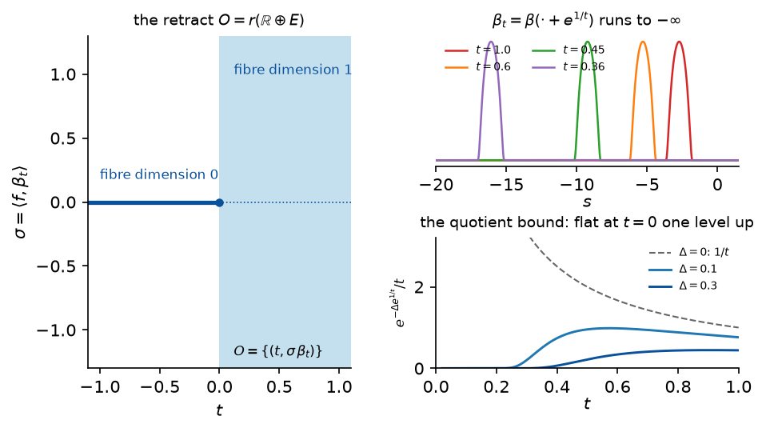

# Chapter 2. Spaces whose dimension jumps: retracts and M-polyfolds (HWZ Part I, Chapter 2, preprint pp. 18–60)

*Hofer–Wysocki–Zehnder, "Polyfold and Fredholm Theory", Part I, Chapter 2 (2014 preprint, arXiv
1407.3185, pp. 18–60, including its appendix §2.6), with the motivating examples from their
"Sc-smoothness, retractions and new models for smooth spaces" (2010, arXiv 1002.3381, §1.2–1.3 and
§2.4), rewritten for a first-year graduate student who wants to know what the definitions are for.
Every proof is complete; where the preprint gives a sketch (Lemma 2.40, Propositions 2.43–2.46,
2.54) the argument is supplied, and where a step needs a fact the text does not state, the fact is
proved as a lettered lemma. Statement numbers are those of the preprint; the book (Springer 2021)
renumbers (see `BookConcordance.md`), and places where the two may differ, once marked "check against
the book", have been checked against the book's arXiv version, arXiv 1707.08941 (2017), not against
the Springer edition, which was not available; each is now annotated (book 2017: …) with
"unchanged", "corrected", or the 2017 statement number and page. The
conventions of Chapter 1 are kept: an sc-Banach space is a nested scale $E = E_0\supset E_1\supset
\cdots$ with compact inclusions and $E_\infty$ dense in every level; $E^k$ is the level shift; a
tuple $(U,C,E)$ is a relatively open subset $U$ of a partial quadrant $C$, filtered by
$U_m = U\cap E_m$; $TU = U^1\oplus E$; "$C^k$ on $U_m$" is Definition 3.C of Chapter 1; Theorem
1.21 is the chain rule, Lemma 1.24 the independence of the degeneracy index $d_C$, Lemma 5.A of
Chapter 1 its semicontinuity and the density of smooth points of equal index.*

---

## 0. Gluing two half-cylinders

Return to the neck of Chapter 1, §0: a long thin cylinder along which a profile $u$ slides. When a
pseudoholomorphic curve breaks, the neck stretches to infinite length and the curve becomes a pair
$(u^+,u^-)$ of maps on two half-cylinders $\mathbb R^\pm\times S^1$ with a common asymptotic limit.
Conversely, from such a pair and a *gluing parameter* $a$ in the disk of radius $\tfrac12$ in
$\mathbb C$ one builds a map on a finite cylinder $Z_a$ of length
$$R = \varphi(|a|) = e^{1/|a|}-e$$
by a convex combination, $\beta_a(s)u^+(s,t) + (1-\beta_a(s))u^-(s-R,t-\vartheta)$, where
$\vartheta$ is the argument of $a$ and $\beta_a$ is a cut-off centred at $s = R/2$ (2010 paper,
§1.3). For $|a| = \tfrac12$ the cylinder has length $e^2-e\approx4.67$; for $|a| = \tfrac14$ it has
length $e^4-e\approx51.9$; for $|a| = \tfrac1{10}$ it has length $e^{10}-e\approx22\,024$; at
$a = 0$ it breaks into the two half-cylinders.

The natural configuration space of a neighbourhood of the broken curve is therefore the union
$$\{0\}\times E\ \cup\ \bigcup_{0<|a|<1/2}\{a\}\times H^3(Z_a,\mathbb R^N),$$
where $E$ is the space of pairs $(u^+,u^-)$ with common limit, in the Sobolev–weighted sense of
Example 1.2. This set is not a Banach manifold in any reasonable sense: the fibre over $a\ne0$ is a
space of functions on a compact cylinder, the fibre over $a = 0$ is a space of pairs of functions on
two infinite half-cylinders, and the glued map $\oplus_a(u^+,u^-)$ forgets everything about
$(u^+,u^-)$ that lives in the middle of the neck, so the kernel of $\oplus_a$ is infinite-dimensional
for $a\ne0$ and zero for $a = 0$. The "dimension" of the fibre jumps at $a = 0$. HWZ's way out is to
realize the union as a subset of the fixed space $B_{1/2}\oplus E$: there is a family of bounded
projections $\pi_a:E\to E$, $\pi_0 = \mathrm{id}$, whose image for $a\ne0$ is a copy of $H^3(Z_a)$
(the *splicing core*), such that
$$r(a,u) = (a,\pi_au)$$
is an sc-smooth map with $r\circ r = r$ (2010 paper, Theorem 1.28). Its image
$O = \{(a,u):\pi_au = u\}$ is the configuration space above, as a subset of one Banach space. It is
not a submanifold of $B_{1/2}\oplus E$: a smooth idempotent in the classical sense would have an
image that is a submanifold (Proposition 2.2 below), and submanifolds do not change dimension. The
sc-smoothness of $r$ is weaker than classical smoothness in exactly the way that allows the jump.

A toy version with one-dimensional jump is the subject of this chapter's figure (2010 paper,
Example 1.22): on $\mathbb R\oplus L^2(\mathbb R)$ let $\pi_t = 0$ for $t\le0$ and let $\pi_t$, for
$t>0$, be the orthogonal projection onto the line spanned by the bump $\beta(\cdot+e^{1/t})$. Then
$r(t,f) = (t,\pi_tf)$ is an sc-smooth retraction and its image is a half-line glued to a half-plane.

This chapter builds differential geometry on such images. §1 shows that the tangent space of a
retract $O = r(U)$, defined as the image of the tangent map $Tr$, does not depend on the retraction
$r$, and defines sc-smooth maps between retracts; this is the main theorem of §2.1 of the preprint
and the reason the rest of the theory is well posed. §2 glues retracts into *M-polyfolds*, proves
that they are metrizable level by level and that they have a tangent bundle, and treats
sub-M-polyfolds. §3 transports the degeneracy index of Chapter 1 to M-polyfolds, characterizes the
reduced tangent space and the partial cone at a smooth point by sc-smooth paths, and derives the
boundary recognition theorem (Theorem 1.25 of Chapter 1) from it. §4 isolates the *tame* retracts,
whose boundary has faces and corners as a manifold with corners does. §5 introduces strong bundles,
the bundles in which the Fredholm sections of Chapter 3 live. §6 returns to the gluing of
half-cylinders and shows that every splicing is tame.

---

## 1. Sc-smooth retractions and retracts (preprint pp. 18–22)

**Definition 2.1.** Let $(U,C,E)$ be a tuple. An sc-smooth map $r:U\to U$ is an *sc-smooth
retraction* if $r\circ r = r$.

*(Checked by machine: `Polyfold.ScRetraction`, with the retract `Polyfold.ScRetraction.retract`.)*

The classical counterpart has no surprises:

**Proposition 2.2.** Let $U$ be an open subset of a Banach space $E$ and $r:U\to U$ a $C^\infty$ map
with $r\circ r = r$. Then $O := r(U)$ is a $C^\infty$ submanifold of $E$: for every $x\in O$ there are
an open neighbourhood $V$ of $x$, an open neighbourhood $W$ of $0$ in $E$, a splitting $E = R\oplus N$
into closed subspaces and a diffeomorphism $\psi:V\to W$ with $\psi(x) = 0$ and
$\psi(O\cap V) = R\cap W$.

(The preprint prints "$\psi(0) = x$"; since $\psi:V\to W$ with $x\in V$ and $0\in W$, it must be
$\psi(x) = 0$ *(book 2017: unchanged, Proposition 2.1, p. 15)*.) The proof, which HWZ attribute to H. Cartan and give in
their appendix 2.6.1, is in §8 below. The contrast is the point of the chapter: there are sc-smooth
retractions whose images have locally varying dimension (§0, and the figure), so the sc-analogue of
Proposition 2.2 is false, and the images of sc-smooth retractions are genuinely new spaces.

*Not checked by machine:* Proposition 2.2 is not formalized; it serves only as motivation.

**Definition 2.3.** A tuple $(O,C,E)$ is an *sc-smooth retract* if there are a relatively open
subset $U\subset C$ and an sc-smooth retraction $r:U\to U$ with $r(U) = O$.

Note that $O\subset U$ (as $O = r(U)\subset U$) and that $O$ is exactly the fixed-point set of $r$:
if $x = r(y)$ then $r(x) = r(r(y)) = x$, and conversely. Since $r:U_m\to U_m$ is continuous, $O_m = O\cap E_m$ is closed in $U_m$ for every $m$, and $r(U_m) = O_m$: the inclusion $\subset$ because $r$ preserves levels, the inclusion $\supset$ because $O_m$ consists of fixed points.

*(Checked by machine: `Polyfold.IsScRetract`; $O$ is the fixed-point set of $r$ in $U$, `Polyfold.ScRetraction.mem_retract_iff`, and $O_m\subset U_m$, `Polyfold.ScRetraction.lvlSet_retract_subset`.)*

**Lemma 1.A (the derivative of a retraction).** Let $r:U\to U$ be an sc-smooth retraction with
image $O$.

1. For $x\in U_1$, $Dr(r(x))\circ Dr(x) = Dr(x)$. For $x\in O_1$, $Dr(x):E_0\to E_0$ is a bounded
   projection, $Dr(x)^2 = Dr(x)$, so its image is closed and $E_0 = Dr(x)E_0\oplus(1-Dr(x))E_0$.
2. For $x\in O_\infty$, $Dr(x):E\to E$ is an sc-operator with $Dr(x)^2 = Dr(x)$; hence (Lemma 2.B
   of Chapter 1) $Dr(x)E$ and $(1-Dr(x))E$ are sc-subspaces and $E = Dr(x)E\oplus(1-Dr(x))E$ is an
   sc-splitting.
3. $Tr:TU\to TU$ is an sc-smooth retraction, $Tr\circ Tr = Tr$, with image $Tr(TU)$.

*Proof.* (1) By the chain rule (Theorem 1.21), $T(r\circ r) = Tr\circ Tr$, i.e.
$Dr(r(x))Dr(x) = Dr(x)$ for $x\in U_1$; if $r(x) = x$ this is $Dr(x)^2 = Dr(x)$. The image of a
bounded projection $P$ is the kernel of $1-P$, hence closed, and $v = Pv+(1-P)v$. (2) By
Proposition 1.16 (last sentence), $Df(x)$ is an sc-operator at a smooth point $x$ for any $\mathrm{sc}^1$ map $f$. (3) $Tr$ is sc-smooth because $r$ is (Definition of $\mathrm{sc}^k$), and $Tr\circ Tr = T(r\circ r) = Tr$ by Corollary 4.A of Chapter 1. $TU$ is a relatively open subset of the partial quadrant $TC$ in $TE$ (Lemma 3.B of Chapter 1), so $Tr$ is an sc-smooth retraction in the sense of Definition 2.1. $\square$

*Checked by machine.* (1) at points of $O_1$: `Polyfold.ScRetraction.scDeriv_comp_self`; (2): at a smooth $x\in O$, $Dr(x)$ is an sc-operator (`Polyfold.ScRetraction.isScOperator_scDeriv`) and $E = Dr(x)E\oplus(1-Dr(x))E$ is an sc-splitting (`Polyfold.ScRetraction.isScSplitting_range_scDeriv`); (3): `Polyfold.ScRetraction.tangentRetraction` with retract $TO$ (`Polyfold.ScRetraction.tangentRetraction_retract`), $TU$ being relatively open in the partial quadrant $TC$ (`Polyfold.IsPartialQuadrant.tangentSet`, `Polyfold.IsRelOpenInQuadrant.tangentSet`).

The retraction $r$ onto $O$ is far from unique; the next proposition, the main theorem of §2.1,
says that what it produces at the level of tangents is unique.

**Proposition 2.4.** Let $(O,C,E)$ be an sc-smooth retract and let $r:U\to U$ and $r':U'\to U'$ be
sc-smooth retractions on relatively open subsets $U,U'$ of $C$ with $r(U) = r'(U') = O$. Then
$$Tr(TU) = Tr'(TU').$$

*Proof.* *Step 1: $r'\circ r = r$ on $U$ and $r\circ r' = r'$ on $U'$.* Let $y\in U$. Then
$r(y)\in O = r'(U')$, so $r(y) = r'(y')$ for some $y'\in U'$, and $r'(r(y)) = r'(r'(y')) = r'(y') = r(y)$. This uses that $r(y)\in U'$, which holds because $O\subset U'$. Symmetrically $r\circ r' = r'$. Note that the compositions make sense as sc-smooth maps: $r:U\to U$ is sc-smooth into $E$ with image in $O\subset U\cap U'$, and $U\cap U'$ is relatively open in $C$, so $r:U\to U\cap U'$ is sc-smooth (Lemma 3.G(2),(4) of Chapter 1), and $r'$ restricted to $U\cap U'$ is sc-smooth.

*Step 2: $Tr(TU)\subset Tr'(TU')$.* Let $(x,h)\in Tr(TU)$, say $(x,h) = Tr(y,k) = (r(y),Dr(y)k)$ with $(y,k)\in TU$, i.e. $y\in U_1$, $k\in E_0$. Then $x = r(y)\in O_1\subset U'_1$ (as $r$ preserves level $1$), so $(x,h)\in TU' = U'^1\oplus E$. By the chain rule applied to the identity $r'\circ r = r$ of sc-smooth maps $U\to E$ (with $r:U\to U\cap U'$ and $r':U\cap U'\to E$, as arranged in Step 1),
$$Tr'(x,h) = Tr'(Tr(y,k)) = T(r'\circ r)(y,k) = Tr(y,k) = (x,h).$$
So $(x,h)$ is in the image of $Tr'$, and since $(x,h)\in TU'$, $(x,h) = Tr'(x,h)\in Tr'(TU')$.

*Step 3.* Exchanging the roles of $r$ and $r'$ gives $Tr'(TU')\subset Tr(TU)$. $\square$

*Checked by machine:* `Polyfold.proposition_2_4`, by this proof, written with the description of $Tr(TU)$ as the set of $p\in TU$ with $Tr(p) = p$ (`Polyfold.ScRetraction.mem_tangent_iff`); the inclusion is proved from $r(U)\subset r'(U')$ alone (`Polyfold.ScRetraction.tangent_subset_of_retract_subset`).

**Definition 2.5.** The *tangent* of the sc-smooth retract $(O,C,E)$ is the tuple
$$T(O,C,E) = (TO,TC,TE),\qquad TO := Tr(TU),$$
for any sc-smooth retraction $r:U\to U$ onto $O$; $TC = C^1\oplus E$ and $TE = E^1\oplus E$ as in
Chapter 1. Explicitly
$$TO = \{(r(y),Dr(y)k) : y\in U_1,\ k\in E_0\} = \{(x,h) : x\in O_1,\ h\in Dr(x)E_0\},$$
the second description because for $x = r(y)\in O_1$ one has $Dr(y)k = Dr(x)Dr(y)k\in Dr(x)E_0$
(Lemma 1.A(1)) and conversely $Dr(x)h = Dr(x)Dr(x)h$ with $(x,h)\in TU$.

*(Checked by machine: `Polyfold.retractTangent`, independent of $r$ by `Polyfold.retractTangent_eq`; the two descriptions are `Polyfold.ScRetraction.mem_tangent_iff_exists` and `Polyfold.ScRetraction.mem_tangent_iff_mem_range`.)*

By Lemma 1.A(3), $(TO,TC,TE)$ is again an sc-smooth retract, with retraction $Tr$ on the relatively open subset $TU$ of $TC$; so the construction iterates. The projection $p:TO\to O^1$, $(x,h)\mapsto x$, has fibre $p^{-1}(x) = \{x\}\times Dr(x)E_0$ over $x\in O_1$, a closed subspace of $E_0$ (Lemma 1.A(1)) which by Proposition 2.4 does not depend on $r$.

> **The reference $(C,E)$ matters.** HWZ warn (p. 19) that one writes $O$ for $(O,C,E)$ only as an
> abbreviation: a set $O$ may be an sc-smooth retract for some quadrant $C$ without being one for
> $C = E$. The tangent $TO$ as a set does not see $C$, but the degeneracy index of §3 does.

**Proposition 2.6.** Let $(O,C,E)$ and $(O',C',E')$ be sc-smooth retracts, $f:O\to O'$ a map, and
$r:U\to U$, $s:V\to V$ two sc-smooth retractions onto $O$ for $(O,C,E)$.

1. $f\circ r:U\to E'$ is sc-smooth if and only if $f\circ s:V\to E'$ is.
2. If so, $T(f\circ r)|_{TO} = T(f\circ s)|_{TO}$.
3. $T(f\circ r)$ maps $TO$ into $TO'$.

*Proof.* (1) Suppose $f\circ r:U\to E'$ is sc-smooth. As in Step 1 of Proposition 2.4,
$s:V\to U$ is sc-smooth (its image $O$ lies in $U$, and $U$ is relatively open in $C$) and
$r\circ s = s$. Hence $f\circ s = f\circ r\circ s:V\to E'$ is sc-smooth by the chain rule
(Corollary 4.A). Exchange $r$ and $s$ for the converse. (2) Let $(x,h)\in TO$. By Proposition 2.4,
$TO = Ts(TV)$, and $Ts$ is the identity on its image (Lemma 1.A(3)), so $(x,h) = Ts(x,h)$ (here $(x,h)\in TV$ because $x\in O_1\subset V_1$). Then
$$T(f\circ r)(x,h) = T(f\circ r)(Ts(x,h)) = T(f\circ r\circ s)(x,h) = T(f\circ s)(x,h).$$
(3) Let $\rho:U'\to U'$ be an sc-smooth retraction onto $O'$ for $(O',C',E')$. Since $f$ takes values in $O'$, $\rho\circ f = f$, hence $\rho\circ f\circ r = f\circ r$ as maps $U\to E'$ (with $f\circ r$ valued in $O'\subset U'$). By the chain rule, for $(x,h)\in TO\subset TU$,
$$T(f\circ r)(x,h) = T(\rho\circ f\circ r)(x,h) = T\rho\big(T(f\circ r)(x,h)\big)\in T\rho(TU') = TO'. \qquad\square$$

*(Checked by machine: `Polyfold.proposition_2_6_1`, `Polyfold.proposition_2_6_2`, `Polyfold.proposition_2_6_3`, by this proof.)*

**Definition 2.7.** A map $f:O\to O'$ between sc-smooth retracts $(O,C,E)$ and $(O',C',E')$ is
*sc-smooth* if $f\circ r:U\to E'$ is sc-smooth for one (equivalently, by Proposition 2.6(1), every)
sc-smooth retraction $r:U\to U$ onto $O$. Its *tangent map* is
$$Tf := T(f\circ r)|_{TO}:TO\to TO',$$
independent of $r$ by Proposition 2.6(2) and valued in $TO'$ by (3). Likewise $f$ is $\mathrm{sc}^k$ if $f\circ r$ is, and $f$ is an *sc-diffeomorphism* if it is a bijection with $f$ and $f^{-1}$ sc-smooth.

*(Checked by machine: `Polyfold.IsScSmoothRetractMap`, which asks $f(O)\subset O'$ and the sc-smoothness of $f\circ r$ for every retraction $r$ onto $O$; for one $r$ it is `Polyfold.isScSmoothRetractMap_iff_exists`. The tangent map is `Polyfold.retractTangentMap`, independent of $r$ on $TO$ by `Polyfold.retractTangentMap_eqOn`. The notions $\mathrm{sc}^k$ and sc-diffeomorphism between retracts are not defined separately; germs of sc-diffeomorphisms appear in §3.2.)*

For $o\in O_1$ the *linearization* $Tf(o):T_oO\to T_{f(o)}O'$ is the restriction of $D(f\circ r)(o)$ to $T_oO = Dr(o)E_0$; it is a bounded linear map between these Banach spaces, with $Tf(o,h) = (f(o),Tf(o)h)$. Two sanity checks: a retract $O$ with $r = \mathrm{id}_U$ and $O = U$ recovers Definition 1.14 (sc-smooth maps $U\to E'$), and the inclusion $O\to E$ is sc-smooth with tangent map the inclusion $TO\to TE$ (since $\mathrm{id}\circ r = r$ and $Tr|_{TO} = \mathrm{id}$).

**Theorem 2.8 (chain rule for retracts).** Let $f:O\to O'$ and $g:O'\to O''$ be sc-smooth maps
between sc-smooth retracts. Then $g\circ f:O\to O''$ is sc-smooth and $T(g\circ f) = Tg\circ Tf$.

(The preprint writes $(O'',C',E'')$ for the third retract; it should be $(O'',C'',E'')$ *(book 2017: unchanged, Theorem 2.1, p. 18)*.)

*Proof.* Let $r:U\to U$ and $r':U'\to U'$ be retractions onto $O$ and $O'$. Since $f\circ r$ takes values in $O'$, $r'\circ f\circ r = f\circ r$, hence
$$(g\circ f)\circ r = g\circ r'\circ(f\circ r)$$
on $U$, with $f\circ r:U\to U'$ sc-smooth (its values lie in $O'\subset U'$) and $g\circ r':U'\to E''$ sc-smooth. By Corollary 4.A of Chapter 1, $(g\circ f)\circ r$ is sc-smooth and $T((g\circ f)\circ r) = T(g\circ r')\circ T(f\circ r)$. Restricting to $TO$ and using that $T(f\circ r)$ maps $TO$ into $TO'$ (Proposition 2.6(3)), $T(g\circ f) = Tg\circ Tf$. $\square$

*(Checked by machine: `Polyfold.theorem_2_8`, for retracts $O$, $O'$, by this proof.)*

HWZ summarize: sc-smooth retracts with sc-smooth maps form a category $\mathcal R$, and $T$ is a functor $\mathcal R\to\mathcal R$ ($T(\mathrm{id}_O) = \mathrm{id}_{TO}$ since $\mathrm{id}\circ r = r$ and $Tr|_{TO} = \mathrm{id}$; functoriality is Theorem 2.8). It has more structure than that: $TO\to O^1$ is a bundle whose fibres are Banach spaces, and the tangent maps are fibrewise linear. The preprint formalizes this with a second category.

*(Checked by machine: $T(\mathrm{id}) = \mathrm{id}$, `Polyfold.retractTangentMap_id`, and $Tf$ is sc-smooth between the tangents, `Polyfold.IsScSmoothRetractMap.tangent`. The categories $\mathcal R$ and $\mathcal{BR}$ are not formalized.)*

**Definition 2.9.** Let $(U,C,E)$ be a tuple and $F$ an sc-Banach space; $p:U\oplus F\to U$ is the trivial sc-bundle. An sc-smooth map $R:U\oplus F\to U\oplus F$ of the form $R(u,v) = (r(u),\rho(u,v))$ with $\rho(u,v)$ linear in $v$ and $R\circ R = R$ is an *sc-smooth bundle retraction* covering $r$; $B = R(U\oplus F)$ is the associated *sc-smooth bundle retract*, with the induced projection $p:B\to O = r(U)$. Given two such, $p:B\to O$ and $p':B'\to O'$, an sc-smooth map $\Phi:B\to B'$ of the form $\Phi(u,v) = (a(u),\phi(u,v))$, $\phi$ linear in $v$, with $p'\circ\Phi = a\circ p$, is an *sc-smooth bundle map*.

(The preprint writes the compatibility as "$p'\circ\Phi = p$"; it must be $p'\circ\Phi = a\circ p$, the two projections having different targets *(book 2017: unchanged, Definition 2.5, p. 19)*.) Here $U\oplus F$ is a relatively open subset of the partial quadrant $C\oplus F$ in $E\oplus F$ (Lemma 1.B of Chapter 1), so $R$ is an sc-smooth retraction in the sense of Definition 2.1 and $B$ is an sc-smooth retract; $r = p\circ R\circ(\mathrm{id},0)$ is then itself an sc-smooth retraction on $U$ with $r(U) = O$.

**Lemma 1.B.** If $r:U\to U$ is an sc-smooth retraction, then $Tr:TU = U^1\oplus E\to TU$,
$Tr(x,h) = (r(x),Dr(x)h)$, is an sc-smooth bundle retraction covering $r|_{U^1}$, and for an
sc-smooth $f:O\to O'$ the tangent map $Tf$ is an sc-smooth bundle map $TO\to TO'$ covering $f|_{O^1}$.

*Proof.* $Tr$ is sc-smooth and idempotent (Lemma 1.A(3)), of the form $(r(x),Dr(x)h)$ with the second component linear in $h$, and the base map $r:U^1\to U^1$ is sc-smooth by Proposition 1.17. $Tf(x,h) = (f(x),Tf(x)h)$ is linear in $h$, sc-smooth (it is the restriction of $T(f\circ r)$, and sc-smoothness of a map on the retract $TO$ means sc-smoothness of $Tf\circ Tr = T(f\circ r)\circ Tr = T(f\circ r\circ r) = T(f\circ r)$ on $TU$), and covers $f$. $\square$

So the tangent functor may be read as $T:\mathcal R\to\mathcal{BR}$, into the category of sc-smooth bundle retracts, with $TE\to E^1$, $TC\to C^1$ and $TO\to O^1$ as the three bundles. A third class, the *strong* bundle retractions with their double filtration, is the subject of §5.

*Checked by machine:* the retraction part of Lemma 1.B ($Tr$ is an sc-smooth retraction, $Tf$ is sc-smooth), as above. Definition 2.9 and the bundle structure (linearity in the fibre as part of a category of bundle retracts) are not formalized.

---

## 2. M-polyfolds, their filtration and tangent bundle; sub-M-polyfolds (preprint pp. 23–31)

### 2.1 Charts and atlases

Two closure properties of the class of retracts are used constantly.

**Proposition 2.10.** Let $(O,C,E)$ be an sc-smooth retract.

1. If $O'$ is an open subset of $O$, then $(O',C,E)$ is an sc-smooth retract.
2. If $V$ is an open subset of $O$ and $s:V\to V$ is sc-smooth (Definition 2.7) with $s\circ s = s$,
   then $(s(V),C,E)$ is an sc-smooth retract.

*Proof.* (1) Let $r:U\to U$ be a retraction onto $O$. Since $r:U\to O$ is continuous (level $0$ of
$\mathrm{sc}^0$) and $O'$ is open in $O$, $U' := r^{-1}(O')$ is open in $U$, hence relatively open in
$C$. $O'\subset U'$ because points of $O'$ are fixed by $r$, and $r(U') = O'$ (as $r(U')\subset O'$
by definition and $r = \mathrm{id}$ on $O'$). So $r' := r|_{U'}:U'\to U'$ is an sc-smooth retraction
(restriction to a relatively open subset, Lemma 3.G(4) of Chapter 1) with image $O'$.

(2) By (1), $(V,C,E)$ is a retract; let $r:U\to U$ be a retraction with $r(U) = V$. Put
$\rho := s\circ r:U\to E$. It is sc-smooth by the definition of sc-smoothness of $s$ on the retract
$V$, and takes values in $s(V)\subset V\subset U$, so $\rho:U\to U$. For $x\in U$, $r(x)\in V$,
$s(r(x))\in V$ and hence $r(s(r(x))) = s(r(x))$: $r\circ\rho = \rho$. Therefore
$\rho\circ\rho = s\circ(r\circ s\circ r) = s\circ s\circ r = s\circ r = \rho$, and
$\rho(U) = s(r(U)) = s(V)$. $\square$

*(Checked by machine: `Polyfold.proposition_2_10_1`, with $O' = O\cap W$ for $W$ open in $E_0$, and `Polyfold.proposition_2_10_2`, by this proof. That sc-smoothness between retracts is a local property, used below for charts, is `Polyfold.IsScSmoothRetractMap.of_locally`.)*

HWZ extend the word: an sc-smooth $s:O\to O$ on a retract with $s\circ s = s$ is also called an
sc-smooth retraction.

**Definition 2.11.** Let $X$ be a topological space and $x\in X$. A *chart around $x$* is a tuple
$(V,\varphi,(O,C,E))$ with $V\subset X$ an open neighbourhood of $x$, $(O,C,E)$ an sc-smooth retract
and $\varphi:V\to O$ a homeomorphism. Two charts $(V,\varphi,(O,C,E))$ and $(V',\psi,(O',C',E'))$ are
*sc-smoothly compatible* if the transition maps
$$\psi\circ\varphi^{-1}:\varphi(V\cap V')\to\psi(V\cap V'),\qquad \varphi\circ\psi^{-1}:\psi(V\cap V')\to\varphi(V\cap V')$$
are sc-smooth in the sense of Definition 2.7, the domains $(\varphi(V\cap V'),C,E)$ and
$(\psi(V\cap V'),C',E')$ being sc-smooth retracts by Proposition 2.10(1).

**Definition 2.12.** An *sc-smooth atlas* on $X$ is a set of pairwise sc-smoothly compatible charts
whose domains cover $X$. Two atlases are *equivalent* if their union is an atlas.

**Definition 2.13.** An *M-polyfold* is a Hausdorff paracompact topological space with an
equivalence class of sc-smooth atlases.

(Paracompact: every open cover has a locally finite open refinement. HWZ recall the standard fact
that the refinement may be indexed by the same set with $V_i\subset U_i$, some $V_i$ empty.)
Equivalence of atlases is an equivalence relation: reflexivity and symmetry are clear, and if
$\mathcal A\cup\mathcal B$ and $\mathcal B\cup\mathcal C$ are atlases, a chart of $\mathcal A$ and a
chart of $\mathcal C$ are compatible because on the overlap the transition map factors locally
through a chart of $\mathcal B$ and Theorem 2.8 applies (every point of the overlap lies in some
chart domain of $\mathcal B$; sc-smoothness is local, Lemma 3.G(4)).

*Checked by machine:* charts `Polyfold.MChart`, compatibility `Polyfold.MChart.Compatible`, atlases `Polyfold.MAtlas` and their equivalence `Polyfold.MAtlas.Equiv` (`Polyfold.MAtlas.equiv_iff`), and M-polyfolds `Polyfold.MPolyfold`. The equivalence class is represented by one atlas: the charts of the structure are all charts compatible with it (`Polyfold.MPolyfold.IsChart`), and they are compatible with each other by the locality argument just given (`Polyfold.MChart.compatible_of_locally`, `Polyfold.MPolyfold.IsChart.compatible`); equivalent atlases give the same charts (`Polyfold.MPolyfold.isChart_congr`).

**Definition 2.14.** A map $f:X\to Y$ between M-polyfolds is *sc-smooth* if for every $x\in X$
there are charts $(V,\varphi,(O,C,E))$ around $x$ and $(V',\varphi',(O',C',E'))$ around $f(x)$ with
$f(V)\subset V'$ such that $\varphi'\circ f\circ\varphi^{-1}:O\to O'$ is sc-smooth in the sense of
Definition 2.7.

The preprint states the definition for *all* such pairs of charts and remarks that it "does not
depend on the choice of sc-smoothly compatible charts": for a second pair $(\psi,\psi')$ the
representation $\psi'\circ f\circ\psi^{-1} = (\psi'\circ\varphi'^{-1})\circ(\varphi'\circ f\circ\varphi^{-1})
\circ(\varphi\circ\psi^{-1})$ on the common domain is sc-smooth by Theorem 2.8. Note that $f$ must
be continuous for charts with $f(V)\subset V'$ to exist; sc-smooth maps are continuous.
Sc-smooth maps between M-polyfolds compose (Theorem 2.8 in charts), and an *sc-diffeomorphism* is a
bijection which is sc-smooth with sc-smooth inverse.

*(Checked by machine: `Polyfold.MPolyfold.IsScSmoothOn` and `Polyfold.MPolyfold.IsScSmoothMap`, with continuity as part of the definition and all charts of the structure; that one pair of charts around each point suffices is `Polyfold.MPolyfold.IsScSmoothOn.of_exists_charts`, and compositions are `Polyfold.MPolyfold.IsScSmoothOn.comp`. A general notion of sc-diffeomorphism is used in the form of §3.1.)*

### 2.2 The filtration

**Lemma 2.A (levels are chart-independent).** Let $(V,\varphi,(O,C,E))$ and $(V',\psi,(O',C',E'))$ be
compatible charts and $x\in V\cap V'$. Then $\varphi(x)\in O_m$ if and only if $\psi(x)\in O'_m$.

*Proof.* The transition map $g = \psi\circ\varphi^{-1}$ is sc-smooth on the retract $\varphi(V\cap V')$,
i.e. $g\circ r$ is sc-smooth, hence $\mathrm{sc}^0$, for a retraction $r$ onto $\varphi(V\cap V')$. If
$\varphi(x)\in O_m$ then $\varphi(x) = r(\varphi(x))\in U_m$ and $\psi(x) = g(r(\varphi(x)))\in E'_m$.
Symmetrically with $g^{-1}$. $\square$

*(Checked by machine: `Polyfold.MPolyfold.mem_levelSet_iff`.)*

So "$x$ is on level $m$" ($\varphi(x)\in O_m$ for one, hence every, chart around $x$) is well
defined. Let $X_m$ be the set of points on level $m$ and $X_\infty = \bigcap_mX_m$. Topologize
$X_m$ by declaring the sets $\varphi^{-1}(W)$, for $(V,\varphi,(O,C,E))$ a chart of the atlas and
$W$ an open subset of $O_m = O\cap E_m$ (with the topology of $E_m$), to be a basis.

**Lemma 2.B.** The collection $\mathcal B_m$ of these sets is a basis of a topology on $X_m$. For every chart, $V_m := V\cap X_m$ is open in $X_m$, and $\varphi:V_m\to O_m$ is a homeomorphism.

*Proof.* Each $\varphi^{-1}(W)$ lies in $X_m$ (its points have $\varphi(x)\in O_m$), and the sets
cover $X_m$ (take $W = O_m$). For the basis property let $x\in\varphi^{-1}(W)\cap\psi^{-1}(W')$ for
two charts. The transition map $g = \psi\circ\varphi^{-1}$ restricted to level $m$ is a
homeomorphism between $\varphi(V\cap V')_m$ and $\psi(V\cap V')_m$ (both $g\circ r$ and
$g^{-1}\circ r'$ are $\mathrm{sc}^0$, and on $O_m$ the map $g\circ r$ is $g$). Hence
$W'' := W\cap g^{-1}(W')\cap\varphi(V\cap V')_m$ is open in $O_m$ (note $\varphi(V\cap V')$ is open
in $O$, so $\varphi(V\cap V')_m$ is open in $O_m$), contains $\varphi(x)$, and
$\varphi^{-1}(W'')\subset\varphi^{-1}(W)\cap\psi^{-1}(W')$. For the second claim, $V_m = \varphi^{-1}(O_m)$
is basic, and $\varphi:V_m\to O_m$ is a bijection which is open by the definition of the basis and
continuous because, by the same transition-map argument, the restriction to $V_m$ of every basic set
$\psi^{-1}(W')$ has image $\varphi(V\cap V')_m\cap g^{-1}(W')$ open in $O_m$. $\square$

*Checked by machine:* the topology of $X_m$ is the one generated by $\mathcal B_m$ (`Polyfold.MPolyfold.levelTopology`); that $\mathcal B_m$ is a basis is not formalized (it is not needed). That $\varphi$ restricted to $V_m$ is a homeomorphism onto $O_m$ is `Polyfold.MPolyfold.isEmbedding_levelLift`, and $V_m$ is open because the inclusion $X_m\to X$ is continuous (`Polyfold.MPolyfold.continuous_levelVal`).

Thus $(V_m,\varphi,(O_m,C_m,E_m))$ is a chart on $X_m$ in the sense of Definition 2.11 provided
$(O_m,C_m,E_m)$ is an sc-smooth retract for the sc-structure $E^m$ — which it is: $r:U^m\to U^m$ is
sc-smooth by Proposition 1.17, and its image is $O_m$ (remark after Definition 2.3). The transition
maps are sc-smooth by Proposition 1.17 again. So $X_m$ is a space with an sc-smooth atlas; that it is Hausdorff and paracompact is Theorem 2.16. We obtain the filtration
$$X = X_0\supset X_1\supset X_2\supset\cdots\supset X_\infty .$$
Points of $X_\infty$ are the *smooth points*. The preprint does not say which topology $X_\infty$ carries; we take the one with basis the sets $\varphi^{-1}(W)$, $W$ open in $O_\infty$ for the Fréchet topology of $E_\infty$ (the initial topology of the inclusions $E_\infty\to E_m$, $m\ge0$); equivalently, the initial topology of the inclusions $X_\infty\to X_m$. This is what the metric at the end of the proof of Theorem 2.16 describes.

*Checked by machine* for $m = 1$: the charts $(V_1,\varphi,(O_1,C_1,E^1))$ (`Polyfold.MPolyfold.levelChart`) are pairwise compatible (`Polyfold.MPolyfold.levelChart_compatible`, by Proposition 1.17 for retracts, `Polyfold.IsScSmoothRetractMap.shift`) and make $X_1$ an M-polyfold $X^1$ (`Polyfold.MPolyfold.shift`). For $m\ge2$ the M-polyfold $X_m$ is not formalized. The topology of $X_\infty$ is the initial topology of the inclusions $X_\infty\to X_m$ (`Polyfold.MPolyfold.smoothLevel_topology_eq`).

**Lemma 2.15.** The inclusion $X_{m+1}\to X_m$ is continuous.

*Proof.* It suffices to show that $\varphi^{-1}(W)\cap X_{m+1}$ is open in $X_{m+1}$ for a chart
$\varphi$ and $W$ open in $O_m$. Write $W = W'\cap O$ with $W'$ open in $E_m$. Then
$W'' := W'\cap E_{m+1}$ is open in $E_{m+1}$ (the inclusion $E_{m+1}\to E_m$ is continuous), and
$\varphi^{-1}(W)\cap X_{m+1} = \varphi^{-1}(W''\cap O)$ with $W''\cap O$ open in $O_{m+1}$. $\square$

*(Checked by machine: `Polyfold.lemma_2_15`.)*

**Theorem 2.16.** Let $X$ be an M-polyfold. For every $m\ge0$ the space $X_m$ is metrizable, in
particular paracompact. $X_\infty$ is metrizable.

The proof (preprint appendix 2.6.2) is in §8; it rests on Smirnov's metrization theorem (a
paracompact Hausdorff space which is locally metrizable is metrizable) and on a lemma about locally
finite closed covers by paracompact subspaces. One point the preprint passes over is that $X_m$ must
be shown *regular* before that lemma applies; §8 does this. So $X_m$ is an M-polyfold in its own right (with the sc-structures $E^m$), and all the constructions below apply to it.

*Checked by machine:* `Polyfold.theorem_2_16`, **with the text's hypotheses**: $X$ is metrizable, every $X_m$ is metrizable and paracompact, and $X_\infty$ is metrizable. The formal proof does not go through Lemma 2.56 and Proposition 2.57, and so does not need the regularity of $X_m$: a partition of unity of $X$ subordinate to the chart domains, pulled back to $X_m$ along the continuous inclusion, gives an explicit metric (`Polyfold.metrizableSpace_of_pullback`, through the cone metrics of `Polyfold.metrizableSpace_of_partition`), and paracompactness follows by Stone's theorem. The same argument proves Smirnov's theorem, which Mathlib lacks (`Polyfold.metrizableSpace_of_locally`). As a by-product every subset of an M-polyfold is paracompact (`Polyfold.MPolyfold.paracompactSpace_subtype`).

### 2.3 The tangent bundle

**Definition 2.17.** Let $(O,C,E)$ be a retract with tangent $(TO,TC,TE)$ and $p:TO\to O^1$ the
projection. For $x\in O_1$ the *tangent space* $T_xO := p^{-1}(x)$, identified with
$Dr(x)E_0\subset E_0$ for any retraction $r$ onto $O$ (Definition 2.5), is a Banach space with the
norm of $E_0$. If $x\in O_\infty$, $T_xO = Dr(x)E$ is an sc-subspace of $E$ and carries the induced
sc-structure (Lemma 1.A(2)).

For $x\in O_1$ not smooth, $T_xO$ has no natural sc-structure: $Dr(x)$ is bounded on $E_0$ but
need not preserve the levels.

*(Checked by machine: $T_xO$ is `Polyfold.tangentSpace`, the range of $Dr(x)$ (`Polyfold.tangentSpace_eq_range`); its sc-structure at smooth $x$ is not formalized.)*

Now let $X$ be an M-polyfold and $x\in X_1$. Consider tuples $(x,V,\varphi,(O,C,E),h)$ with
$(V,\varphi,(O,C,E))$ a chart around $x$ and $h\in T_{\varphi(x)}O$. Call two tuples
$(x,V,\varphi,(O,C,E),h)$ and $(x',V',\psi,(O',C',E'),h')$ *equivalent* if
$$x = x'\qquad\text{and}\qquad T(\varphi\circ\psi^{-1})(\psi(x))\,h' = h .$$

**Lemma 2.C.** This is an equivalence relation, and for fixed $x$ and charts $\varphi,\psi$ around
$x$ the map $h'\mapsto T(\varphi\circ\psi^{-1})(\psi(x))h'$ is a linear homeomorphism
$T_{\psi(x)}O'\to T_{\varphi(x)}O$.

*Proof.* Let $g = \varphi\circ\psi^{-1}$, an sc-diffeomorphism between the retracts
$\psi(V\cap V')$ and $\varphi(V\cap V')$, with inverse $g^{-1} = \psi\circ\varphi^{-1}$. By Theorem
2.8, $Tg^{-1}\circ Tg = T(\mathrm{id}) = \mathrm{id}$ on $T\psi(V\cap V')$ and symmetrically; so
$Tg(\psi(x)):T_{\psi(x)}O'\to T_{\varphi(x)}O$ is a bounded linear bijection with bounded inverse
$Tg^{-1}(\varphi(x))$ — here the tangent space of the open subset $\psi(V\cap V')$ of $O'$ at a point is $T_{\psi(x)}O'$, since a retraction onto the open subset is a restriction of one onto $O'$ (Proposition 2.10(1)). Reflexivity: $T(\mathrm{id}) = \mathrm{id}$. Symmetry: by the inverse just computed. Transitivity: for a third chart $\chi$, $T(\varphi\circ\chi^{-1}) = T(\varphi\circ\psi^{-1})\circ T(\psi\circ\chi^{-1})$ at the appropriate points, by Theorem 2.8 on the triple overlap. $\square$

*Checked by machine:* the equivalence relation, `Polyfold.MPolyfold.TangentPre.Rel` and `Polyfold.MPolyfold.TangentPre.setoid`, by the chain rule on the triple overlap (`Polyfold.MPolyfold.TangentPre.transport_transport`), which also needs that $Tf$ computed on an open subset of a retract agrees with $Tf$ computed on the retract (`Polyfold.retractTangentMap_inter_isOpen`). That the transition maps are linear homeomorphisms of the tangent spaces is not formalized.

**Definition 2.18.** The *tangent bundle* $TX$ is the set of equivalence classes
$[(x,V,\varphi,(O,C,E),h)]$, and $T_xX := \{[(x,V,\varphi,(O,C,E),h)] : h\in T_{\varphi(x)}O\}$ for
$x\in X_1$, so that $TX = \bigcup_{x\in X_1}T_xX$ (disjointly). $T_xX$ is a vector space with
$\lambda[(x,\varphi,h_1)]+\mu[(x,\varphi,h_2)] := [(x,\varphi,\lambda h_1+\mu h_2)]$, well defined
because the transition isomorphisms of Lemma 2.C are linear. The map
$$T\varphi:TV := \bigcup_{x\in V_1}T_xX\to TO,\qquad T\varphi([(x,V,\varphi,(O,C,E),h)]) = (\varphi(x),h)$$
is a bijection, linear on each fibre, and $T_xX$ receives the Banach space structure of
$T_{\varphi(x)}O$; by Lemma 2.C two charts give equivalent norms. For $x\in X_\infty$ the space
$T_xX$ is an sc-Banach space, because $T_{\varphi(x)}O$ is and the transition isomorphisms
$T(\varphi\circ\psi^{-1})(\psi(x))$ are then sc-isomorphisms (Corollary 4.B of Chapter 1, applied to $g\circ r'$ at the smooth point $\psi(x)$, where $r'$ retracts onto $\psi(V\cap V')$ and $Dr'(\psi(x))$ is the identity on $T_{\psi(x)}O'$).

*Checked by machine:* $TX$ is `Polyfold.MPolyfold.TangentSpace`, with $p$ (`Polyfold.MPolyfold.tangentProj`), $T_xX$ (`Polyfold.MPolyfold.tangentFiber`), $TV$ and $T\varphi$ (`Polyfold.MPolyfold.tangentChartSet`, `Polyfold.MPolyfold.tangentChartMap`, injective on $TV$ by `Polyfold.MPolyfold.tangentChartMap_injOn`). The vector space, Banach and sc-Banach structures of $T_xX$ are not formalized: $T_xX$ is a set, identified with $T_{\varphi(x)}O$ by $T\varphi$.

$TX$ is topologized by the basis $\mathcal B$ of all sets $\widetilde W := (T\varphi)^{-1}(W)$, for
charts $(V,\varphi,(O,C,E))$ of the atlas and open subsets $W$ of $TO\subset E_1\oplus E_0$.

**Proposition 2.19.** (1) $\mathcal B$ is a basis of a Hausdorff topology on $TX$. (2) The
projection $p:TX\to X_1$, $p(T_xX) = x$, is continuous and open. (3) $TX$ is metrizable, hence
paracompact.

*Checked by machine:* (1) Hausdorff, the instance `Polyfold.MPolyfold.instT2SpaceTangentSpace` (the basis property is not needed: the topology is the one generated by $\mathcal B$); (2) continuity of $p$, `Polyfold.MPolyfold.continuous_tangentProj`; the openness of $p$ is **not formalized**; (3) `Polyfold.proposition_2_19_3`, by the pull-back argument of Theorem 2.16 along $TX\to X_1\to X$.

The proof (preprint appendix 2.6.3) is in §8. Granting it: each $T\varphi:TV\to TO$ is a
homeomorphism (open by the definition of the basis, continuous by the transition-map argument of
Lemma 2.B), and for two charts the transition map is
$$T\varphi'\circ(T\varphi)^{-1}(a,h) = \big(\varphi'\circ\varphi^{-1}(a),\,T(\varphi'\circ\varphi^{-1})(a)h\big)
= T(\varphi'\circ\varphi^{-1})(a,h), \tag{2.1}$$
the tangent map of the sc-smooth transition map, which is sc-smooth (Lemma 1.B) between the
retracts $T\varphi(TV\cap TV')$ and $T\varphi'(TV\cap TV')$ — these are the open subsets
$p^{-1}(\varphi(V\cap V')_1)$ of $TO$, resp. of $TO'$, retracts by Proposition 2.10(1). Hence:

**Corollary 2.D.** The charts $(TV,T\varphi,(TO,TC,TE))$ form an sc-smooth atlas on $TX$, and $TX$
is an M-polyfold. The projection $p:TX\to X_1$ is sc-smooth (in charts it is $TO\to O^1$,
$(x,h)\mapsto x$, the restriction of a projection of $TE$), fibrewise linear, and the transition maps
(2.1) are sc-smooth bundle maps; HWZ call $p:TX\to X_1$ an *sc-smooth M-polyfold bundle*. $\square$

*Checked by machine:* the charts `Polyfold.MPolyfold.tangentChart`, the transition map (2.1) `Polyfold.MPolyfold.tangentChart_transition`, their compatibility `Polyfold.MPolyfold.tangentChart_compatible`, the M-polyfold `Polyfold.MPolyfold.tangentPolyfold`, and $p:TX\to X^1$ sc-smooth, `Polyfold.MPolyfold.tangentProj_isScSmooth`. The fibrewise linear (bundle) structure is not formalized.

For an sc-smooth $f:X\to Y$ the tangent map $Tf:TX\to TY$, $Tf([(x,\varphi,h)]) :=
[(f(x),\varphi',T(\varphi'\circ f\circ\varphi^{-1})(\varphi(x))h)]$, is well defined (chain rule) and
sc-smooth. HWZ note that if $X = X_\infty$ (every point smooth), $X$ has a tangent space at every
point, and that there are finite-dimensional examples of this kind with locally varying dimension
(their Figure 1, a "chap", and the 2010 paper's Example 1.22 with its Figure 2: an open disc
with an arc attached, modelled on the retract of this chapter's figure, for which $S_m = S$ for all $m$).

*(Checked by machine: `Polyfold.MPolyfold.tangentMap`, well defined, covering $f$ (`Polyfold.MPolyfold.levelVal_tangentProj_tangentMap`), with the chain rule `Polyfold.MPolyfold.tangentMap_comp` and $Tf$ sc-smooth, `Polyfold.MPolyfold.tangentMap_isScSmooth`. The examples are not formalized.)*

### 2.4 Sub-M-polyfolds

**Definition 2.20.** A subset $A$ of an M-polyfold $X$ is a *sub-M-polyfold* if every $a\in A$ has an
open neighbourhood $V$ in $X$ and an sc-smooth retraction $r:V\to V$ (an sc-smooth map between
M-polyfolds with $r\circ r = r$) with $r(V) = A\cap V$.

*(Checked by machine: `Polyfold.MPolyfold.IsSubMPolyfold`.)*

**Proposition 2.21.** A sub-M-polyfold $A$ of $X$ has a natural M-polyfold structure such that:

1. the inclusion $i:A\to X$ is sc-smooth and a homeomorphism onto its image (with the subspace
   topology);
2. for every $a\in A$ and every sc-smooth retraction $r:V\to V$ with $a\in V$ and $r(V) = A\cap V$,
   the map $i^{-1}\circ r:V\to A$ is sc-smooth;
3. for every smooth $a\in A$, $T_aA$ has an sc-complement in $T_aX$;
4. for every smooth $a\in A$ and every sc-smooth retraction $s:W\to W$ with $a\in W$ and
   $s(W) = A\cap W$, the induced map $W\to A$ is sc-smooth and $Ts(a)T_aX = T_aA$.

*Proof.* *The charts.* Fix $a\in A$, a chart $(V,\varphi,(O,C,E))$ of $X$ around $a$, and an open
$U\ni a$ with a retraction $r:U\to U$, $r(U) = U\cap A$. Put $W := r^{-1}(U\cap V)\cap(U\cap V)$: it
is open in $X$ (as $r$ is continuous), contains $a$ (as $r(a) = a$), and satisfies $r(W)\subset W$
(for $w\in W$, $r(w)\in U\cap V$ and $r(r(w)) = r(w)\in U\cap V$) and $r(W) = W\cap A$ (points of
$W\cap A$ are fixed; $r(W)\subset A$). Replacing $U$ and $V$ by $W$ (and $O$ by the open subset
$\varphi(W)$, a retract by Proposition 2.10(1)), we may assume $U = V = W$. Define
$$\rho := \varphi\circ r\circ\varphi^{-1}:O\to O .$$
It is sc-smooth (Definition 2.14 in the charts $\varphi,\varphi$) and $\rho\circ\rho = \rho$, so by
Proposition 2.10(2) $O' := \rho(O) = \varphi(W\cap A)$ is an sc-smooth retract $(O',C,E)$, with a
retraction $r':U'\to U'$ on a relatively open $U'\subset C$. Put $\psi := \varphi|_{W\cap A}:W\cap A\to O'$,
a homeomorphism for the subspace topology. So $(W\cap A,\psi,(O',C,E))$ is a chart on $A$, and
these charts cover $A$.

*Compatibility.* Let $(W'\cap A,\psi',(O'',C',E'))$ be a second such chart, built from a chart
$(V',\varphi',(\widehat O,C',E'))$ of $X$ and a retraction $r''$ on $W'$. The domain
$\psi((W\cap A)\cap(W'\cap A))$ of the transition map $\psi'\circ\psi^{-1}$ is open in $O'$, hence a
retract (Proposition 2.10(1)); let $s'':U''\to U''$ be a retraction onto it, $U''\subset C$
relatively open. On $U''$,
$$(\psi'\circ\psi^{-1})\circ s'' = (\varphi'\circ\varphi^{-1})\circ s'' ,$$
since $\psi,\psi'$ are restrictions of $\varphi,\varphi'$ and $s''$ takes values in
$\varphi(W\cap W'\cap A)$. The right side is sc-smooth: $s'':U''\to\varphi(V\cap V')$ is sc-smooth
and $\varphi'\circ\varphi^{-1}$ is sc-smooth on the retract $\varphi(V\cap V')$, i.e.
$(\varphi'\circ\varphi^{-1})\circ\tilde r$ is sc-smooth for a retraction $\tilde r$ onto
$\varphi(V\cap V')$, and $\tilde r\circ s'' = s''$. By Definition 2.7, $\psi'\circ\psi^{-1}$ is
sc-smooth. Symmetrically for $\psi\circ\psi'^{-1}$. So the charts form an sc-smooth atlas; $A$ is
Hausdorff as a subspace of $X$, and paracompact because it is metrizable (a subspace of the
metrizable $X$, Theorem 2.16); the M-polyfold structure is the class of this atlas. (The atlas
depends on no choices: a chart built from different data is compatible by the same argument.)

*(1) and (2).* In the charts $\psi = \varphi|_{W\cap A}$ and $\varphi$, the inclusion $i$ is the
inclusion $j:O'\to O$, and $j\circ r' = r':U'\to E$ is sc-smooth; so $i$ is sc-smooth, and it is a
homeomorphism onto its image by construction. For (2), with $U = V = W$ as above, $i^{-1}\circ r:W\to A$
reads in the charts $\varphi,\psi$ as $\psi\circ r\circ\varphi^{-1} = \rho:O\to O'\subset E$, which is
sc-smooth; for a general $r$ on a general $V\ni a$, shrink to $W$ as in the first step (sc-smoothness is
local).

*(3) and (4).* Work in a chart: $X = O = r(U)$ with $r:U\to U$ a retraction on $U\subset C\subset E$,
$A\subset O$, and $a\in A$ smooth with an open $V\ni a$ in $O$ and a retraction $s:V\to V$,
$s(V) = A\cap V$. Shrinking $U$ to $r^{-1}(V)$ we may assume $r(U) = V$. Put $t := s\circ r:U\to U$.
As in Proposition 2.10(2), $t$ is an sc-smooth retraction with $t(U) = s(V) = A\cap V$, so by
Definition 2.17 and the chart of $A$ constructed above (whose retract is $A\cap V = t(U)$)
$$T_aA = Dt(a)E = Ds(a)\circ Dr(a)E = Ds(a)(T_aO),$$
where $Ds(a)$ means $D(s\circ r)(a) = Dt(a)$ and the chain rule $Dt(a) = D(s\circ r)(a)$ is read on
$U$; in particular $Ts(a) := Dt(a)|_{T_aO}$ maps $T_aO$ onto $T_aA$, which is (4) with $W = V$. From
$r\circ t = r\circ s\circ r = s\circ r = t$ ($s$ takes values in $V\subset O$, fixed by $r$) we get
$Dr(a)Dt(a) = Dt(a)$, so $T_aA = Dt(a)E\subset Dr(a)E = T_aO$. Now $Dt(a)$ and $Dr(a)$ are
sc-projections ($a$ is smooth; Lemma 1.A(2)) with $Dt(a)Dr(a) = Dt(a)$ (from $t\circ r = t$) and
$Dr(a)Dt(a) = Dt(a)$. Hence $P := Dt(a)|_{T_aO}$ is an sc-projection of the sc-Banach space $T_aO$
onto $T_aA$, and by Lemma 2.B of Chapter 1 (applied in $T_aO$)
$$T_aO = T_aA\oplus(1-Dt(a))(T_aO)$$
is an sc-splitting. This is (3) in the chart; transporting by $T\varphi(a)$, an sc-isomorphism at the smooth point $a$, gives (3) in $X$. The sc-smoothness of the induced map $W\to A$ in (4) is (2). $\square$

The preprint's proof of (3) writes "$T_aO = Ds(a)\circ Dr(a) + (I-Ds(a))Dr(a)E$", which is the
displayed splitting with $Ds(a)$ standing for $Dt(a)$; that the sum is an *sc*-splitting (and not
just algebraic) is what Lemma 2.B of Chapter 1 adds.

*Checked by machine.* The structure, with the subspace topology on $A$: `Polyfold.MPolyfold.subPolyfold`, with the charts `Polyfold.MPolyfold.subChart` built from the set $W$ (`Polyfold.MPolyfold.SubData.shrink`) and pairwise compatible (`Polyfold.MPolyfold.subChart_compatible`, through `Polyfold.IsScSmoothRetractMap.mono_source`); paracompactness of $A$ is `Polyfold.MPolyfold.paracompactSpace_subtype`. (1): `Polyfold.MPolyfold.subPolyfold_inclusion_isScSmooth`; (2): `Polyfold.MPolyfold.subPolyfold_retraction_isScSmooth`. (3) and (4) are proved **in a chart**, as above: `Polyfold.proposition_2_21_3` ($T_aO = Dt(a)E\oplus(Dr(a)-Dt(a))E$, both summands sc-subspaces, the sum direct on every level; $(Dr(a)-Dt(a))E = (1-Dt(a))(T_aO)$) and `Polyfold.proposition_2_21_4`. The transport to $T_aX$ by $T\varphi(a)$ is not formalized, since the fibres of $TX$ carry no sc-structure in the formalization.

---

## 3. The degeneracy index and boundary geometry (preprint pp. 31–38)

### 3.1 The index on an M-polyfold

Recall from Chapter 1, §5: for a partial quadrant $C\subset E$ with sc-isomorphism
$T:E\to\mathbb R^k\oplus W$, $T(C) = [0,\infty)^k\oplus W$, the degeneracy index $d_C(x)$ is the
number of vanishing coordinates of $T(x)$ in $\mathbb R^k$; it is independent of $T$ (Lemma 1.24),
upper semicontinuous, and every $x\in C$ is a limit of smooth points of $C$ of the same index (Lemma
5.A of Chapter 1).

**Definition 2.22.** Let $X$ be an M-polyfold and $x\in X$. For a chart $(V,\varphi,(O,C,E))$
around $x$ put $d(x,V,\varphi,(O,C,E)) := d_C(\varphi(x))$. The *degeneracy index* of $X$ is
$$d_X(x) := \min\{d(x,V,\varphi,(O,C,E)) : (V,\varphi,(O,C,E)) \text{ a chart of the atlas around } x\}.$$

(The preprint says "smooth chart"; all charts of an sc-smooth atlas are meant.) The minimum is
over a non-empty set of natural numbers, so it is attained. The minimum is needed: the chart index
depends on the chart. For example $r(a,b) := (\tfrac{a+b}2,\tfrac{a+b}2)$ is a linear, hence
sc-smooth, retraction of $C = [0,\infty)^2$ onto the diagonal $O = \{(a,a): a\ge0\}$, so
$(O,[0,\infty)^2,\mathbb R^2)$ is a retract with chart index $d_C(0,0) = 2$; but $(a,a)\mapsto a$ is an
sc-diffeomorphism of $O$ onto the retract $([0,\infty),[0,\infty),\mathbb R)$ (both it and its inverse
are restrictions of linear maps), where the index of the origin is $1$. So $d_O(0,0)\le1$, and in fact
$= 1$ (Corollary 2.32 and Proposition 2.24 below). Theorem 2.31 in §3.3 says how far a chart index can
exceed an intrinsic quantity.

*(Checked by machine: `Polyfold.MPolyfold.degIndex`, over all charts of the structure, with the minimum attained, `Polyfold.MPolyfold.exists_isChart_degIndex_eq`. The diagonal example is not formalized.)*

**Lemma 2.23.** Every $x\in X$ has an open neighbourhood $U(x)$ with $d_X(y)\le d_X(x)$ for all
$y\in U(x)$.

*Proof.* Choose a chart $(V,\varphi,(O,C,E))$ around $x$ with $d_C(\varphi(x)) = d_X(x)$. By Lemma
5.A(1) of Chapter 1 there is an $E_0$-neighbourhood $N$ of $\varphi(x)$ in $C$ on which
$d_C\le d_C(\varphi(x))$; put $U(x) := \varphi^{-1}(N\cap O)$. For $y\in U(x)$,
$d_X(y)\le d_C(\varphi(y))\le d_C(\varphi(x)) = d_X(x)$. $\square$

*(Checked by machine: `Polyfold.lemma_2_23`.)*

**Proposition 2.24.** Let $f:(U,x)\to(V,f(x))$ be a germ of sc-diffeomorphisms between open subsets
of M-polyfolds $X$, $Y$. Then $d_X(x) = d_Y(f(x))$.

*Proof.* Shrink so that $f:U\to V$ is an sc-diffeomorphism of open subsets. If
$(V',\psi,(O',C',E'))$ is a chart of $Y$ around $f(x)$, then $(f^{-1}(V'\cap V),\psi\circ f,(\psi(V'\cap V),C',E'))$
is a chart around $x$ compatible with the atlas of $X$: its transition map with a chart $\varphi$ of
$X$ is $\psi\circ f\circ\varphi^{-1}$, sc-smooth because $f$ is. It gives $d(x,\dots) = d_{C'}(\psi(f(x)))$. Taking the minimum over $\psi$, $d_X(x)\le d_Y(f(x))$; the same with $f^{-1}$ gives the reverse. (The index is defined with respect to the equivalence class of atlases, so adding this compatible chart does not change $d_X$.) $\square$

*(Checked by machine: `Polyfold.proposition_2_24`, for an sc-diffeomorphism between open subsets (`Polyfold.MPolyfold.IsScDiffeoOn`); the transported chart $\psi\circ f$ is `Polyfold.MPolyfold.transportChart`.)*

**Definition 2.25.** $\partial X := \{x\in X : d_X(x)\ge1\}$ is the *boundary* of $X$; $X$ is
*without boundary* if $d_X\equiv0$.

*(Checked by machine: `Polyfold.MPolyfold.boundary`, `Polyfold.MPolyfold.IsWithoutBoundary`; $\partial X$ is closed, `Polyfold.MPolyfold.isClosed_boundary`.)*

**Lemma 2.26.** If $A$ is a sub-M-polyfold of $X$, then $d_A(a)\le d_X(a)$ for all $a\in A$.

*Proof.* Choose a chart $(V,\varphi,(O,C,E))$ of $X$ around $a$ with $d_C(\varphi(a)) = d_X(a)$.
Shrinking $V$ to the set $W$ of the proof of Proposition 2.21 does not change $d_C(\varphi(a))$, and
produces the chart $(W\cap A,\psi,(O',C,E))$ of $A$ with $\psi = \varphi|_{W\cap A}$ and the *same*
quadrant $C$. Hence $d(a,W\cap A,\psi,(O',C,E)) = d_C(\varphi(a)) = d_X(a)$, and $d_A(a)$, a minimum
over charts of $A$, is $\le d_X(a)$. $\square$

*(Checked by machine: `Polyfold.lemma_2_26`.)*

### 3.2 Reduced tangent space and partial cone

Let $E = \mathbb R^k\oplus W$ and $C = [0,\infty)^k\oplus W$. For $i\in\{1,\dots,k\}$ let
$\lambda_i(a,w) := a_i$, a continuous linear functional on every level, and
$$E_i := \ker\lambda_i,\qquad H_i := \{\lambda_i\ge0\},\qquad E_I := \bigcap_{i\in I}E_i,\qquad
C_I := \bigcap_{i\in I}H_i\quad(I\subset\{1,\dots,k\}),$$
with $E_\emptyset = C_\emptyset = E$ and $E_{\{1,\dots,k\}} = \{0\}\oplus W$. For $x\in C$ let
$I(x) := \{i : \lambda_i(x) = 0\}$, so $d_C(x) = \#I(x)$, and put $E_x := E_{I(x)}$, $C_x := C_{I(x)}$.
$E_x$ is a closed subspace of codimension $d_C(x)$, and $C_x$ is a partial quadrant in $E$ (in the
coordinates that list the indices of $I(x)$ first) with $d_{C_x}(0) = d_C(x)$; $E_x$ is an sc-subspace
with sc-complement $\mathbb R^{I(x)}\oplus0$. For the standard quadrant in $\mathbb R^2$:
$C_{(0,0)} = C$, $C_{(1,0)} = \{y\ge0\}$, $C_{(0,1)} = \{x\ge0\}$, $C_{(1,1)} = \mathbb R^2$. For
$z\in C_1$ one should think of $C_z$ as a partial quadrant in $T_zC = E$: it is the set of directions
in which one can move from $z$ without leaving $C$ to first order. (Lemma 1.24 shows these notions
are independent of the sc-isomorphism $T$ when $C$ is a general partial quadrant; §4 gives an intrinsic
description.)

*Checked by machine*, through a presentation $T$ of $C$: $E_x$ is `Polyfold.minimalSubspaceWith`, closed, of codimension $d_C(x)$ (`Polyfold.finrank_quotient_minimalSubspaceWith`), and independent of $T$ (`Polyfold.minimalSubspaceWith_eq`); $C_x$ is `Polyfold.partialQuadrantAtWith`, closed and convex. That $C_x$ is a partial quadrant with $d_{C_x}(0) = d_C(x)$, and that $E_x$ is an sc-subspace with the sc-complement $\mathbb R^{I(x)}\oplus0$, are not formalized.

HWZ call a closed convex $P$ with $\mathbb R_+P = P$ a *partial cone*, and a *cone* if moreover
$P\cap(-P) = 0$.

**Definition 2.27.** Let $(O,C,E)$ be an sc-smooth retract with $C = [0,\infty)^k\oplus W$ and
$x\in O_\infty$. The *partial cone* and the *reduced tangent space* at $x$ are
$$C_xO := T_xO\cap C_x,\qquad T^R_xO := T_xO\cap E_x .$$

*(Checked by machine: `Polyfold.partialConeWith`, `Polyfold.reducedTangentSpaceWith`, defined at every $x\in O_1$ through a presentation of $C$.)*

**Remark 2.28.** $T^R_xO\subset C_xO\subset T_xO$, and $C_xO$ is a partial cone in $T_xO$ (closed,
convex, invariant under $\mathbb R_+$). HWZ remark that one might expect $C_xO$ to be a partial
quadrant in $T_xO$, and that "in general this is not the case"; the preprint gives no example, and
Theorem 2.31 below shows that the failure can only occur when the chart index $d_O(x)$ strictly
exceeds $\dim(T_xO/T^R_xO)$. The diagonal example after Definition 2.22 shows at least that the chart
index can exceed this dimension ($2$ against $1$) — there $C_xO$ is a ray in a line, still a
quadrant. The tame retracts of §4 are exactly those for which equality, and hence the quadrant
property, holds at every smooth point.

*(Checked by machine: $T^R_xO\subset C_xO$, `Polyfold.reducedTangentSpaceWith_subset_partialConeWith`; for tame retracts $C_xO$ is a partial quadrant at every smooth point, `Polyfold.proposition_2_36_partialCone`. The negative claim of the remark is not formalized.)*

Two facts about intersections with finitely many hyperplanes are needed before the next lemma;
the preprint uses both without comment ("since the closure of $(T^R_xO)_\infty$ is equal to
$T^R_xO$", and the closedness of $C_xO$ in the proof of (2)).

**Lemma 3.A.** Let $N$ be an sc-Banach space and $\lambda_1,\dots,\lambda_d$ continuous linear
functionals on $N_0$.

1. $K := \bigcap_i\ker\lambda_i$ is an sc-subspace of $N$ (i.e. $K\cap N_\infty$ is dense in $K\cap N_m$ for every $m$).
2. The smooth points of $P := \{v\in N : \lambda_i(v)\ge0,\ i = 1,\dots,d\}$ are dense in $P$, and even in $P\cap N_m$ for the $m$-norm.

*Proof.* Let $\Lambda := (\lambda_1,\dots,\lambda_d):N_0\to\mathbb R^d$ and $L := \Lambda(N_0)$, a
subspace of $\mathbb R^d$. Since $N_\infty$ is dense in $N_m$ and $\Lambda$ is continuous on $N_m$,
$\Lambda(N_\infty)$ is dense in $\Lambda(N_m) = L$ (the image of a dense subspace under a continuous linear map is dense in the image; $\Lambda(N_m) = L$ because $N_m\supset N_\infty$ and $\Lambda(N_\infty)$ is dense in the finite-dimensional $L$, hence equal to $L$). Choose $e_1,\dots,e_l\in N_\infty$ with $\Lambda(e_1),\dots,\Lambda(e_l)$ a basis of $L$, and let $\sigma:L\to N_\infty$ be the linear map sending $\Lambda(e_j)$ to $e_j$; then $\Lambda\circ\sigma = \mathrm{id}_L$ and $\sigma$ is continuous into every $N_m$ (finite-dimensional domain).

(1) Let $v\in K\cap N_m$ and $v_n\in N_\infty$ with $v_n\to v$ in $N_m$. Then $\Lambda(v_n)\to\Lambda(v) = 0$, and $k_n := v_n-\sigma(\Lambda(v_n))\in N_\infty$ satisfies $\Lambda(k_n) = 0$ and $k_n\to v$ in $N_m$. Closedness of $K$ in $N_0$ is clear.

(2) $Q := L\cap[0,\infty)^d$ is a closed convex cone in $L$ and $P = \Lambda^{-1}(Q)$. Let $p\in Q$ be a point of the relative interior of $Q$ in $L$ (non-empty, as $Q$ is a non-empty convex set in the finite-dimensional space $L$; if $L\cap(0,\infty)^d\neq\emptyset$ it is that intersection, and in general $Q$ spans a subspace $L'\subset L$ and the relative interior is taken in $L'$ — but then $Q\subset L'$ and we may replace $L$ by $L'$ and $N$ by $\Lambda^{-1}(L')$, which is an sc-subspace by (1); so assume $Q$ has interior in $L$). Fix $e := \sigma(p)\in N_\infty\cap P$. Let $v\in P\cap N_m$ and $\varepsilon>0$. The point $v+\varepsilon e$ has $\Lambda(v+\varepsilon e) = \Lambda(v)+\varepsilon p$ in the interior of $Q$ (interior point plus any point of the convex $Q$, scaled, is interior). Choose $v_n\in N_\infty$ with $v_n\to v+\varepsilon e$ in $N_m$; then $\Lambda(v_n)\to\Lambda(v)+\varepsilon p$, so $\Lambda(v_n)\in Q$ for large $n$, i.e. $v_n\in P\cap N_\infty$. Thus $v+\varepsilon e$ is an $m$-limit of smooth points of $P$, and letting $\varepsilon\to0$ so is $v$. $\square$

*Checked by machine* in the form the proofs of §2.3 use, with level $1$ in place of smooth points: for a continuous linear map $L$ from $E_0$ to a finite-dimensional space, the points of $\ker L$ on level $1$ are dense in $\ker L$ (`Polyfold.ScBanach.subset_closure_ker_inter_range_toBase`), and the points of $C_x$ on level $1$ are dense in $C_x$ (`Polyfold.partialQuadrantAtWith_subset_closure`). Lemma 3.A as stated (smooth points, every level, a general sc-Banach space $N$) is not formalized; the case that Proposition 2.36 needs, $T^R_xO$ for a tame retract, is proved directly there (`Polyfold.proposition_2_36_partialCone`).

In particular $T^R_xO$ and $C_xO$, for $x\in O_\infty$, are the sets $K$ and $P$ of the lemma for
$N = T_xO$ (an sc-Banach space) and the functionals $\lambda_i|_{T_xO}$, $i\in I(x)$: $T^R_xO$ is an
sc-subspace of $T_xO$ and both have dense smooth points.

**Lemma 2.29.** Let $(O,C,E)$ be an sc-smooth retract, $C = [0,\infty)^k\oplus W$, and
$x\in O_\infty$. Write $\dot\alpha(0)$ for the derivative at $0$ of a path $\alpha$, and "sc-smooth
path" for an sc-smooth map from an interval (with the constant sc-structure on $\mathbb R$) into $O$.

1. $T^R_xO = \overline{\{\dot\alpha(0) : \alpha:(-\varepsilon,\varepsilon)\to O \text{ sc-smooth},\ \alpha(0) = x\}}$.
2. $C_xO = \overline{\{\dot\alpha(0) : \alpha:[0,\varepsilon)\to O \text{ sc-smooth},\ \alpha(0) = x\}}$.
3. $T_xO = C_xO - C_xO$.

Here an sc-smooth path $\alpha$ takes values in $O_\infty$ (an $\mathrm{sc}^0$ map sends level $m$ of
$\mathbb R$, which is all of $\mathbb R$, into level $m$), $\alpha:\mathbb R\to E_m$ is $C^1$ for every
$m$ (Proposition 1.18), and $\dot\alpha(0)\in E_\infty$ (the derivatives into $E_m$ agree by uniqueness, Lemma 3.D of Chapter 1); the closures are in $E_0$.

*Proof.* Fix a retraction $r:U\to U$ onto $O$.

(1) Let $\Gamma$ be the set of derivatives. *$\Gamma\subset(T^R_xO)_\infty$.* Let $\alpha$ be a path
with $\alpha(0) = x$. Then $r(\alpha(t)) = \alpha(t)$, and the chain rule gives
$Dr(x)\dot\alpha(0) = \dot\alpha(0)$, so $\dot\alpha(0)\in Dr(x)E = T_xO$. For $i\in I(x)$ the function
$\alpha_i := \lambda_i\circ\alpha$ is $C^1$, $\ge0$ on $(-\varepsilon,\varepsilon)$ and $0$ at $t = 0$, so it has a minimum at $0$ and $\dot\alpha_i(0) = \lambda_i(\dot\alpha(0)) = 0$. Hence $\dot\alpha(0)\in T_xO\cap E_x$, and it is smooth. *$(T^R_xO)_\infty\subset\Gamma$.* Let $v\in T^R_xO\cap E_\infty$. For $i\in I(x)$, $\lambda_i(x+tv) = 0$; for $i\notin I(x)$, $\lambda_i(x) >0$, so $\lambda_i(x+tv)>0$ for $|t|$ small; hence $x+tv\in C$ for $|t|<\varepsilon$, and $x+tv\in U$ for $\varepsilon$ small (relative openness in $E_0$). The path $t\mapsto x+tv$ is sc-smooth into $U$ (an affine map with smooth coefficients: Lemma 3.G(4) of Chapter 1), so $\alpha(t) := r(x+tv)$ is an sc-smooth path in $O$ with $\alpha(0) = x$ and, by the chain rule, $\dot\alpha(0) = Dr(x)v = v$ (as $v\in T_xO = Dr(x)E$ and $Dr(x)$ is a projection). So $v\in\Gamma$. Taking closures, and using that $(T^R_xO)_\infty$ is dense in $T^R_xO$ (Lemma 3.A(1)) while $T^R_xO$ is closed, gives (1).

(2) Let $\Gamma^+$ be the set of one-sided derivatives. If $\alpha:[0,\varepsilon)\to O$ is sc-smooth
with $\alpha(0) = x$, then as before $Dr(x)\dot\alpha(0) = \dot\alpha(0)$ (the chain rule on the
relatively open subset $[0,\varepsilon)$ of the quadrant $[0,\infty)$), so $\dot\alpha(0)\in T_xO$; and for $i\in I(x)$, $\lambda_i(\alpha(t))\ge0 = \lambda_i(\alpha(0))$ gives $\lambda_i(\dot\alpha(0))\ge0$. So $\Gamma^+\subset C_xO$, which is closed; hence $\overline{\Gamma^+}\subset C_xO$. Conversely, for a smooth $v\in C_xO$, $x+tv\in C$ for $t\ge0$ small (coordinates in $I(x)$: $t\lambda_i(v)\ge0$; others positive), so $\alpha(t) := r(x+tv)$ is defined for $t\in[0,\varepsilon)$ and $\dot\alpha(0) = Dr(x)v = v$. Thus $(C_xO)_\infty\subset\Gamma^+$, and by Lemma 3.A(2) the smooth points are dense in $C_xO$: $C_xO\subset\overline{\Gamma^+}$.

(3) $C_xO - C_xO\subset T_xO$ since $T_xO$ is a vector space. Conversely let $h\in T_xO$, $h = Dr(x)k$
with $k = (a,w)\in E$. Write $a_i = a_i^+-a_i^-$ with $a_i^\pm = (|a_i|\pm a_i)/2\ge0$ for $i\in I(x)$, and put
$$k^+ := (b,w),\quad b_i = a_i\ (i\notin I(x)),\ b_i = a_i^+\ (i\in I(x));\qquad k^- := (c,0),\quad c_i = 0\ (i\notin I(x)),\ c_i = a_i^-\ (i\in I(x)).$$
Then $k = k^+-k^-$ and $\lambda_i(k^\pm)\ge0$ for $i\in I(x)$, i.e. $k^\pm\in C_x$. We claim
$Dr(x)(C_x)\subset C_xO$; then $h = Dr(x)k^+-Dr(x)k^-\in C_xO-C_xO$. For a *smooth* $u\in C_x$,
$x+tu\in C$ for small $t\ge0$ and $t\mapsto r(x+tu)$ is an sc-smooth path in $O$ with derivative
$Dr(x)u$, so $Dr(x)u\in\Gamma^+\subset C_xO$ by (2). For a general $u\in C_x$ choose smooth
$u_n\to u$ in $E_0$ with $u_n\in C_x$ (Lemma 3.A(2) for $N = E$); then $Dr(x)u_n\to Dr(x)u$ and
$C_xO$ is closed. $\square$

> **HWZ's text skips** the approximation in (3): it applies (2) to $Dr(x)k^\pm$ directly, but $k^\pm$
> is only on level $0$, and $t\mapsto r(x+tk^\pm)$ is then not an sc-smooth path (the derivative of $r$ at $x$ is only defined for increments in $E_1$). The closedness of $C_xO$ and the density of smooth points (Lemma 3.A(2)) repair this.

*Not checked by machine:* Lemma 2.29, about sc-smooth paths, is not formalized. Its content at the level of derivatives, the two sign arguments, is: for an $\mathrm{sc}^1$ map $f$ between relatively open subsets of partial quadrants and $x$ on level $1$, $Df(x)(E_x)\subset E'_{f(x)}$ and $Df(x)(C_x)\subset C'_{f(x)}$ (`Polyfold.IsSc1With.deriv_mem_minimalSubspace_of_lvl1`, `Polyfold.IsSc1With.mapsTo_minimalSubspace`, `Polyfold.IsSc1With.deriv_mem_partialQuadrant_of_lvl1`, `Polyfold.IsSc1With.mapsTo_partialQuadrant`). Part (3) is not formalized.

**Proposition 2.30.** Let $(O,C,E)$, $(O',C',E')$ be sc-smooth retracts in quadrants of the form
$[0,\infty)^k\oplus W$, $x\in O_\infty$, and $f:(O,x)\to(O',y)$ a germ of sc-diffeomorphism with
$y = f(x)$. Then $y\in O'_\infty$ and
$$Tf(x)(T^R_xO) = T^R_yO',\qquad Tf(x)(C_xO) = C_yO' .$$

*Proof.* $y$ is smooth because $f$ is $\mathrm{sc}^0$. $Tf(x):T_xO\to T_yO'$ is a linear
homeomorphism with inverse $Tf^{-1}(y)$ (Theorem 2.8 applied to $f^{-1}\circ f = \mathrm{id}$).
If $\alpha$ is an sc-smooth path in $O$ with $\alpha(0) = x$, then $f\circ\alpha$ is an sc-smooth
path in $O'$ (Theorem 2.8) with $(f\circ\alpha)^\cdot(0) = Tf(x)\dot\alpha(0)$. So $Tf(x)$ maps the set
$\Gamma$ (resp. $\Gamma^+$) for $O$ into the corresponding set for $O'$, and being continuous, maps
closures into closures: $Tf(x)(T^R_xO)\subset T^R_yO'$ and $Tf(x)(C_xO)\subset C_yO'$ by Lemma 2.29.
The same for $f^{-1}$ gives the reverse inclusions. $\square$

*Checked by machine:* `Polyfold.proposition_2_30_reduced`, `Polyfold.proposition_2_30_cone`, in a stronger form, at every $x$ on level $1$ and for germs that are only $\mathrm{sc}^1$ (`Polyfold.ScRetraction.IsDiffeoGerm`), and by a different proof: not through Lemma 2.29 but from the sign arguments and the identities $D(f^{-1}\circ r')(y)\,D(f\circ r)(x) = Dr(x)$, $D(f\circ r)(x)\,D(f^{-1}\circ r')(y) = Dr'(y)$ (`Polyfold.ScRetraction.IsDiffeoGerm.deriv_inv_deriv`, `Polyfold.ScRetraction.IsDiffeoGerm.deriv_deriv_inv`).

### 3.3 The index of a retract and the boundary recognition theorem

A retract $(O,C,E)$ is an M-polyfold with the single chart $(O,\mathrm{id},(O,C,E))$ (it is
metrizable as a subset of $E_0$, hence paracompact). Its index is, by Definition 2.22 and Proposition
2.24,
$$d_O(x) = \min\{d_{C'}(\varphi(x)) : \varphi:(O,x)\to(O',\varphi(x)) \text{ a germ of sc-diffeomorphism onto a retract } (O',C',E')\},$$
since the charts around $x$ of atlases equivalent to $\{\mathrm{id}\}$ are exactly such germs
(composed with inclusions of open subsets, Proposition 2.10(1)). In particular $d_O\le d_C$ on $O$.

*(Checked by machine: `Polyfold.LocalModel.toMPolyfold`, the M-polyfold $O$ with the chart $\mathrm{id}$; $d_O$ is Definition 2.22 for it.)*

**Theorem 2.31.** Let $(O,C,E)$ be an sc-smooth retract and $x\in O_\infty$. Then
$$\dim(T_xO/T^R_xO)\le d_O(x),$$
and if equality holds, $C_xO$ is a partial quadrant in the sc-Banach space $T_xO$.

*Proof.* By Proposition 2.30, $\dim(T_xO/T^R_xO)$ is invariant under germs of sc-diffeomorphisms
between retracts, and so (trivially) is $d_O$ (Proposition 2.24). Choosing a germ $\varphi$ realizing
the minimum in $d_O(x)$ and replacing $(O,C,E)$ by $(O',C',E')$, we may assume $d_O(x) = d_C(x) =: d$;
composing with the sc-isomorphism $T$ of Definition 1.11 (an sc-diffeomorphism which, by Lemma 1.24,
preserves $d_C$ and visibly preserves $E_x$, $C_x$) we may assume $E = \mathbb R^k\oplus W$,
$C = [0,\infty)^k\oplus W$, and, after permuting coordinates,
$x = (0,\dots,0,x_{d+1},\dots,x_k,w)$ with $x_i>0$ for $i>d$. Then $I(x) = \{1,\dots,d\}$, and in the
decomposition $E = \mathbb R^d\oplus\mathbb R^{k-d}\oplus W$: $v = (a,b,w)\in T^R_xO$ iff $v\in T_xO$ and
$a = 0$; $v\in C_xO$ iff $v\in T_xO$ and $a\in[0,\infty)^d$.

*The inequality.* Let $v^1,\dots,v^l\in T_xO$ have linearly independent classes in $T_xO/T^R_xO$,
$v^j = (a^j,b^j,w^j)$. If $\sum_j\mu_ja^j = 0$ then $\sum_j\mu_jv^j = (0,\sum\mu_jb^j,\sum\mu_jw^j)\in T_xO\cap E_x = T^R_xO$, so all $\mu_j = 0$. Hence $a^1,\dots,a^l$ are linearly independent in $\mathbb R^d$, $l\le d$, and $\dim(T_xO/T^R_xO)\le d = d_O(x)$.

*The quadrant.* Suppose $\dim(T_xO/T^R_xO) = d$. The map
$$\Phi:T_xO/T^R_xO\to\mathbb R^d,\qquad \Phi((a,b,w)+T^R_xO) := a$$
is well defined (the $\mathbb R^d$-component vanishes on $T^R_xO$), linear, and injective by the
computation above; both spaces have dimension $d$, so $\Phi$ is an isomorphism. Choose vectors
$\hat v^1,\dots,\hat v^d\in T_xO$ with $\Phi(\hat v^j+T^R_xO) = e_j$, the standard basis — and choose
them *smooth*: the set of $(\hat v^1,\dots,\hat v^d)\in(T_xO)^d$ with $\Phi$-image a basis is open
and non-empty, the smooth points are dense in $(T_xO)^d$, and if $\Phi(\hat v^j+T^R_xO) = p_j$ with
$(p_j)$ a basis one replaces $\hat v^j$ by the corresponding linear combination, which is still
smooth. So $\hat v^j = (e_j,\hat b^j,\hat w^j)\in(T_xO)_\infty$. For $v = (a,b,w)\in T_xO$,
$$v = \sum_{j=1}^da_j\hat v^j + \Big(v-\sum_ja_j\hat v^j\Big),$$
and the bracket has $\mathbb R^d$-component $a-\sum a_je_j = 0$, so it lies in $T^R_xO$. Hence
$$T_xO = \mathbb R\hat v^1\oplus\cdots\oplus\mathbb R\hat v^d\oplus T^R_xO,\qquad
C_xO = \mathbb R_+\hat v^1\oplus\cdots\oplus\mathbb R_+\hat v^d\oplus T^R_xO,$$
the second because $v\in C_xO$ iff $a\in[0,\infty)^d$. Define
$$S:T_xO\to\mathbb R^d\oplus T^R_xO,\qquad S(v) := \Big(a,\ v-\sum_ja_j\hat v^j\Big)\quad(a = \text{the }\mathbb R^d\text{-component of } v).$$
$S$ is a linear bijection with inverse $(a,u)\mapsto\sum a_j\hat v^j+u$. On every level: $v\mapsto a$ is continuous $(T_xO)_m\to\mathbb R^d$ (restriction of the continuous $\lambda_1,\dots,\lambda_d$ on $E_m$), $a\mapsto\sum a_j\hat v^j$ is continuous into $(T_xO)_m$ because the $\hat v^j$ are smooth, so $S$ maps $(T_xO)_m$ continuously into $\mathbb R^d\oplus(T^R_xO)_m$ and $S^{-1}$ back; $T^R_xO$ is an sc-subspace of $T_xO$ by Lemma 3.A(1), so $\mathbb R^d\oplus T^R_xO$ is an sc-Banach space. Thus $S$ is an sc-isomorphism with $S(C_xO) = [0,\infty)^d\oplus T^R_xO$: $C_xO$ is a partial quadrant in $T_xO$ (Definition 1.11). $\square$

> **Two steps the preprint omits.** (i) The vectors $\hat v^j$ must be chosen smooth for $S$ to be an
> *sc*-isomorphism; the preprint takes a basis of $T_xO/T^R_xO$ without saying so. (ii) $T^R_xO$ must be
> an sc-subspace of $T_xO$ (dense smooth points), which is Lemma 3.A(1). Without (ii) the target
> $\mathbb R^d\oplus T^R_xO$ is not an sc-Banach space.

*Checked by machine:* the inequality, in a stronger form: for every chart $\varphi$ of every M-polyfold $X$ around $x$ with $\varphi(x)$ on level $1$, $\dim(T_{\varphi(x)}O/T^R_{\varphi(x)}O)\le d_X(x)$ (`Polyfold.theorem_2_31`; for a retract as above, `Polyfold.theorem_2_31_retract`). The proof does not reduce to a chart realizing $d_O(x)$: for every chart $\psi$ around $x$, $D(\psi\circ\varphi^{-1})$ induces an isomorphism $T_xO/T^R_xO\cong T_yO'/T^R_yO'$, and the latter embeds in $E'/E'_y$, of dimension $d_{C'}(y)$ (`Polyfold.ScRetraction.IsDiffeoGerm.quotDim_le`). **The second statement** (equality makes $C_xO$ a partial quadrant) **is not formalized in general**; for tame retracts its conclusion is proved directly, with explicit smooth vectors $\hat v^j$ (Proposition 2.36 below, `Polyfold.proposition_2_36_partialCone`).

The partial quadrant $C\subset E$ is itself a retract, with $r = \mathrm{id}_C$, $U = C$; HWZ denote
the resulting M-polyfold $X_C$. For a smooth $x\in C$, $T_xC = E$ and $T^R_xC = E_x$, so
$\dim(T_xC/T^R_xC) = d_C(x)$, and Theorem 2.31 gives $d_C(x)\le d_{X_C}(x)$. The reverse inequality is
the definition. Hence:

**Corollary 2.32.** $d_{X_C} = d_C$ on every partial quadrant $C$.

*Proof.* For smooth $x$: just shown. For general $x\in C$, choose smooth $x_k\to x$ in $C$ with
$d_C(x_k) = d_C(x)$ (Lemma 5.A(2) of Chapter 1); then $d_C(x) = d_C(x_k) = d_{X_C}(x_k)$. By
definition of $d_{X_C}(x)$ there is a germ of sc-diffeomorphism $f:(U(x),x)\to(O',f(x))$, $U(x)$
relatively open in $C$, onto a retract $(O',C',E')$, with $d_{X_C}(x) = d_{C'}(f(x))$. For large $k$,
$x_k\in U(x)$, $f$ is a germ of sc-diffeomorphism at $x_k$, and $f(x_k)\to f(x)$ in $E'_0$, so by
Proposition 2.24, the definition of $d_{X_{C'}}$, and the semicontinuity of $d_{C'}$ (Lemma 5.A(1)),
$$d_C(x) = d_{X_C}(x_k) = d_{X_{C'}}(f(x_k))\le d_{C'}(f(x_k))\le d_{C'}(f(x)) = d_{X_C}(x)$$
for large $k$. With $d_{X_C}(x)\le d_C(x)$ this is the claim. $\square$

*(Checked by machine: `Polyfold.corollary_2_32`, for every nonempty relatively open subset $U$ of $C$ viewed as an M-polyfold; level-$1$ points of the same index suffice for the approximation.)*

**Theorem 1.25 (boundary recognition), second proof.** Let $(U,C,E)$ and $(U',C',E')$ be tuples
and $f:(U,x)\to(U',x')$ a germ of local sc-diffeomorphism. Then $d_C(x) = d_{C'}(x')$.

*Proof.* $U$ and $U'$ are open subsets of the M-polyfolds $X_C$ and $X_{C'}$ (charts: the identity
onto the retracts $(U,C,E)$, $(U',C',E')$, with $r = \mathrm{id}$), and $f$ is a germ of
sc-diffeomorphism between them in the sense of Definition 2.14, since sc-smoothness on a retract with
$r = \mathrm{id}$ is sc-smoothness in the sense of Definition 1.14. By Proposition 2.24,
$d_{X_C}(x) = d_{X_{C'}}(x')$, and by Corollary 2.32 both sides are $d_C(x)$, $d_{C'}(x')$. $\square$

*(Checked by machine: `Polyfold.theorem_1_25`, in `Polyfold/Chapter2/DegeneracyIndex.lean`, for $\mathrm{sc}^1$ germs; the proof applies the core inequality of Theorem 2.31 for germs between relatively open subsets of quadrants, `Polyfold.degIndexWith_le_of_germ`, to $f$ and to $f^{-1}$, at level-$1$ points, and approximates.)*

This is the route the preprint intends when it cites, for Theorem 1.25, a "more general result".
The ingredients are the same as in the direct proof of Chapter 1, §5: the chain rule (through
Proposition 2.30), the density of smooth points of equal index and the semicontinuity of $d_C$
(Lemma 5.A), and a codimension count — here packaged as Theorem 2.31, where the count is between
$T_xO/T^R_xO$ and the number of vanishing coordinates. The retract version is genuinely more general:
it shows that for *any* retract $O$ in $C$ the chart index $d_C(x)$ at a smooth point is at least the
intrinsic number $\dim(T_xO/T^R_xO)$, with equality forcing the local picture of a quadrant in the
tangent space. The tame retracts of §4 are those where equality always holds.

---

## 4. Tame M-polyfolds (preprint pp. 38–47)

### 4.1 The faces of a partial quadrant, intrinsically

Let $C$ be a partial quadrant in $E$. In the model $E = \mathbb R^k\oplus W$, $C = [0,\infty)^k\oplus W$,
we have the functionals $\lambda_i$, the hyperplanes $E_i = \ker\lambda_i$ and half-spaces
$H_i = \{\lambda_i\ge0\}$ of §3.2. HWZ describe these without reference to the sc-isomorphism $T$:

**Lemma 4.A.** Let $C\subset E$ be a partial quadrant with model $[0,\infty)^k\oplus W$, $k\ge1$. The set $\{e\in C : d_C(e) = 1\}$ has exactly $k$ connected
components $A_1,\dots,A_k$; in the model, $A_i = \{(a,w) : a_i = 0,\ a_j>0 \text{ for } j\ne i\}$. The
smallest closed subspace $f_i$ of $E$ containing $A_i$ is $E_i$, and exactly one of the two closed
half-spaces of $E$ bounded by $f_i$ contains $C$, namely $H_i$. Consequently the *extended faces*
$f_1,\dots,f_k$, the half-spaces $H_{f_i} := H_i$, and for $e\in C$ the set
$\mathcal F(e) := \{f_i : e\in f_i\}$ are determined by $C$ alone, and $d_C(e) = \#\mathcal F(e)$.

*Proof.* Work in the model ($T$ is a homeomorphism of $E_0$ preserving everything in sight). The
set $\{d_C = 1\}$ is the disjoint union of the sets $A_i$ described; each $A_i$ is convex, hence
connected, and each is closed in $\{d_C = 1\}$ (it is $\{d_C = 1\}\cap E_i$), so, being the complement
of the finite union of the others, also open in it; thus the $A_i$ are the components. $A_i$ contains
$(\mathbf 1-e_i,w)$ for all $w\in W$ and $(\mathbf 1-e_i+te_j, 0)$ for $t>-1$, $j\ne i$, where
$\mathbf 1 = (1,\dots,1)$; differences of such points span $\{0\}\oplus W$ and the $e_j$, $j\ne i$, so
the span of $A_i$ is $E_i$, which is closed. $C\subset H_i$, and $C\not\subset-H_i$ because
$(\mathbf 1,0)\in C$ has $\lambda_i = 1>0$. Finally $e\in f_i$ iff $\lambda_i(e) = 0$, so
$\#\mathcal F(e) = \#I(e) = d_C(e)$. $\square$

*Checked by machine* in part: the formalization works with a presentation and takes the extended faces to be the hyperplanes $f_i = \{\lambda_i = 0\}$ (`Polyfold.coordHyper`); that a connected subset of $\{d_C = 1\}$ lies in a single $f_i$ is `Polyfold.subset_coordHyper_of_isPreconnected`. The count of components, the span of $A_i$ and the intrinsic characterization are not formalized.

**Definition 2.33.** For $e\in C$ the *partial quadrant associated with $e$* and the *minimal linear
subspace associated with $e$* are
$$C_e := \bigcap_{f\in\mathcal F(e)}H_f,\qquad E_e := \bigcap_{f\in\mathcal F(e)}f,$$
with $C_e = E_e = E$ if $d_C(e) = 0$. In the model, $C_e = C_{I(e)}$ and $E_e = E_{I(e)}$ as in §3.2.

So $E_e\subset C_e\subset E$, $E_e$ has codimension $d_C(e)$, and $C_e$ is a partial quadrant in $E$
whose index function takes the maximal value $d_C(e)$ exactly on $E_e$.

*(Checked by machine: `Polyfold.partialQuadrantAtWith`, `Polyfold.minimalSubspaceWith`, with $E_e\subset C_e$ and $\dim(E/E_e) = d_C(e)$; both are independent of the presentation, `Polyfold.minimalSubspaceWith_eq`. The last sentence is not formalized.)*

### 4.2 Tame retractions

**Definition 2.34.** An sc-smooth retraction $r:U\to U$ on a relatively open subset $U$ of a partial
quadrant $C\subset E$ is *tame* if

1. $d_C(r(x)) = d_C(x)$ for all $x\in U$;
2. at every smooth point $x\in O := r(U)$ there is an sc-subspace $A\subset E$ with $E = T_xO\oplus A$
   (an sc-splitting) and $A\subset E_x$.

A retract $(O,C,E)$ is a *tame sc-smooth retract* if $O$ is the image of a tame retraction.

Condition (1) says that $r$ does not move points to a less or more degenerate stratum; (2) says that
at a corner the retract is "transverse to nothing": every complementary direction to $T_xO$ can be
taken tangent to all the faces through $x$. The identity of $C$, splicings $r(v,f) = (v,\pi_vf)$ (§6),
and products of tame retractions are tame; the diagonal retraction after Definition 2.22 is not
(the interior point $(1,0)$ of index $1$ is mapped to the interior point $(\tfrac12,\tfrac12)$ of index $0$).

*(Checked by machine: `Polyfold.ScRetraction.IsTameWith`, `Polyfold.ScRetraction.IsTame`, `Polyfold.IsTameRetract`; tameness for one presentation of $C$ implies it for all, `Polyfold.ScRetraction.IsTameWith.isTame`. The identity is tame, `Polyfold.ScRetraction.id_isTame`; the other examples of this paragraph are not formalized.)*

**Proposition 2.35.** Let $r:U\to U$ be tame and $x\in O_\infty$. Then $(1-Dr(x))E\subset E_x$, so in
condition (2) one can always take $A = (1-Dr(x))E$. Equivalently, $\lambda_i\circ Dr(x) = \lambda_i$
on $E$ for every $i\in I(x)$ (in a model of $C$).

*Proof.* Let $A$ be as in (2). Since $(1-Dr(x))T_xO = 0$ (Lemma 1.A), applying $1-Dr(x)$ to
$E = T_xO\oplus A$ gives $(1-Dr(x))E = (1-Dr(x))A$, so it suffices to show $Dr(x)A\subset E_x$, and as
$A\subset E_x$ it suffices to show $Dr(x)E_x\subset E_x$. Pass to the model and let $d = d_C(x)$,
$I(x) = \{1,\dots,d\}$ after renumbering. First let $y\in E_x$ be smooth. For $|\tau|$ small,
$x+\tau y\in C$ (its first $d$ coordinates are $0$, the others are close to those of $x$, positive) and
$x+\tau y\in U$; moreover $d_C(x+\tau y) = d$. By (1), $d_C(r(x+\tau y)) = d$; and since
$r(x+\tau y)\to r(x) = x$ as $\tau\to0$, the semicontinuity of the vanishing set (if $\lambda_i(x)>0$
then $\lambda_i>0$ near $x$) gives $I(r(x+\tau y))\subset I(x)$ for small $\tau$. A subset of $I(x)$
with $d$ elements is $I(x)$: so $\lambda_i(r(x+\tau y)) = 0$ for $i\le d$ and small $|\tau|$.
Differentiating at $\tau = 0$ (Definition 1.14(2) at $x\in U_1$ with the increment $\tau y\in E_1$,
and $\lambda_i$ continuous linear on $E_0$) gives $\lambda_i(Dr(x)y) = 0$, i.e. $Dr(x)y\in E_x$. For
$y\in E_x$ on level $0$, approximate by smooth $y_n\in E_x$ (Lemma 3.A(1), or directly: $E_x = \mathbb R^{k-d}\oplus W$ has dense smooth points) and use that $Dr(x)$ is bounded on $E_0$ and $E_x$ closed.
Finally, $(1-Dr(x))E\subset E_x = \bigcap_{i\in I(x)}\ker\lambda_i$ says exactly $\lambda_i(v-Dr(x)v) = 0$ for all $v$. $\square$

*Checked by machine:* `Polyfold.proposition_2_35` and the reformulation `Polyfold.coord_scDeriv_eq`. The formal proof needs only condition (2): the step $Dr(x)E_x\subset E_x$ holds for *every* sc-smooth retraction at every point of $O_1$, by the sign argument applied to $r$ with $r(x) = x$ (`Polyfold.ScRetraction.scDeriv_mapsTo_minimalSubspace`), so condition (1) is not used.

The reformulation is the form in which the proposition is used below: at a smooth point of a tame
retract, the derivative of the retraction does not change the coordinates that vanish at that point.
It has a consequence for finite displacements along the faces:

**Lemma 4.B (rays stay in their face).** Let $r:U\to U$ be tame, $C = [0,\infty)^k\oplus W$,
$u\in O_\infty$ and $i\in I(u)$. Let $y\in E_\infty$ with $\lambda_i(y) = 0$, $\lambda_l(y)>0$ for
$l\in I(u)\setminus\{i\}$, and $\lambda_l(y) = 0$ for $l\notin I(u)$. Then for all small $\tau>0$,
$$d_C(r(u+\tau y)) = 1\qquad\text{and}\qquad I(r(u+\tau y)) = \{i\}.$$

*Proof.* For small $\tau>0$, $z_\tau := u+\tau y\in U$ and $I(z_\tau) = \{i\}$, so
$d_C(r(z_\tau)) = 1$ by tameness (1), and $I(r(z_\tau)) = \{j(\tau)\}$ with $j(\tau)\in I(u)$ by
semicontinuity ($r(z_\tau)\to u$). The map $\tau\mapsto r(z_\tau)$ is continuous into
$\{d_C = 1\} = \bigsqcup_jA_j$, and the $A_j$ are relatively open and closed there (Lemma 4.A), so
$j(\tau)$ is locally constant on the interval $(0,\tau_0]$, hence constant $= j$. Thus
$\lambda_j(r(u+\tau y)) = 0$ for all $\tau\in(0,\tau_0]$, and differentiating at $\tau = 0$ (as in
Proposition 2.35) gives $\lambda_j(Dr(u)y) = 0$. By Proposition 2.35, $\lambda_j(Dr(u)y) = \lambda_j(y)$
because $j\in I(u)$. But $\lambda_j(y) = 0$ with $j\in I(u)$ forces $j = i$. $\square$

*(Checked by machine: `Polyfold.ray_zeroSet`, for $u$ on level $1$ and smooth, with $y$ on level $1$.)*

**Proposition 2.36.** Let $(O,C,E)$ be a tame retract and $x\in O_\infty$. Then $T^R_xO$ is an
sc-subspace of codimension $d_O(x)$ in $T_xO$,
$$\dim(T_xO/T^R_xO) = d_O(x), \tag{4.1}$$
and $C_xO$ is a partial quadrant in $T_xO$. Moreover
$$d_O(x) = d_C(x)\qquad\text{for every } x\in O. \tag{4.2}$$

*Proof.* Let $r:U\to U$ be a tame retraction onto $O$ and pass to the model $C = [0,\infty)^k\oplus W$.
For smooth $x$ let $A$ be as in Definition 2.34(2). Since $A\subset E_x$ and $E = T_xO\oplus A$,
$$E_x = (T_xO\oplus A)\cap E_x = (T_xO\cap E_x)\oplus A = T^R_xO\oplus A$$
(if $t+a\in E_x$ with $t\in T_xO$, $a\in A\subset E_x$, then $t\in E_x$). Therefore
$$d_C(x) = \dim(E/E_x) = \dim\big((T_xO\oplus A)/(T^R_xO\oplus A)\big) = \dim(T_xO/T^R_xO).$$
By Theorem 2.31, $\dim(T_xO/T^R_xO)\le d_O(x)$, and $d_O(x)\le d_C(x)$ by definition; so
$d_C(x) = d_O(x) = \dim(T_xO/T^R_xO)$ for smooth $x$, which is (4.1) and (4.2) at smooth points, and
Theorem 2.31 then makes $C_xO$ a partial quadrant in $T_xO$. $T^R_xO$ is an sc-subspace by Lemma 3.A(1).

For an arbitrary $x = (a,w)\in O$ choose $w_j\in W_\infty$ with $w_j\to w$ in $W_0$ and put
$x_j := r(a,w_j)$ (defined for large $j$, as $(a,w_j)\to(a,w) = x\in U$). The $x_j$ are smooth points
of $O$ (as $r$ is $\mathrm{sc}^0$ and $(a,w_j)$ is smooth) converging to $r(x) = x$ in $E_0$, and by
tameness (1), $d_C(x_j) = d_C(a,w_j) = d_C(a,w) = d_C(x)$. By the smooth case, $d_O(x_j) = d_C(x)$ for all $j$.
By Lemma 2.23 there is a neighbourhood of $x$ in $O$ on which $d_O\le d_O(x)$, so for large $j$,
$d_C(x) = d_O(x_j)\le d_O(x)\le d_C(x)$. $\square$

*Checked by machine:* (4.1) and (4.2), `Polyfold.proposition_2_36` and `Polyfold.proposition_2_36_degIndex`, by this proof, and in the stronger form that a chart of any M-polyfold whose model is a tame retract realizes the degeneracy index at every point of its domain (`Polyfold.MPolyfold.degIndex_eq_chartDegIndex_of_isTameWith`). That $T^R_xO$ is an sc-subspace and $C_xO$ a partial quadrant in $T_xO$ is `Polyfold.proposition_2_36_partialCone`, by a different route that does not use the second statement of Theorem 2.31: for a tame retraction the smooth vectors of its proof can be written down, $\hat v^j = Dr(x)T^{-1}(e_{i_j},0)$, smooth because $Dr(x)$ is an sc-operator at the smooth point $x$, with $\lambda_{i_k}(\hat v^j) = \delta_{jk}$ by Proposition 2.35; the map $S$ is the sc-isomorphism `Polyfold.splitIso`. That $T^R_xO$ is an sc-subspace follows from $Dr(x)E_x\subset E_x$: for $u\in T^R_xO\cap E_m$ with $Tu = (a,w)$, the smooth points $Dr(x)T^{-1}(a,w')$, $w'\in W_\infty$, lie in $T^R_xO$ and converge to $u$ in $E_m$.

**Definition 2.37.** A *tame M-polyfold* is an M-polyfold with an atlas (in the equivalence class)
all of whose charts are modelled on tame retracts.

*(Checked by machine: `Polyfold.MPolyfold.IsTame`.)*

**Definition 2.38.** Let $X$ be an M-polyfold and $x\in X_\infty$. The *reduced tangent space*
$T^R_xX\subset T_xX$ and the *partial cone* $C_xX\subset T_xX$ are the preimages, under
$T\psi(x):T_xX\to T_oO$ for any chart $\psi:(V,x)\to(O,o)$ with $C$ in the model form, of $T^R_oO$
and $C_oO$. By Proposition 2.30 they do not depend on the chart; $T^R_xX$ is an sc-subspace and
$C_xX$ a closed convex set invariant under $\mathbb R_+$.

(For a chart whose quadrant $C$ is not in model form one first applies the sc-isomorphism $T$ of
Definition 1.11, an sc-diffeomorphism of retracts.) If $X$ is tame and $x$ smooth, Proposition 2.36 in
a tame chart gives
$$d_X(x) = \dim(T_xX/T^R_xX) = d_{C_xX}(0_x),$$
where $C_xX$ is a partial quadrant in $T_xX$ and $0_x$ its origin (the index of the origin of the
quadrant $[0,\infty)^d\oplus T^R_xO$ is $d$); here $d_X(x) = d_O(\psi(x))$ because a tame chart
realizes the minimum in Definition 2.22 (by (4.2) its chart index equals $d_O(\psi(x))$, which equals
$d_X(x)$ by Proposition 2.24 applied to the chart map). In a tame M-polyfold the degeneracy index is
thus read off from the tangent space: the boundary structure is linearized.

*Not checked by machine:* Definition 2.38 is formalized only in a chart (Definition 2.27, with the invariance of Proposition 2.30); $T^R_xX$, $C_xX$ and the identity $d_X(x) = d_{C_xX}(0_x)$ are not. That $d_X(x) = \dim(T_{\psi(x)}O/T^R_{\psi(x)}O)$ in a tame chart at a smooth point is `Polyfold.MPolyfold.degIndex_eq_chartDegIndex_of_isTameWith` with (4.1), and that $C_{\psi(x)}O$ is a partial quadrant in $T_{\psi(x)}O$ there is `Polyfold.proposition_2_36_partialCone`.

### 4.3 Faces

**Definition 2.39.** Let $X$ be a tame M-polyfold. A *face* of $X$ is the closure (in $X$) of a
connected component of $\{x\in X : d_X(x) = 1\}$. $X$ is *face-structured* if every $x\in X$ lies in
exactly $d_X(x)$ faces.

*(Checked by machine: `Polyfold.MPolyfold.IsFace`, `Polyfold.MPolyfold.IsFaceStructured`.)*

For a tame retract $(O,C,E)$, $C = [0,\infty)^k\oplus W$, write $S := \{x\in O : d_O(x) = 1\}$,
which by (4.2) equals $\{x\in O : d_C(x) = 1\} = \bigsqcup_iS_i$ with $S_i := A_i\cap O$; the $S_i$
are relatively open and closed in $S$ (Lemma 4.A), so the components of $S$ are the components of the
$S_i$. The preprint's proof of the next lemma is a sketch ("using this argument repeatedly, we can
connect any two points…"); the following local lemma supplies what it needs.

**Lemma 4.C (local structure of a face).** Let $r:U\to U$ be a tame retraction onto $O$,
$C = [0,\infty)^k\oplus W$, and $e\in f_i\cap O$. There is $\varepsilon>0$ such that, with
$B := \{z\in C : |z-e|_0<\varepsilon\}$:

1. $B\subset U$, $I(z)\subset I(e)$ and $I(r(z))\subset I(e)$ for all $z\in B$;
2. $r(A_i\cap B)$ is a connected subset of $S_i$, hence lies in a single component $\widehat F(e)$ of $S_i$;
3. every $e'\in f_i\cap O\cap B$ is the endpoint of a continuous path $\gamma:[0,1]\to f_i\cap O$
   with $\gamma(0) = e'$ and $\gamma((0,1])\subset r(A_i\cap B)\subset\widehat F(e)$;
4. $\widehat F(e)$ is the only component of $S_i$ whose closure contains $e$, and
   $f_i\cap O\cap B\subset\overline{\widehat F(e)}$.

*Proof.* (1) $U$ is relatively open, the coordinates $\lambda_l$ with $\lambda_l(e)>0$ stay positive
near $e$, and $r$ is continuous at $e$ with $r(e) = e$.

(2) $A_i\cap B$ is convex ($A_i$ and the ball are), hence connected; its image under the continuous
$r$ lies in $\{d_C = 1\}\cap O = S$ by tameness (1), and is connected, so lies in one $S_j$ with
$j\in I(e)$ by (1). To see $j = i$: write $e = (a,w)$, choose $w'\in W_\infty$ so close to $w$ that
$u := r(a,w')\in B$, and note $u\in O_\infty$ with $I(u) = I(e)$ (as $I(u)\subset I(e)$ by (1) and
$\#I(u) = d_C(a,w') = \#I(e)$ by tameness). Let $y := (y_a,0)$ with $(y_a)_i = 0$, $(y_a)_l = 1$ for
$l\in I(e)\setminus\{i\}$, $(y_a)_l = 0$ otherwise. For small $\tau>0$, $u+\tau y\in A_i\cap B$, and
by Lemma 4.B, $r(u+\tau y)\in S_i$. So $j = i$.

(3) Let $e' = (a',w^{\prime\prime})\in f_i\cap O\cap B$ and choose $w'\in W_\infty$ and $\eta>0$ so small that
$z_t := (a'+t\eta\,y_a,\ w^{\prime\prime}+t(w'-w^{\prime\prime}))\in B$ for $t\in[0,1]$, where $y_a$ is built from $I(e')$ as in
(2). For $t\in(0,1]$, $I(z_t) = \{i\}$ (the coordinates in $I(e')\setminus\{i\}$ become $t\eta>0$, the
$i$-th stays $0$, the others are positive), so $z_t\in A_i\cap B$ and $\gamma(t) := r(z_t)\in r(A_i\cap B)\subset S_i\subset f_i\cap O$ by (2); $\gamma(0) = r(e') = e'\in f_i\cap O$; $\gamma$ is continuous.

(4) If $e\in\overline{\widehat F_1}$ for a component $\widehat F_1$ of $S_i$, pick
$z\in\widehat F_1\cap B$; then $z\in S_i\cap B\subset A_i\cap B$ and $z = r(z)\in r(A_i\cap B)\subset\widehat F(e)$, so $\widehat F_1\cap\widehat F(e)\ne\emptyset$ and $\widehat F_1 = \widehat F(e)$. By (3), every $e'\in f_i\cap O\cap B$ is a limit of points of $\widehat F(e)$. $\square$

*(Checked by machine: `Polyfold.local_face_structure`, which gives (1), the conclusion of (2), and $r(e')\in\overline{\widehat F(e)}$ for $e'\in f_i\cap B$ — the consequence of (3) the proofs use; uniqueness in (4) is `Polyfold.connectedComponentIn_eq_of_mem_closure`.)*

**Lemma 2.40.** Let $(O,C,E)$ be a tame retract and $f_1,\dots,f_k$ the extended faces of $C$. The
faces of $O$ are exactly the connected components of the sets $f_i\cap O$. For $x\in O$ and
$i,j\in I(x)$, the components of $f_i\cap O$ and $f_j\cap O$ containing $x$ coincide only if $i = j$.

*Proof.* Let $F = \overline{\widehat F}$ be a face, $\widehat F$ a component of $S_i$. Then $F$ is
connected and $F\subset f_i\cap O$ ($f_i$ is closed in $E_0$, and the closure is taken in $O$). $F$
is relatively open in $f_i\cap O$: for $e\in F$, Lemma 4.C(4) gives $\widehat F(e) = \widehat F$ and
$f_i\cap O\cap B\subset F$. Being also closed and connected, $F$ is a component of $f_i\cap O$.
Conversely, let $Q$ be a component of $f_i\cap O$ and $e\in Q$. The set
$\overline{\widehat F(e)}$ is connected, contained in $f_i\cap O$, and contains $e$ (Lemma 4.C(3)),
so it lies in $Q$; it is relatively open and closed in $f_i\cap O$ by the first part, and $Q$ is
connected, so $Q = \overline{\widehat F(e)}$ is a face.

For the second statement, suppose the components of $f_i\cap O$ and $f_j\cap O$ through $x$ coincide,
$\overline{\widehat F} = \overline{\widehat F'}$ with $\widehat F\subset S_i$, $\widehat F'\subset S_j$.
Pick $z\in\widehat F$, so $I(z) = \{i\}$. Points of $C$ near $z$ have vanishing set $\subset\{i\}$, so
no point of $S_j$ ($I = \{j\}$) lies near $z$ if $j\ne i$; but $z\in\overline{\widehat F'}$. Hence
$i = j$. $\square$

*(Checked by machine: `Polyfold.lemma_2_40` and `Polyfold.lemma_2_40_injective`, for faces of the retract in $E_0$; they are the faces of the M-polyfold $O$ by `Polyfold.LocalModel.isFace_toMPolyfold_iff`.)*

**Corollary 2.41.** In a tame retract $(O,C,E)$ every point $x$ lies in exactly $d_O(x)$ faces.

*Proof.* By (4.2), $d_O(x) = d_C(x) = \#I(x)$. A face containing $x$ is a component of some
$f_i\cap O$ with $x\in f_i$, i.e. $i\in I(x)$ (Lemma 2.40); for each $i\in I(x)$ there is exactly one
such component, and distinct $i$ give distinct faces. $\square$

*(Checked by machine: `Polyfold.corollary_2_41`, the M-polyfold $O$ is face-structured.)*

**Proposition 2.42.** Let $X$ be a tame M-polyfold. Every $x\in X$ has an open neighbourhood $V$ such
that $d_V = d_X|_V$ and every $y\in V$ lies in exactly $d_X(y)$ faces of the M-polyfold $V$. Globally,
$x$ lies in at most $d_X(x)$ faces of $X$.

*Proof.* Take $V$ the domain of a tame chart $\varphi:V\to O$. For $y\in V$, $d_V(y) = d_O(\varphi(y))$
(the chart is an sc-diffeomorphism $V\to O$, Proposition 2.24), and $d_O(\varphi(y)) = d_X(y)$: "$\ge$"
because $d_X(y)\le d_C(\varphi(y)) = d_O(\varphi(y))$ by (4.2); "$\le$" because if $\psi$ is a chart
of $X$ realizing $d_X(y) = d_{C'}(\psi(y))$, then $\psi\circ\varphi^{-1}$ is a germ of sc-diffeomorphism
from $O$ into the retract $O'$ and $d_O(\varphi(y))\le d_{C'}(\psi(y))$ by the description of $d_O$ in
§3.3. The faces of $V$ correspond under $\varphi$ to the faces of $O$, so Corollary 2.41 gives the
local count. For the global statement, let $F = \overline G$ be a face of $X$ containing $x$, $G$ a
component of $\{d_X = 1\}$. Then $G\cap V$ is a union of components of $\{d_V = 1\} = \{d_X = 1\}\cap V$,
and $x\in\overline{G\cap V}$ ($V$ is an open neighbourhood of $x$), so $x$ lies in the closure of one
of these components, i.e. in a face of $V$ contained in $F$. Distinct global faces through $x$ yield
distinct local faces (a component of $\{d_V = 1\}$ lies in only one component of $\{d_X = 1\}$). So
there are at most $d_X(x)$ of them. $\square$

*(Checked by machine: `Polyfold.proposition_2_42`, with the neighbourhood $V$ represented by the M-polyfold $O$ of a tame chart, and the global bound `Polyfold.MPolyfold.faces_encard_le`.)*

A global face can pass through $x$ more than once (think of a disc from which two boundary points are
identified), which is why only an inequality holds globally; face-structured M-polyfolds are those
where this does not happen.

**Proposition 2.43 (faces are tame sub-M-polyfolds).** Let $(O,C,E)$ be a tame retract with tame
retraction $r:U\to U$, and $F$ a face of $O$. There are an open neighbourhood $U^*$ of $F$ in $U$ and
an sc-smooth retraction $s:U^*\to U^*$ with $s(U^*) = F$. With $V := O\cap U^*$, the restriction
$s|_V:V\to V$ is an sc-smooth retraction onto $F$, so $F$ is a sub-M-polyfold of $O$. $F$ is tame
(it has a compatible atlas with tame models), and $d_F(x) = d_O(x)-1$ for all $x\in F$.

*Proof.* In the model, with $F$ a component of $f_1\cap O$ (Lemma 2.40), let $P_1:E\to E$,
$P_1(b,v) := (0,b_2,\dots,b_k,v)$, the sc-projection onto $f_1 = E_1$; it maps $C$ into $C$.

*The neighbourhood.* For $e\in F$ take $B_e$ as in Lemma 4.C (with $i = 1$), and let $B'_e$ be the set of
$z\in B_e$ with $P_1z\in B_e$; it is relatively open in $C$ and contains $e$ (as $P_1e = e$). The
preimage condition is needed: $P_1$ is a continuous projection, but it need not decrease the norm of
$E_0$, so $|P_1z-e|_0\le|z-e|_0$ fails in general (it holds for a max-norm in the model coordinates,
not for the norm of $E_0$ transported by an arbitrary sc-isomorphism $T$). For $z\in B'_e$ we have
$P_1z\in f_1\cap C$ and, by Lemma 4.C(2),(3) applied at the point $e$, $P_1z\in f_1\cap B_e$, and either $P_1z\in A_1\cap B_e$, so
$r(P_1z)\in\widehat F(e)\subset F$, or $d_C(P_1z)\ge2$, in which case $P_1z$ lies in the closure of
$A_1\cap B_e$ (perturb the coordinates in $I(P_1z)\setminus\{1\}$) and $r(P_1z)\in\overline{\widehat F(e)} = F$
by continuity (here $F = \overline{\widehat F(e)}$ by Lemma 4.C(4), as $e\in F$). So
$r(P_1(B'_e))\subset F$. Put $U^* := \bigcup_{e\in F}B'_e$, an open neighbourhood of $F$ in $U$, and
$$s:U^*\to E,\qquad s(z) := r(P_1z).$$

*$s$ is a retraction onto $F$.* $s$ is sc-smooth ($P_1$ is an sc-operator mapping $U^*$ into $U$,
and $r$ is sc-smooth), with $s(U^*)\subset F\subset U^*$. For $x\in F\subset f_1\cap O$, $P_1x = x$ and
$rx = x$, so $s(x) = x$; hence $s(U^*) = F$ and $s\circ s = s$. Restricting to $V = O\cap U^*$ (open in
$O$) gives an sc-smooth retraction $s|_V:V\to V$ on the retract $O$ (sc-smooth in the sense of
Definition 2.7 since $s\circ r = r\circ P_1\circ r$ is sc-smooth on $U^*\cap r^{-1}(U^*)$) with image $F = F\cap V$; by Definition 2.20, $F$ is a sub-M-polyfold of $O$, and by Proposition 2.21 it carries an M-polyfold structure.

*A tame model for $F$.* Let $E' := f_1 = E_1\cong\mathbb R^{k-1}\oplus W$ with the induced sc-structure
(an sc-subspace with sc-complement $\mathbb Re_1$), $C' := C\cap E' = [0,\infty)^{k-1}\oplus W$, and
$U' := U^*\cap E'$, relatively open in $C'$. Then $r' := r|_{U'} = s|_{U'}:U'\to U'$ is an sc-smooth
retraction with image $F$ ($r(U')\subset F$ as shown, and $F\subset U'$ is fixed). The chart of $F$
given by Proposition 2.21 is the inclusion $F\to F$ with model $(F,C,E)$; the identity
$(F,C,E)\to(F,C',E')$ is an sc-diffeomorphism of retracts (the inclusion $E'\to E$ and the projection
$P_1$ are sc-operators, and $\mathrm{id}\circ r' = r'$, $\mathrm{id}\circ s = s$ are sc-smooth), so the
chart $(F,\mathrm{id},(F,C',E'))$ is compatible. We show $r'$ is tame. Condition (1): on $C'$,
$d_C = d_{C'}+1$, and $d_C(r(z)) = d_C(z)$ with $z,r(z)\in f_1$ gives $d_{C'}(r'(z)) = d_{C'}(z)$.
Condition (2): let $x\in F$ be smooth. Then $T_xF = Dr'(x)E' = Dr(x)(f_1)$ (the retraction $r'$ is the
restriction of $r$), while $T_xO = Dr(x)E = Dr(x)(f_1)+\mathbb R\,Dr(x)e_1$. By Proposition 2.35,
$\lambda_1(Dr(x)e_1) = \lambda_1(e_1) = 1$ and $\lambda_1(Dr(x)f_1) = \lambda_1(f_1) = 0$, so
$Dr(x)e_1\notin T_xF$ and
$$T_xO = T_xF\oplus\mathbb P,\qquad \mathbb P := \mathbb R\,Dr(x)e_1,\qquad T_xF\subset f_1,\quad\mathbb P\cap f_1 = 0 .$$
Let $A\subset E_x$ be an sc-complement of $T_xO$ in $E$ (Definition 2.34(2)); since $1\in I(x)$,
$E_x\subset f_1$. Then $E = T_xF\oplus\mathbb P\oplus A$, and intersecting with $f_1$:
$$f_1 = T_xF\oplus\big((\mathbb P\oplus A)\cap f_1\big) = T_xF\oplus A ,$$
because $p+\alpha\in f_1$ with $p\in\mathbb P$, $\alpha\in A\subset f_1$ forces $p\in f_1$, so $p = 0$.
$A$ is an sc-subspace of $E'$ (its filtration is induced from $E$, and $E'_m = f_1\cap E_m$), and the
sum is an sc-splitting on every level, the projection $f_1\to A$ being the restriction of the
continuous projection $E\to A$ along $T_xO$. Finally $A\subset E_x = E'_x$, the minimal subspace of
$x$ in the quadrant $C'$ (the extended faces of $C'$ through $x$ are the $f_j\cap f_1$, $j\in I(x)\setminus\{1\}$).
So $r'$ is tame, $F$ is a tame M-polyfold, and by (4.2) for $(F,C',E')$ and for $(O,C,E)$,
$d_F(x) = d_{C'}(x) = d_C(x)-1 = d_O(x)-1$. $\square$

> **HWZ's text skips** the verification that $r(P_1z)$ lies in $F$ (it says "we find an open
> neighbourhood $U_{(a,w)}$ … such that … $r(0,b_2,\dots,b_k,v)$ has the first coordinate vanishing"
> without argument); this is Lemma 4.C, which rests on Lemma 4.B, i.e. on tameness condition (2)
> through Proposition 2.35. The "last statement" $d_F = d_O-1$, called obvious, is (4.2) applied twice.

*Checked by machine:* the retraction, `Polyfold.proposition_2_43` (with the neighbourhoods $B'_e$, $s = r\circ P_1$), and $F$ a sub-M-polyfold of $O$, `Polyfold.LocalModel.isSubMPolyfold_of_isFace`. The tame model is formalized differently: the extended face is modelled on $\mathbb R^{k-1}\oplus W$ itself through the sc-operators $\iota$ (insert a zero coordinate) and $\pi$ (delete it) (`Polyfold.faceIncl`, `Polyfold.faceProj`), the retraction is $r' = \pi\circ r\circ\iota$ on $\iota^{-1}(U^*)$, and condition (2) is proved with the complement $(1-Dr'(x))E'$, by Proposition 2.35 for $r$, instead of intersecting $A$ with $f_1$ (`Polyfold.proposition_2_43_tameModel`). With the chart $\pi:F\to\pi(F)$, compatible with the sub-M-polyfold structure, $F$ is tame and $d_F+1 = d_O$ (`Polyfold.LocalModel.proposition_2_43_isTame`). No hypothesis is added.

**Face germs.** Since every point $x$ of a tame M-polyfold has a neighbourhood $V$ in which exactly
$d_X(x)$ faces of $V$ pass through $x$ (Proposition 2.42), and $V$ can be shrunk, one speaks of the
*face germs* at $x$: two local faces $F,F'$ at $x$ have the same germ if $F\cap W = F'\cap W$ for some
neighbourhood $W$ of $x$; $[F,x]$ denotes the germ, $\mathcal F_x$ the set of the $d_X(x)$ germs (also
called codimension-one face germs), and for $\sigma\subset\mathcal F_x$, $F^\sigma_x := \bigcap_{[F,x]\in\sigma}F$
(as a germ) is the *codimension-$\#\sigma$ face germ*.

**Proposition 2.44.** In a tame M-polyfold every point $x$ has exactly $d_X(x)$ local faces, each a
tame M-polyfold $F$ with $d_F(x) = d_X(x)-1$. For $\sigma\subset\mathcal F_x$, the germ $F^\sigma_x$ is
the germ of a tame sub-M-polyfold of codimension $\#\sigma$ with $d_{F^\sigma}(x) = d_X(x)-\#\sigma$.

*Proof.* The first sentence is Proposition 2.42 with Proposition 2.43 (in a tame chart). For the
second, induct on $\#\sigma$ in a tame model $(O,C,E)$, $x\in f_1\cap\cdots\cap f_d\cap O$,
$d = d_O(x)$, local faces $F_j$ = the component of $f_j\cap O$ through $x$. Let $\sigma = \{1,2\}$. By
Proposition 2.43, $F_1$ is a tame retract in $(C\cap f_1,f_1)$ whose extended faces are $f_j\cap f_1$,
$j\ge2$. Let $G$ be the component of $f_2\cap f_1\cap F_1$ through $x$, a face of $F_1$ (Lemma 2.40 in
$f_1$). $G$ is connected, contained in $f_2\cap O$ and in $F_1$, and contains $x$, so $G\subset F_1\cap F_2$.
Conversely, Lemma 4.C(4) applied to the tame retract $F_1$ at $x$ (with $i = 2$) gives a ball $B$
with $f_2\cap F_1\cap B\subset G$, hence $F_1\cap F_2\cap B\subset G$: the germs of $F_1\cap F_2$ and
of $G$ at $x$ agree. So $F^{\{1,2\}}_x$ is the germ of a face of the tame M-polyfold $F_1$, hence of a
tame sub-M-polyfold (Proposition 2.43 again, now for $F_1$) with index $d_{F_1}(x)-1 = d-2$ at $x$.
Iterating gives the general case; each step reduces the index at $x$ by one and the "codimension" (the
number of quadrant coordinates removed from the model) grows by one. $\square$

(The preprint states Proposition 2.44 without proof; the identification of the germ of
$F_1\cap F_2$ with a face of $F_1$ is the step that needs Lemma 4.C.)

*Checked by machine:* the first sentence, `Polyfold.MPolyfold.proposition_2_44` (the local faces being the faces of the M-polyfold $O$ of a tame chart); the second sentence, `Polyfold.MPolyfold.proposition_2_44_corner`, by a different route. The face germs at $x$ are the faces $F_i$, $i\in I(\varphi(x))$, of a tame chart $\varphi$, and for $\sigma\subset I(\varphi(x))$ the set $A = \varphi^{-1}(B\cap\bigcap_{i\in\sigma}F_i)$, $B$ a small open set, is a tame sub-M-polyfold with $d_A+\#\sigma = d_X$ on all of $A$; the codimension is the number of quadrant coordinates removed in its tame model. Instead of the induction above, all coordinates of $\sigma$ are removed at once: Lemma 4.C(3) for each $i\in\sigma$ shows that $r$ maps points of $f_\sigma\cap C$ near $\varphi(x)$, $f_\sigma = \bigcap_{i\in\sigma}f_i$, into $f_\sigma$, so that $r\circ P_\sigma$ is a retraction onto $O\cap f_\sigma$ near $\varphi(x)$ (`Polyfold.corner_retraction`), and the tame model is $\pi_\sigma\circ r\circ\iota_\sigma$ on $\mathbb R^{n-\#\sigma}\oplus W$ (`Polyfold.corner_tameModel`), as in Proposition 2.43.

**Theorem 2.45.** Let $X$ be a tame M-polyfold and $F = \overline G$ a face, $G$ a component of
$\{d_X = 1\}$. Then $F\cap\{d_X = 1\} = G$ (the "interior" of the face), and $G$ is a sub-M-polyfold
of $X$. If $X$ is face-structured, every face $F$ is a sub-M-polyfold of $X$, its induced structure is
tame, and the inclusion $i:F\to X$ satisfies $d_X(i(x)) = d_F(x)+1$. Every $x\in X$ has an open
neighbourhood $U$ such that every $y\in U$ lies in exactly $d_X(y)$ faces of $U$; if $X$ is
face-structured, every $x$ lies in exactly $d_X(x)$ faces of $X$.

*Proof.* *$F\cap\{d_X = 1\} = G$.* Let $y\in F$ with $d_X(y) = 1$. In a tame chart around $y$,
Lemma 4.C(4) (with $I(\varphi(y)) = \{i\}$) shows that all points of $\{d = 1\}$ near $y$ lie in the
single component $\widehat F(\varphi(y))$ of $S_i$, whose closure contains $\varphi(y)$; since $y\in\overline G$,
$G$ meets every neighbourhood of $y$, so $G$ contains points of that component, hence contains it,
hence contains $y$.

*$G$ is a sub-M-polyfold.* At $y\in G$, in a tame chart $\varphi:V\to O$, the local face
$F_{loc} := \overline{\widehat F(\varphi(y))}$ of $O$ satisfies $F_{loc}\cap B = \varphi(G)\cap B$ for a
small ball $B$ around $\varphi(y)$ (both equal $S_i\cap B$: points of $B\cap O$ have $d\le1$, those with
$d = 1$ are in $S_i\cap B\subset\widehat F(\varphi(y))\subset\varphi(G)$, and $F_{loc}\cap B\subset f_i\cap O\cap B$
consists of points with $d\ge1$). Proposition 2.43 provides an sc-smooth retraction of a neighbourhood
of $\varphi(y)$ in $O$ onto $F_{loc}$; restricted to the set of points of $B\cap O$ that it maps into $B$
(an open neighbourhood of $\varphi(y)$ in $O$, mapped into itself, since the retraction fixes its image)
it is a retraction onto $\varphi(G)\cap B$; transport by $\varphi^{-1}$.

*Face-structured case.* Let $x\in F$ with $d_X(x) = d$. By Proposition 2.42 there are exactly $d$ local
faces at $x$ and at most $d$ global faces through $x$, each containing a local face; by hypothesis
there are exactly $d$ global faces, so each global face through $x$ contains exactly one local face at
$x$, and $F\cap W = F_{loc}\cap W$ for a small neighbourhood $W$ of $x$ and the corresponding local face
$F_{loc}$ of a tame chart. Proposition 2.43 gives the retraction onto $F_{loc}$ near $x$, so $F$ is a
sub-M-polyfold; the charts of $F$ so obtained are modelled on the tame retracts $(F_{loc},C',E')$ of
Proposition 2.43, so $F$ is tame, and $d_F(x) = d_{F_{loc}}(\varphi(x)) = d_O(\varphi(x))-1 = d_X(x)-1$
by Proposition 2.43 and Proposition 2.42 ($d_F(x)$ is computed in the tame chart of $F$ by (4.2)).
The last two statements are Proposition 2.42 and the definition of face-structured. $\square$

*Checked by machine:* $F\cap\{d_X = 1\} = G$, `Polyfold.MPolyfold.theorem_2_45_interior`; $G$ a sub-M-polyfold, `Polyfold.MPolyfold.theorem_2_45_isSubMPolyfold_interior`, through the local criterion `Polyfold.MPolyfold.isSubMPolyfold_of_local` (which includes the shrinking just described); the face-structured case, `Polyfold.MPolyfold.theorem_2_45_isSubMPolyfold_face` and `Polyfold.MPolyfold.theorem_2_45_isTame_face`, with "each global face through $x$ contains exactly one local face" proved by counting (`Polyfold.MPolyfold.exists_localFace_of_isFaceStructured`).

**Lemma 4.D (products).** If $X$ and $Y$ are M-polyfolds, $X\times Y$ is an M-polyfold with the
product charts $(V\times V',\varphi\times\varphi',(O\times O',C\times C',E\oplus E'))$, and
$d_{X\times Y}(x,y)\le d_X(x)+d_Y(y)$. If $X$ and $Y$ are tame, so is $X\times Y$, and
$d_{X\times Y}(x,y) = d_X(x)+d_Y(y)$.

*Proof.* $O\times O' = (r\times r')(U\times U')$ with $r\times r'$ sc-smooth (Lemma 3.G(3) of Chapter 1)
and idempotent; $C\times C'$ is a partial quadrant in $E\oplus E'$ (reorder the summands, as in Lemma
3.B of Chapter 1) with $d_{C\times C'}(x,x') = d_C(x)+d_{C'}(x')$; transition maps are products, hence
sc-smooth; $X\times Y$ is Hausdorff and metrizable (Theorem 2.16), so paracompact. The inequality is
Definition 2.22 applied to product charts. If $r,r'$ are tame, so is $r\times r'$: condition (1) is
additivity of the index; for (2), $T_{(x,x')}(O\times O') = T_xO\oplus T_{x'}O'$ has the sc-complement
$A\oplus A'\subset E_x\oplus E'_{x'} = (E\oplus E')_{(x,x')}$. With tame product charts, (4.2) gives equality. $\square$

*Checked by machine:* the product M-polyfold `Polyfold.MPolyfold.prod` (product charts `Polyfold.MChart.prod`, compatible by `Polyfold.MChart.Compatible.prod`; paracompact by `Polyfold.MPolyfold.paracompactSpace_prod`), with $d_{C\times C'} = d_C+d_{C'}$ (`Polyfold.degIndex_prod`), the inequality (`Polyfold.MPolyfold.degIndex_prod_le`) and the tame case (`Polyfold.MPolyfold.isTame_prod`, through `Polyfold.ScRetraction.IsTameWith.prod` for the product presentation $E\oplus E'\cong\mathbb R^{n+n'}\oplus(W\oplus W')$). The projections and the pairing of sc-smooth maps are sc-smooth (`Polyfold.MPolyfold.isScSmoothMap_fst`, `Polyfold.MPolyfold.isScSmoothMap_snd`, `Polyfold.MPolyfold.IsScSmoothOn.prodMk`).

**Proposition 2.46 (fibred products).** Let $f:X\to Z$ be a local sc-diffeomorphism and $g:Y\to Z$
sc-smooth. Then $X\,{}_f\!\times_g Y := \{(x,y)\in X\times Y : f(x) = g(y)\}$ is a sub-M-polyfold of
$X\times Y$. If $Y$ is tame, so is $X\,{}_f\!\times_gY$, and $d_{X_f\times_gY}(x,y) = d_Y(y)$. If $X$ and
$Y$ are tame and both $f$ and $g$ are local sc-diffeomorphisms, then
$$d_{X_f\times_gY}(x,y) = \tfrac12d_{X\times Y}(x,y) = \tfrac12\big(d_X(x)+d_Y(y)\big) = d_X(x) = d_Y(y).$$

*Proof.* Let $(x,y)$ be in the fibred product. Choose open $U\ni x$ and $W\ni f(x)$ with
$f|_U:U\to W$ an sc-diffeomorphism, and open $V\ni y$ with $g(V)\subset W$. Define
$$R:U\times V\to U\times V,\qquad R(x',y') := \big((f|_U)^{-1}(g(y')),\,y'\big).$$
$R$ is sc-smooth (composition of sc-smooth maps between M-polyfolds), $R\circ R = R$, and
$R(U\times V) = \{(x',y')\in U\times V : f(x') = g(y')\}$ (if $f(x') = g(y')$ then $x' = (f|_U)^{-1}g(y')$ by
injectivity of $f|_U$). So the fibred product is a sub-M-polyfold (Definition 2.20), with the structure
of Proposition 2.21. The map $\pi_2:(x',y')\mapsto y'$ restricted to $(U\times V)\cap X_f\times_gY$ is
sc-smooth (inclusion followed by a projection) and bijective onto $V$ with inverse
$y'\mapsto\big((f|_U)^{-1}(g(y')),\,y'\big)$, which is sc-smooth into $X\times Y$ (a pairing of sc-smooth maps)
with values in the fibred product, hence sc-smooth into the sub-M-polyfold by Proposition 2.21(2). (It equals
$y'\mapsto R(x,y')$, but it cannot be factored through $y'\mapsto(x,y')$: a constant map is $\mathrm{sc}^0$ only
when its value is a smooth point.) So $\pi_2$ is a local sc-diffeomorphism onto $Y$, and by Proposition 2.24, $d_{X_f\times_gY}(x,y) = d_Y(y)$; if $Y$ is tame, the charts $\varphi'\circ\pi_2$ with tame charts $\varphi'$ of $V$ form a tame atlas, compatible with the sub-M-polyfold structure because $\pi_2$ is an sc-diffeomorphism onto $V$. (The preprint writes "$\pi_2:X_f\times_gY\to X$, $(x,y)\to y$" — the target is $Y$.) If also $g$ is a local sc-diffeomorphism, the symmetric argument gives $d_{X_f\times_gY}(x,y) = d_X(x)$ (no tameness is needed for this), so $d_X(x) = d_Y(y)$, and, for tame $X$ and $Y$, $d_{X\times Y}(x,y) = d_X(x)+d_Y(y) = 2d_{X_f\times_gY}(x,y)$ by Lemma 4.D. The fibred
product is paracompact, being closed in the metrizable space $X\times Y$. $\square$

*Checked by machine:* `Polyfold.MPolyfold.proposition_2_46`, with "local sc-diffeomorphism" read as "each point has an open neighbourhood mapped sc-diffeomorphically onto an open set" (`Polyfold.MPolyfold.IsLocalScDiffeo`); the retraction $R$ is `Polyfold.MPolyfold.fibredSubDataL`, $\pi_2$ is a local sc-diffeomorphism by `Polyfold.MPolyfold.isScDiffeoOn_snd_fibredProduct`, and $d_{X_f\times_gY} = d_Y\circ\pi_2$ holds without tameness (`Polyfold.MPolyfold.degIndex_fibredProduct_eq_snd`). The last statement is `Polyfold.MPolyfold.proposition_2_46_of_isLocalScDiffeo`: $d_{X_f\times_gY} = d_X = d_Y$ for arbitrary $X$, $Y$, and $2d_{X_f\times_gY} = d_{X\times Y}$ when $X$ and $Y$ are tame.

### An interactive look at a retract whose dimension jumps

The figure shows the toy splicing of the 2010 paper's Example 1.22 (with the function space
$L^2(\mathbb R)$ in place of the cylinder, as in the figure of Chapter 1). Let $\beta$ be a smooth bump
of $L^2$-norm one supported in $[-1,1]$, $\beta_t := \beta(\cdot+e^{1/t})$ for $t>0$ (a copy of $\beta$
centred at $s = -e^{1/t}$), and $\pi_tf := \langle f,\beta_t\rangle_{L^2}\beta_t$ for $t>0$, $\pi_t := 0$ for
$t\le0$. The retraction is $r(t,f) = (t,\pi_tf)$ on $\mathbb R\oplus E$, $E_m = H^{m,\delta_m}(\mathbb R)$.
*Left:* the retract $O = r(\mathbb R\oplus E)$ in the coordinates $(t,\sigma)$, $\sigma = \langle f,\beta_t\rangle$:
the half-line $\{t\le0\}$ (every $f$ is retracted to $0$) continuing into the half-plane $\{t>0\}$. The
fibre $T_{(t,f)}O\cap(\{0\}\oplus E)$ has dimension $0$ for $t\le0$ and $1$ for $t>0$. *Right, top:* the
bumps $\beta_t$ for four values of $t$; as $t\downarrow0$ the bump runs to $-\infty$ at the rate $e^{1/t}$.
*Right, bottom:* the quantity that makes $r$ sc-smooth across $t = 0$ (2010 paper, Lemma 1.23): for $f$ on
level $m+1$ the coefficient obeys $|\langle f,\beta_t\rangle|\le e^{-\delta_{m+1}e^{1/t}}|f|_{m+1}$ (the weight
$e^{\delta_{m+1}|s|}$ is at least $e^{\delta_{m+1}(e^{1/t}-1)}$ on the support of $\beta_t$), while
$|\beta_t|_m\le c_me^{\delta_me^{1/t}}$; so $|\pi_tf|_m/t\le c_m\,e^{-(\delta_{m+1}-\delta_m)e^{1/t}}|f|_{m+1}/t\to0$,
the difference quotient at $t = 0$ vanishes, and $Dr(0,f) = (\mathrm{id},0)$. The curve plotted is
$e^{-\Delta e^{1/t}}/t$ for $\Delta = \delta_{m+1}-\delta_m\in\{0.1,0.3\}$ against $t$; it is flat to every
order at $t = 0$, which is the picture of "the dimension jumps, but sc-smoothly". On a *single* level
($\Delta = 0$) the bound is $|f|_m/t$, which does not tend to $0$: classically $r$ is not differentiable at
$t = 0$, in agreement with Proposition 2.2. In the interactive version a slider moves $t$; the current
point on the retract and the current bump are drawn, and the coefficient $\langle f,\beta_t\rangle$ for a
fixed test function $f$ and the two bounds are printed.

*(In the printed version this figure is a still image; the interactive version is in the web
edition.)*

---

## 5. Strong bundles (preprint pp. 48–53)

The sc-Fredholm sections of Chapter 3 are sections of bundles whose fibres carry *two* filtrations:
the one inherited from the base, and one shifted up by one level, in which the compact perturbations
($\mathrm{sc}^+$-sections) live. HWZ encode this in a non-symmetric product.

**The product $U\triangleleft F$.** Let $(U,C,E)$ be a tuple and $F$ an sc-Banach space. The set
$U\triangleleft F := U\times F$ carries the *double filtration*
$$(U\triangleleft F)_{m,k} := U_m\oplus F_k,\qquad m\ge0,\ 0\le k\le m+1 ,$$
and for $i\in\{0,1\}$ the sc-manifolds $(U\triangleleft F)[i]$ defined by their filtrations
$((U\triangleleft F)[i])_m := U_m\oplus F_{m+i}$; that is, $(U\triangleleft F)[i] = U\oplus F^i$ is a
relatively open subset of the partial quadrant $C\oplus F^i$ in $E\oplus F^i$ (Lemma 1.B of Chapter 1),
and the two sc-structures differ by a level shift in the fibre. The restriction $k\le m+1$ records that
a fibre vector may be one level smoother than its base point, but not more; $U\triangleleft F\to U$ is
viewed as a trivial bundle.

*(Checked by machine: $U\triangleleft F = U\times F$ is relatively open in the partial quadrant $C\times F$ of $E\oplus F$, `Polyfold.IsRelOpenInQuadrant.prod_univ`.)*

**Definition 2.47.** A *strong bundle map* $\Phi:U\triangleleft F\to U'\triangleleft F'$ is a map of
the form $\Phi(u,h) = (\varphi(u),\Gamma(u,h))$ with $\Gamma(u,h)$ linear in $h$, which preserves the
double filtration ($\Phi(U_m\oplus F_k)\subset U'_m\oplus F'_k$ for $k\le m+1$) and is sc-smooth as a map
$(U\triangleleft F)[i]\to(U'\triangleleft F')[i]$ for $i = 0$ and $i = 1$. A *strong bundle
isomorphism* is an invertible strong bundle map whose inverse is a strong bundle map. A *strong
bundle retraction* is a strong bundle map $R:U\triangleleft F\to U\triangleleft F$ with $R\circ R = R$;
writing $R(u,h) = (r(u),\Gamma(u,h))$, $r:U\to U$ is an sc-smooth retraction, and $R$ is *tame* if $r$ is.

That $r$ is an sc-smooth retraction: $r(u)$ is the first component of $R(u,0)$, sc-smooth as a
composite of sc-smooth maps on $(U\triangleleft F)[0]$, and $R\circ R = R$ in the first component reads
$r\circ r = r$.

*(Checked by machine: `Polyfold.IsStrongBundleMap`, `Polyfold.IsStrongBundleRetraction`, and the base retraction `Polyfold.IsStrongBundleRetraction.baseRetraction`. Strong bundle isomorphisms are not defined separately.)*

**Lemma 5.A.** Let $R(u,h) = (r(u),\Gamma(u,h))$ be a strong bundle retraction and $O = r(U)$.

1. For $u\in O$, $\Gamma(u,\cdot):F_0\to F_0$ is a bounded projection; for $u\in O_m$ it maps $F_k$ to
   $F_k$ continuously for $k\le m+1$; for $u\in O_\infty$ it is an sc-projection, and also an
   sc-projection of $F^1$.
2. For $i = 0,1$ the restriction $R:(U\triangleleft F)[i]\to(U\triangleleft F)[i]$ is an sc-smooth
   retraction (Definition 2.1) and an sc-smooth bundle retraction covering $r$ (Definition 2.9).

*Proof.* (1) $R\circ R = R$ reads $\Gamma(r(u),\Gamma(u,h)) = \Gamma(u,h)$; for $u\in O$,
$r(u) = u$, so $\Gamma(u,\cdot)^2 = \Gamma(u,\cdot)$. Continuity: $R$ is $\mathrm{sc}^0$ on
$(U\triangleleft F)[0]$ and on $(U\triangleleft F)[1]$, so $(u,h)\mapsto\Gamma(u,h)$ is continuous
$U_m\oplus F_m\to F_m$ and $U_m\oplus F_{m+1}\to F_{m+1}$; for $u\in O_m$ and $k\le m$ use the first with
$m = k$ (as $u\in U_k$), for $k = m+1$ the second. For smooth $u$ all levels are covered, so
$\Gamma(u,\cdot)$ is an sc-operator on $F$ and on $F^1$. (2) Sc-smoothness is part of Definition 2.47,
idempotence is $R\circ R = R$, and the form $(r(u),\Gamma(u,h))$ with $\Gamma$ linear in $h$ is that of Definition 2.9. $\square$

*Checked by machine:* in (1), that $\Gamma(u,\cdot)$ is a projection for $u\in O$ (`Polyfold.IsStrongBundleRetraction.fiber_idem`); the level statements and the sc-projection property are not formalized. (2): $R$ is an sc-smooth retraction on $(U\triangleleft F)[0]$ and on $(U\triangleleft F)[1]$ (`Polyfold.IsStrongBundleRetraction.toScRetraction`, `Polyfold.IsStrongBundleRetraction.toScRetractionOne`); Definition 2.9 is not formalized.

**Definition 2.48.** A *local strong bundle retract* $(K,C\triangleleft F,E\triangleleft F)$ is a subset
$K = R(U\triangleleft F)\subset C\triangleleft F$ which is the image of a strong bundle retraction
$R(u,h) = (r(u),\Gamma(u,h))$ on $U\triangleleft F$, with $r:U\to U$ an sc-smooth retraction onto
$O = r(U)$. It is abbreviated $p:K\to O$, $p$ the projection to the first factor; it is *tame* if $R$ is.

$K$ is the fixed-point set of $R$ and inherits the double filtration
$$K_{m,k} := K\cap(U_m\oplus F_k) = \{(u,h)\in O_m\oplus F_k : \Gamma(u,h) = h\},\qquad 0\le k\le m+1 ,$$
so the fibre $K_u := p^{-1}(u)$ over $u\in O$ is the image of the projection $\Gamma(u,\cdot)$, a closed
subspace of $F_0$ (filtered by $K_u\cap F_k$ for $k\le m+1$ when $u\in O_m$). For $i = 0,1$ put
$$K[i] := K_{0,i}\quad\text{with the filtration}\quad K[i]_m := K_{m,m+i}.$$

**Lemma 5.B.** $K[i]$ is an sc-smooth retract in $(C\oplus F^i,E\oplus F^i)$, namely
$K[i] = R((U\triangleleft F)[i])$, and $p:K[i]\to O$ is an sc-smooth bundle map (in particular
sc-smooth) for $i = 0,1$. As sets, $K[0] = K$ and $K[1] = \{(u,h)\in K : h\in F_1\}$.

*Proof.* By Lemma 5.A(2), $R$ is an sc-smooth retraction on $U\oplus F^i$, whose image is its
fixed-point set $K\cap(U\oplus F^i)$; on level $m$ this is $K\cap(U_m\oplus F_{m+i}) = K_{m,m+i}$. The
projection $p$ is sc-smooth on the retract $K[i]$ because $p\circ R = r\circ\mathrm{pr}_1$ is sc-smooth on
$U\oplus F^i$; it is linear on fibres and covers $\mathrm{id}_O$. $\square$

*(Checked by machine: `Polyfold.IsStrongBundleRetract`, $K = \{(u,h): u\in O,\ \Gamma(u,h) = h\}$ (`Polyfold.IsStrongBundleRetraction.mem_image_iff`), $K[1] = R((U\triangleleft F)[1])$ (`Polyfold.IsStrongBundleRetraction.toScRetractionOne_retract`), $K[0]$, $K[1]$ retracts (`Polyfold.IsStrongBundleRetract.isScRetract`, `Polyfold.IsStrongBundleRetract.isScRetract_one`), and $p$ sc-smooth (`Polyfold.IsStrongBundleRetract.isScSmoothRetractMap_fst`, `Polyfold.IsStrongBundleRetract.isScSmoothRetractMap_fst_one`); "bundle map" is read as sc-smooth.)*

**Definition 2.49.** A *section* of $p:K\to O$ is a map $f:O\to K$ with $p\circ f = \mathrm{id}_O$; it
has the form $f(x) = (x,\mathbf f(x))$ with the *principal part* $\mathbf f:O\to F$, $\Gamma(x,\mathbf f(x)) = \mathbf f(x)$
(usually denoted by the same letter). The section is *sc-smooth* if it is an sc-smooth map
$O\to K[0]$ (equivalently, the principal part is sc-smooth $O\to F$), and *$\mathrm{sc}^+$-smooth* if it
is an sc-smooth map $O\to K[1]$ (equivalently, the principal part is sc-smooth $O\to F^1$: it raises
the level by one and is sc-smooth as such).

(The preprint writes $K(0)$, $K(1)$ in this definition and $K[0]$, $K[1]$ elsewhere *(book 2017:
unchanged, Definition 2.24, p. 46)*.) The equivalences: $f$ is sc-smooth into the retract $K[i]$ iff $f\circ r:U\to E\oplus F^i$ is
sc-smooth (Definition 2.7), iff both components $r$ and $\mathbf f\circ r$ are (Lemma 3.G(3) of Chapter
1), iff $\mathbf f$ is sc-smooth $O\to F^i$. An $\mathrm{sc}^+$-section is sc-smooth (compose with the
sc-operator $F^1\to F$), and its principal part is level-raising: $\mathbf f(O_m)\subset F_{m+1}$. This is the
nonlinear counterpart of the $\mathrm{sc}^+$-operators of Definition 1.4, and the class of perturbations
of Chapter 3.

*(Checked by machine: `Polyfold.IsScSmoothSection`, `Polyfold.IsScPlusSection`, and an $\mathrm{sc}^+$-section is sc-smooth, `Polyfold.IsScPlusSection.isScSmoothSection`. The equivalences with the principal part are not formalized.)*

HWZ collect the local strong bundle retracts into a category $\mathcal{SBR}$: morphisms are maps
$\Phi:K\to K'$, linear in the fibres, preserving the double filtrations, with $\Phi[i]:K[i]\to K'[i]$
sc-smooth for $i = 0,1$ (i.e. $\Phi\circ R$ sc-smooth on $(U\oplus F)[i]$). Forgetting one of the two
filtrations gives functors $\mathrm{forget}[i]:\mathcal{SBR}\to\mathcal{BR}$, $K\mapsto K[i]$, $\Phi\mapsto\Phi[i]$.

*Not checked by machine:* the category $\mathcal{SBR}$ and the functors $\mathrm{forget}[i]$.

**Definition 2.50.** Let $P:Y\to X$ be a continuous surjection from a paracompact Hausdorff space $Y$
onto an M-polyfold $X$, with every fibre $Y_x = P^{-1}(x)$ a Banachable space (a topological vector
space whose topology is given by some complete norm). A *strong bundle chart* is a tuple
$(\Phi,P^{-1}(V),K,U\triangleleft F)$ where $(K,C\triangleleft F,E\triangleleft F)$ is a local strong
bundle retract, $K = R(U\triangleleft F)$ with $R(u,h) = (r(u),\Gamma(u,h))$ and $O = r(U)$;
$V\subset X$ is open with a homeomorphism $\varphi:V\to O$ (a chart of $X$); and $\Phi:P^{-1}(V)\to K$ is a
homeomorphism covering $\varphi$ ($p\circ\Phi = \varphi\circ P$) which on each fibre $P^{-1}(x)\to p^{-1}(\varphi(x))$ is
a bounded linear operator. Two strong bundle charts are *compatible* if the transition maps
$$(\Phi'\circ\Phi^{-1})[i]:\Phi(P^{-1}(V\cap V'))[i]\to\Phi'(P^{-1}(V\cap V'))[i]$$
are sc-diffeomorphisms for $i = 0,1$. (For $(\Phi'\circ\Phi^{-1})[1]$ to be the restriction of
$\Phi'\circ\Phi^{-1}$ to the points whose fibre component lies in $F_1$, the transition must send such
points to points whose fibre component lies in $F'_1$; the preprint takes this for granted.) A *strong
bundle atlas* is a set of compatible strong bundle charts covering $Y$; two atlases are *equivalent* if
their union is an atlas.

*(Checked by machine: `Polyfold.StrongBundleChart`, with $\varphi$ a chart of the structure of $X$ and boundedness on the fibres derived from linearity, `Polyfold.StrongBundleChart.continuous_fiber`; compatibility `Polyfold.StrongBundleChart.Compatible`, which states the $F_1$ condition; atlases `Polyfold.StrongBundleAtlas`.)*

**Definition 2.51.** A *strong bundle over the M-polyfold $X$* is such a $P:Y\to X$ with an
equivalence class of strong bundle atlases.

The charts induce on $Y$ a double filtration $Y_{m,k}$, $0\le k\le m+1$ ($y\in Y_{m,k}$ iff
$\Phi(y)\in K_{m,k}$ in a chart; chart-independent because the transition maps preserve the double
filtrations), and so two M-polyfolds
$$Y[i],\qquad Y[i]_m := Y_{m,m+i}\quad(i = 0,1),$$
with the charts $\Phi:P^{-1}(V)[i]\to K[i]$ — as sets $Y[0] = Y$ and $Y[1] = Y_{0,1}$, and the topology
on $Y[1]$ is the one induced by the charts, as for $X_m$ in §2.2. (The preprint calls $Y$ "the M-polyfold
$Y$" before giving it a structure; the structure meant is that of $Y[0]$, whose level-$0$ topology agrees
with the given one since the $\Phi$ are homeomorphisms.) The projections $P[i]:Y[i]\to X$ are sc-smooth
(Lemma 5.B in charts), and the transition maps (Definition 2.50) are sc-smooth bundle maps.

*Checked by machine:* the strong bundle `Polyfold.StrongBundle`, the M-polyfold $Y[0]$ (`Polyfold.StrongBundle.toMPolyfold0`) and $P[0]:Y[0]\to X$ sc-smooth (`Polyfold.StrongBundle.isScSmoothMap_proj`); $Y_{m,k}$ is defined with the charts (`Polyfold.StrongBundle.doubleLevel`) and is chart-independent (`Polyfold.StrongBundle.mem_doubleLevel_iff`): for $k\le m$ by the $[0]$-transition, for $k = m+1$ by the condition on the $[1]$-transition stated in Definition 2.50. The M-polyfold $Y[1]$ is `Polyfold.StrongBundle.toMPolyfold1`, on the set $Y_{0,1}$ (`Polyfold.StrongBundle.oneSet`, chart-independent by `Polyfold.StrongBundle.mem_oneSet_iff`) with the topology generated by the charts $\Phi[1]$ (`Polyfold.StrongBundle.oneChart`, compatible by `Polyfold.StrongBundle.oneChart_compatible`); it is paracompact, which the text does not mention, because it is metrizable (`Polyfold.StrongBundle.metrizableSpace_one`, as in Theorem 2.16). $P[1]:Y[1]\to X$ is sc-smooth (`Polyfold.StrongBundle.isScSmoothMap_proj1`), and so is the inclusion $Y[1]\to Y[0]$ (`Polyfold.StrongBundle.isScSmoothMap_oneVal`).

**Definition 2.52.** A *section* of the strong bundle $P:Y\to X$ is a map $f:X\to Y$ with
$P\circ f = \mathrm{id}_X$. It is an *sc-smooth section* if it is sc-smooth as a map $X\to Y[0]$, and an
*$\mathrm{sc}^+$-section* if it is sc-smooth as a map $X\to Y[1]$.

*(Checked by machine: `Polyfold.StrongBundle.IsScSmoothSection`; `Polyfold.StrongBundle.IsScPlusSection` asks it chart by chart, through the charts $\Phi[1]$, and this is the definition above: `Polyfold.StrongBundle.isScPlusSection_iff`.)*

**Definition 2.53 (pull-back).** Let $P:Y\to X$ be a strong bundle and $f:Z\to X$ sc-smooth. The
*pull-back bundle* is $P_f:f^*Y\to Z$, $f^*Y := \{(z,y)\in Z\times Y : P(y) = f(z)\}$, $P_f(z,y) = z$,
with the projection $P':f^*Y\to Y$, $P'(z,y) = y$, so that $P\circ P' = f\circ P_f$.

*(Checked by machine: `Polyfold.pullbackSpace`, `Polyfold.pullback_comm`.)*

**Proposition 2.54.** $P_f:f^*Y\to Z$ is a strong bundle over $Z$.

*Proof* (the preprint leaves it to the reader, citing [20], Proposition 4.11). *Topology.* $f^*Y$ is
closed in $Z\times Y$ (as $P$ and $f$ are continuous and $X$ is Hausdorff), hence Hausdorff, and
paracompact because $Z$ and $Y = Y[0]$ are metrizable (Theorem 2.16), so $Z\times Y$ and its closed
subsets are. The fibre over $z$ is $\{z\}\times Y_{f(z)}$, Banachable. *Charts.* Let $z\in Z$, let
$(\Phi,P^{-1}(V),K,U\triangleleft F)$ be a strong bundle chart with $f(z)\in V$, $\varphi:V\to O$, and let
$(W,\psi,(O_Z,C_Z,E_Z))$ be a chart of $Z$ around $z$ with $f(W)\subset V$, $r_Z:U_Z\to U_Z$ a
retraction onto $O_Z$. The map $g := \varphi\circ f\circ\psi^{-1}:O_Z\to O$ is sc-smooth. Define
$$R_g:U_Z\triangleleft F\to U_Z\triangleleft F,\qquad R_g(w,h) := \big(r_Z(w),\ \Gamma(g(r_Z(w)),h)\big).$$
It preserves the double filtration (for $(w,h)\in(U_Z)_m\oplus F_k$, $k\le m+1$, the point
$(g(r_Z(w)),h)$ lies in $O_m\oplus F_k\subset U_m\oplus F_k$, and $R$ preserves the double filtration); it is
sc-smooth on $[i]$ as the composite of $(w,h)\mapsto(g(r_Z(w)),h)$, sc-smooth $U_Z\oplus F^i\to U\oplus F^i$,
with $R$ on $(U\triangleleft F)[i]$; and $R_g\circ R_g = R_g$ because $r_Z\circ r_Z = r_Z$ and
$\Gamma(o,\cdot)$ is a projection for $o = g(r_Z(w))\in O$ (Lemma 5.A). So $R_g$ is a strong bundle
retraction with image $K_g = \{(w,h) : w\in O_Z,\ \Gamma(g(w),h) = h\} = \{(w,h): w\in O_Z,\ (g(w),h)\in K\}$.
The chart of $f^*Y$ over $W$ is
$$\Phi_f:P_f^{-1}(W)\to K_g,\qquad \Phi_f(z',y) := \big(\psi(z'),\ \mathrm{pr}_F\Phi(y)\big),$$
a homeomorphism covering $\psi$ and linear on fibres (for $y\in Y_{f(z')}$, $\Phi(y) = (g(\psi(z')),h)\in K$).
*Compatibility.* If $\Phi'\circ\Phi^{-1}(u,h) = (\varphi'\circ\varphi^{-1}(u),\gamma(u,h))$ is the transition map
of two strong bundle charts of $Y$, the transition map of the pulled-back charts is
$(w,h)\mapsto(\psi'\circ\psi^{-1}(w),\gamma(g(w),h))$. Composed with $R_g$ it becomes
$(w,h)\mapsto(\psi'\circ\psi^{-1}(r_Zw),\ \gamma(g(r_Zw),\Gamma(g(r_Zw),h)))$, whose first component is
sc-smooth and whose second is the $F'$-component of $(\Phi'\circ\Phi^{-1})[i]\circ R\circ(g\circ r_Z,\mathrm{id})$,
sc-smooth on $U_Z\oplus F^i$ because $(\Phi'\circ\Phi^{-1})[i]$ is sc-smooth on the retract $K[i]$
(i.e. $(\Phi'\circ\Phi^{-1})\circ R$ is sc-smooth). Its inverse is of the same form. So the pulled-back
charts are compatible, and the equivalence class of the atlas is independent of the choices (a chart
built from other data is compatible by the same computation). $\square$

*Checked by machine:* `Polyfold.proposition_2_54`, by this construction: the pulled-back retraction `Polyfold.pullbackRetraction` (a strong bundle retraction with image $K_g$, `Polyfold.isStrongBundleRetraction_pullback`, `Polyfold.pullback_image`), the charts `Polyfold.PullbackChartData.toChart`, the transition formula `Polyfold.PullbackChartData.transition_eqOn` and compatibility on $[0]$ and $[1]$ (`Polyfold.PullbackChartData.compatible_toChart`), and the paracompactness of $f^*Y$ (`Polyfold.paracompactSpace_pullbackSpace`; it is metrizable as a subspace of $Z\times Y$).

---

## 6. Application: the gluing of half-cylinders as a tame retract

We make §0 precise, following the 2010 paper (§1.3 and §2.4), and prove one new statement:
every splicing is a tame retraction.

**The spaces.** Fix $0<\delta_0<\delta_1<\cdots$. Let $E$ be the space of pairs $u = (u^+,u^-)$ of
maps $u^\pm:\mathbb R^\pm\times S^1\to\mathbb R^N$ with a common asymptotic constant $c\in\mathbb R^N$ such that
$r^\pm := u^\pm-c$ lie in $H^{3,\delta_0}(\mathbb R^\pm\times S^1)$, with $E_m$ the pairs with
$r^\pm\in H^{3+m,\delta_m}$ and norm $|u|_m^2 = |c|^2+|r^+|_{3+m,\delta_m}^2+|r^-|_{3+m,\delta_m}^2$;
this is an sc-Hilbert space by the argument of Proposition 1.C of Chapter 1 (the constant is a
one-dimensional sc-summand). For $a\in B_{1/2}\subset\mathbb C$, $a\ne0$, write $a = |a|e^{-2\pi i\vartheta}$,
$R := \varphi(|a|) = e^{1/|a|}-e$, and let $Z_a = [0,R]\times S^1$ (with the identification
$(s,t)\sim(s-R,t-\vartheta)$ to the second half-cylinder) and $C_a$ the infinite cylinder glued the
same way. Fix $\beta:\mathbb R\to[0,1]$ smooth with $\beta(-s)+\beta(s) = 1$, $\beta = 1$ on $(-\infty,-1]$,
$\beta'<0$ on $(-1,1)$, and put $\beta_a(s) := \beta(s-R/2)$.

**Gluing and anti-gluing.** For $a\ne0$,
$$\oplus_a(u^+,u^-)(s,t) := \beta_a(s)u^+(s,t)+(1-\beta_a(s))u^-(s-R,t-\vartheta),\qquad 0\le s\le R,$$
$$\ominus_a(u^+,u^-)(s,t) := -(1-\beta_a(s))\big(u^+(s,t)-\mathrm{av}_a(u)\big)+\beta_a(s)\big(u^-(s-R,t-\vartheta)-\mathrm{av}_a(u)\big),\quad s\in\mathbb R,$$
with $\mathrm{av}_a(u) := \tfrac12\int_{S^1}\big(u^+(R/2,t)+u^-(-R/2,t)\big)dt$; for $a = 0$,
$\oplus_0 = \mathrm{id}$, $\ominus_0 = 0$. The glued map lives on $Z_a$, the anti-glued map on $C_a$ (it is
supported where both $u^\pm$ are present, i.e. near $s = R/2$, up to the asymptotic constants). The 2010
paper proves (its Theorem 1.27) that $\boxdot_a = (\oplus_a,\ominus_a):E\to G_a := H^3(Z_a)\oplus H^{3,\delta_0}_c(C_a)$
is an sc-isomorphism for every $a$, so that
$$E = \ker\oplus_a\oplus\ker\ominus_a,\qquad \oplus_a:\ker\ominus_a\to H^3(Z_a)\ \text{an sc-isomorphism}\ (a\ne0).$$
Here is the jump of §0: $\ker\oplus_a$ is infinite-dimensional for $a\ne0$ (take any smooth $h^+$
supported in $(R/2-1,R/2+1)\times S^1$ and $h^-(s-R,t-\vartheta) := -\beta_a(s)h^+(s,t)/(1-\beta_a(s))$,
well defined since $1-\beta_a>0$ there; then $(h^+,h^-)\in\ker\oplus_a$), and $\ker\oplus_0 = 0$.

**The splicing.** Let $\pi_a:E\to E$ be the projection onto $\ker\ominus_a$ along $\ker\oplus_a$:
$\pi_a(h)$ is the unique $\eta\in E$ with $\oplus_a\eta = \oplus_ah$ and $\ominus_a\eta = 0$. Solving the
$2\times2$ linear system pointwise (the determinant is $\gamma_a := \beta_a^2+(1-\beta_a)^2\ge\tfrac12$, and
integrating the first equation over the circle $s = R/2$, where $\beta_a = \tfrac12$, gives
$\mathrm{av}_a(\eta) = \mathrm{av}_a(h)$) one finds, for $h^\pm = A+r^\pm$,
$$\eta^+(s,t) = A+\Big(1-\frac{\beta_a(s)}{\gamma_a(s)}\Big)\mathrm{av}_a(r^+,r^-)
+\frac{\beta_a(s)}{\gamma_a(s)}\Big(\beta_a(s)r^+(s,t)+(1-\beta_a(s))r^-(s-R,t-\vartheta)\Big),\qquad s\ge0,$$
and a symmetric formula for $\eta^-$ (we checked the inversion: the coefficient of $A$ is
$(\beta_a-(1-\beta_a)(2\beta_a-1))/\gamma_a = 1$, and $1-\beta_a/\gamma_a = -(1-\beta_a)(2\beta_a-1)/\gamma_a$). The idempotence
$\pi_a\circ\pi_a = \pi_a$, which the 2010 paper says "a computation shows", is immediate from the
characterization: $\eta = \pi_ah$ itself satisfies $\oplus_a\eta = \oplus_a\eta$, $\ominus_a\eta = 0$.
Theorem 1.28 of the 2010 paper is that
$$r:B_{1/2}\oplus E\to B_{1/2}\oplus E,\qquad r(a,u) := (a,\pi_au)$$
is sc-smooth; its proof (§2.4 there, Proposition 2.17) decomposes $\pi_a$ into the five maps
$u\mapsto A$, $(a,r^+)\mapsto[r^+]_R$, $(a,r^+)\mapsto(\beta_a/\gamma_a)[r^+]_R$, $(a,r^+)\mapsto(\beta_a^2/\gamma_a)r^+$,
$(a,r^-)\mapsto(\beta_a(1-\beta_a)/\gamma_a)\,r^-(\cdot-R,\cdot-\vartheta)$ and shows each is sc-smooth near
$a = 0$, the last by the shift-map argument of Chapter 1, §6, and the weight gain $e^{-\delta R}$ as
$R\to\infty$. We do not reproduce this proof; we take Theorem 1.28 as given and look at the retract.

**The retract.** $O := r(B_{1/2}\oplus E) = \{(a,u): \pi_au = u\} = \{0\}\times E\ \cup\ \bigcup_{a\ne0}\{a\}\times\ker\ominus_a$,
and $(a,u)\mapsto(a,\oplus_au)$ is a bijection of $O$ onto the configuration space of §0. So the
configuration space is, by transport of structure, an sc-smooth retract $(O,B_{1/2}\oplus E,\mathbb C\oplus E)$
and hence an M-polyfold (one chart). Its tangent space at $(a,u)\in O_1$ is, by Definition 2.17,
$$T_{(a,u)}O = Dr(a,u)(\mathbb C\oplus E) = \{(\delta a,\ D_a\pi_a(u)\delta a+\pi_a\delta u) : \delta a\in\mathbb C,\ \delta u\in E_0\}\cong\mathbb C\oplus\ker\ominus_a ,$$
a graph over $\mathbb C\oplus\ker\ominus_a$: two parameters for the gluing, plus a copy of $H^3(Z_a)$
(for $a\ne0$) or of $E$ (for $a = 0$). In the toy example of the figure the analogous $D_t\pi_t(f)$
vanishes at $t = 0$ (the bound in the figure caption), so the tangent space at the jump is the full
$\mathbb R\oplus E$; the 2010 paper uses $Dr(y_0) = \mathrm{id}$ at a broken configuration $y_0$ for a closely related
retraction (its §3), and the same mechanism — the weight gain $e^{-(\delta_{m+1}-\delta_m)R}$ with
$R\to\infty$ as $a\to0$ — gives $D_a\pi_a(u) = 0$ at $a = 0$ here *(book 2017: not treated; the book's Chapters 1–6
have splicings only in general, Definition 2.18 and Lemma 2.5, p. 36)*.

**Boundary.** In the Morse–Floer version of gluing the parameter is real and non-negative,
$a\in[0,\tfrac12)$, and the broken configurations $\{a = 0\}$ form the boundary. The same formulas define
$r$ on the relatively open subset $[0,\tfrac12)\oplus E$ of the partial quadrant $[0,\infty)\oplus E$, and
$O\cap\{a = 0\} = \{0\}\times E$ is its boundary of index $1$. The following lemma says this boundary is
as good as that of a manifold with boundary.

**Lemma 6.A (splicings are tame).** Let $D$ be a partial quadrant in an sc-Banach space $W$, $V\subset D$
relatively open, $F$ an sc-Banach space, and $\Psi:V\oplus F\to F$ sc-smooth with $\Psi(v,\cdot) =: \pi_v$ a
linear projection of $F_0$ for every $v\in V$. Then the *splicing* $r(v,f) := (v,\pi_vf)$ is a tame
sc-smooth retraction on $U := V\oplus F$ in the partial quadrant $C := D\oplus F$ of $E := W\oplus F$.

*Proof.* $r$ is sc-smooth (components $v$ and $\Psi$) and $r\circ r(v,f) = (v,\pi_v\pi_vf) = r(v,f)$.
*Condition (1).* In a model $D = [0,\infty)^k\oplus W'$ the quadrant coordinates of $E$ are those of $W$,
so $d_C(v,f) = d_D(v) = d_C(r(v,f))$. *Condition (2).* Let $x = (v,f)$ be a smooth point of
$O = r(U)$, so $\pi_vf = f$. Differentiating $\Psi(v,\Psi(v,f)) = \Psi(v,f)$ in $v$ at this point (chain
rule at a smooth point; $D_f\Psi(v,f) = \pi_v$ since $\Psi$ is linear in $f$) gives
$$D_v\Psi(v,f)\delta v+\pi_v\big(D_v\Psi(v,f)\delta v\big) = D_v\Psi(v,f)\delta v,\qquad\text{i.e.}\qquad \pi_v\circ D_v\Psi(v,f) = 0 .$$
Put $L := D_v\Psi(v,f):W\to F$ and $A := \{0\}\oplus\ker\pi_v$. Then
$$T_xO = Dr(x)E = \{(\delta v,\ L\delta v+\pi_v\delta f)\},\qquad
(\delta v,\delta f) = \big(\delta v,\ L\delta v+\pi_v\delta f\big)+\big(0,\ (1-\pi_v)\delta f-L\delta v\big),$$
with the second summand in $A$ (as $\pi_vL = 0$). The sum is direct: if $(\delta v,L\delta v+\pi_v\delta f) = (0,k)$
with $\pi_vk = 0$, then $\delta v = 0$ and $k = \pi_v\delta f\in\mathrm{im}\,\pi_v\cap\ker\pi_v = 0$. At the smooth
point $x$, $Dr(x)$ is an sc-operator (Proposition 1.16), so $L$ and $\pi_v = D_f\Psi(v,f)$ are
sc-operators; $A$ is an sc-subspace (kernel of the sc-projection $\pi_v$, Lemma 2.B of Chapter 1), and the
projection $E\to A$ along $T_xO$, $(\delta v,\delta f)\mapsto(0,(1-\pi_v)\delta f-L\delta v)$, is continuous on every
level: $E = T_xO\oplus A$ is an sc-splitting. Finally $A\subset\{0\}\oplus F\subset E_x$, because the
minimal subspace $E_x$ of $x = (v,f)$ in $C = D\oplus F$ is $W_v\oplus F$ (all quadrant coordinates lie
in $W$). $\square$

*Not checked by machine:* the gluing construction of this section and Lemma 6.A are not formalized.

Hence the gluing splicing with real parameter is a tame retract: by Proposition 2.36 its index is
$d_C$ (so $d_O(a,u) = 1$ exactly on the broken configurations, $0$ elsewhere), $C_xO$ is a partial
quadrant in $T_xO$ at every smooth point, and by Lemma 2.40 and Corollary 2.41 it has exactly one
face, $\{0\}\times E$, which is a tame sub-M-polyfold (Proposition 2.43) — the space of broken curves
sits inside the space of all curves as a face of codimension one, with $T_x^RO = \{0\}\oplus E$ and
$T_xO/T_x^RO$ one-dimensional at $x = (0,u)$, as (4.1) predicts. In Part II of the theory this is what
allows the boundary of a compactified moduli space to be stratified by the number of breakings, with
the degeneracy index counting them.

---

## 7. Summary of what was silently assumed, now made explicit

| Where (preprint) | HWZ say | What is actually needed |
|---|---|---|
| p. 18, Prop. 2.2 | "$\psi(0) = x$" | $\psi(x) = 0$; the proof (§8) needs the remainder estimate (22) uniformly in the base point (mean value inequality with (19)) |
| p. 19, Prop. 2.4 | "$r'\circ r = r$" | $O\subset U'$ so that the composition is defined; $r:U\to U\cap U'$ is sc-smooth by locality |
| p. 20, Def. 2.7 | "the image of $Tf$ lies in $TO'$" | $\rho\circ f = f$ for a retraction $\rho$ onto $O'$ and the chain rule (Prop. 2.6(3)) |
| p. 21, Thm. 2.8 | "$(O'',C',E'')$" | $(O'',C'',E'')$ |
| p. 22, Def. 2.9 | bundle map with "$p'\circ\Phi = p$" | $p'\circ\Phi = a\circ p$ |
| p. 24, Def. 2.14 | sc-smoothness "does not depend on the choice of charts" | Theorem 2.8 on overlaps; $f$ must be continuous for charts with $f(V)\subset V'$ to exist |
| p. 25 | points on level $m$: "independent of the choice of a chart" | transition maps are $\mathrm{sc}^0$ after composing with a retraction (Lemma 2.A); $\mathcal B$ is a basis (Lemma 2.B) |
| p. 25 | $X_\infty$ "metrizable" | the topology of $X_\infty$ is never defined; it is the initial topology of $X_\infty\to X_m$ |
| pp. 25, 57, Thm. 2.16 | $X_m$ paracompact via Prop. 2.57 | Prop. 2.57 needs $X_m$ regular, which is proved in §8 using the metrizability of $X$; Stone's theorem (metrizable $\Rightarrow$ paracompact) for $C^j_m$ |
| p. 26, Def. 2.18 | equivalence of tuples | it is an equivalence relation and the transition isomorphisms are linear homeomorphisms (Lemma 2.C); sc-isomorphisms at smooth points |
| p. 58, Prop. 2.19(1) | $W'_i = [T(\varphi_i\circ\varphi^{-1})(\varphi(x))]^{-1}(W_i)$ | the preimage must be under the map $T(\varphi_i\circ\varphi^{-1})$ on $T\varphi(TV\cap TV_i)$, not under its linearization at one point; the sets $T\varphi(TV\cap TV')$ are open in $TO$ |
| p. 30, Prop. 2.21(3) | "$T_aO = Ds(a)\circ Dr(a)+(I-Ds(a))Dr(a)E$" | $Dt(a)$ for $t = s\circ r$; the sum is an sc-splitting by Lemma 2.B of Chapter 1 |
| p. 31, Def. 2.22 | minimum over "smooth charts" | all charts of the atlas; the chart index depends on the chart (diagonal example) |
| p. 31, Prop. 2.24 | "from the definitions one deduces immediately" | charts of $Y$ pulled back by $f$ are compatible charts of $X$ |
| p. 33, Lemma 2.29 | "the closure of $(T^R_xO)_\infty$ is equal to $T^R_xO$" | Lemma 3.A(1): the kernel of finitely many functionals on an sc-Banach space has dense smooth points |
| p. 34, Lemma 2.29(2),(3) | "since $C_xO$ is closed, the result follows"; $h^\pm = Dr(x)k^\pm\in C_xO$ "by (2)" | density of smooth points in $C_xO$ (Lemma 3.A(2)); $k^\pm$ is on level $0$, so approximate by smooth vectors and use closedness |
| p. 36, Thm. 2.31 | $T:T_xO\to\mathbb R^d\oplus T^R_xO$ "a sc-linear isomorphism" | the $\hat v^j$ must be smooth, and $T^R_xO$ must be an sc-subspace (Lemma 3.A(1)) |
| p. 38, Cor. 2.32 | "trivially $d_{C'}(f(x_k))\le d_{C'}(f(x))$ for large $k$" | semicontinuity (Lemma 5.A(1) of Chapter 1); the step $d_{X_C}(x_k) = d_{X_{C'}}(f(x_k))$ is Prop. 2.24 |
| p. 39 | extended faces: "$\{d_C = 1\}$ has exactly $k$ components" | Lemma 4.A: convexity of the $A_i$, finite clopen decomposition, span of $A_i$ |
| p. 40, Prop. 2.35 | "the first $d$ coordinates of $r(x+\tau y)$ vanish" | from $\#I = d$ and $I(r(x+\tau y))\subset I(x)$ by semicontinuity; the derivative is taken with a smooth increment |
| p. 43, Lemma 2.40 | "using this argument repeatedly, we can connect any two points in $Q$" | Lemma 4.B (rays stay in their face, via Prop. 2.35) and Lemma 4.C (local structure); closures of distinct components are disjoint and relatively open |
| p. 44, Prop. 2.42 | "$d_V(y) = d_X(y)$" | a tame chart realizes the minimum in Def. 2.22 (Prop. 2.36 + Prop. 2.24) |
| pp. 44–45, Prop. 2.43 | "$r(0,b_2,\dots,b_k,v)$ has the first coordinate vanishing" | Lemma 4.C; $s(U^*)\subset U^*$ since $F\subset U^*$; the model $(F,C\cap f_1,f_1)$ is compatible; "the last statement is obvious" is (4.2) twice |
| p. 46, Prop. 2.44, Thm. 2.45 | no proofs | germ of $F_1\cap F_2$ equals a face of $F_1$ (Lemma 4.C(4) in $f_1$); $F\cap\{d = 1\} = G$; face-structured $\Rightarrow$ one local face per global face |
| p. 47, Prop. 2.46 | "$\pi_2:X_f\times_gY\to X$, $(x,y)\to y$"; "$d_{X\times Y} = d_X+d_Y$" | target $Y$; additivity needs tameness (Lemma 4.D), in general only $\le$ |
| p. 50, Def. 2.49 | "$K(0)$, $K(1)$" | $K[0]$, $K[1]$; sc$^+$-section $\Leftrightarrow$ principal part sc-smooth into $F^1$ |
| p. 52, Def. 2.51 | "the M-polyfold $Y$" | the M-polyfold structure is that of $Y[0]$; the topology of $Y[1]$ is induced by the charts |
| p. 53, Prop. 2.54 | "the easy proof is left to the reader" | the pulled-back retraction $R_g$ and the compatibility computation (§5); $f^*Y$ paracompact as a closed subset of a metrizable space |
| 2010 paper, p. 29 | "a computation shows that $\pi_a\circ\pi_a = \pi_a$" | immediate from the characterization of $\pi_ah$ once $\boxdot_a$ is an isomorphism |

---

## 8. Appendix: the delegated proofs (preprint §2.6, pp. 54–60)

### 8.1 Proof of Proposition 2.2

Let $x\in O$; translating, assume $x = 0$. By the chain rule, $Dr(r(y))Dr(y) = Dr(y)$ for $y\in U$, so
$P := Dr(0)$ satisfies $P^2 = P$, and $E = R\oplus N$ with $R := P(E) = \ker(1-P)$,
$N := \ker P = (1-P)(E)$, both closed. Use the equivalent norm $|(a,b)| := \max(\|a\|,\|b\|)$ on
$R\oplus N$ and write $B(\rho)$ for the open ball of radius $\rho$ about $0$. Define
$$f(a,b) := r(a)+(1-Dr(a))b\qquad\text{for } (a,b)\in R\oplus N,\ a\in U .$$
Then $f(0,0) = 0$ and $Df(0,0)[h,k] = Dr(0)h+(1-Dr(0))k = h+k$ for $h\in R$, $k\in N$ (the derivative
of $a\mapsto(1-Dr(a))b$ vanishes at $b = 0$), which is the identity of $E = R\oplus N$. By the inverse function theorem, $f$ is a $C^\infty$
diffeomorphism from a neighbourhood of $0$ onto a neighbourhood of $0$.

*Claim: there is $\delta>0$ such that $(a,b)\in B(\delta)$ and $f(a,b)\in O$ imply $b = 0$.* Choose
$\varepsilon>0$ with $B(2\varepsilon)\subset U$ and
$$\|Dr(y)-Dr(0)\|<\tfrac14\qquad\text{for } |y|<2\varepsilon . \tag{8.1}$$
By the mean value inequality, for $|y|<\varepsilon$ and $|h|<\varepsilon$,
$$|r(y+h)-r(y)-Dr(y)h|\le\sup_{0\le t\le1}\|Dr(y+th)-Dr(y)\|\,|h|\le\tfrac12|h| . \tag{8.2}$$
Choose $\delta\in(0,\varepsilon)$ with $|r(a)|<\varepsilon$ for $|a|<\delta$ (continuity, $r(0) = 0$). Let
$(a,b)\in B(\delta)$ with $f(a,b)\in O$, and put $h := (1-Dr(a))b$. Since $Dr(0)b = 0$,
$h = b-(Dr(a)-Dr(0))b$, so by (8.1)
$$\tfrac34|b|\le|h|\le\tfrac54|b|<\varepsilon . \tag{8.3}$$
The condition $f(a,b)\in O$ means $r(r(a)+h) = r(a)+h$. By (8.2) with $y = r(a)$,
$r(r(a)+h) = r(a)+Dr(r(a))h+o$ with $|o|\le\tfrac12|h|$; hence $h = Dr(r(a))h+o$. Now
$Dr(r(a))h = Dr(r(a))b-Dr(r(a))Dr(a)b = Dr(r(a))b-Dr(a)b$ by the chain rule identity, and
$h = b-Dr(a)b$; so $b = Dr(r(a))b+o$. By (8.1), $|Dr(r(a))b| = |(Dr(r(a))-Dr(0))b|\le\tfrac14|b|$, and by
(8.3), $|o|\le\tfrac12|h|\le\tfrac58|b|$. Thus $|b|\le\tfrac78|b|$, so $b = 0$.

*Conclusion.* Shrink $\delta$ so that $f$ is a diffeomorphism on $W := B(\delta)$; put $V := f(W)$
and $\psi := (f|_W)^{-1}:V\to W$, so $\psi(0) = 0 = \psi(x)$. If $y\in O\cap V$, $y = f(a,b)$ with
$(a,b)\in W$, the claim gives $b = 0$, so $\psi(y) = (a,0)\in R\cap W$. Conversely $f(a,0) = r(a)\in O$
for $(a,0)\in W$. So $\psi(O\cap V) = R\cap W$. $\square$

*Not checked by machine:* Proposition 2.2 is not formalized.

### 8.2 Proof of Theorem 2.16

We use three facts from general topology. **(Smirnov, preprint Theorem 2.55)** A paracompact
Hausdorff space in which every point has a metrizable open neighbourhood is metrizable (Smirnov,
1951; Engelking, *General Topology*, 5.4.A). **(Stone)** Every metrizable space is paracompact
(Engelking 4.4.1). **(Preprint Lemma 2.56, from Michael 1953)** A regular Hausdorff space is
paracompact iff every open cover has a locally finite *closed* refinement.

**Proposition 2.57.** Let $Y$ be regular and $(Y_i)_{i\in I}$ a locally finite family of closed
paracompact subspaces with $Y = \bigcup_iY_i$. Then $Y$ is paracompact.

*Proof.* Let $\mathcal U = (U_j)_{j\in J}$ be an open cover of $Y$; by Lemma 2.56 it suffices to find a
closed locally finite refinement. For each $i$, $(Y_i\cap U_j)_j$ is an open cover of the paracompact
$Y_i$, so it has a closed (in $Y_i$, hence in $Y$) locally finite refinement $(C^i_j)_{j\in J}$,
$C^i_j\subset Y_i\cap U_j$, $\bigcup_jC^i_j = Y_i$. Put $C_j := \bigcup_iC^i_j\subset U_j$. *$C_j$ is closed:*
given $y\notin C_j$, a neighbourhood $V$ of $y$ meets only finitely many $Y_i$, say $i\in I'$; for
$i\notin I'$, $V\cap C^i_j = \emptyset$, and $V\cap\bigcap_{i\in I'}(Y\setminus C^i_j)$ is an open
neighbourhood of $y$ missing $C_j$. *Cover and refinement:* $\bigcup_jC_j = \bigcup_iY_i = Y$ and
$C_j\subset U_j$. *Locally finite:* given $y$, take an open $V\ni y$ meeting only $Y_i$, $i\in I'$ (finite);
for each $i\in I'$, local finiteness of $(C^i_j)_j$ in $Y_i$ gives an open $V_i\ni y$ in $Y$ with $V_i\cap Y_i$
meeting $C^i_j$ for finitely many $j$ only; then $V\cap\bigcap_{i\in I'}V_i$ meets $C_j$ only for finitely many $j$. $\square$

*Proof of Theorem 2.16.* *$m = 0$.* Each chart domain $V^j$ is homeomorphic to $O^j\subset E^j_0$, a
metric space, so $X$ is locally metrizable; it is paracompact Hausdorff, so metrizable by Smirnov.

*$X_m$ is Hausdorff, locally metrizable and regular.* Distinct points of $X_m$ have disjoint open
neighbourhoods $U,U'$ in $X$, and $U\cap X_m$, $U'\cap X_m$ are disjoint open in $X_m$ (Lemma 2.15).
The sets $V^j_m$ are open in $X_m$ and homeomorphic to the metric spaces $O^j_m$ (Lemma 2.B). For
regularity, let $x\in X_m$ and $N$ an open neighbourhood of $x$ in $X_m$; pick a chart $\varphi:V\to O$
around $x$. As $X$ is metrizable, hence regular, there is an open $G\ni x$ in $X$ with
$\overline G^X\subset V$. The set $\varphi(G\cap N\cap V_m)$ is open in $O_m$ and contains $\varphi(x)$;
choose an open ball $W_1$ of $O_m$ about $\varphi(x)$ with $\overline{W_1}^{O_m}\subset\varphi(G\cap N\cap V_m)$.
Then $\varphi^{-1}(W_1)$ is open in $X_m$, contains $x$, and its closure in $X_m$ is contained in
$\overline{\varphi^{-1}(W_1)}^X\cap X_m\subset\overline G^X\cap X_m\subset V_m$ (the inclusion $X_m\to X$ is
continuous), and within $V_m\cong O_m$ it equals $\varphi^{-1}(\overline{W_1}^{O_m})\subset N$. So $X_m$ is regular.

*$X_m$ is paracompact.* By Lemma 2.56 applied to $X$ (paracompact Hausdorff, hence regular) there is a
closed locally finite refinement $(C_j)$ of the chart cover $(V^j)$. The sets $C^j_m := C_j\cap X_m$ are
closed in $X_m$ (Lemma 2.15), locally finite in $X_m$ (a neighbourhood in $X$ meeting finitely many $C_j$
intersects $X_m$ in a neighbourhood meeting finitely many $C^j_m$), cover $X_m$, and are paracompact:
$C^j_m$ is a closed subset of $V^j_m$, which is metrizable and hence paracompact by Stone, and closed
subsets of paracompact spaces are paracompact. By Proposition 2.57, $X_m$ is paracompact, and by
Smirnov it is metrizable.

*$X_\infty$.* Let $d_m$ be a metric for $X_m$ and $d := \sum_m2^{-m}d_m/(1+d_m)$ on $X_\infty$. A
$d$-ball contains a finite intersection of $d_m$-balls (truncate the series) and is contained in each
$d_m$-ball of suitable radius; so $d$ induces the initial topology of the inclusions $X_\infty\to X_m$,
which is the topology we gave $X_\infty$ in §2.2. $\square$

*Checked by machine* by a different route (see after Theorem 2.16 in §2.2): no regularity of $X_m$, no Lemma 2.56 and no Proposition 2.57 are needed, since a partition of unity of $X$ pulled back to $X_m$ gives the metric directly (`Polyfold.metrizableSpace_of_pullback`). Smirnov's theorem is `Polyfold.metrizableSpace_of_locally`; Lemma 2.56 and Proposition 2.57 are not formalized.

### 8.3 Proof of Proposition 2.19

Throughout, for a chart $\varphi:V\to O$ the map $T\varphi:TV\to TO$ is the bijection of Definition 2.18,
and for two charts the set $T\varphi(TV\cap TV') = p^{-1}(\varphi(V\cap V')_1)$ is open in $TO$ (preimage of
an open subset of $O_1$ under the continuous $p:TO\to O_1$), while $T(\varphi'\circ\varphi^{-1})$ is a
homeomorphism $T\varphi(TV\cap TV')\to T\varphi'(TV\cap TV')$ with inverse $T(\varphi\circ\varphi'^{-1})$ (both are
$\mathrm{sc}^0$ by Lemma 1.B and Theorem 2.8).

*(1) Basis.* Let $\alpha\in\widetilde W_1\cap\widetilde W_2$ with $\widetilde W_i = (T\varphi_i)^{-1}(W_i)$,
$W_i$ open in $TO_i$, and let $\varphi$ be a chart around $x = p(\alpha)$ (e.g. $\varphi = \varphi_1$). Put
$$W := \big(T(\varphi_1\circ\varphi^{-1})\big)^{-1}(W_1)\cap\big(T(\varphi_2\circ\varphi^{-1})\big)^{-1}(W_2),$$
preimages taken on the open sets $T\varphi(TV\cap TV_i)$; $W$ is open in $TO$, $T\varphi(\alpha)\in W$ by
(2.1), and $(T\varphi)^{-1}(W) = \widetilde W_1\cap\widetilde W_2$. So the intersection of two members of
$\mathcal B$ is a member, and $\mathcal B$ (which covers $TX$) is a basis. (The preprint takes the
preimage under the linear map $T(\varphi_i\circ\varphi^{-1})(\varphi(x))$ at the single point $\varphi(x)$; the
preimage must be under the map on the whole open set.)

*Hausdorff.* Let $\alpha\ne\alpha'$ in $TX$, $x = p(\alpha)$, $x' = p(\alpha')$. If $x\ne x'$, choose
charts $\varphi,\varphi'$ around $x,x'$ with disjoint domains $V,V'$ ($X$ is Hausdorff; restrict charts to
open subsets, Proposition 2.10(1)); then $TV = (T\varphi)^{-1}(TO)$ and $TV'$ are disjoint members of $\mathcal B$. If $x = x'$, both $\alpha,\alpha'$ lie in $TV$ for a chart $\varphi$ around $x$, and $T\varphi(\alpha)\ne T\varphi(\alpha')$ in the metric space $TO$; separate them by open $W,W'\subset TO$, then $(T\varphi)^{-1}(W)$, $(T\varphi)^{-1}(W')$ are disjoint.

*(2) $p$ is open:* for $\widetilde W = (T\varphi)^{-1}(W)$, $p(\widetilde W) = \varphi^{-1}(\pi(W))$ with
$\pi:TO\to O_1$ the projection, so it suffices that $\pi$ is open. (The preprint says $\pi$ "is
continuous and open" without argument; openness is not formal, since $(x',h)\in TO$ need not hold for
$x'$ near $x$ when $(x,h)\in TO$ — the fibres vary.) Let $W\subset TO$ be open, $(x,h)\in W$, and
$x_n\to x$ in $O_1$; we show $x_n\in\pi(W)$ for large $n$. Put $h_n := Dr(x_n)h\in T_{x_n}O$. Since $Tr$ is
$\mathrm{sc}^0$ and $(x_n,h)\to(x,h)$ in $TU$, $(x_n,h_n) = Tr(x_n,h)\to Tr(x,h) = (x,Dr(x)h) = (x,h)$ in $TO$,
so $(x_n,h_n)\in W$ for large $n$ and $x_n = \pi(x_n,h_n)\in\pi(W)$. Hence $\pi(W)$ is open.
*$p$ is continuous:* for $U'\subset V_1$ open in $X_1$, $p^{-1}(U') = (T\varphi)^{-1}\big((\varphi(U')\times E_0)\cap TO\big)\in\mathcal B$.

*(3) Metrizable.* $TX$ is locally metrizable: $T\varphi:TV\to TO$ is a homeomorphism onto a subset of
the metric space $E_1\oplus E_0$ (open by definition of $\mathcal B$, continuous because every basic set
$(T\varphi')^{-1}(W')$ meets $TV$ in $(T\varphi)^{-1}$ of the open set $T(\varphi\circ\varphi'^{-1})(W'\cap T\varphi'(TV\cap TV'))$).
It is regular: for $\alpha\in TV$ and an open $N\ni\alpha$, choose $G\ni x = p(\alpha)$ open in $X_1$ with
$\overline G^{X_1}\subset V_1$ ($X_1$ is regular, §8.2); then $p^{-1}(G)$ is an open neighbourhood of $\alpha$
with closure in $p^{-1}(\overline G)\subset TV$ ($p$ continuous), and inside $TV\cong TO$ one shrinks as in §8.2.
It is paracompact: let $(C_j)$ be a closed locally finite refinement of the chart cover $(V^j)$ of $X$
(Lemma 2.56), $C^j_1 := C_j\cap X_1$, closed and locally finite in $X_1$, and $\widetilde K^j := p^{-1}(C^j_1)$,
closed in $TX$ and locally finite ($p$ is continuous), with $\widetilde K^j\subset TV^j$ metrizable, hence
paracompact (Stone, closed subsets). By Proposition 2.57, $TX$ is paracompact, and by Smirnov metrizable. $\square$

*Checked by machine:* (1) Hausdorff (the basis property is not needed); (2) continuity of $p$, not its openness; (3) by the pull-back argument along $TX\to X$, not through Proposition 2.57 (`Polyfold.proposition_2_19_3`).

**Checked by machine.** This chapter is formalized in Lean 4 against Mathlib (`Polyfold/Chapter2/`); the
paragraphs "*Checked by machine*" after the statements above name the declarations. Formalized: every
definition of the preprint's Chapter 2 except Definition 2.9 (bundle retractions) and Definition 2.38
(given only in a chart); Propositions 2.4, 2.6, 2.10, 2.19 (without the openness of $p$), 2.21 ((3) and
(4) in a chart), 2.24, 2.30, 2.35, 2.36, 2.42, 2.43, 2.44, 2.46, 2.54; Lemmas
2.15, 2.23, 2.26, 2.40; Theorems 2.8, 2.16, 2.31 (the inequality), 2.45, 2.55 (Smirnov's theorem, proved);
Corollaries 2.32, 2.41; and of this exposition the lemmas 1.A, 2.A, 2.C (the equivalence relation), 4.A (in
part), 4.B, 4.C, 4.D, 5.A (in part), 5.B, Corollary 2.D, the tangent map $Tf$ with the chain rule, and Theorem
1.25 (proved here, for $\mathrm{sc}^1$ germs). Several are proved in a stronger form: Proposition 2.30,
Theorem 2.31 and Corollary 2.32 at points on level $1$ (and Theorem 2.31 for every chart of every
M-polyfold), Proposition 2.35 from condition (2) of tameness alone, Proposition 2.36's (4.2) for every chart
with a tame model. Proposition 2.36's partial quadrant is proved without the second statement of Theorem 2.31,
and the second sentence of Proposition 2.44 without the induction on $\#\sigma$. In §2.5 the M-polyfold $Y[1]$,
the sc-smoothness of $P[1]$ and the chart-independence of $Y_{m,k}$ are proved, and $\mathrm{sc}^+$-sections are
the sc-smooth sections into $Y[1]$. **Theorem 2.16 is proved with the text's hypotheses**, by a route that needs neither the
regularity of $X_m$ nor Lemma 2.56 and Proposition 2.57. Not formalized: Proposition 2.2; Lemma 2.29 (its
sign arguments are), Lemma 3.A as stated, Remark 2.28's negative claim; the second statement of Theorem 2.31
in general (for tame retracts its conclusion is Proposition 2.36) and the partial quadrant $C_xX$ in $T_xX$
after Definition 2.38; the openness of $p:TX\to X_1$; the linear and sc-structures of $T_xX$; $X_m$ as an
M-polyfold for $m\ge2$; strong bundle isomorphisms and the category $\mathcal{SBR}$; the application of §6
(Lemma 6.A). Three arguments of this
exposition were corrected on the way: the neighbourhood $U^*$ of Proposition 2.43 (the projection $P_1$ need
not decrease the norm), the shrinking in the proof of Theorem 2.45, and the inverse of $\pi_2$ in Proposition 2.46. The machine-checked statements are
listed in `Exposition/Verification.md` (V2.1–V2.64), compared with the text in
`Exposition/polyfold-beside-lean.html`, and their proofs retold in `Exposition/ProofByProof.md` (Part II).
