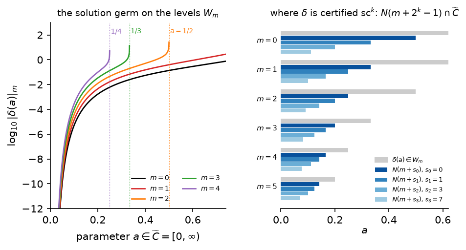

# Chapter 3. Solving equations whose solutions may break: sc-Fredholm theory (HWZ Part I, Chapter 3, pp. 89–174 (preprint pp. 61–146))

*Hofer–Wysocki–Zehnder, "Polyfold and Fredholm Theory", Part I, Chapter 3 (2014 preprint, arXiv
1407.3185, pp. 61–146, including its appendix §3.8), rewritten for a first-year graduate student who
wants to know what the implicit function theorem of polyfold theory says and why it is true. Every
proof is complete; where the preprint cites a proof from its reference [21] (Theorem 3.3.3 (preprint 3.30), Lemmas
3.8.1–3.8.2 (preprint 3.62–3.63)) or leaves the details to the reader (the induction of Theorem 3.5.1 (preprint 3.40)), the argument is
supplied, and where the Lean formalization found a missing hypothesis or a shorter route, the text
below follows the Lean. Statement numbers and pages are those of the book (Springer 2021), with the preprint's in parentheses (see `BookConcordance.md`); places where the preprint and the book may differ, once marked
"book?", were checked against the book's arXiv version, arXiv 1707.08941 (2017), before the
Springer edition was available; each is annotated (book 2017: …) with "unchanged",
"corrected", or the 2017 statement number and page.* *The conventions of
Chapters 1 and 2 are kept: an sc-Banach space is a scale $E = E_0\supset E_1\supset\cdots$ with
compact inclusions $\iota$ and $E_\infty$ dense in every level; $E^k$ is the level shift; a partial
quadrant $C\subset E$ is the preimage of $[0,\infty)^n\oplus W$ under an sc-isomorphism; $C_m = C\cap
E_m$; $d_C$ is the degeneracy index; $U\triangleleft F$ is the product with the double filtration of
Chapter 2, §5. In this chapter $P$ is a finite-dimensional normed space (the preprint's $\mathbb R^n$),
carrying the constant sc-structure $P_m = P$, and $\widetilde C\subset P$ is a partial quadrant in it
(the preprint's $[0,\infty)^k\oplus\mathbb R^{n-k}$). Sections 4 and 6 prove the implicit function
theorems, the local ones (Theorems 3.1.22, 3.1.26, 3.6.8 (preprint 3.19, 3.23, 3.54)) and the global ones (Theorems 3.6.10, 3.6.11 (preprint 3.56, 3.57), Corollary
3.1.27 (preprint 3.24)), all with the text's hypotheses. The text's argument for the surjectivity of the linearization at the
zeros near a given one has a gap; a new argument found while formalizing closes it (§6.3, Step 5), and with
it the Fredholm index is locally constant along the solution set.*

---

## 0. Counting solutions that may break

Floer counted the periodic orbits of a Hamiltonian system by counting the gradient lines of the action
functional that connect them: maps $u:\mathbb R\times S^1\to M$ solving a nonlinear Cauchy–Riemann
equation $\bar\partial_Ju = 0$ and converging to two periodic orbits at $s = \pm\infty$. The count is
meaningful only if the solutions near a given one form a smooth manifold of the expected dimension,
and its invariance only if the compactified space of solutions is a manifold with boundary whose
boundary consists of *broken* solutions: two gradient lines glued end to end. The tool that produces
such manifolds is the implicit function theorem: the solution set of $F(x) = 0$, near a solution at
which $DF$ is onto, is the graph of a smooth map over $\ker DF$.

Near a broken solution the classical theorem cannot be applied, and Chapters 1 and 2 explain why. The
natural space of maps near a breaking is the M-polyfold of Chapter 2: the union over gluing
parameters $a$ of spaces of maps on cylinders of length $R = e^{1/|a|}-e$, realized as the image of an
sc-smooth retraction, with a fibre dimension that jumps at $a = 0$. The Cauchy–Riemann operator is a
section of a bundle over it, and the charts of that bundle are glued by transition maps containing the
shift $u\mapsto u(\cdot+R,\cdot+\vartheta)$, which is sc-smooth but not $C^1$ (Chapter 1, §0); no classical
smoothness is available to feed the classical theorem. HWZ say it
plainly at the start of the chapter: "since sc-maps are more flabby than $C^\infty$-maps, we do not
have an implicit function theorem for all sc-smooth maps". What they have is a theorem for a
restricted class, the *sc-Fredholm sections*, which is broad enough for the Cauchy–Riemann operator of
Gromov–Witten theory, Floer theory and SFT.

The idea is the oldest proof of the implicit function theorem: rewrite the equation as a fixed point
problem with parameters,
$$w = B(a,w),\qquad a\in\widetilde C\subset P\ \text{(finitely many parameters)},\quad w\in W\ \text{(infinitely many unknowns)},$$
where $B(a,\cdot)$ is a contraction with constant as small as one likes near $(0,0)$, *on every level
$W_m$ of the scale*. Banach's fixed point theorem then solves it on every level, and the solution
$w = \delta(a)$ is the same on all levels where it exists. A section is sc-Fredholm if, after two
normalizations (filling, §1, and subtraction of a compact perturbation, §2), it can be brought into this
form by a change of coordinates. The theorem of §3 says that the solution germ $\delta$ is as regular
as $B$: sc$^k$ if $B$ is sc$^k$.

What "as regular" means is subtle, and this is where the present formalization contributes. Consider
the following toy model, which is the subject of this chapter's figure: $W$ is the space of sequences
$(w_k)_{k\ge1}$ with the norms $|w|_m^2 = \sum_ke^{2mk}|w_k|^2$, the parameter is $a\in[0,\infty)$, and
$$B(a,w) = aw+\beta(a),\qquad \beta(a)_k = a\,e^{-k/a}.$$
(Think of $k$ as a Fourier mode along a neck of length about $1/a$, damped like $e^{-k/a}$, and of the
level $m$ as the strength $e^{mk}$ of the weight that measures it; this is a cartoon, not a computation
in Floer theory.) The fixed point is $\delta(a) = \beta(a)/(1-a)$, and
$$|\delta(a)|_m^2 = \Big(\frac{a}{1-a}\Big)^2\frac{q}{1-q},\qquad q = e^{2(m-1/a)},$$
which is finite exactly when $a<1/m$. For $a = 0.3$ the solution lies on the levels $0,1,2,3$ and on no
higher one ($|\delta(0.3)|_3\approx0.44$); for $a = 0.1$ it lies on the levels $0,\dots,9$
($|\delta(0.1)|_9\approx0.044$). The solution is the more regular the closer the parameter is to $0$:
it is a *germ*, defined on level $m$ only on a neighbourhood $V_m$ of $0$ that shrinks with $m$. This
is not a defect of the example; it is the normal situation for solutions of sc-Fredholm problems
(Theorem 3.5.1 (preprint 3.40) says that solutions close to $0$ on level $0$ lie on level $m$), and HWZ build it into
the definitions: a germ is a decreasing sequence $V_0\supset V_1\supset\cdots$, and "the size of the
sets does not matter" (Definition 3.1.1 (preprint 3.1)).

The machine-checked proof of the germ implicit function theorem (Theorem 3.3.6 (preprint 3.33)) shows how much the size
does matter. Each derivative of $\delta$ costs a shift of the sequence of neighbourhoods: $\delta$ is
sc$^k$ on the germ $V_m = N(m+s_k)$ with $s_k = 2^k-1$, where $N(m)$ are the neighbourhoods on which
$B$ contracts. "If $f$ is sc-smooth so is its solution germ" (Theorem 3.35 (preprint; not in the 2021 edition)) is true in the sense that
for every $k$ the solution is sc$^k$ on *some* germ, not in the sense that it is sc$^k$ for all $k$ on
one germ. §3.6 explains where the shift comes from and what it means for the statements of the text.

The chapter follows the preprint's order with two exceptions: Theorem 3.5.1 (preprint 3.40) (from the preprint's §3.5) is
proved in §3, right after the fixed point machinery it uses, and the finite-dimensional tools scattered
over the preprint's §3.2, §3.5 and appendix are gathered in §7. §1 gives the germs and the sections of
strong bundles, with fillers; §2 the basic germs, the sc-Fredholm germs and sections, local compactness
(Theorem 3.1.13 (preprint 3.12)) and the stability under compact perturbations (Theorem 3.1.18 (preprint 3.15)); §3 the contraction germs
and the germ implicit function theorem, with every step of its induction, followed by the proof of
Theorems 3.1.13 and 3.5.1 (preprint 3.12 and 3.40). §5 treats the basic class: the stability of basic germs under
sc$^+$-perturbations (Theorem 3.4.2 (preprint 3.38)) and their local solvability (Theorem 3.5.6 (preprint 3.43), Theorem 3.5.11 (preprint Corollary 3.47)). §4
gives the implicit function theorems at interior and boundary points and the tangent germ property
(Theorem 3.2.3 (preprint 3.27)), and §6 the fundamental implicit function theorem 3.54 and the global theorems
3.56–3.57, with the one step of the text's proof that needs a new argument (§6.3, Step 5). §7 collects the finite-dimensional tools of the preprint's
§3.2 and appendix: good position and the quadrant structure of $N\cap C$ (Proposition 3.1.25 (preprint 3.22)), the
degeneracy index along a graph (Lemma 3.8.13 (preprint 3.70)), the inverse and implicit function theorems in partial
quadrants (Theorems 3.8.15, 3.8.22 (preprint 3.72, 3.78)). §8 follows one sc-Fredholm problem from the section to its
solution curve, §9 lists what the text assumes silently, and §10 contains the routine proofs.

---

## 1. Germs, sections of strong bundles, fillers (pp. 89–94, 98–99 (preprint pp. 61–66, 71–72))

### 1.1 Germs

**Definition 3.1.1 (preprint 3.1).** Let $C$ be a partial quadrant in the sc-Banach space $E$. An *sc-germ of
neighbourhoods* around $0\in C$, written $\mathcal O(C,0)$, is a decreasing sequence
$$U_0\supset U_1\supset U_2\supset\cdots$$
where $U_m$ is a relatively open neighbourhood of $0$ in $C_m = C\cap E_m$. Its *tangent*
$T\mathcal O(C,0)$ is the decreasing sequence $U_1\oplus E_0\supset U_2\oplus E_1\supset\cdots$ (a germ
around $0$ in the partial quadrant $TC = C^1\oplus E$ of $TE$).

Two examples from the text. A relatively open neighbourhood $U$ of $0$ in $C$ with $U_m = U\cap E_m$ is a
germ; if $E$ is infinite-dimensional these $U_m$ are unbounded in $E_m$ (a bounded relatively open set in
$E_m$ would be precompact in $E_0$). The sets $U_0 = U$, $U_m = U\cap B^{E_m}_{1/m}(0)\cap E_m$ ($m\ge1$) form a germ with
$U_m$ bounded in $E_m$. HWZ add: "the size of the sets $U_m$ does not matter. In the applications the
size of $U_m$ quite often decreases rapidly."

*Checked by machine:* `Polyfold.ScNbhdGerm` (each $U_m$ of the form $O\cap C_m$ with $O$ open in $E_m$ and
$0\in U_m$, nested along the inclusions $E_{m+1}\to E_m$), with the tangent germ
`Polyfold.ScNbhdGerm.tangent` and the first example `Polyfold.ScNbhdGerm.ofSet`.

> **Re-indexing a germ.** The sequence $(U_{m+1})_{m\ge0}$ is in general *not* a germ: $U_{m+1}$ is
> relatively open in $C_{m+1}$, not in $C_m$. It is one when all levels of $E$ coincide, i.e. when $E$ is
> finite-dimensional with the constant structure. This trivial remark is the hinge of §3: the solution
> germ of a contraction germ lives on the finite-dimensional parameter space $P$, where re-indexing is
> allowed, and the proof of the germ implicit function theorem re-indexes once per derivative.

**Definition 3.1.2 (preprint 3.2).** Let $F$ be an sc-Banach space. An *sc$^0$-germ* $f:\mathcal O(C,0)\to F$ is a
continuous map $f:U_0\to F$ such that $f(U_m)\subset F_m$ and $f:U_m\to F_m$ is continuous for every $m$.
An *sc$^1$-germ* is an sc$^0$-germ such that for every $x\in U_1$ there is a bounded operator
$Df(x)\in L(E_0,F_0)$ with
$$\lim_{|h|_1\to0}\frac{|f(x+h)-f(x)-Df(x)h|_0}{|h|_1} = 0\qquad(h\in E_1,\ x+h\in U_1),$$
and such that the tangent map $Tf(x,h) = (f(x),Df(x)h)$ maps $U_{m+1}\oplus E_m$ into $F_{m+1}\oplus F_m$
and is an sc$^0$-germ $T\mathcal O(C,0)\to TF$. The germ $f$ is *sc$^2$* if $Tf$ is sc$^1$, and so on; it is
*sc-smooth* if it is sc$^k$ for every $k$. One writes $f:\mathcal O(C,0)\to(F,0)$ when $f(0) = 0$.

*Checked by machine:* `Polyfold.IsSc0Germ`, `Polyfold.IsSc1GermWith` (with a given derivative family),
`Polyfold.IsSc1Germ`, `Polyfold.IsSckGerm`, `Polyfold.IsScSmoothGerm` — the exact analogues of the
notions of Chapter 1 with $U_m$ in place of $U\cap E_m$. The derivative $Df(x)$, $x\in U_1$, is unique
because $U_1$ is relatively open in $C_1$ and $C_1$ is convex with nonempty interior
(`Polyfold.IsQuadrantLike`, which every partial quadrant satisfies,
`Polyfold.IsPartialQuadrant.isQuadrantLike`).

The text uses germs as freely as maps on open sets: it restricts them, composes them, pairs them and
applies Propositions 1.2.1–1.2.3 (preprint 1.16–1.18) to them. None of this is stated; all of it is true, with the proofs of
Chapter 1 and $U\cap E_m$ replaced by $U_m$. Only one point needs care: a composition $g\circ f$ of germs
makes sense level by level only if $f$ maps $U_m$ into the domain $V_m$ of $g$ for every $m$.

**Lemma 1.A (calculus of germs).** Let $G = (U_m)$ be an sc-germ of neighbourhoods around $0\in C$.

1. Whether $f$ is an sc$^k$-germ on $G$ depends only on $f|_{U_0}$, and an sc$^k$-germ on $G$ is an
   sc$^k$-germ on every germ $(U'_m)$ with $U'_m\subset U_m$.
2. An sc$^k$-map on a relatively open $U\ni0$ (Chapter 1) is an sc$^k$-germ on $U_m = U\cap E_m$.
3. (Chain rule.) If $f$ is an sc$^k$-germ on $G$, $g$ an sc$^k$-germ on a germ $(V_m)$ around $0$ in a
   partial quadrant of $F$, and $f(U_m)\subset V_m$ for every $m$, then $g\circ f$ is an sc$^k$-germ on $G$, and
   $T(g\circ f) = Tg\circ Tf$ on $TG$.
4. An sc-operator $T:E\to F$ is an sc-smooth germ on every germ, and the pairing $(f,g)$ of two
   sc$^k$-germs on $G$ is an sc$^k$-germ into $F\oplus F'$.

*Proof.* As in Chapter 1, §§3–4, with $U\cap E_m$ replaced by $U_m$; the points where the germ version
differs are recorded in §10.1. $\square$

*Checked by machine:* (1) `Polyfold.IsSckGerm.congr`, `Polyfold.IsSckGerm.mono`; (2)
`Polyfold.IsSck.isSckGerm`; (3) `Polyfold.IsSckGerm.comp`, with the level-by-level condition
`Polyfold.ScNbhdGerm.MapsToGerm`, and `Polyfold.IsSc1Germ.comp` for the tangent identity; (4)
`Polyfold.ScOperator.isScSmoothGerm`, `Polyfold.IsSckGerm.pair`.

**Lemma 1.B (Propositions 1.2.1–1.2.3 (preprint 1.16–1.18) for germs).** Let $f$ be an sc$^1$-germ on $G = (U_m)$ with
derivative family $D$.

1. For $x\in U_{m+1}$ the operator $Df(x)$ restricts to a bounded operator $E_m\to F_m$, the map
   $(x,h)\mapsto Df(x)h$ is continuous $U_{m+1}\times E_m\to F_m$, and $f:U_{m+1}\to F_m$ is differentiable at
   every point of $U_{m+1}$ (within $U_{m+1}$) with derivative this level-$m$ operator.
2. The shifted sequence $G^1 = (U_{m+1})_m$ is a germ around $0$ in the partial quadrant $C^1$ of $E^1$,
   and if $f$ is an sc$^k$-germ on $G$ then $f$ is an sc$^k$-germ $G^1\to F^1$.
3. If $f$ is an sc$^k$-germ on $G$, then $f:U_{m+k}\to F_m$ is of class $C^k$ for every $m$.

*Proof.* §10.1. $\square$

*Checked by machine:* (1) `Polyfold.IsSc1GermWith.exists_levelDeriv`,
`Polyfold.IsSc1GermWith.continuousOn_levelDeriv`, `Polyfold.IsSc1GermWith.hasFDerivWithinAt_level`;
(2) `Polyfold.ScNbhdGerm.shift`, `Polyfold.IsSckGerm.shift`; (3) `Polyfold.IsSckGerm.contDiffOn_levels`.

### 1.2 Sections of strong bundles

Recall from Chapter 2, §5 (Definition 2.6.4 (preprint 2.50)) a *strong bundle chart*
$(\Phi,P^{-1}(V),K,U\triangleleft F)$ of the strong bundle $P:Y\to X$ over the M-polyfold $X$: $V\subset X$ is
open, $\varphi:V\to O$ and $\Phi:P^{-1}(V)\to K$ are homeomorphisms with $p\circ\Phi = \varphi\circ P$, the
model fibre space is $K = R(U\triangleleft F)$ for a strong bundle retraction
$$R(u,h) = (r(u),\rho(u)h)$$
covering the sc-smooth retraction $r:U\to U$ onto $O = r(U)$, $U$ relatively open in a partial quadrant
$C\subset E$. The form of $R$ is a consequence of Definition 2.6.1 (preprint 2.47), and the identities used below follow
from $R\circ R = R$:

**Lemma 1.C.** Write $r(u) = (R(u,0))_1$ and $\rho(u)h = (R(u,h))_2$ for $u\in U$, $h\in F_0$. Then
$R(u,h) = (r(u),\rho(u)h)$; $r\circ r = r$; $\rho(r(u))\rho(u) = \rho(u)$; for $x\in O$, $r(x) = x$ and
$\rho(x)$ is a projection; $R$ fixes the points of $K$, so $\rho(x)h = h$ for $(x,h)\in K$; and $\rho(u)$
is a bounded linear operator on $F_0$.

*Proof.* $R(u,h) = (r(u),\rho(u)h)$ because the base component of a strong bundle map does not depend
on the fibre variable (Definition 2.6.1 (preprint 2.47)). Comparing components of $R(R(u,h)) = R(u,h)$ gives
$r(r(u)) = r(u)$ and $\rho(r(u))\rho(u)h = \rho(u)h$; for $x = r(u)\in O$ this reads
$\rho(x)\rho(x) = \rho(x)$ (apply the second identity at $u = x$, where $r(x) = x$). A point of $K$ is
$R(q)$ for some $q$, and $R(R(q)) = R(q)$. Linearity of $\rho(u)$ is part of Definition 2.6.1 (preprint 2.47); continuity
holds because $R$ is sc$^0$, hence continuous on level $0$, and $h\mapsto\rho(u)h$ is its restriction to
$\{u\}\times F_0$ followed by a projection. $\square$

*Checked by machine:* `Polyfold.StrongRetr.r`, `Polyfold.StrongRetr.ρ`, `Polyfold.StrongRetr.apply_eq`,
`Polyfold.StrongRetr.r_r`, `Polyfold.StrongRetr.ρ_r_ρ`, `Polyfold.StrongRetr.ρ_ρ`,
`Polyfold.StrongRetr.apply_eq_self_of_mem_K`, `Polyfold.StrongRetr.ρ_eq_self_of_mem_K`,
`Polyfold.StrongRetr.ρCLM` (the text: "$\rho(u):F\to F$ is a bounded linear operator", without comment).

A section $f$ of $P$ over $V$ has the local representative $\hat f = \Phi\circ f\circ\varphi^{-1}:O\to K$,
of the form $\hat f(z) = (z,\mathbf f(z))$; $\mathbf f:O\to F$ is its *principal part*. HWZ use the same
letter for both, and so will we when no confusion is possible.

**Definition 3.1.3 (preprint 3.3).** An *sc-smooth section germ* $(f,x_0)$ of the strong bundle $P:Y\to X$ is a continuous
section $f:V\to P^{-1}(V)$ on an open neighbourhood $V$ of the smooth point $x_0$, such that in some strong
bundle chart with $\varphi(x_0) = 0\in O$ the principal part $\mathbf f$ of $\Phi\circ f\circ\varphi^{-1}$ has
the property that
$$\mathbf f\circ r:\mathcal O(C,0)\to F$$
is an sc-smooth germ in the sense of Definition 3.1.2 (preprint 3.2) (on the germ $U_m = U\cap E_m$ of the chart).

*Checked by machine:* `Polyfold.StrongBundle.IsScSmoothSectionGerm`; an sc-smooth section (Definition
2.6.6 (preprint 2.52)) is an sc-smooth section germ at every smooth point around which there is a centred chart
(`Polyfold.StrongBundle.IsScSmoothSection.isScSmoothSectionGerm`).

> **Which charts.** "A strong bundle chart" in Definitions 3.1.3, 3.1.6 and 3.1.11 (preprint 3.3, 3.6 and 3.11) must mean a chart
> *compatible* with the atlas of $P$, not a member of it: a chart of the atlas need not be centred at
> $x_0$, and the notions must not depend on the atlas within its equivalence class. The price is that
> the local representatives of sections must be shown sc-smooth in every compatible chart. For an
> sc-smooth section this is Definition 2.3.8 (preprint 2.14) as it stands; for an sc$^+$-section, sc-smooth into $Y[1]$,
> it is the change of chart $(\Phi\circ\Phi'^{-1})[1]$ on $K[1]$ — exactly the compatibility on $[1]$ that
> Definition 2.6.4 (preprint 2.50) requires. This is the first place in the book where that compatibility is used.
> (Lean: `Polyfold.StrongBundle.IsChart`,
> `Polyfold.StrongBundle.IsScSmoothSection.isScSmoothRetractMap`,
> `Polyfold.StrongBundle.IsScPlusSection.isScSmoothRetractMap_one`.)

The proofs of Theorems 3.1.13 and 3.1.18 (preprint 3.12 and 3.15) add sections and look for their zeros. The algebra behind this is
not stated in the text:

**Lemma 1.D (section algebra).** Let $f$, $s$ be sections of $P$.

1. The fibrewise sum $f+s$, $(f+s)(x) = f(x)+s(x)$ in the vector space $P^{-1}(x)$, is a section, and in
   every strong bundle chart its principal part is $\mathbf f+\mathbf s$ on $O$.
2. $f(x) = 0$ (the zero of $P^{-1}(x)$) if and only if $\mathbf f(\varphi(x)) = 0$.
3. The fibres of $K$ over $O$ are linear subspaces: $(u,a),(u,b)\in K$ imply $(u,a+b)\in K$.
4. (Sum rule.) If $f,g:U\to F$ are sc-smooth on a relatively open subset $U$ of a partial quadrant, so
   are $f+g$, $f-g$, $-f$; and a map sc-smooth into $F^1$ is sc-smooth into $F$.

*Proof.* (1)–(2): $\Phi$ is linear on the fibres and maps the zero of $P^{-1}(x)$ to $(\varphi(x),0)$.
(3): $(u,a)\in K$ means $\rho(u)a = a$ (Lemma 1.C), and $\rho(u)$ is linear. (4): $f+g$ is the pairing
$(f,g)$, sc-smooth by the pairing rule, followed by the sc-operator $F\oplus F\to F$, $(a,b)\mapsto a+b$
(chain rule); the inclusion $F^1\to F$ is an sc-operator. $\square$

*Checked by machine:* (1) `Polyfold.sectionAdd`, `Polyfold.IsSection.sectionAdd`,
`Polyfold.StrongBundleChart.principal_sectionAdd`; (2) `Polyfold.StrongBundleChart.isZeroAt_iff`; (3)
`Polyfold.StrongBundleChart.add_mem_K`; (4) `Polyfold.IsScSmooth.add`, `Polyfold.IsScSmooth.sub`,
`Polyfold.IsScSmooth.neg`, `Polyfold.IsScSmooth.toBase_shift`.

### 1.3 Fillers

The domain $O = r(U)$ of the principal part of a section is a retract, whose dimension may jump; it is
hard to analyse a map on it directly. A filler extends the section to the whole of $U$ without
creating new zeros.

**Definition 3.1.4 (preprint 3.4) (Filling).** Let $K = R(U\triangleleft F)\to O$ be a tame strong local bundle, $R(u,h) =
(r(u),\rho(u)h)$ covering the tame retraction $r$ onto $O = r(U)$, with $r(0) = 0$. An sc-smooth section
germ $(f,0)$ of $K\to O$ *has a filling* if there is an sc-smooth section germ $(g,0)$ of $U\triangleleft
F\to U$ with the following properties.

1. $f(x) = g(x)$ for $x\in O$ close to $0$.
2. If $g(y) = \rho(r(y))g(y)$ for a point $y\in U$ near $0$, then $y\in O$.
3. The linearization of $y\mapsto[1-\rho(r(y))]\,g(y)$ at $0$, restricted to $\ker Dr(0)$, is a
   topological linear isomorphism $\ker Dr(0)\to\ker\rho(0)$.

Condition (3) presupposes that $y\mapsto[1-\rho(r(y))]g(y)$ is differentiable at $0$. It is sc$^1$ when
$g$ and $R$ are sc-smooth (it is $g(y)-\rho(r(y))g(y)$, and $y\mapsto\rho(r(y))g(y)$ is the second
component of $R\circ(r,g)$ composed with $y\mapsto(y,g(y))$), so nothing is lost by requiring it.

*Checked by machine:* `Polyfold.IsFillerOf`, for the principal parts $f,g:E_0\to F_0$: conditions (1) and
(2) near $0$, and (3) with the map $y\mapsto[1-\rho(r(y))]g(y)$ required sc$^1$ on $U$ and its
linearization at $0$ inducing a continuous linear equivalence $\ker Dr(0)\simeq\ker\rho(0)$. The
sc-smoothness of $g$ is not part of `IsFillerOf`; it is added in Definition 3.1.6 (preprint 3.6) below.

*The crucial property.* The zeros of $f$ in $O$ and of $g$ in $U$ coincide near $0$: if $g(y) = 0$ then
$g(y) = \rho(r(y))g(y)$ trivially, so $y\in O$ by (2), and $f(y) = g(y) = 0$ by (1); conversely a zero of
$f$ near $0$ is a zero of $g$ by (1). "In the Gromov–Witten theory and the SFT they seem almost
canonical."

*The linearizations.* Suppose $f(0) = 0$, so $g(0) = 0$. Since $r\circ r = r$, $Dr(0)$ is a projection, and so is
$\rho(0)$ (Lemma 1.C); write
$$E = E'\oplus E'',\ E' = Dr(0)E = T_0O,\ E'' = \ker Dr(0);\qquad F = F'\oplus F'',\ F' = \rho(0)F,\ F'' = \ker\rho(0).$$
(At the smooth point $0$ these are sc-splittings, Lemma 2.B of Chapter 1.) The linearization $Tf(0)$ of
the section is the restriction of $D(\mathbf f\circ r)(0)$ to $T_0O$. Three identities hold near $0$ in $U$:
$g\circ r = \mathbf f\circ r$ (by (1), since $r(y)\in O$); $\rho(r(y))\mathbf f(r(y)) = \mathbf f(r(y))$ (since
$\hat f$ takes values in $K$); and $(1-\rho(r(y)))g(r(y)) = 0$ (the two previous ones). Differentiating
at $0$, using $\mathbf f(0) = g(0) = 0$ to kill the terms in which the derivative falls on $\rho$, gives
$Dg(0)|_{E'} = Tf(0)$, $\rho(0)Tf(0) = Tf(0)$, and $(1-\rho(0))Dg(0)Dr(0) = 0$. Hence, in the splittings,
$$Dg(0) = \begin{pmatrix}Tf(0) & \rho(0)Dg(0)|_{E''}\\ 0 & (1-\rho(0))Dg(0)|_{E''}\end{pmatrix},$$
and the lower right entry is the linearization in (3) (the derivative of $[1-\rho(r(y))]g(y)$ at $0$ is
$(1-\rho(0))Dg(0)$ because $g(0) = 0$), an isomorphism $E''\to F''$. In particular
$\ker Dg(0) = \ker Tf(0)\oplus\{0\}$. (The preprint writes the target as "$(1-D\rho(0))F$"; it is
$(1-\rho(0))F$ *(book 2017: unchanged, before Proposition 3.1, p. 60)*.) The differentiations above use that $(u,h)\mapsto\rho(u)h$ is differentiable,
i.e. that $R$ is sc$^1$; the text does not say so.

**Proposition 3.1.5 (preprint 3.5) (Filler).** Assume $f$ has the filling $g$ and $f(0) = 0$.

1. $Tf(0):Dr(0)E\to\rho(0)F$ is surjective if and only if $Dg(0):E\to F$ is surjective.
2. $Tf(0)$ is Fredholm if and only if $Dg(0)$ is Fredholm, and then $\operatorname{ind}Tf(0) =
   \operatorname{ind}Dg(0)$.

*Proof.* Write the matrix above as $\begin{pmatrix}A&B\\0&D\end{pmatrix}$ with $D:E''\to F''$ an
isomorphism. Then
$$\begin{pmatrix}A&B\\0&D\end{pmatrix} = \begin{pmatrix}1&BD^{-1}\\0&1\end{pmatrix}\begin{pmatrix}A&0\\0&D\end{pmatrix},$$
and the first factor is an isomorphism of $F$. So $Dg(0)$ is onto (Fredholm) if and only if
$\operatorname{diag}(A,D)$ is, which, $D$ being an isomorphism, holds if and only if $A$ is onto
(Fredholm). The kernels and cokernels of $\operatorname{diag}(A,D)$ are those of $A$, and composing with an
isomorphism does not change the index. $\square$

*Checked by machine:* `Polyfold.IsFillerOf.proposition_3_5` (for a filler $g$, sc-smooth with $g(0) = 0$; $Tf(0) = Dg(0)|_{Dr(0)E}$), through the linear algebra `Polyfold.proposition_3_5` for idempotents $p$, $q$ and $L$ with $(1-q)Lp = 0$ and $(1-q)L:\ker p\to\ker q$ a topological isomorphism. Instead of the factorization above, the proof exhibits $\ker A\cong\ker L$ and $\operatorname{coker}A\cong\operatorname{coker}L$ (`Polyfold.fillerRestrict_kerEquiv`, `Polyfold.fillerRestrict_cokerEquiv`), so the index equality needs no finiteness assumption. The derivative identities are `Polyfold.StrongRetr.scDeriv_fiber_zero`, `Polyfold.IsFillerOf.deriv_comp_r_eq_zero` and `Polyfold.IsFillerOf.scDeriv_section_comp_r`.

**Definition 3.1.6 (preprint 3.6) (Filled version).** Let $f$ be an sc-smooth section of the tame strong bundle $P:Y\to
X$ and $x_0$ a smooth point. The germ $(f,x_0)$ *has a filling* if there is a strong bundle chart
$\Phi:P^{-1}(V)\to K$ covering $\varphi:(V,x_0)\to(O,0)$, with $K\to O$ a tame strong local bundle and
$0\in O\subset U$, such that the section germ $\Phi\circ f\circ\varphi^{-1}:O\to K$ has a filling
$g:U\to U\triangleleft F$ near $0$. The germ $(g,0)$ is a *filled version* of $(f,x_0)$.

*Checked by machine:* `Polyfold.IsFilledVersion` (the local data: $g$ sc-smooth on the whole $U$ of the
chart and a filler in the sense of `Polyfold.IsFillerOf`). The text's germ $(g,0)$ is defined near $0$;
defining $g$ on all of $U$ is no restriction, since the chart can be restricted to $U\cap W$ for an open
$W\ni0$.

The next two lemmas are the local content of the stability theorem 3.15. An *sc$^+$-section* of
$K\to O$ (Definition 2.6.3 (preprint 2.49)) is a section whose principal part is sc-smooth into $F^1$.

**Lemma 3.1.19 (preprint 3.16).** An sc$^+$-section $s:O\to K$, $s(u) = (u,\mathbf s(u))$, extends to the sc$^+$-section
$\tilde s(u) = (u,\mathbf s(r(u)))$ of $U\triangleleft F\to U$, and

1. $\tilde s(u) = s(u)$ for $u\in O$;
2. $R(r(u),\tilde{\mathbf s}(u)) = s(r(u))$ for $u\in U$.

*Proof.* $\tilde{\mathbf s} = \mathbf s\circ r$ is sc-smooth into $F^1$ by the chain rule (Definition 2.1.14 (preprint 2.7): $\mathbf
s$ is sc-smooth on the retract $O$ exactly when $\mathbf s\circ r$ is sc-smooth). (1) For $u\in O$,
$r(u) = u$. (2) $s(r(u)) = (r(u),\mathbf s(r(u)))\in K$ because $s$ is a section of $K$, and $R$ fixes the
points of $K$ (Lemma 1.C); so $R(r(u),\mathbf s(r(u))) = (r(u),\mathbf s(r(u)))$. $\square$

*Checked by machine:* `Polyfold.lemma_3_16`: (1) as $\mathbf s(r(x)) = \mathbf s(x)$ on $O$, (2) as
$\rho(r(u))\mathbf s(r(u)) = \mathbf s(r(u))$ and $R(r(u),\mathbf s(r(u))) = (r(u),\mathbf s(r(u)))$, from the
hypothesis that $s$ takes values in $K$ (the text's "using that $s(u) = R(s(u))$"). The sc$^+$
regularity of $\tilde s$ is not part of this statement; it is proved where it is used, in Theorem 3.1.18 (preprint 3.15)
(`Polyfold.StrongBundle.IsScFredholmGerm.sectionAdd`).

**Lemma 3.1.20 (preprint 3.17).** Let $f:O\to K$ be an sc-smooth section and $s:O\to K$ an sc$^+$-section. If $f$ has the
filler $g$, then $f+s$ has the filler $g+\tilde s$.

*Proof.* (1) On $O$, $g+\tilde{\mathbf s} = \mathbf f+\mathbf s$ by (1) for $g$ and Lemma 3.1.19 (1) (preprint 3.16). (2) By
Lemma 3.1.19 (2) (preprint 3.16), $\rho(r(y))\tilde{\mathbf s}(y) = \tilde{\mathbf s}(y)$; so $(g+\tilde{\mathbf s})(y) =
\rho(r(y))(g+\tilde{\mathbf s})(y)$ is equivalent to $g(y) = \rho(r(y))g(y)$, which forces $y\in O$. (3) By the
same identity,
$$[1-\rho(r(y))](g(y)+\tilde{\mathbf s}(y)) = [1-\rho(r(y))]g(y)\qquad(y\in U),$$
so the two maps of condition (3) coincide on $U$ and have the same linearization at $0$ (derivatives on
$U_1$ are unique). $\square$

*Checked by machine:* `Polyfold.lemma_3_17`, conditions (1)–(3) of `Polyfold.IsFillerOf` for
$(\mathbf f+\mathbf s,\ g+\mathbf s\circ r)$, by this proof; the sc$^1$ requirement of (3) is transported along
the equality of the two maps on $U$. As in Lemma 3.1.19 (preprint 3.16), the sc-smoothness of $g+\tilde{\mathbf s}$ (the
text: "follow immediately") is supplied in the proof of Theorem 3.1.18 (preprint 3.15).

---

## 2. Basic germs and sc-Fredholm sections (pp. 93–101 (preprint pp. 66–75))

### 2.1 Basic germs

**Definition 3.1.7 (preprint 3.7) (Basic germ).** Let $W$ be an sc-Banach space and $C = \widetilde C\oplus W$ the partial
quadrant in $E = P\oplus W$, $\widetilde C = [0,\infty)^k\oplus\mathbb R^{n-k}$. A *basic germ* is an
sc-smooth germ
$$f:\mathcal O(C,0)\to\mathbb R^N\oplus W$$
with $f(0) = 0$ such that, if $P_W:\mathbb R^N\oplus W\to W$ is the projection,
$$P_W\circ f(a,w) = w-B(a,w),\qquad B(0,0) = 0,$$
and for every $\varepsilon>0$ and every $m\ge0$
$$|B(a,w)-B(a,w')|_m\le\varepsilon|w-w'|_m$$
if $(a,w)$ and $(a,w')$ are close enough to $(0,0)$ on level $m$.

(Remark 3.1.8 (preprint 3.8): in [21] $f(0) = 0$ was not required; the normalization $f(0) = 0$ is the
convention of the book.) The estimate is the contraction property of Definition 3.3.1 (preprint 3.28) below; in the
Lean, a basic germ is an sc-smooth germ whose $W$-component is $w-B(a,w)$ with $B$ an sc$^0$-contraction
germ.

*Checked by machine:* `Polyfold.IsBasicGerm`, for a finite-dimensional $Q$ in place of $\mathbb R^N$, a set
$\widetilde C$ in a finite-dimensional $P$ in place of $[0,\infty)^k\oplus\mathbb R^{n-k}$ (the theorems that use it ask
$\widetilde C$ closed, or a partial quadrant), and the
contraction property in the form `Polyfold.IsSc0ContractionGerm` (Definition 3.3.1 (preprint 3.28), §3.1), which asks the
points $(a,w)$, $(a,w')$ to lie in $U_m$ — the text's "close enough on level $m$" presupposes it.

**Lemma 3.1.9 (preprint 3.9).** Let $B$ be as in Definition 3.1.7 (preprint 3.7). For every $\varepsilon>0$ and $m\ge0$,
$$|D_2B(a,w)\zeta|_m\le\varepsilon|\zeta|_m\qquad\text{for all }\zeta\in W_m,$$
if $(a,w)\in E_{m+1}$ is close enough to $(0,0)$ in $E_m$. In particular $D_2B(0,0) = 0$.

*Proof.* Here $D_2B(a,w)$, $(a,w)\in U_{m+1}$, is the level-$m$ operator of Lemma 1.B (1), and
$B:U_{m+1}\to W_m$ is differentiable at $(a,w)$ with this derivative. (The text says "recalling Proposition
1.17"; what is used is Proposition 1.2.1 (preprint 1.16), for germs.) Choose $\rho$ such that the contraction estimate with
constant $\varepsilon$ holds for points of $U_m$ within $\rho$ of $0$ on level $m$, and let $(a,w)\in U_{m+1}$
with $|(a,w)|_m<\rho$. For $\zeta\in W_{m+1}$ and small real $t$, the point $(a,w+t\zeta)$ lies in $U_{m+1}$
and within $\rho$ of $0$ on level $m$, so
$$|D_2B(a,w)\zeta|_m = \Big|\frac{B(a,w+t\zeta)-B(a,w)}t\Big|_m+\frac{|o(t)|_m}{|t|}\le\varepsilon|\zeta|_m+\frac{|o(t)|_m}{|t|},$$
and letting $t\to0$ gives the estimate for $\zeta\in W_{m+1}$. Since $W_{m+1}$ is dense in $W_m$ and
$D_2B(a,w):W_m\to W_m$ is bounded, it holds for all $\zeta\in W_m$. Taking $(a,w) = 0$ and letting
$\varepsilon\to0$ gives $D_2B(0,0) = 0$. $\square$

The proof uses only that $B$ is sc$^1$, not sc-smooth; this matters, because Theorem 3.3.3 (preprint 3.30) and Lemma 3.3.4 (preprint 3.31)
apply Lemma 3.1.9 (preprint 3.9) to germs of class sc$^1$ and sc$^k$.

*Checked by machine:* `Polyfold.ContractionGerm.norm_levelDeriv_snd_le`, for an sc$^1$-germ $B$ in the
working form of §3.1, with $\varepsilon = \tfrac12$ (the only value used): for $a\in N(m+1)\cap\widetilde C$,
$w\in O(m+1)$ with $\iota w\in O(m)$, $\|D_2B(a,w)\|_{L(W_m)}\le\tfrac12$. The density step is as above.

**Proposition 3.1.10 (preprint 3.10).** Let $f:[0,\infty)^k\oplus\mathbb R^{n-k}\oplus W\to\mathbb R^N\oplus W$ be an sc-smooth
germ with $f(0) = 0$ of the form $f = h+s$, $h$ a basic germ and $s$ an sc$^+$-germ. Then $Df(0):\mathbb
R^n\oplus W\to\mathbb R^N\oplus W$ is sc-Fredholm of index $n-N$. Moreover, for every $m$,
$Df(a,w):\mathbb R^n\oplus W_m\to\mathbb R^N\oplus W_m$ is Fredholm of index $n-N$ if $(a,w)\in E_{m+1}$ is
sufficiently small in $E_m$.

*Proof.* At $0$, $Df(0)(\delta a,\delta w) = \delta w-D_2B(0)\delta w-D_1B(0)\delta a+(1-P_W)Dh(0)(\delta
a,\delta w)+Ds(0)(\delta a,\delta w)$, and $D_2B(0) = 0$ (Lemma 3.1.9 (preprint 3.9)). The terms $D_1B(0)\delta a$ and
$(1-P_W)Dh(0)$ have finite-dimensional source or target, hence finite rank with values in smooth points
($Dh(0)$ is an sc-operator at the smooth point $0$), so they are sc$^+$; and $Ds(0)$ is an sc$^+$-operator; so $Df(0)$ is
an sc$^+$-perturbation of $(\delta a,\delta w)\mapsto(0,\delta w)$, whose kernel is $\mathbb R^n$ and whose
cokernel is $\mathbb R^N$: an sc-Fredholm operator of index $n-N$. By Proposition 1.1.11 (preprint 1.10) the perturbation is
sc-Fredholm with the same index (sc$^+$-operators are compact on each level). For the second statement,
$Df(a,w)$ on level $m$ is a compact perturbation of $(\delta a,\delta w)\mapsto(0,(1-D_2B(a,w))\delta w)$, and
by Lemma 3.1.9 (preprint 3.9) with $\varepsilon<1$ the operator $1-D_2B(a,w)$ is invertible on $W_m$ (Neumann series) for
$(a,w)\in E_{m+1}$ small in $E_m$. $\square$

*Checked by machine:* the first statement, `Polyfold.proposition_3_10` (for $s$ sc$^1$ into $(\mathbb R^N\oplus W)^1$ and $f$ sc$^1$; the sc$^+$-operator $Df(0)-T_0$ built level by level, `Polyfold.proposition_3_10_scPlus`). The second statement is checked on level $0$ only, for points of $U_1$ small on level $1$ (`Polyfold.StabilityData.exists_isFredholm_Dfs'`, §5); levels $m\ge1$ are not.

### 2.2 Sc-Fredholm germs and sections

**Definition 3.1.11 (preprint 3.11) (sc-Fredholm germ).** Let $f$ be an sc-smooth section of the strong bundle $P:Y\to X$
over the tame M-polyfold $X$ and $x_0$ a smooth point. Then $(f,x_0)$ is an *sc-Fredholm germ* if it has a
filled version $(g,0):U\to U\triangleleft F$ (Definition 3.1.6 (preprint 3.6)) and a local sc$^+$-section
$s:U\to U\triangleleft F$ with $s(0) = g(0)$ such that the germ $(g-s,0)$ is *conjugated to a basic germ*:
there is a strong bundle isomorphism $\Psi:U\triangleleft F\to U'\triangleleft F'$ covering an
sc-diffeomorphism $\psi:U\to U'$ such that the push-forward section $\Psi\circ(g-s)\circ\psi^{-1}:U'\to
U'\triangleleft F'$ is a basic germ.

*Checked by machine:* `Polyfold.StrongBundle.IsScFredholmGerm`: $x_0$ smooth, a strong bundle chart of
$P$ centred at $x_0$, a filled version $g$ of the principal part, an $s:U\to F_1$ sc-smooth into $F^1$ with
$\iota s(0) = g(0)$, and `Polyfold.IsConjugateToBasicGerm` for $u\mapsto g(u)-\iota s(u)$: a strong bundle
isomorphism (`Polyfold.IsStrongBundleIso`: strong bundle maps $\Psi$, $\Psi'$ in both directions, inverse
to each other) with $\psi(0) = 0$, $U'$ relatively open in $\widetilde C\oplus W$ with $\widetilde C$ a
partial quadrant of a finite-dimensional space, a basic germ $h$ on a germ of neighbourhoods inside
$U'$, and $(\Psi(u,g(u)-s(u)))_2 = h(\psi(u))$ for $u\in U$ near $0$. The text's $C' = T\psi(0)C$ (used in
the proof of Theorem 3.6.8 (preprint 3.54)) is not imposed. Tameness of $X$ is not used anywhere in Definitions
3.1.3–3.1.16 (preprint 3.3–3.14) or in Theorem 3.1.18 (preprint 3.15), and the Lean definitions do not assume it.

The paragraph after the definition derives the index: $D(g-s)(0)$ is sc-Fredholm of index $n-N$ by
Proposition 3.1.10 (preprint 3.10) (it is conjugate to the derivative of a basic germ by the isomorphisms $D\psi(0)$ and
the fibre map of $\Psi$), so $Dg(0)$ is sc-Fredholm by Proposition 1.1.11 (preprint 1.10) ($Ds(0)$ is sc$^+$), and by
Proposition 3.1.5 (preprint 3.5) the linearization $Tf(x_0)$ is Fredholm with $\operatorname{ind}Tf(x_0) = n-N$.

*Checked by machine, on level $0$ in the chart:* `Polyfold.proposition_3_52_local` ($Dg(0)$ and $Tf(x_0)$ Fredholm with equal index; through `Polyfold.IsConjugateToBasicGerm.scDeriv_isFredholm` and Proposition 3.1.5 (preprint 3.5)). The formal statement records the index only as "$n-N$ for some natural numbers"; that it is the $n-N$ of the conjugating basic germ is used inside the proof (`Polyfold.proposition_3_10_basic_level_zero`) but not stated.

**Theorem 3.1.13 (preprint 3.12) (Local compactness for sc-Fredholm germs).** Let $f$ be an sc-smooth section of the tame
strong bundle $P:Y\to X$ and $x_0$ a smooth point such that $(f,x_0)$ is an sc-Fredholm germ with
$f(x_0) = 0$. Then there is a nested sequence of open neighbourhoods
$$O(0)\supset O(1)\supset\cdots\supset O(i)\supset O(i+1)\supset\cdots$$
of $x_0$ in $X_0$ such that for every $i$ the $X_0$-closure $\mathrm{cl}_{X_0}\{x\in O(i)\mid f(x) = 0\}$ is a
compact subset of $X_i$.

The $O(i)$ are open on level $0$; the solutions in them are nevertheless confined to a compact subset of
level $i$. HWZ call this "an immediate consequence of Theorem 3.40"; it is not quite, and the proof is
given in §3.7 after Theorem 3.5.1 (preprint 3.40).

*Checked by machine:* `Polyfold.theorem_3_12`: for a section $f$ with $(f,x_0)$ an sc-Fredholm germ and
$f(x_0) = 0$, nested open $O(i)\ni x_0$ such that $\mathrm{cl}_X\{x\in O(i)\mid f(x) = 0\}$ is the image of a
compact subset of $X_i$ (with its level topology) under the inclusion $X_i\to X$. Of the hypothesis "$f$ an
sc-smooth section of the tame strong bundle" only $P\circ f = \mathrm{id}$ is used; the regularity enters
through the filled version.

**Corollary 3.1.15 (preprint 3.13).** Under the hypotheses of Theorem 3.1.13 (preprint 3.12), if $f(x_k) = 0$ and $x_k\to x$ in $X_0$, then for
every $m$, $x_k\in X_m$ for $k$ large and $x_k\to x$ in $X_m$.

As stated, the corollary concerns an arbitrary limit $x$ while the hypothesis is about the germ at
$x_0$. It holds for $x = x_0$, and for any limit $x$ when $f$ is an sc-Fredholm section (Definition 3.1.16 (preprint 3.14)),
which provides the germ property at $x$. Proof in §3.7.

*Checked by machine:* `Polyfold.corollary_3_13` (the limit is the base point $x_0$) and
`Polyfold.corollary_3_13_section` (for an sc-Fredholm section and an arbitrary limit $x$, which is then
itself a zero and a smooth point). The convergence in $X_m$ is stated for lifts $y_k\in X_m$ of the $x_k$
($k$ large) converging to the lift of $x$.

**Definition 3.1.16 (preprint 3.14) (sc-Fredholm section).** A section $f$ of the tame strong bundle $P:Y\to X$ is an
*sc-Fredholm section* if

1. $f$ is sc-smooth;
2. $f$ is *regularizing*: if $x\in X_m$ and $f(x)\in Y_{m,m+1}$, then $x\in X_{m+1}$;
3. $(f,x)$ is an sc-Fredholm germ at every smooth point $x\in X$.

*Checked by machine:* `Polyfold.StrongBundle.IsScFredholmSection`, for any strong bundle.

The regularizing property makes the zeros smooth points: $0\in Y_{m,m+1}$ over $X_m$ for every $m$, so a
zero on level $m$ lies on level $m+1$, and by induction on level $\infty$
(`Polyfold.StrongBundle.IsScFredholmSection.mem_smoothSet_of_isZeroAt`). With $\Gamma(P)$ the vector space of
sc-smooth sections, $\mathrm{Fred}(P)\subset\Gamma(P)$ the sc-Fredholm sections and $\Gamma^+(P)$ the
sc$^+$-sections (Definition 2.6.6 (preprint 2.52)), the next theorem is the reason for the form of Definition 3.1.11 (preprint 3.11).

**Theorem 3.1.18 (preprint 3.15) (Stability under sc$^+$-perturbations).** Let $P:Y\to X$ be a strong bundle over the tame
M-polyfold $X$. If $f\in\mathrm{Fred}(P)$ and $s\in\Gamma^+(P)$, then $f+s\in\mathrm{Fred}(P)$.

*Proof.* *Step 1: $f+s$ is sc-smooth.* In a strong bundle chart of the atlas the local representative of
$f+s$ is $z\mapsto(z,\mathbf f(z)+\mathbf s(z))$ (Lemma 1.D (1)). The map $z\mapsto(z,\mathbf f(z))$ is
sc-smooth $O\to K$, and $z\mapsto(z,\mathbf s_1(z))$ is sc-smooth $O\to K[1]$ ($\mathbf s_1$ the lift of $\mathbf
s$ to $F_1$); composing with the inclusion $K[1]\to K$ and adding the fibre components (sum rule, Lemma
1.D (4)) gives an sc-smooth map $O\to E\oplus F$ with values in $K$, because the fibres of $K$ are linear
(Lemma 1.D (3)). Continuity of $f+s$ on $X$ is read off the same representatives.

*Step 2: $f+s$ is regularizing.* Let $x\in X_m$ with $(f+s)(x)\in Y_{m,m+1}$. In a chart, $\mathbf s(\varphi(x))
\in F_{m+1}$ because the representative $O\to K[1]$ of $s$ preserves levels: $\varphi(x)\in O_m$ is mapped
into $K[1]_m = K\cap(E_m\oplus F_{m+1})$. So $\mathbf f(\varphi(x)) = (\mathbf f+\mathbf s)(\varphi(x))-\mathbf
s(\varphi(x))\in F_{m+1}$, i.e. $f(x)\in Y_{m,m+1}$ ($\Phi$ is linear on the fibres), and $x\in X_{m+1}$ since
$f$ is regularizing.

*Step 3: the germ property at a smooth point $x$.* Let the chart $\Phi$, the filled version $g$, the
sc$^+$-section $t_0:U\to F_1$ with $t_0(0) = g(0)$ and the conjugation $\Psi$ be as in Definition 3.1.11 (preprint 3.11) for
$(f,x)$. Put $t = \Phi_*(s)$, the principal part of $s$ in this chart; it is an sc$^+$-section of $K\to O$
(this uses the compatibility on $[1]$, see the blockquote in §1.2). By Lemma 3.1.19 (preprint 3.16) it extends to
$\tilde t = t\circ r$ on $U$, and by Lemma 3.1.20 (preprint 3.17) $g+\tilde t$ fills $\mathbf f+\mathbf t$, the principal part of
$f+s$; it is sc-smooth on $U$ by the sum rule ($t\circ r$ is sc-smooth into $F^1$ because $t$ is sc-smooth
on the retract $O$). The section $\tilde t+t_0$ is sc$^+$ and $(\tilde t+t_0)(0) = t(0)+g(0) = (g+\tilde
t)(0)$. Finally
$$(g+\tilde t)-(\tilde t+t_0) = g-t_0\qquad\text{on }U,$$
which is conjugated to a basic germ by the same $\Psi$. So $(f+s,x)$ is an sc-Fredholm germ. $\square$

The clauses proved in Steps 1 and 2 are silent in the text ("then $f+s$ is an sc-smooth section which is also
regularizing"). The identity in Step 3 holds on $U$, which is why the Lean states the conjugation
condition "for $u\in U$ near $0$" and transports it along equality on $U$.

*Checked by machine:* `Polyfold.theorem_3_15`, with Step 1
`Polyfold.StrongBundle.IsScSmoothSection.sectionAdd` (via
`Polyfold.StrongBundle.IsScSmoothSection.add_isScSmoothRetractMap`), Step 2
`Polyfold.StrongBundle.regularizing_sectionAdd` (via `Polyfold.StrongBundle.IsScPlusSection.snd_mem_range`),
Step 3 `Polyfold.StrongBundle.IsScFredholmGerm.sectionAdd` (via `Polyfold.lemma_3_17`,
`Polyfold.IsFillerOf.congr_left`, `Polyfold.IsConjugateToBasicGerm.congr`). The bundle is not assumed tame.
Step 3 keeps the chart, so germ data in a tame chart (Definition 3.6.3 (preprint 3.50), §6.1) stay in that chart: for an
sc-Fredholm section with germ data in tame charts, $f+s$ has germ data in the same tame charts
(`Polyfold.theorem_3_15_tame`, with `Polyfold.StrongBundle.IsScFredholmGermTame.sectionAdd`).

**Theorem 3.1.21 (preprint 3.18) (Parameterized perturbations).** Let $P:Y\to X$ be a tame strong bundle and $f$ an
sc-Fredholm section. If $s_1,\dots,s_n\in\Gamma^+(P)$, then $(r,x)\mapsto f(x)+\sum_ir_is_i(x)$ is an
sc-Fredholm section of the pull-back bundle $\pi^*(P)\to\mathbb R^n\times X$, $\pi(r,x) = x$.

*Proof (as in the text).* The section $\tilde f(r,x) = ((r,x),f(x))$ of $\pi^*P$ is sc-Fredholm ("as is
readily verified": a filled version of $\tilde f$ at $(r,x)$ is $(r,u)\mapsto g(u)$ in the product chart, and
the conjugation is the product of $\Psi$ with the identity of $\mathbb R^n$, which adds $n$ parameters to the
basic germ), and $\tilde s(r,x) = ((r,x),\sum r_is_i(x))$ is an sc$^+$-section of $\pi^*P$; apply Theorem
3.1.18 (preprint 3.15). $\square$

*Checked by machine:* `Polyfold.theorem_3_18` (with `Polyfold.theorem_3_18'`, which also supplies the
paracompactness of $\mathbb R^n\times X$ and $\pi^*Y$); the step "$\tilde f$ is sc-Fredholm" is
`Polyfold.StrongBundle.IsScFredholmSection.param`, through translation charts of $\mathbb R^n\times X$ centred at
$(r_0,x)$, the product chart, and the $\mathbb R^n$-extension of the conjugation
(`Polyfold.IsConjugateToBasicGerm.paramExtend`). No hypothesis is added; tameness is not used, as in
Theorem 3.1.18 (preprint 3.15), and $\mathbb R^n\times X$ is tame when $X$ is (`Polyfold.prod_rn_isTame`). For germ data in
tame charts (Definition 3.6.4 (preprint 3.51), §6.1): `Polyfold.theorem_3_18_tame`. The product chart
$(r\mapsto r-r_0)\times\varphi$ has the base retraction $1\times r$ on $\mathbb R^n\times U$, which is tame
when $r$ is, the factor $\mathbb R^n$ carrying no boundary coordinate
(`Polyfold.PullbackChartData.ofProd_isTame`); so $F$ has germ data in tame charts whenever $f$ has, which
is what the implicit function theorems of §6 need for $F$.

The text continues (pp. 100–105 (preprint pp. 74–79)) with the implicit function theorems for sc-Fredholm sections at interior
points (Theorem 3.1.22 (preprint 3.19)) and at boundary points in good position (Theorem 3.1.26 (preprint 3.23)), whose proofs come in §3.6
of the preprint; they are the subject of §4 below. Their engine is the germ implicit function theorem,
to which we turn now.

---

## 3. Contraction germs and the germ implicit function theorem (pp. 108–113, 117–123 (preprint pp. 84–89, 94–98))

Throughout this section $P$ is a finite-dimensional normed space with the constant sc-structure,
$\widetilde C\subset P$ a closed convex set containing $0$ with nonempty interior (the preprint:
$\widetilde C = [0,\infty)^k\oplus\mathbb R^{n-k}\subset\mathbb R^n$; everything below holds in this
generality), $W$ an sc-Banach space, and $E = P\oplus W$ with levels $E_m = P\times W_m$ and the partial
quadrant (or quadrant-like set) $\widetilde C\oplus W$. Because all levels of $P$ coincide, a germ around
$0\in\widetilde C$ is a decreasing sequence of relatively open neighbourhoods $V_m$ of $0$ in $\widetilde
C$ itself, and $(V_{m+s})_m$ is again a germ for every $s$.

### 3.1 Definition 3.3.1 (preprint 3.28) and its working form

**Definition 3.3.1 (preprint 3.28) (sc$^0$-contraction germ).** An sc$^0$-germ $f:\mathcal O(\widetilde C\oplus W,0)\to(W,0)$
is an *sc$^0$-contraction germ* if $f(a,w) = w-B(a,w)$ for $(a,w)$ near $(0,0)$ and for every
$\varepsilon>0$ and $m\ge0$
$$|B(a,w)-B(a,w')|_m\le\varepsilon|w-w'|_m$$
for all $(a,w)$, $(a,w')$ on level $m$ sufficiently close to $(0,0)$, depending on $\varepsilon$ and $m$.

The text adds that "more precisely", for given $\varepsilon$, one may choose a smaller germ $U_0\supset
U_1\supset\cdots$ with the estimate on $U_m$. We take the statement literally: there is $r>0$ such that
the estimate holds for $a\in\widetilde C$, $|a|<r$, $|w|_m,|w'|_m<r$, and these points lie in the domain
$U_m$ of the germ (the text presupposes this). The *solution germ* is the germ $\delta$ with
$f(a,\delta(a)) = 0$, i.e. $\delta(a) = B(a,\delta(a))$.

*Checked by machine:* `Polyfold.IsSc0ContractionGerm` ($B$ an sc$^0$-germ on the germ $G$, $B(0,0) = 0$,
and the estimate on balls with the points in $U_m$); `Polyfold.contractionMap` is $f = w-B(a,w)$.

Balls are the wrong shape for the induction of §3.4: the contraction germ $f^{(1)}$ built there has a
fibre $TW = W^1\oplus W$ in whose second factor its map is affine, so its natural contraction region is
unbounded in that factor, and a ball cannot express this. The formalization therefore works with
explicit regions.

**Definition 3.A (working form).** A *contraction germ in working form* consists of $B:P\times W_0\to
W_0$, a germ of neighbourhoods $G = (U_m)$ around $0$ in $\widetilde C\oplus W$ on which $B$ is sc$^0$, with
$B(0,0) = 0$, and

* open neighbourhoods $N(0)\supset N(1)\supset\cdots$ of $0$ in $P$;
* open sets $O(m)\ni0$ and closed sets $K(m)\subset O(m)$ in $W_m$, with $\iota K(m+1)\subset K(m)$ and
  $0\in K(m)$;

such that for every $m$ and $a\in N(m)\cap\widetilde C$: $\{a\}\times O(m)\subset U_m$; $B_m(a,\cdot)$ maps
$K(m)$ into $K(m)$; and $B_m(a,\cdot)$ is a $\tfrac12$-contraction on $O(m)$. Here $B_m:U_m\to W_m$ is the
level-$m$ map of $B$.

*Checked by machine:* `Polyfold.ContractionGerm` (with fields `N`, `O`, `K` as above).

**Lemma 3.B.** Every sc$^0$-contraction germ (Definition 3.3.1 (preprint 3.28)) has a working form with the same $B$ and
$G$.

*Proof.* Apply Definition 3.3.1 (preprint 3.28) with $\varepsilon = \tfrac12$ to get radii $r_m>0$. Make them decrease fast
enough for the inclusions: $r'_0 = r_0$, $r'_{m+1} = \min(r_{m+1},\,r'_m/(\|\iota_m\|+1))$, where
$\iota_m:W_{m+1}\to W_m$. Put
$$O(m) = \{|w|_m<r'_m\},\qquad K(m) = \{|w|_m\le r'_m/2\}.$$
Then $|\iota_mw|_m\le\|\iota_m\|r'_{m+1}/2\le r'_m/2$ for $w\in K(m+1)$. Since $B_m$ is continuous at $0$
on $U_m$ with $B_m(0) = 0$, there is $\rho^0_m>0$ with $|B_m(x)|_m<r'_m/4$ for $x\in U_m$, $|x|_m<\rho^0_m$.
Put $\rho_0 = \min(\rho^0_0,r'_0)$, $\rho_{m+1} = \min(\rho_m,\rho^0_{m+1},r'_{m+1})$ and $N(m) = \{|a|<\rho_m\}$.
For $a\in N(m)\cap\widetilde C$ and $w\in O(m)$ we have $|a|<r_m$ and $|w|_m<r_m$, so $(a,w)\in U_m$ and the
$\tfrac12$-contraction holds; and for $w\in K(m)$,
$$|B_m(a,w)|_m\le|B_m(a,w)-B_m(a,0)|_m+|B_m(a,0)|_m\le\tfrac12\cdot\tfrac{r'_m}2+\tfrac{r'_m}4 = \tfrac{r'_m}2 .\qquad\square$$

*Checked by machine:* `Polyfold.IsSc0ContractionGerm.toContractionGerm`, with exactly these radii.

### 3.2 Existence of the solution germ

**Lemma 3.C (parametrized Banach fixed point theorem).** Let $X$ be a complete metric space, $K\subset X$
closed and nonempty, $\Lambda'$ a subset of a topological space, and $g_l:K\to K$ ($l\in\Lambda'$) maps
with $d(g_lx,g_ly)\le\tfrac12d(x,y)$, such that $l\mapsto g_l(x)$ is continuous on $\Lambda'$ for every
$x\in K$. Then the fixed point $\phi(l)\in K$ of $g_l$ is unique in $K$ and depends continuously on
$l\in\Lambda'$.

*Proof.* Existence and uniqueness are Banach's theorem. For $l,l_0\in\Lambda'$,
$$d(\phi(l),\phi(l_0))\le d(g_l\phi(l),g_l\phi(l_0))+d(g_l\phi(l_0),g_{l_0}\phi(l_0))\le\tfrac12d(\phi(l),\phi(l_0))+d(g_l\phi(l_0),g_{l_0}\phi(l_0)),$$
so $d(\phi(l),\phi(l_0))\le2\,d(g_l(\phi(l_0)),g_{l_0}(\phi(l_0)))$, which tends to $0$ as $l\to l_0$ by the
continuity of $l\mapsto g_l(x)$ at the single point $x = \phi(l_0)$. $\square$

The text invokes "the parametrized version of Banach's fixed point theorem" in the proofs of Theorems
3.3.2 and 3.5.1 (preprint 3.29 and 3.40) without stating it. *Checked by machine:* `Polyfold.exists_fixedPoint_continuousOn`
(Mathlib has the fixed point theorem without the parameter).

**Theorem 3.3.2 (preprint 3.29) (Existence).** An sc$^0$-contraction germ $f:\mathcal O(\widetilde C\oplus W,0)\to(W,0)$ admits
a uniquely determined sc$^0$-solution germ $\delta:\mathcal O(\widetilde C,0)\to(W,0)$ with
$f\circ\operatorname{graph}(\delta) = 0$, where $\operatorname{graph}(\delta)(a) = (a,\delta(a))$.

*Proof.* Take the working form (Lemma 3.B). For $a\in N(m)\cap\widetilde C$ the map $B_m(a,\cdot):K(m)\to
K(m)$ is a $\tfrac12$-contraction of a closed subset of the Banach space $W_m$; let $\delta_m(a)\in K(m)$ be
its fixed point. It is the only fixed point of $B_m(a,\cdot)$ in the larger set $O(m)$ (two fixed points
$w,w'\in O(m)$ satisfy $|w-w'|_m\le\tfrac12|w-w'|_m$). For $a\in N(m+1)\cap\widetilde C$ the point
$\iota\delta_{m+1}(a)$ lies in $K(m)\subset O(m)$ and is a fixed point of $B_m(a,\cdot)$, because $B$ commutes
with the inclusions; hence
$$\iota\,\delta_{m+1}(a) = \delta_m(a).$$
So $\delta := \delta_0$ maps $V_m := N(m)\cap\widetilde C$ into $W_m$, with level-$m$ map $\delta_m$. Each
$\delta_m$ is continuous on $V_m$ by Lemma 3.C ($\Lambda' = V_m$, $g_a = B_m(a,\cdot)$ on $K(m)$, continuous in
$a$ because $B_m$ is continuous). Thus $\delta$ is an sc$^0$-germ on $(V_m)$, $\delta(0) = 0$ (as $B(0,0) = 0$),
$(a,\delta_m(a))\in U_m$ for $a\in V_m$, and $f(a,\delta(a)) = 0$ on $V_0$. Uniqueness: a solution $w\in O(0)$
of $w = B(a,w)$, $a\in V_0$, equals $\delta(a)$. $\square$

The text's statement leaves the uniqueness region implicit; Remark 3.3.8 (preprint 3.36) makes it explicit ($|w|_0\le\tau_0$).
(Also, preprint p. 85 writes "$\delta_1:V_1\to W_1$ satisfying $\delta(0) = 0$" for $\delta_1(0) = 0$ *(book 2017: unchanged, p. 77)*.)

*Checked by machine:* `Polyfold.theorem_3_29` (the solution germ property
`Polyfold.ContractionGerm.IsSolutionGerm` on the germ $V_m = N(m)\cap\widetilde C$, and uniqueness in $O(0)$),
with `Polyfold.ContractionGerm.fixLvl`, `Polyfold.ContractionGerm.incl_fixLvl`,
`Polyfold.ContractionGerm.continuousOn_fixLvl`, `Polyfold.ContractionGerm.sol`,
`Polyfold.ContractionGerm.eq_sol`; from Definition 3.3.1 (preprint 3.28) directly,
`Polyfold.theorem_3_29_of_isSc0ContractionGerm`.

For $s\ge0$ write
$$\mathrm{germ}(s) := \big(N(m+s)\cap\widetilde C\big)_{m\ge0},$$
the germ shifted by $s$ levels (`Polyfold.ContractionGerm.germ`). The solution germ property passes to
every $\mathrm{germ}(s)$ (`Polyfold.ContractionGerm.isSolutionGerm_germ`).

### 3.3 The solution germ is sc$^1$: Theorem 3.3.3 (preprint 3.30)

**Theorem 3.3.3 (preprint 3.30).** If the sc$^0$-contraction germ $f:\mathcal O(\widetilde C\oplus W,0)\to(W,0)$ is of class
sc$^1$, then its solution germ $\delta$ is of class sc$^1$.

The text cites [21, Theorem 2.3], "the hard part of the regularity theory", and gives no proof. Here is
the one that was formalized. It proves the theorem on the shifted germ $\mathrm{germ}(1)$, i.e. on $V_m =
N(m+1)\cap\widetilde C$, and the shift is forced by the argument.

*Proof.* Let $D$ be the derivative family of $B$ (an sc$^1$-germ on $G$). For $a\in N(m+1)\cap\widetilde C$ put
$$L_m(a) := D B(a,\delta_{m+1}(a))\in L(P\times W_m,W_m),\qquad T_m(a) := L_m(a)|_{\{0\}\times W_m} = D_2B(a,\delta_{m+1}(a)),$$
the level-$m$ operators of Lemma 1.B (1) at the point $(a,\delta_{m+1}(a))\in U_{m+1}$. By Lemma 3.1.9 (preprint 3.9) (in the
working form), $\|T_m(a)\|\le\tfrac12$, so $1-T_m(a)$ is invertible (Neumann series), and we define the
candidate derivative
$$A_m(a) := (1-T_m(a))^{-1}L_m(a)|_{P\times\{0\}}\in L(P,W_m).$$
It is characterized by the *key identity*
$$L_m(a)(h,A_m(a)h) = A_m(a)h\qquad(h\in P),\tag{3.1}$$
because $L_m(a)(h,\zeta) = L_m(a)(h,0)+T_m(a)\zeta$, so $\zeta = L_m(a)(h,\zeta)$ has the unique solution
$\zeta = (1-T_m(a))^{-1}L_m(a)(h,0)$. Since the level operators are compatible with the inclusions, so are
the $A_m$: $\iota A_m(a)h = A_0(a)h$ for $a\in N(m+1)\cap\widetilde C$.

*Differentiability at $a_0\in N(2)\cap\widetilde C$.* Put $x_1 = (a_0,\delta_1(a_0))\in U_1$,
$A_1 = A_1(a_0)$, $A_0 = A_0(a_0)$. For $a\in N(2)\cap\widetilde C$ near $a_0$ let $h = a-a_0$ and
$$k := (h,A_1h)\in E_1,\qquad |k|_1\le(1+\|A_1\|)|h| .$$
This is the point where $a_0\in N(2)$ is needed: the level-$1$ operator $A_1(a_0)$ exists only because
$(a_0,\delta_2(a_0))\in U_2$, and without it the increment $A_0h$ need not lie in $W_1$, so the
sc$^1$-differentiability of $B$ at $x_1$ — which controls only increments in $E_1$ — could not be applied.
For $h$ small, $\delta_1(a_0)+A_1h\in O(1)$ (open), so $x_1+k = (a,\delta_1(a_0)+A_1h)\in U_1$, and
$y := \delta(a_0)+A_0h\in O(0)$. By the sc$^1$ property of $B$ at $x_1$,
$$B(a,y) = B(\iota(x_1+k)) = B(a_0,\delta(a_0))+D(x_1)\,\iota k+\mathrm{rem},\qquad |\mathrm{rem}|_0\le c(h)|k|_1,\ c(h)\to0 .$$
Now $B(a_0,\delta(a_0)) = \delta(a_0)$ and $D(x_1)\iota k = L_0(a_0)(h,A_0h) = A_0h$ by (3.1) on level $0$.
Hence $B(a,y) = y+\mathrm{rem}$: the point $y$ is an approximate fixed point of $B(a,\cdot)$. Both $y$ and
$\delta(a)$ lie in $O(0)$, where $B(a,\cdot)$ is a $\tfrac12$-contraction, so
$$|\delta(a)-y|_0\le|B(a,\delta(a))-B(a,y)|_0+|B(a,y)-y|_0\le\tfrac12|\delta(a)-y|_0+|\mathrm{rem}|_0,$$
and therefore
$$|\delta(a)-\delta(a_0)-A_0(a_0)h|_0\le2|\mathrm{rem}|_0\le2c(h)(1+\|A_1\|)|h| = o(|h|).$$
So $\delta$ is differentiable at $a_0$ within $N(2)\cap\widetilde C$ with derivative $A_0(a_0)$.

*The tangent map is sc$^0$ on the tangent of $\mathrm{germ}(1)$.* Level $m$ of $T\,\mathrm{germ}(1)$ is
$(N(m+2)\cap\widetilde C)\times P$, and there the tangent map is $(a,h)\mapsto(\delta_{m+1}(a),A_m(a)h)\in
W_{m+1}\times W_m$ (compatibility of the $A_m$). Its first component is continuous (Theorem 3.3.2 (preprint 3.29)). The
second is continuous because $a\mapsto L_m(a)$ is continuous in the strong sense of Lemma 1.B (1)
(joint continuity of $(x,v)\mapsto Dx\,v$ on $U_{m+1}\times E_m$, composed with the continuous
$a\mapsto(a,\delta_{m+1}(a))$), and the inverse $(1-T_m(a))^{-1}$ is controlled by $\|T_m(a)\|\le\tfrac12$: writing
$\zeta(a) = A_m(a)h$, the identity $\zeta(a) = L_m(a)(h,0)+T_m(a)\zeta(a)$ gives
$|\zeta(a)-\zeta(a')|_m\le2|L_m(a)(h,0)-L_m(a')(h,0)|_m+2|(T_m(a)-T_m(a'))\zeta(a')|_m$. With
$\mathrm{germ}(1)$ at level $1$ equal to $N(2)\cap\widetilde C$, this is exactly Definition 3.1.2 (preprint 3.2) for $\delta$ on
$\mathrm{germ}(1)$, with derivative $A_0(a)$. $\square$

*Checked by machine:* `Polyfold.theorem_3_30` (solution germ and sc$^1$-germ on $\mathrm{germ}(1)$), with
`Polyfold.ContractionGerm.isSc1GermWith_sol` (derivative family `Polyfold.ContractionGerm.solDeriv`),
the operators `Polyfold.ContractionGerm.Lop`, `Polyfold.ContractionGerm.Top`,
`Polyfold.ContractionGerm.Aop`, the estimate `Polyfold.ContractionGerm.norm_Top_le`, the key identity
`Polyfold.ContractionGerm.Lop_Aop` and its uniqueness `Polyfold.ContractionGerm.eq_Aop`, the
compatibility `Polyfold.ContractionGerm.toBase_Aop`, the differentiability step
`Polyfold.ContractionGerm.hasFDerivWithinAt_sol`, and the continuity
`Polyfold.ContractionGerm.continuousOn_Aop`.

> **The first shift.** At a parameter $a_0\in N(1)\setminus N(2)$ the point $(a_0,\delta(a_0))$ lies in $U_1$
> but perhaps not in $U_2$; the argument above does not apply there, and whether $\delta$ is differentiable
> at such points is neither needed nor addressed. What is proved is that $\delta$ is sc$^1$ on the germ
> $V_m = N(m+1)\cap\widetilde C$ — legitimately a germ only because $\widetilde C$ is finite-dimensional
> (§1.1). In the text's language, where a germ may be shrunk at will, this is "$\delta$ is sc$^1$".

### 3.4 The contraction germ $f^{(1)}$: Lemma 3.3.4 (preprint 3.31)

**Lemma 3.3.4 (preprint 3.31).** Let $f = w-B(a,w)$ be an sc$^0$-contraction germ of class sc$^k$, $k\ge1$, whose solution germ
$\delta$ is of class sc$^j$. Define
$$f^{(1)}:\mathcal O(T\widetilde C\oplus TW,0)\to TW,\qquad f^{(1)}(v,b,u,w) = \big(u-B(v,u),\ w-DB(v,\delta(v))(b,w)\big) = (u,w)-B^{(1)}(v,b,u,w).\tag{38}$$
Then $f^{(1)}$ is an sc$^0$-contraction germ of class sc$^{\min\{k-1,j\}}$, and its solution germ is the
tangent germ $T\delta(v,b) = (\delta(v),D\delta(v)b)$.

Here the parameters are $(v,b)\in T\widetilde C = \widetilde C\times P$ (a partial quadrant in $P\times P$
with the constant structure), the unknowns $(u,w)\in TW$, whose level $m$ is $W_{m+1}\times W_m$. The
lemma hides three things: the regions on which $f^{(1)}$ contracts, a chain rule computation, and the
identification of its solution with $T\delta$ "from the uniqueness". We give it with every step, for $\delta$
an sc$^j$-germ on $\mathrm{germ}(s)$ for some $s$ (which is what the induction supplies).

*Proof.* *Step 1: the germ and the regions.* Let
$$U^{(1)}_m := \{((v,b),(u,w)) : (v,u)\in U_{m+1},\ v\in N(m+1+s)\}\subset(P\times P)\times(W_{m+1}\times W_m),$$
a germ of neighbourhoods around $0$ in $(\widetilde C\times P)\oplus TW$, and take as regions
$$N^{(1)}(m) = N(m+2+s)\times P,\qquad O^{(1)}(m) = O(m+1)\times W_m,\qquad K^{(1)}(m) = K(m+1)\times W_m .$$
They are unbounded in the directions $b$ and $w$. This is necessary: the solution must be
$(\delta(v),D\delta(v)b)$ for *all* $b\in P$, and $D\delta(v)b$ is unbounded in $b$.

*Step 2: the level-$m$ map.* For $v\in N(m+1)\cap\widetilde C$ and $u\in O(m+1)$,
$$B^{(1)}_m((v,b),(u,w)) = \big(B_{m+1}(v,u),\ L_m(v)(b,w)\big),$$
with $L_m(v) = DB(v,\delta_{m+1}(v))$ on level $m$ as in §3.3. The point $(v,\delta_{m+1}(v))$ lies in
$U_{m+1}$ because $v\in N(m+1)$; this is where the parameter region $N(m+1+\cdot)$ comes from.

*Step 3: contraction and invariance.* For $(v,b)\in N^{(1)}(m)\cap(\widetilde C\times P)$ and
$(u,w),(u',w')\in O^{(1)}(m)$,
$$|B^{(1)}_m(v,b,u,w)-B^{(1)}_m(v,b,u',w')| = \max\big(|B_{m+1}(v,u)-B_{m+1}(v,u')|_{m+1},\ |T_m(v)(w-w')|_m\big)\le\tfrac12\max(|u-u'|_{m+1},|w-w'|_m),$$
by the $\tfrac12$-contraction of $B_{m+1}(v,\cdot)$ on $O(m+1)$ and Lemma 3.1.9 (preprint 3.9) ($\|T_m(v)\|\le\tfrac12$). (The
text uses the sum norm on $W_{m+1}\oplus W_m$ and the constant $\varepsilon$; any product norm works.)
$B^{(1)}_m(v,b,\cdot)$ maps $K(m+1)\times W_m$ into itself, since $B_{m+1}(v,\cdot)$ maps $K(m+1)$ into itself and
the second factor is all of $W_m$. Also $B^{(1)}(0) = 0$, and $\{(v,b)\}\times O^{(1)}(m)\subset U^{(1)}_m$.

*Step 4: the class of $B^{(1)}$ (the text: "as one verifies by comparing the tangent map $Tf$ with
$f^{(1)}$").* Let $\sigma((v,b),(u,w)) = ((v,u),(b,w))$, a reshuffling sc-operator
$(P\times P)\oplus TW\to T(P\oplus W)$, and
$$\Gamma((v,b),(u,w)) = ((v,\delta(v)),(b,w)),$$
where $v\mapsto\delta(v)$ is regarded as a map into $W_1$, i.e. as the *shifted* germ $\delta:\mathrm{germ}(s)^1\to
W^1$. With $TB(x,\xi) = (B(x),DB(x)\xi)$,
$$B^{(1)} = \big(\mathrm{pr}_1\circ TB\circ\sigma,\ \mathrm{pr}_2\circ TB\circ\Gamma\big).$$
Now: $TB$ is an sc$^{k-1}$-germ on $TG$ (Definition 3.1.2 (preprint 3.2)); $\sigma$ and the projections are sc-operators;
$\Gamma$ is the pairing of the sc-operator $(v,b,u,w)\mapsto(b,w)$ with $(v,\delta(v))$, which is sc$^j$ because
$\delta$ is sc$^j$ on $\mathrm{germ}(s)$ and so is its shift into $W^1$ (Lemma 1.B (2), Proposition 1.2.2 (preprint 1.17) for
germs — the text needs it but states it only for open sets); and $\Gamma$ maps $U^{(1)}_m$ into
$(TG)_m = U_{m+1}\times E_m$ because $v\in N(m+1+s)$ gives $(v,\delta_{m+1}(v))\in U_{m+1}$. The chain rule and the
pairing rule (Lemma 1.A) give that $B^{(1)}$ is an sc$^{\min\{k-1,j\}}$-germ on $(U^{(1)}_m)$.

*Step 5: the solution germ is $T\delta$.* Let $v\in N(2+s)\cap\widetilde C$ and $b\in P$, so that
$(v,b)\in N^{(1)}(0)$. The point $(\delta_1(v),A_0(v)b)$ lies in $O^{(1)}(0) = O(1)\times W_0$, and it is a fixed
point of $B^{(1)}(v,b,\cdot)$: the first component is $B_1(v,\delta_1(v)) = \delta_1(v)$, the second is
$L_0(v)(b,A_0(v)b) = A_0(v)b$ by the key identity (3.1). By the uniqueness in Theorem 3.3.2 (preprint 3.29) (in
$O^{(1)}(0)$) it is the value of the solution germ $\delta^{(1)}$ of $f^{(1)}$ at $(v,b)$:
$$\delta^{(1)}(v,b) = (\delta(v),A_0(v)b) = (\delta(v),D\delta(v)b) = T\delta(v,b),$$
the last equality by Theorem 3.3.3 (preprint 3.30) ($A_0(v) = D\delta(v)$ for $v\in N(2)\cap\widetilde C$). $\square$

The uniqueness the text invokes holds only in a contraction region, so $T\delta(v,b)$ must lie in it for
every $b$: the regions of Step 1 are what makes "from the uniqueness we conclude $\delta^{(1)} = T\delta$" true.
Note also that $D\delta(v)$ needs the level-$1$ operators at $(v,\delta(v))$, i.e. $v\in N(2)$: the parameter
region of $f^{(1)}$ is $N(2+s)\times P$.

*Checked by machine:* `Polyfold.ContractionGerm.lemma_3_31` (if $B$ is sc$^{k+1}$ and $\delta$ is sc$^j$ on
$\mathrm{germ}(s)$, then $f^{(1)}$ is a contraction germ of class sc$^{\min(k,j)}$ whose solution germ is
$T\delta$ on $(N(2+s)\cap\widetilde C)\times P$), with the germ `Polyfold.ContractionGerm.nextG`, the map
`Polyfold.ContractionGerm.nextB` (formula (38) as $(\mathrm{pr}_1\circ TB\circ\sigma,\mathrm{pr}_2\circ
TB\circ\Gamma)$, `Polyfold.tangentShuffle`, `Polyfold.ContractionGerm.nextΓ`), the working form
`Polyfold.ContractionGerm.next` (regions as in Step 1), the level map
`Polyfold.ContractionGerm.levelB_next`, the regularity `Polyfold.ContractionGerm.nextB_isSckGerm`, and the
solution `Polyfold.ContractionGerm.next_sol`, `Polyfold.ContractionGerm.next_sol_eq_tangentMapWith`.

### 3.5 The induction: Lemma 3.3.5 (preprint 3.32) and Theorem 3.3.6 (preprint 3.33)

**Lemma 3.3.5 (preprint 3.32).** Given an sc$^0$-contraction germ $f$ of class sc$^k$ and a solution germ $\delta$ of class
sc$^j$ with $j\le k$, there is an sc$^0$-contraction germ $f^{(j)}$ of class sc$^{\min\{k-j,1\}}$ having
$\delta^{(j)} := T^j\delta$ as its solution germ.

**Theorem 3.3.6 (preprint 3.33) (Germ implicit function theorem).** If $f:\mathcal O(\widetilde C\oplus W,0)\to(W,0)$ is an
sc$^0$-contraction germ of class sc$^k$, then its solution germ $\delta:\mathcal O(\widetilde C,0)\to(W,0)$,
$f(v,\delta(v)) = 0$, is of class sc$^k$.

The text proves Lemma 3.3.5 (preprint 3.32) by iterating $f\mapsto f^{(1)}$, and Theorem 3.3.6 (preprint 3.33) by contradiction: if $\delta$
were sc$^j$ but not sc$^{j+1}$ for some $j<k$, then $f^{(j)}$ would be sc$^1$, so its solution germ $T^j\delta$
would be sc$^1$ by Theorem 3.3.3 (preprint 3.30), i.e. $\delta$ would be sc$^{j+1}$. The formalized proof is the same
argument organized as one induction on $j$, with the statement quantified over *all* contraction germs
(the germ $f^{(1)}$ has parameter space $P\times P$ and fibre $TW$, so the induction hypothesis must apply
to it). It keeps track of the germ on which each conclusion holds.

**Claim ($\mathrm S_j$).** For every contraction germ (in working form, over any finite-dimensional
parameter space) of class sc$^k$ with $k\ge j$, its solution germ $\delta$ is an sc$^j$-germ on
$\mathrm{germ}(s_j)$, where
$$s_0 = 0,\qquad s_{j+1} = 2s_j+1,\qquad\text{i.e. } s_j = 2^j-1.$$

*Proof.* Induction on $j$.

*$j = 0$.* Theorem 3.3.2 (preprint 3.29): $\delta$ is sc$^0$ on $\mathrm{germ}(0)$.

*$j\to j+1$.* Let $f = w-B(a,w)$ be of class sc$^k$, $k\ge j+1$, write $k = k'+1$ (so $k'\ge j$), and let $D$
be the derivative family of $B$; then $TB$ is sc$^{k'}$, in particular sc$^j$, on $TG$.

1. By ($\mathrm S_j$) for $f$: $\delta$ is sc$^j$ on $\mathrm{germ}(s_j)$.
2. By Lemma 3.3.4 (preprint 3.31) with $s = s_j$ (Step 4): $f^{(1)}$, built on the germ $U^{(1)}$ with parameter region
   $N(m+2+s_j)\times P$, is a contraction germ of class sc$^{\min(k',j)} = $ sc$^j$.
3. By ($\mathrm S_j$) for $f^{(1)}$ (with $k := j$): its solution germ $\delta^{(1)}$ is sc$^j$ on
   $\mathrm{germ}^{(1)}(s_j)$, whose level $m$ is $N^{(1)}(m+s_j)\cap(\widetilde C\times P) = (N(m+s_j+2+s_j)\cap
   \widetilde C)\times P$.
4. By Theorem 3.3.3 (preprint 3.30): $\delta$ is sc$^1$ on $\mathrm{germ}(1)$ with derivative $A_0$, hence on
   $\mathrm{germ}(2s_j+1)$ (restriction, Lemma 1.A (1)). Level $m$ of the tangent germ of
   $\mathrm{germ}(2s_j+1)$ is $(N(m+1+2s_j+1)\cap\widetilde C)\times P$, the set in item 3.
5. On that set $\delta^{(1)} = T\delta$ (Lemma 3.3.4 (preprint 3.31), Step 5: the parameter $v$ lies in $N(2+s_j)$). The
   identification of $T\widetilde C = \widetilde C\times P$ inside $TP$ with $\widetilde C\times P$ inside the
   constant structure on $P\times P$ is the identity on every level, an sc-isomorphism through which the
   chain rule transports the germ. So $T\delta$ is sc$^j$ on the tangent of $\mathrm{germ}(2s_j+1)$.
6. By Definition 3.1.2 (preprint 3.2) ($\delta$ sc$^1$ and $T\delta$ sc$^j$), $\delta$ is sc$^{j+1}$ on $\mathrm{germ}(2s_j+1) =
   \mathrm{germ}(s_{j+1})$. $\square$

*Proof of Theorem 3.3.6 (preprint 3.33).* Apply ($\mathrm S_k$) to the working form of $f$ (Lemma 3.B): $\delta$ is a solution
germ and an sc$^k$-germ on $\mathrm{germ}(2^k-1)$. $\square$

Lemma 3.3.5 (preprint 3.32) is contained in this induction: items 2–3 are its step from $j$ to $j+1$, without the iterated
germs $f^{(j)}$ ever being constructed.

*Checked by machine:* `Polyfold.ContractionGerm.sol_isSckGerm` (Claim ($\mathrm S_j$), stated with "for some
$s$"), its step `Polyfold.ContractionGerm.isSckGerm_succ_of_next` (if $T\delta$ is sc$^j$ on
$\mathrm{germ}^{(1)}(s')$ then $\delta$ is sc$^{j+1}$ on $\mathrm{germ}(s+s'+1)$, the transport through
`Polyfold.constTangentOp'`), and `Polyfold.theorem_3_33`: *there is $s$* such that $\delta$ is a solution germ
and an sc$^k$-germ on $\mathrm{germ}(s)$. The value $s_k = 2^k-1$ is read off the Lean proof (the step
produces $s+s'+1$ from the values $s$, $s'$ of the previous stage, both equal to $s_j$ because the proof
does the same thing for every contraction germ); it is not itself a Lean statement. Lemma 3.3.5 (preprint 3.32) as stated
(with the germs $f^{(j)}$) is not formalized.

### 3.6 The shrinking of the germ; Corollary 3.3.7 (preprint 3.34), Theorem 3.35 (preprint; not in the 2021 edition), Remark 3.3.8 (preprint 3.36)

**Corollary 3.3.7 (preprint 3.34).** If the sc$^0$-contraction germ $f$ is an sc-smooth germ, there is for every $m\ge0$ and
$k\ge0$ a relatively open neighbourhood $V_{m,k}$ of $0$ in $\widetilde C$ such that

1. $\delta(V_{m,k})\subset W_m$;
2. $\delta:V_{m,k}\to W_m$ is of class $C^k$.

In particular, the solution germ $\delta$ is sc-smooth at the smooth point $0$.

*Proof.* Given $k$, Theorem 3.3.6 (preprint 3.33) gives $s$ with $\delta$ an sc$^k$-germ on $\mathrm{germ}(s)$; by Lemma 1.B (3)
(Proposition 1.2.3 (preprint 1.18) for germs), $\delta$ maps level $m+k$ of that germ, $V_{m,k} := N(m+k+s)\cap\widetilde C$, into
$W_m$ by a $C^k$ map. $\square$

(The text cites "Proposition 1.17 and 1.18 and Proposition 3.40"; the last is Theorem 3.5.1 (preprint 3.40), and it is not
needed *(book 2017: unchanged, renumbered: "Proposition 1.6 and 1.7 and Proposition 3.11" for Theorem 3.11, p. 79)*.)

*Checked by machine:* `Polyfold.corollary_3_34`, with $V_{m,k} = N(m+k+s)\cap\widetilde C$, by this proof
(`Polyfold.theorem_3_33_smooth`, `Polyfold.IsSckGerm.contDiffOn_levels`).

**Theorem 3.35 (preprint).** Let $\widetilde C$ be a finite-dimensional partial quadrant in $\mathbb R^n$. If $f:\mathcal
O(\widetilde C\oplus W,0)\to(W,0)$ is an sc$^0$-contraction germ of class sc$^k$, then its solution germ $\delta$
is of class sc$^k$. In particular, if $f$ is sc-smooth so is $\delta$.

*Proof.* The proofs above use of $\widetilde C$ only that it is convex, contains $0$, and has nonempty
interior (for the uniqueness of derivatives); partial quadrants have these properties. $\square$

*Checked by machine:* `Polyfold.theorem_3_35` and, for the last sentence, `Polyfold.theorem_3_35_smooth`:
for every $k$ there is $s$ with $\delta$ sc$^k$ on $\mathrm{germ}(s)$.

**What Theorem 3.35's (preprint) last sentence means.** Definition 3.1.2 (preprint 3.2) calls $\delta$ sc-smooth on a germ $(V_m)$ if it is
sc$^k$ on that germ for every $k$. The proof gives, for each $k$, a germ $\mathrm{germ}(2^k-1)$ on which
$\delta$ is sc$^k$; the germs shrink with $k$, and their intersection over $k$, level by level, is in general
not a neighbourhood of $0$. Nor can a single germ be extracted by a diagonal choice: being sc$^k$ on a germ
involves every level of it (sc$^0$ alone asks continuity of $\delta:V_m\to W_m$ for all $m$), so a germ on
which $\delta$ is sc$^k$ for all $k$ by this argument would have to lie inside $N(m+2^k-1)$ at every level $m$
for every $k$. Therefore:

* Theorem 3.3.6 (preprint 3.33) holds, and Theorem 3.35's (preprint) first sentence holds, for germs read "up to shrinking": the
  sequence of neighbourhoods on which $\delta$ is sc$^k$ is $N(m+2^k-1)\cap\widetilde C$, not the $N(m)\cap\widetilde C$ on
  which $\delta$ was constructed.
* Theorem 3.35's (preprint) last sentence, and the last sentence of Corollary 3.3.7 (preprint 3.34) ("$\delta$ is sc-smooth at the smooth
  point $0$"), hold in the sense of Corollary 3.3.7 (preprint 3.34): *for every $k$*, sc$^k$ on a germ depending on $k$
  (`Polyfold.theorem_3_35_smooth`). They are not proved — by the text or by the formalization — in the
  sense of `Polyfold.IsScSmoothGerm` on one fixed germ.
* HWZ's germs are "up to shrinking" ("the size of the sets $U_m$ does not matter", Definition 3.1.1 (preprint 3.1)), and in
  that reading the two senses coincide. The formalization, which must fix the sets, shows that the
  difference is real for the method of proof: Theorem 3.3.3 (preprint 3.30) costs one shift, and each step of the
  induction uses the previous stage twice — for $f$ and for $f^{(1)}$ — so that $s_{j+1} = 2s_j+1$.

Whether the shrinking is a property of contraction germs or only of the proof is not decided here. In the
example of the figure below the solution germ is sc-smooth on the original germ $N(m)\cap\widetilde C$;
the proof certifies sc$^k$ only on $N(m+2^k-1)\cap\widetilde C$. The later sections of the chapter ask for
"sc-smooth germs" in their conclusions (Definition 3.2.1 (ii) (preprint 3.25), Theorem 3.5.6 (1) (preprint 3.43), Theorem 3.5.11 (1) (preprint Corollary 3.47)); in
which of the two senses they are proved, and needed, is the subject of §§4–6.

**Remark 3.3.8 (preprint 3.36).** If $f$ is an sc$^0$-contraction germ which is an sc-smooth germ with $f(0) = 0$, there are
decreasing sequences $(\varepsilon_i)$, $(\tau_i)$ such that (1) $\delta:\{a\in\widetilde C:|a|_0\le\varepsilon_0\}\to
\{|w|_0\le\tau_0\}$ is a continuous solution with $\delta(0) = 0$; (2) a solution $(a,w)$ of $f(a,w) = 0$ with
$|a|_0\le\varepsilon_0$, $|w|_0\le\tau_0$ has $w = \delta(a)$; (3) if $|a|_0\le\varepsilon_i$ then $\delta(a)\in W_i$
and $|\delta(a)|_i\le\tau_i$; (4) $\delta:\{|a|_0\le\varepsilon_i\}\to W_i$ is of class $C^i$.

In the working form, (1)–(3) hold with $\varepsilon_i$ slightly less than the radius $\rho_i$ of $N(i)$ and
$\tau_i = r'_i/2$, the radius of $K(i)$ (Theorem 3.3.2 (preprint 3.29): $\delta_i(a)\in K(i)$, uniqueness in $O(0)$); (4) is
Corollary 3.3.7 (preprint 3.34) with $m = k = i$, which needs $\varepsilon_i$ below the radius of $N(2i+2^i-1)$.

*Not checked by machine:* Remark 3.3.8 (preprint 3.36) is not formalized in its quantitative form; its content is
`Polyfold.theorem_3_29` (with `Polyfold.ContractionGerm.fixLvl_mem_K`) and `Polyfold.corollary_3_34`.

### An interactive look at a contraction germ

The figure shows the toy model of §0. The scale is $W_m = \{w = (w_k)_{k\ge1}:|w|_m^2 = \sum_ke^{2mk}|w_k|^2<\infty\}$
(the inclusions $W_{m+1}\to W_m$ are compact because $e^{2k}\to\infty$, and finite sequences are dense in
every $W_m$), the parameter space is $P = \mathbb R$ with $\widetilde C = [0,\infty)$, and
$$f(a,w) = w-B(a,w),\qquad B(a,w) = aw+\beta(a),\qquad \beta(a)_k = a\,e^{-k/a}\ (a>0),\ \beta(0) = 0 .$$
$B(a,\cdot)$ has Lipschitz constant $|a|$ on every level, so $f$ is an sc$^0$-contraction germ (for given
$\varepsilon$ take $|a|<\varepsilon$), and one checks directly that $B$ is sc-smooth on the germ
$N(m)\cap\widetilde C = [0,\frac1{m+2})$ (on it $\beta$ is $C^\infty$ into $W_{m+1}$, and $B(a,\cdot)$ is a
$\tfrac12$-contraction). The solution germ is $\delta(a) = \beta(a)/(1-a)$, with the norms of §0: $\delta(a)\in W_m$
exactly for $a<1/m$. *Left:* $\log_{10}|\delta(a)|_m$ against $a$ for $m = 0,\dots,4$; the curve of level $m$ blows
up at $a = 1/m$ — the graph of the solution germ, seen through the levels of the fibre. *Right:* for each
level $m$, the set $[0,1/m)$ where $\delta(a)\in W_m$ at all (grey), the germ $N(m)\cap\widetilde C$ of the
contraction germ, and the shrunken germs $N(m+s_k)\cap\widetilde C = [0,\frac1{m+2^k+1})$ on which the proof of
Theorem 3.3.6 (preprint 3.33) certifies $\delta$ to be sc$^k$, for $k = 0,1,2,3$ ($s_k = 0,1,3,7$). On level $0$ the certified
radius falls from $\tfrac12$ to $\tfrac13$, $\tfrac15$, $\tfrac19$. In this example $\delta$ is in fact sc-smooth on
$N(m)\cap\widetilde C$ itself: the blue bars below the darkest one are the price of the proof, not of the
problem. In the interactive version sliders choose the parameter $a$, the level $m$ and the order $k$;
the current point $(a,|\delta(a)|_m)$, the three intervals and their radii are shown.

*(In the printed version this figure is a still image; the interactive version is in the web
edition.)*

### 3.7 Local regularity and compactness: Theorem 3.5.1 (preprint 3.40), and the proofs of Theorem 3.1.13 (preprint 3.12) and Corollary 3.1.15 (preprint 3.13)

Theorem 3.5.1 (preprint 3.40) belongs to the preprint's §3.5 (the basic class, §5 below); it is proved here because its
proof is the level-by-level fixed point argument of §3.2 with a perturbation, and because Theorem 3.1.13 (preprint 3.12)
rests on it.

**Theorem 3.5.1 (preprint 3.40) (Local regularity and compactness).** Let $U$ be a relatively open neighbourhood of $0$ in
$C = \widetilde C\oplus W$ and $f:U\to F = \mathbb R^N\oplus W$ an sc-smooth map with $f(0) = 0$ of the form
$f = h+s$, $h$ a basic germ and $s$ an sc$^+$-germ with $s(0) = 0$. Let $S = \{(a,w)\in U\mid f(a,w) = 0\}$.
Then there are relatively open neighbourhoods $U\supset O(0)\supset O(1)\supset\cdots$ of $0$ in $C$ on level
$0$ such that $\mathrm{cl}_{C_0}(S\cap O(m))\subset C_m$ for every $m$.

Of $f$ only the $W$-component matters: $P_Wf(a,w) = w-B(a,w)+P_Ws(a,w)$, so $S$ is contained in the set of
solutions of
$$w = B(a,w)-\mathbf s(a,w),\qquad\mathbf s := P_W\circ s,\tag{3.2}$$
and of the hypotheses only these are used: $B$ is an sc$^0$-contraction germ (not sc-smooth); $\mathbf s$ is
sc$^0$ as a map into $W^1$, i.e. $\mathbf s:U_m\to W_{m+1}$ continuous for every $m$ (the sc$^+$ property level
by level), with $\mathbf s(0) = 0$; and $\widetilde C$ is closed (true for partial quadrants; needed for the
solution set to be closed in $E_0$, where the text takes closures in $C_0$). The formalized statement is
stronger than the text's in the way Theorem 3.1.13 (preprint 3.12) needs: the closures are *compact* subsets of level $m$.

**Theorem 3.5.1 (preprint 3.40), as proved.** Under these hypotheses, for any set $S$ of solutions of (3.2) in $U_0$, there
are nested open neighbourhoods $O(i)$ of $0$ in $E_0$ and compact sets $K_i\subset E_i$ with
$$\mathrm{cl}_{E_0}(S\cap O(i)) = \iota_i(K_i)\qquad\text{for every }i ;$$
in particular $\mathrm{cl}(S\cap O(i))\subset E_i$.

*Proof.* *Step 0: the level-$m$ contractions with a parameter $(a,z)$.* Let $r_m$ be the radii of
Definition 3.3.1 (preprint 3.28) for $\varepsilon = \tfrac12$, and
$$c_m := \min\Big(r_m,\ \frac{r_0}{\|\iota_m\|+1}\Big),\qquad \iota_m:W_m\to W_0 ,$$
so that $|\iota_my|_0<r_0$ whenever $|y|_m\le c_m/2$ (the text's $\tau'_1<\tau_0/c_1$). Choose
$\rho_m\in(0,c_m]$ with $|B_m(a,0)|_m\le c_m/8$ for $a\in\widetilde C$, $|a|<\rho_m$ (continuity of $B_m$ at $0$).
On
$$\Sigma_m = \{(a,z)\in\widetilde C\times W_m : |a|<\rho_m,\ |z|_m\le c_m/8\}$$
the maps $w\mapsto B_m(a,w)-z$ send the closed ball $\bar B_m(c_m/2)$ of $W_m$ into itself
($\tfrac12\cdot\tfrac{c_m}2+\tfrac{c_m}8+\tfrac{c_m}8 = \tfrac{c_m}2$) and are $\tfrac12$-contractions there. By
Lemma 3.C there is a continuous $\delta_m:\Sigma_m\to\bar B_m(c_m/2)$,
$$\delta_m(a,z) = B_m(a,\delta_m(a,z))-z,$$
unique in $\bar B_m(c_m/2)$. (The text's $\delta_0$, $\delta_1$ on $\Sigma_0$, $\Sigma_1$.)

*Step 1: the lifts (the induction the text leaves to the reader).* Let
$$\mathrm{Sol}(\tau) = \{x = (a,w) : a\in\widetilde C,\ |a|\le\tau,\ |w|_0\le\tau,\ w = B(a,w)-\mathbf s(a,w)\}.$$
*Claim:* for every $m$ there are $\tau_m\in(0,c_0/2]$ and a map $L_m:E_0\to E_m$ such that for every
$x\in\mathrm{Sol}(\tau_m)$: $\iota_mL_mx = x$, $L_mx\in U_m$, $|(L_mx)_W|_m\le c_m/2$; and $L_m$ is continuous on
$\mathrm{Sol}(\tau_m)$ *for the level-$0$ topology of the source*.

For $m = 0$ take $\tau_0 = c_0/2$ and $L_0 = \mathrm{id}$. Given $\tau_m$, $L_m$: by continuity of $\mathbf s_m:U_m\to
W_{m+1}$ at $0$ there is $\eta>0$ with $|\mathbf s_m(y)|_{m+1}<c_{m+1}/8$ for $y\in U_m$, $|y|_m<\eta$; by
continuity of $L_m$ at $0$ (where $L_m(0) = 0$) there is $\theta>0$ with $|L_mx|_m<\eta$ for
$x\in\mathrm{Sol}(\tau_m)$, $|x|_0<\theta$. Put $\tau_{m+1} = \min(\tau_m,\rho_{m+1}/2,\theta/2)$. For
$x = (a,w)\in\mathrm{Sol}(\tau_{m+1})$ the point $z := \mathbf s_m(L_mx)\in W_{m+1}$ satisfies $|z|_{m+1}\le
c_{m+1}/8$, and $|a|<\rho_{m+1}$, so $(a,z)\in\Sigma_{m+1}$, and we set
$$L_{m+1}x := (a,\ \delta_{m+1}(a,z)).$$
*It lifts $x$:* $d := \delta_{m+1}(a,z)$ satisfies $d = B_{m+1}(a,d)-z$; applying $\iota_{m+1}$ (which commutes
with $B$, and $\iota_{m+1}z = \iota_1\mathbf s(x)$ because $\iota_mL_mx = x$) shows that $w' := \iota_{m+1}d$
solves $w' = B(a,w')-\mathbf s(x)$. So does $w$. Both have $|\cdot|_0<r_0$ ($|w'|_0<r_0$ by the choice of
$c_{m+1}$), and $|a|<r_0$, so by the $\tfrac12$-contraction on level $0$,
$|w-w'|_0 = |B(a,w)-B(a,w')|_0\le\tfrac12|w-w'|_0$, and $w' = w$ — the text's (43), on every level. *Bound and
domain:* $|d|_{m+1}\le c_{m+1}/2$, and $(a,d)\in U_{m+1}$ by Definition 3.3.1 (preprint 3.28). *Continuity:* $x\mapsto(a,\mathbf
s_m(L_mx))$ is continuous from the level-$0$ topology into $\Sigma_{m+1}$, and $\delta_{m+1}$ is continuous.

The induction step needs the continuity of $L_m$: the bound $|\mathbf s_m(L_mx)|_{m+1}\le c_{m+1}/8$ requires
$L_mx$ small on level $m$, whereas $x$ is only small on level $0$. The text's level-$1$ step does not show
this because there $L_0 = \mathrm{id}$ ("the induction step is now clear and the further details are left to
the reader"); existence, bound and continuity of the lifts have to be proved together.

*Step 2: compactness of the lifts.* $\mathrm{Sol}(\tau)$ is closed in $E_0$ ($\widetilde C$ closed, $B$ and $\mathbf s$
continuous on level $0$). For $x\in\mathrm{Sol}(\tau_{m+1})$ the $W$-component is $\iota_{m+1}$ of a vector of
norm $\le c_{m+1}/2$ in $W_{m+1}$, and $\iota_{m+1}:W_{m+1}\to W_0$ is a compact operator ($m+1\ge1$); with $|a|\le
\tau_{m+1}$ in finite-dimensional $P$, $\mathrm{Sol}(\tau_{m+1})$ is a closed subset of a compact set, hence
compact. Its image under the continuous $L_{m+1}$ is compact in $E_{m+1}$.

*Step 3: the neighbourhoods.* Let $\varrho_0 = \tau_1$, $\varrho_{i+1} = \min(\varrho_i,\tau_{i+2})$ and
$O(i) = \{|a|<\varrho_i,\ |w|_0<\varrho_i\}$, open in $E_0$, decreasing. Then $S\cap O(i)\subset\mathrm{Sol}(\tau_{i+1})$, a
closed set, so $\mathrm{cl}(S\cap O(i))\subset\mathrm{Sol}(\tau_{i+1})$. Let $\iota^{i+1}_i:E_{i+1}\to E_i$ be the
inclusion and
$$K_i := \iota^{i+1}_i\big(L_{i+1}(\mathrm{Sol}(\tau_{i+1}))\big)\cap\iota_i^{-1}\big(\mathrm{cl}(S\cap O(i))\big),$$
compact (a compact set intersected with a closed one). Every $x\in\mathrm{cl}(S\cap O(i))$ equals
$\iota_i(\iota^{i+1}_iL_{i+1}x)$, so $\mathrm{cl}(S\cap O(i)) = \iota_i(K_i)$. $\square$

The $O(i)$ are the balls of radius $\tau_{i+1}$ (up to the monotone adjustment), one level ahead of the
text's $O(m)$ (radius $\tau_m$): compactness in $E_i$ comes from boundedness in $E_{i+1}$.

*Checked by machine:* `Polyfold.theorem_3_40_compactness` (the statement "as proved") and
`Polyfold.theorem_3_40_regularity` (the text's statement), with Step 1
`Polyfold.IsSc0ContractionGerm.exists_lift` and Step 2
`Polyfold.IsSc0ContractionGerm.isCompact_lift_image`; the compactness of $\iota_{m+1}$ is
`Polyfold.ScBanach.toBase_succ_isCompactOperator`. For a basic germ plus an sc$^+$-germ (the solution set of
$h+s$, whose $\mathbb R^N$-component only shrinks $S$): `Polyfold.theorem_3_12_local`, and for any subset of
that solution set `Polyfold.theorem_3_12_local_subset`.

**Corollary 3.1.15 (preprint 3.13) in local form.** If $x_k$ are solutions of (3.2) in $U_0$ with $x_k\to0$ in $E_0$, then for
every $m$ the $x_k$ lie in $E_m$ for $k$ large and converge to $0$ there.

*Proof.* For $k$ large, $x_k\in\mathrm{Sol}(\tau_m)$, and $L_mx_k\to L_m0 = 0$ in $E_m$ by the continuity of $L_m$
for the level-$0$ topology. $\square$

*Checked by machine:* `Polyfold.corollary_3_13_local`.

**Proof of Theorem 3.1.13 (preprint 3.12).** Let $\Phi$ be the chart of Definition 3.1.11 (preprint 3.11), centred at $x_0$, with filled version
$g$, sc$^+$-section $s$ ($s(0) = g(0)$) and conjugation $\Psi$ covering $\psi$, $h$ the basic germ with
$(\Psi(u,g(u)-s(u)))_2 = h(\psi(u))$ near $0$.

1. *Normalizations.* $f(x_0) = 0$ gives $\mathbf f(0) = 0$, so $g(0) = 0$ (filler (1) at $0\in O$) and $s(0) = 0$.
2. *The zeros correspond.* For $x\in V$ near $x_0$: $f(x) = 0\iff\mathbf f(\varphi(x)) = 0$ (Lemma 1.D (2))
   $\iff g(\varphi(x)) = 0$ (filler (1)). For $u\in U$ near $0$: $g(u) = 0\iff g(u)-s(u) = -s(u)\iff
   h(\psi(u))+t(\psi(u)) = 0$, where $t(\psi(u)) := (\Psi(u,s(u)))_2$, because the fibre maps of $\Psi$ are
   linear bijections. And zeros of $g$ in $U$ near $0$ lie in $O$ (filler (2)).
3. *The push-forward $t$ is an sc$^+$-germ with $t(0) = 0$*, because $\Psi[1]$ is sc-smooth (Definition 2.6.1 (preprint 2.47))
   and $\psi$ is an sc-diffeomorphism.
4. *Local compactness.* Apply Theorem 3.5.1 (preprint 3.40) (as proved) to $S' := \psi(\varphi(\{x\text{ near }x_0: f(x) = 0\}))$,
   a subset of the solution set of $h+t$, and intersect its $O'(i)$ with a small ball, so that the
   $E_0$-closures stay inside $\psi(U)$ and inside the region where items 1–2 hold (the closure of a subset of
   the solution set is still compact).
5. *Back to $X$.* The $E_0$-closure consists of zeros of $h+t$, hence corresponds to zeros of $g$ in $U$,
   which lie in $O$ by the filler condition (2). An $X_0$-closure of a subset of $V$ might a priori leave $V$;
   the compactness in $E_0$ shows that it does not. Finally, a compact subset of $E_i$ is carried to a
   compact subset of $X_i$ because $\psi^{-1}$ is sc$^0$ and the inverse chart $\varphi^{-1}:O_i\to X_i$ is
   continuous for the level topology of $X_i$ (the transition maps are sc$^0$; the paragraph after
   Definition 2.3.8 (preprint 2.14), for every level).

Setting $O(i) := \varphi^{-1}(\psi^{-1}(O'(i)\cap\text{ball}))$ gives the theorem. $\square$

*Checked by machine:* `Polyfold.theorem_3_12`, through `Polyfold.theorem_3_12_local_subset`,
`Polyfold.IsStrongBundleIso.snd_eq_zero_iff` (item 2), `Polyfold.IsStrongBundleMap.base_isScSmooth` and
`Polyfold.IsStrongBundleMap.toBase_shiftFiber_snd` (item 3), `Polyfold.eq_of_mem_closure_of_continuousOn`
(item 5: a limit of zeros in the domain of continuity is a zero), and
`Polyfold.MPolyfold.continuousOn_levelChartSymm` (item 5: the inverse chart $O_i\to X_i$).

**Proof of Corollary 3.1.15 (preprint 3.13).** Let $f(x_k) = 0$, $x_k\to x_0$ in $X$. Fix $m$ and take $O(m)$, $K_m$ from Theorem
3.1.13 (preprint 3.12). For $k$ large $x_k\in O(m)$, so $x_k$ is the image of some $y_k\in K_m$; likewise $x_0 = \iota(y_0)$, $y_0\in
K_m$. Since $K_m$ is compact, $\iota:X_m\to X$ continuous and injective, and $\iota(y_k)\to\iota(y_0)$, we get
$y_k\to y_0$ in $X_m$ (Lemma 10.C). If $f$ is an sc-Fredholm section and $x$ is any limit of zeros, then $x$
is a zero (the principal part is continuous in a chart), hence a smooth point (regularizing), so
$(f,x)$ is an sc-Fredholm germ and the first part applies at $x$. $\square$

The space $X_m$ is not known to be first countable here (its metrizability, Theorem 2.3.10 (preprint 2.16), is not used), so
the convergence is proved with cluster points in the compact set $K_m$ rather than with subsequences.

*Checked by machine:* `Polyfold.corollary_3_13`, `Polyfold.corollary_3_13_section` (with
`Polyfold.StrongBundle.IsScSmoothSection.isZeroAt_of_tendsto`,
`Polyfold.StrongBundle.IsScFredholmSection.mem_smoothSet_of_isZeroAt`), and
`Polyfold.tendsto_of_isCompact_of_tendsto_map` (Lemma 10.C).

---

## 4. Implicit function theorems at interior and boundary points; the tangent germ property (pp. 100–109 (preprint pp. 74–84))

The preprint states its implicit function theorems on pp. 100–105 (preprint pp. 74–79) and proves them in its §3.6 from Theorem 3.6.8 (preprint 3.54); its §3.2 develops the tool that turns a graph description of a set into a manifold structure, the tangent germ property. We keep this order; the proofs of Theorems 3.1.22, 3.1.26 (preprint 3.19, 3.23) and Corollary 3.1.27 (preprint 3.24) use Theorem 3.6.8 (preprint 3.54) and its proof (§6.3). Good position (Definition 3.1.24 (preprint 3.21), Proposition 3.1.25 (preprint 3.22)) is in §7.1.

### 4.1 Parameterized perturbations and the local implicit function theorems

**Theorem 3.1.21 (preprint 3.18) (Parameterized perturbations).** Let $P:Y\to X$ be a tame strong bundle, $f$ an sc-Fredholm section and $s_1,\dots,s_n\in\Gamma^+(P)$. Then $(r,x)\mapsto f(x)+\sum_ir_is_i(x)$ is an sc-Fredholm section of the pull-back bundle $\pi^*(P)\to\mathbb R^n\times X$, $\pi(r,x) = x$.

The text's proof is given at the end of §2.2: $(r,x)\mapsto f(x)$ is sc-Fredholm on $\pi^*P$, and Theorem 3.1.18 (preprint 3.15) adds the sc$^+$-section $\sum_ir_is_i$.

*Checked by machine:* `Polyfold.theorem_3_18`, by the text's route (the pull-back of $f$ is sc-Fredholm, `Polyfold.StrongBundle.IsScFredholmSection.param`, then Theorem 3.1.18 (preprint 3.15)); its linearization at $(0,x)$, $(\delta r,\xi)\mapsto f'(x)\xi+\sum_i\delta r_is_i(x)$, is `Polyfold.linAt_paramSection_zero`. No added hypothesis. With germ data in tame charts, as the theorems of §6 need: `Polyfold.theorem_3_18_tame` (§2.2).

Its use (p. 101 (preprint p. 75)): if $f'(x_0)$ is not onto, add sc$^+$-sections $s_i$ whose values at $x_0$ span a complement of the range; the zero set $\tilde S$ of $f+\sum_ir_is_i$ near $(0,x_0)$ is then a manifold (Theorems 3.1.21, 3.6.8 (preprint 3.18, 3.54)), and the zeros of $f$ are those of $(r,y)\mapsto r$ on $\tilde S$. This finite-dimensional reduction uses the local Theorem 3.6.8 (preprint 3.54), including the step that the text leaves incomplete and §6.3 (Step 5) proves. The formula for the linearization holds at $(0,x)$ in the chart form; at a point $(r_0,x)$ with $r_0\ne0$ its first term is the linearization of $f+\sum_ir_{0,i}s_i$, not $f'(x)$ (`Polyfold.linAt_paramSection`).

**Theorem 3.1.22 (preprint 3.19) (Implicit function theorem: interior case).** Let $P:Y\to X$ be a strong bundle over an M-polyfold with $d_X\equiv0$, $f$ an sc-Fredholm section and $x_0$ a smooth point with $f(x_0) = 0$. Then $f'(x_0):T_{x_0}X\to Y_{x_0}$ is sc-Fredholm. If it is surjective, there is an open neighbourhood $U$ of $x_0$ such that $S(f,U) = \{x\in U\mid f(x) = 0\}$ is in a natural way a smooth manifold whose dimension is the Fredholm index; moreover $U$ can be chosen such that $f'(y)$ is surjective and $\ker f'(y) = T_yS(f,U)$ for $y\in S(f,U)$.

*Proof, given Theorem 3.6.8 (1) (preprint 3.54).* The first claim is Proposition 3.6.5 (preprint 3.52) (§6.1). Let $f'(x_0)$ be onto. As $d_X(x_0) = 0$, condition (2) of Definition 3.6.6 (preprint 3.53) is void and $(f,x_0)$ is in good position; $X$ is tame, as the text notes (a chart realizing $d_X(x) = 0$ can be shrunk to one whose quadrant is the whole space). Theorem 3.6.8 (1) (preprint 3.54) gives an open $V_0\ni x_0$ in which every zero is in good position (the step for which the text's argument is incomplete and §6.3, Step 5, gives a new one), and Theorem 3.1.26 (preprint 3.23) below gives $U\subset V_0$ with $S(f,U)$ a manifold with corners of dimension $d = \dim\ker f'(x_0) = \operatorname{ind}f'(x_0)$, without boundary since $d_S\le d_X = 0$ (Lemma 2.4.6 (preprint 2.26)). For $y\in S(f,U)$, $f'(y)$ is onto, and in the chart at $x_0$ its kernel is the tangent space of the graph of $\sigma$ (§6.3, Step 3 (a), (b)): $\ker f'(y) = T_yS(f,U)$, read in that chart. $\square$

*Checked by machine, with the text's hypotheses:* `Polyfold.theorem_3_19'` for $d_X\equiv0$ (`Polyfold.MPolyfold.IsWithoutBoundary`), an sc-Fredholm section with germ data in a tame chart at every smooth point (Definition 3.6.4 (preprint 3.51), `Polyfold.StrongBundle.IsScFredholmSectionTame`) and a zero in good position in a tame chart (Definition 3.6.6 (preprint 3.53) in the chart of Definition 3.6.3 (preprint 3.50), `Polyfold.StrongBundle.IsGoodPositionGermTame`; §6.1), concluding good position in tame charts at the zeros in $U$; `Polyfold.theorem_3_19_of_surjective` with the text's hypothesis "$f'(x_0)$ surjective" (`Polyfold.StrongBundle.IsLinSurjAt`): at a zero with $d_X = 0$ the tame chart of the germ data has $d_C = d_X = 0$ there, the partial cone is the whole tangent space, and good position is surjectivity (`Polyfold.StrongBundle.isGoodPositionGerm_iff_isLinSurjAt`). **Dimension = Fredholm index**: `Polyfold.theorem_3_19_index`, with $S(f,U)$ a tame $d$-dimensional manifold without boundary and, at every zero $y\in U$, $f'(y)$ onto with $\operatorname{ind}f'(y) = \dim\ker f'(y) = d$ in every chart (`Polyfold.StrongBundle.IsSurjLinOfIndex`). **$\ker f'(y) = T_yS$ in charts**: `Polyfold.theorem_3_54_ker_eq_tangent` — in the chart $\psi\circ\varphi$ of §6.3, the derivative $D\psi$ maps $\ker f'(y)$ onto the tangent space of the graph of $\sigma$ at the point over $y$; $T_yS$ as a subspace of $T_yX$ is not formalized ($T_yX$ is gap G.13). The first clause: `Polyfold.theorem_3_19_linearization_index` (Fredholm on level $0$ in the chart, index $\dim\ker f'(x_0) = n-N$ for every conjugation). The earlier form `Polyfold.theorem_3_19` assumes filler condition (3) at the nearby zeros (`Polyfold.StrongBundle.IsGoodPositionGermFilled`, in a tame chart); that condition follows from good position (`Polyfold.isGoodPositionGermFilled_of_isGoodPositionGerm`, §6.3, Step 5).

**Remark 3.1.23 (preprint 3.20).** In [21] the filled version $g$ itself, minus $g(0)$, is conjugated to a basic germ; then $f+s$ need not be sc-Fredholm for an sc$^+$-section $s$, only $(f+s)^1$ is, by a "nontrivial theorem" of [21]. Definition 3.1.11 (preprint 3.11) subtracts an sc$^+$-section instead, which makes Theorem 3.1.18 (preprint 3.15) true and moves the difficulty into the implicit function theorem (the index raise of Theorem 3.4.2 (preprint 3.38)). *Not checked by machine:* a comparison with [21].

The text's sketch (preprint p. 76), a graph over $\ker g'(0)$ in a filling at $0$ and "different fillings" at other points, is Step 2 and Steps 4–6 of §6.3.

**Theorem 3.1.26 (preprint 3.23) (Implicit function theorem: boundary case).** Let $P:Y\to X$ be a strong bundle over a tame M-polyfold, $f$ an sc-Fredholm section, and $x$ a zero with (1) $f'(x):T_xX\to Y_x$ surjective and (2) $\ker f'(x)$ in good position to the partial cone $C_xX$ in $T_xX$. Then there is an open neighbourhood $U$ of $x$ such that (1) $S(f,U)$, which consists of smooth points, is a tame sub-M-polyfold of $X$; (2) $S(f,U)$ admits a uniquely determined structure of a smooth manifold with boundary with corners, the same as the M-polyfold structure of Proposition 2.3.19 (preprint 2.21).

*Proof, given Theorem 3.6.8 (1) (preprint 3.54).* Zeros are smooth points, $f$ being regularizing (§2.2). Let $V_0\ni x$ be open with every zero in $V_0$ in good position (Theorem 3.6.8 (1) (preprint 3.54)). Step 6 of §6.3 gives regular data of Definition 3.2.1 (2) (preprint 3.25) for $S = f^{-1}(0)$ at $x$, of dimension $d = \dim\ker f'(x)$, on a chart with domain $U\subset V_0$, and every such datum at a point of $S\cap U$ has dimension $d$. At $y\in S(f,U) = S\cap U$ the same result, with $U$ in place of $V_0$, gives regular data for $S$ of dimension $d$ on a chart with domain in $U$, which are data for $S(f,U)$. Theorem 3.2.3 (preprint 3.27) (§4.2) for $M = S(f,U)$ gives (1) and (2): the structure of Proposition 2.3.19 (preprint 2.21), with the equivalent atlas of the charts $\pi\circ\varphi$. It is unique, since sc-smooth maps between relatively open subsets of finite-dimensional partial quadrants are $C^\infty$. $\square$

(The text's sketch on preprint p. 78 projects onto $T_0O$ along $(1-Dt(0))E$; the charts here are those of Theorem 3.2.3 (2) (preprint 3.27).)

*Checked by machine, with the text's hypotheses:* `Polyfold.theorem_3_23'` (through Theorem 3.6.8 (1) (preprint 3.54), `Polyfold.theorem_3_54_one'`, and `Polyfold.theorem_3_23_of_nearby`, which assumes that every zero in an open $V_0\ni x$ is in good position), and `Polyfold.theorem_3_23_index`, which adds that $d$ is the Fredholm index: at every zero $y\in U$, $f'(y)$ is onto with $\operatorname{ind}f'(y) = \dim\ker f'(y) = d$ in every chart. (The earlier `Polyfold.theorem_3_23` assumes `Polyfold.StrongBundle.IsGoodPositionGermFilled`, which follows from good position.) $S(f,U)$ consists of smooth points (`Polyfold.StrongBundle.IsScFredholmSection.mem_smoothSet_of_isZeroAt`), is a sub-M-polyfold (`Polyfold.MPolyfold.IsSubMPolyfold`), and the induced structure (`Polyfold.MPolyfold.subPolyfold`) is tame and a $d$-dimensional manifold with corners (`Polyfold.MPolyfold.IsManifoldWithCorners`). "Tame strong bundle" is read as Definitions 3.6.3, 3.6.4 and 3.6.6 (preprint 3.50, 3.51 and 3.53) read it (§6.1): `Polyfold.theorem_3_23'` and `Polyfold.theorem_3_23_index` assume germ data in a tame chart at every smooth point (`Polyfold.StrongBundle.IsScFredholmSectionTame`) and $(f,x)$ in good position in a tame chart (`Polyfold.StrongBundle.IsGoodPositionGermTame`), and conclude good position in tame charts at the zeros in $U$; `Polyfold.theorem_3_23_of_nearby` assumes an sc-Fredholm section and good position in tame charts at $x$ and at the zeros in $V_0$. Uniqueness is not stated separately.

**Corollary 3.1.27 (preprint 3.24).** Let $P:Y\to X$ be a strong bundle over a tame M-polyfold and $f$ an sc-Fredholm section such that at every zero $x$, $f'(x)$ is surjective and $\ker f'(x)$ is in good position to $C_xX$ (an empty condition if $d_X(x) = 0$). Then $M = f^{-1}(0)$ is a sub-M-polyfold of $X$ whose induced structure is tame and admits an sc-smoothly equivalent structure of a smooth manifold with boundary with corners.

*Proof.* This is Theorem 3.6.11 (preprint 3.57) (§6.4): good position at every zero supplies the nearby good position that the proof of Theorem 3.1.26 (preprint 3.23) needs. $\square$

*Checked by machine, with the text's hypotheses:* `Polyfold.corollary_3_24` (= `Polyfold.theorem_3_57`), for an sc-Fredholm section in good position in a tame chart at every zero (`Polyfold.StrongBundle.IsGoodPositionGermTame`, §6.1) and $M\ne\emptyset$, with a manifold with corners of locally constant dimension (`Polyfold.MPolyfold.IsManifoldWithCornersLoc`; §6.4).

### 4.2 The tangent germ property

**Definition 3.2.1 (preprint 3.25) ($n$-dimensional tangent germ property).** Let $X$ be a tame M-polyfold and $M\subset X$. $M$ has the *$n$-dimensional tangent germ property* if (1) $M\subset X_\infty$, and (2) every $x\in M$ has an open neighbourhood $U$ with an sc-smooth chart $\varphi:(U,x)\to(O,0)$ onto a tame retract $(O,C,E)$, an $n$-dimensional smooth subspace $N\subset E$ in good position to $C$ with a good complement $Y$, $E = N\oplus Y$, a relatively open neighbourhood $V$ of $0$ in $N\cap C$ and a continuous $\delta:V\to Y$ such that (i) $\varphi(M\cap U) = \{v+\delta(v)\mid v\in V\}$, and (ii) $\delta:\mathcal O(N\cap C,0)\to(Y,0)$ is an sc$^\infty$-germ with $\delta(0) = 0$, $D\delta(0) = 0$.

We write $\pi:E\to N$ for the projection along $Y$ and $\Gamma(v) = v+\delta(v)$; $N\cap C$ is a partial quadrant in $N$ (Proposition 3.1.25 (preprint 3.22)).

*Checked by machine, with $Y$ closed:* `Polyfold.MPolyfold.TangentGermChart` (the data of (2)) and `Polyfold.MPolyfold.HasTangentGermProperty`, with **the added hypothesis that $Y$ is closed**, so that $\pi$ is continuous (`Polyfold.MPolyfold.TangentGermChart.π`; the text's sc-complement is closed). "sc$^\infty$-germ" has $k$-dependent neighbourhoods (`Polyfold.IsScInftyGermAt`), as the germ implicit function theorem delivers (§3.6); the fixed-germ and set-sense readings imply it (`Polyfold.IsScSmoothGerm.isScInftyGermAt`, `Polyfold.IsScSmooth.isScInftyGermAt`).

**Proposition 3.2.2 (preprint 3.26).** If $\psi:X\to X'$ is an sc-diffeomorphism of tame M-polyfolds with $\psi(M) = M'$, then $M'$ has the $n$-dimensional tangent germ property if and only if $M$ has it.

*Proof.* Data $\varphi$, $N$, $Y$, $V$, $\delta$ for $M$ at $x$ give the data $\varphi\circ\psi^{-1}$ (a chart, Proposition 2.4.4 (preprint 2.24)), $N$, $Y$, $V$, $\delta$ for $M'$ at $\psi(x)$, since $\varphi\circ\psi^{-1}(M'\cap\psi(U)) = \varphi(M\cap U)$; and $M'\subset X'_\infty$, sc-smooth maps preserving levels. Use $\psi^{-1}$ for the converse. $\square$ (The text's first step, that $X' = \psi(X)$ is tame, is not needed: only the model $(O,C,E)$ must be tame.)

*Checked by machine:* `Polyfold.proposition_3_26`, `Polyfold.proposition_3_26_image`, through `Polyfold.MPolyfold.TangentGermChart.transport`.

**Theorem 3.2.3 (preprint 3.27).** If $X$ is a tame M-polyfold and $M\subset X$ has the $n$-dimensional tangent germ property, then (1) $M$ is a sub-M-polyfold of $X$ whose induced structure is tame and sc-smoothly equivalent to a smooth manifold with boundary with corners; (2) with the data of Definition 3.2.1 (preprint 3.25), $M\cap U\to V$, $y\mapsto\pi\circ\varphi(y)$, is a smooth chart of $M$ around $x$.

The formalized proof uses two properties of the data, which the text's proof asserts and which fail in general (blockquote below): (a) $\delta$ is sc-smooth on $V$ as a map on a set; (b) $\pi$ maps $O$ into $C$. Data with (a) and (b) are *regular*. Solution sets of sc-Fredholm sections have regular data at every point (§6.3, Steps 6–7).

*Proof of Theorem 3.2.3 (preprint 3.27) (with regular data at every point).* Fix $x\in M$, regular data $\varphi:U\to O$, $N$, $Y$, $V$, $\delta$, and write $V = O_V\cap C$ with $O_V$ open in $N$.

*Step 1.* Let $\Sigma := \{z\in O\mid\pi(z)\in V\}$, the text's $\{v+y\in C\mid v\in V,\ y\in Y\}\cap O$. By (b), $\Sigma = O\cap\pi^{-1}(O_V)$, relatively open in $O$; it contains $\varphi(M\cap U) = \Gamma(V)$.

*Step 2.* $t := \Gamma\circ\pi:\Sigma\to\Sigma$ (the text's $t(v+w) = v+\delta(v)$) maps $\Sigma$ onto $\Gamma(V)$, and $t\circ t = t$ since $\pi\circ\Gamma = \mathrm{id}_V$. It is sc-smooth: the inclusion $\iota:N\to E$ of a smooth finite-dimensional subspace is sc-smooth (its level maps are linear lifts $N\to E_m$), so $\Gamma = \iota+\delta$ is sc-smooth on $V$ by (a); $\pi$ is sc-smooth, being continuous linear into a finite-dimensional space (Corollary 1.2.5 (preprint 1.20)); and for an sc-smooth retraction $R$ onto $\Sigma$ (Proposition 2.3.1 (1) (preprint 2.10)), $t\circ R = \Gamma\circ(\pi\circ R)$ with $\pi\circ R$ mapping into $V$.

*Step 3.* $U_0 := \varphi^{-1}(\Sigma)\supset M\cap U$ is open, and $s := \varphi^{-1}\circ t\circ\varphi$ is an sc-smooth retraction of $U_0$ onto $M\cap U_0$: $M$ is a sub-M-polyfold (Definition 2.3.18 (preprint 2.20)).

*Step 4.* $y\mapsto\pi\varphi(y)$ maps $M\cap U_0$ homeomorphically onto $V$, with inverse $\varphi^{-1}\circ\Gamma$. Its transition maps with a chart $\varphi'|_{W\cap M}$ of the structure of Proposition 2.3.19 (preprint 2.21) are $\varphi'\circ\varphi^{-1}\circ\Gamma$ and $\pi\circ\varphi\circ\varphi'^{-1}$, sc-smooth; so it is a chart of the induced structure, modelled on $(V,N\cap C,N)$ with the identity retraction, which is tame. These charts form an atlas equivalent to the induced one, whose transition maps are sc-smooth between relatively open subsets of partial quadrants of $n$-dimensional spaces, i.e. classically smooth. $\square$

Tameness of $X$ is not used, only that of the models; the retraction onto $\Sigma\cap O$, for which the text invokes tameness, exists for any retract.

*Checked by machine, under the regularity conditions* (`Polyfold.MPolyfold.TangentGermChart.IsRegular`): `Polyfold.theorem_3_27`, `Polyfold.theorem_3_27_isSubMPolyfold` (Steps 1–3: `Polyfold.MPolyfold.TangentGermChart.Sig_eq`, `Polyfold.MPolyfold.TangentGermChart.t_isScSmoothRetractMap`, `Polyfold.isScSmooth_subtype_val`), `Polyfold.MPolyfold.TangentGermChart.chart`, `Polyfold.MPolyfold.theorem_3_27_isChart`, `Polyfold.MPolyfold.theorem_3_27_isTame`, `Polyfold.MPolyfold.theorem_3_27_isManifoldWithCorners`, `Polyfold.MPolyfold.theorem_3_27_degIndex` ($d_M(y) = d_{N\cap C}(\pi\varphi(y))$); with a dimension that varies from point to point, `Polyfold.theorem_3_27_loc`.

> **Two steps of the text's proof are false as stated.** (a) To show that $\delta$ is sc$^\infty$ near every $v_0\in V$, the text re-centres at $\varphi^{-1}(\Gamma(v_0))$, with data $\psi$, $N'$, $\tau$ there, and asserts that $h\mapsto\pi\circ T(\varphi\circ\psi^{-1})(0)h$ is an isomorphism $N'\to N$. That needs $\delta$ differentiable at $v_0$, known only near $0$. Example: $X = \mathbb R^2$, $M$ the graph of a function $g$, smooth except at $2$, with $g(s) = s^2$ near $0$ and $g(s) = 4+(s-2)^{1/3}$ near $2$. Near $(2,4)$, $M$ is the graph of $w\mapsto w^3$ over the vertical line, so $M$ is a smooth curve with the $1$-dimensional tangent germ property. At $0$ the data $\varphi = \mathrm{id}$, $N$ horizontal, $Y$ vertical, $V = \mathbb R$, $\delta = g$ satisfy Definition 3.2.1 (2) (preprint 3.25), but the text's map at $v_0 = 2$ is $w\mapsto2+w^3$, with derivative $0$ at $0$, and $y\mapsto\pi\varphi(y)$ is not a chart on all of $M\cap U$ (its transition to the chart at $(2,4)$ has a non-smooth inverse); (2) holds after shrinking $U$.
>
> (b) "$\Sigma = \{v+y\in C\mid v\in V,\ y\in Y\}$ is relatively open in $C$" is false for an arbitrary good complement. Example: $E = \mathbb R^3$, $C = [0,\infty)^3$, $N = \mathbb R(1,1,1)$, $Y = \{x+y-z = 0\}$, a good complement (the coordinates of $s(1,1,1)+p$ stay positive for $s>0$, $|p|$ small compared with $s$). Here $\pi(x,y,z) = (x+y-z)(1,1,1)$, so $\Sigma\subset\{x+y\ge z\}$ misses $(\epsilon,0,2\epsilon)\to0$; for $M = N\cap C$, $O = C$, $\delta = 0$, the retraction $t$ is not defined near $0$. Yet $M$ is a sub-M-polyfold: project along $\{x+y+z = 0\}$, which maps $C$ into $N\cap C$.
>
> For solution sets both are repaired: (b) by the choice of the complement (§6.3, Step 7), (a) by re-centring, which needs $\delta$ of class $C^1$ on $V$, true there (Step 6). For a general $M$, data with (b) can be shrunk to regular data by the same re-centring, which uses only Definition 3.2.1 (preprint 3.25) at the nearby points (`Polyfold.MPolyfold.TangentGermChart.exists_isRegular_of_locally`; the combination with Theorem 3.2.3 (preprint 3.27) is not stated as one Lean theorem); whether data with (b) always exist is not settled here.

The text remarks after the proof that $s$ need not be tame: $X = [0,\infty)^2$, $M = \{(x,x)\mid x\ge0\}$. Indeed a retraction onto $M$ near $0$ maps $(t,0)$, $t>0$ small, where $d_C = 1$, to some $(u,u)$, where $d_C$ is $0$ or $2$, against Definition 2.5.2 (1) (preprint 2.34). The induced structure on $M$ is tame nonetheless, through the charts $\pi\circ\varphi$. *Not checked by machine.*

---

## 5. The basic class: stability, local solvability (pp. 113–135 (preprint pp. 90–109))

This section studies the germs
$$f = h+s:\mathcal O\big(([0,\infty)^k\oplus\mathbb R^{n-k})\oplus W,0\big)\to(\mathbb R^N\oplus W,0),\qquad h\in\mathfrak C_{\mathrm{basic}},\quad s\ \text{an sc}^+\text{-germ},\ s(0) = 0,\tag{5.1}$$
which is what an sc-Fredholm germ becomes after filling and conjugation, with the sc$^+$-section of Definition 3.1.11 (preprint 3.11) added back. After raising the levels by one, $f$ is basic in new coordinates (Theorem 3.4.2 (preprint 3.38)); if $Df(0)$ is onto with kernel in good position, its zero set is a graph over the kernel (Theorem 3.5.6 (preprint 3.43), Theorem 3.5.11 (preprint Corollary 3.47)), the local core of the implicit function theorems of §§4 and 6.

The formalization changes the route in three places: the coordinate change of Theorem 3.4.2 (preprint 3.38) is *linear*, so the degeneracy-index argument of Theorem 3.5.11 (preprint Corollary 3.47) (Lemma 3.8.13 (preprint 3.70), Theorem 3.8.15 (preprint 3.72)) is not needed; Lemma 3.5.5 (preprint 3.42) becomes a hypothesis of Theorem 3.5.6 (preprint 3.43); a gap in the proof of Theorem 3.5.6 (3) (preprint 3.43) is filled by Lemma 5.D. Theorem 3.5.1 (preprint 3.40) is proved in §3.7, Lemma 3.5.9 (preprint 3.45) in §7.1. In Lean the basic germ is called $f$, the sum is `Polyfold.StabilityData.fsum`, and only the $W$-component of $s$ is carried (its $\mathbb R^N$-component can be absorbed into $h$). As in the preprint, $C$ also names the kernel of $1+A$ in Theorem 3.4.2 (preprint 3.38), where the quadrant is written $\widetilde C\oplus W$.

### 5.1 Stability of basic germs (pp. 113–118 (preprint pp. 90–94))

**Definition 3.4.1 (preprint 3.37) (The basic class $\mathfrak C_{\mathrm{basic}}$).** A *basic germ*
$f:\mathcal O([0,\infty)^k\oplus\mathbb R^{n-k}\oplus W,0)\to(\mathbb R^N\oplus W,0)$ is an sc-smooth germ such
that $P_W\circ f$ is an sc$^0$-contraction germ, $P_W:\mathbb R^N\oplus W\to W$ the sc-projection;
$\mathfrak C_{\mathrm{basic}}$ is the class of all basic germs.

*Checked by machine:* this is Definition 3.1.7 (preprint 3.7) restated, `Polyfold.IsBasicGerm`.

**Theorem 3.4.2 (preprint 3.38) (Weak stability of basic germs).** Let $f:\mathcal O(([0,\infty)^k\oplus\mathbb R^{n-k})\oplus
W,0)\to(\mathbb R^N\oplus W,0)$ be a basic germ, viewed as the principal part of an sc-smooth section of the
obvious strong bundle, and $s$ the principal part of an sc$^+$-section with $s(0) = 0$. Then there is a strong
bundle isomorphism $\Phi:U\triangleleft(\mathbb R^N\oplus W)\to U'\triangleleft(\mathbb R^{N'}\oplus W')$, $U$ an open
neighbourhood of $0$ in $[0,\infty)^k\oplus\mathbb R^{n-k}\oplus W$ and $U'$ one of $0$ in $[0,\infty)^k\oplus\mathbb
R^{n'-k}\oplus W'$, covering an sc-diffeomorphism $\varphi:(U,0)\to(V,0)$, such that $(\Phi_*(f+s))^1$ is a basic
germ (levels raised by one). Consequently $n-N = n'-N'$.

(The preprint's $V$ is its $U'$ *(book 2017: unchanged, Theorem 3.10, p. 80)*.) The proof absorbs the linearization of $s$ in $w$ into the identity; an estimate it asserts without proof is the reason for the index raise.

**Lemma 5.A (the remainder of an sc$^+$-germ).** Let $s:\mathcal O(\widetilde C\oplus W,0)\to(W^1,0)$ be an sc$^1$-germ and $A := D_2s(0)$. Then $A$ is an sc$^+$-operator $W\to W$, and $S(a,w) := s(a,w)-Aw$ is a contraction in $w$ with arbitrarily small constant on every level $m+1\ge1$: for $\varepsilon>0$ there is $r>0$ such that, for $a\in\widetilde C$, $|a|<r$ and $w,w'\in W_{m+1}$ with $|w|_{m+1},|w'|_{m+1}<r$, the point $(a,w)$ lies in $U_{m+1}$ and
$$|S(a,w)-S(a,w')|_{m+1}\le\varepsilon|w-w'|_{m+1}.$$

*Proof.* §10.5. $\square$

On level $0$ there is no such estimate: sc$^1$ into $W^1$ makes $s:U_{m+1}\to W_{m+1}$ differentiable, but $s:U_0\to W_0$ is only continuous. This is the text's "we can make the arguments which follow only on the levels $m\ge1$". Only $D_2S(0)$ vanishes; $D_1S(0)$ plays no role.

*Checked by machine:* `Polyfold.scPlusOfDeriv` (the sc$^+$-operator $A$), `Polyfold.scPlusRemainder`, `Polyfold.scPlusRemainder_contraction`.

*Proof of Theorem 3.4.2 (preprint 3.38).* Write $P_W\circ f(a,w) = w-B(a,w)$, $B$ an sc$^0$-contraction germ, and let $s$ denote the $W$-component of the sc$^+$-germ.

*Step 1: the splitting.* By Lemma 5.A, $A$ is sc$^+$, so $1+A$ is an sc$^+$-perturbation of the identity, which is sc-Fredholm of index $0$; by Proposition 1.1.11 (preprint 1.10), $1+A$ is sc-Fredholm with $\operatorname{ind}(1+A) = 0$. Its sc-Fredholm splittings (Definition 1.1.9 (preprint 1.8)) are
$$1+A:\ W = C\oplus X\ \longrightarrow\ W = R\oplus Z,\qquad C = \ker(1+A),\quad R = \operatorname{range}(1+A),$$
with $C$, $Z$ finite-dimensional subspaces of $W_\infty$ and $\dim C = \dim Z$. Let $P_1:W\to X$ (along $C$) and $P_2:W\to R$ (along $Z$) be the sc-projections. $L := (1+A)|_X:X\to R$ is bijective on every level, with continuous inverse by the open mapping theorem: an sc-isomorphism.

*Step 2: the normal form.* At points of $U_{m+1}$, with $\bar B := B-S$,
$$P_W(f+s)(a,w) = w-B(a,w)+Aw+S(a,w) = (1+A)w-\bar B(a,w).$$
Since $(1+A)(1-P_1) = 0$ and $(1+A)P_1w\in R$, $L^{-1}P_2(1+A)w = P_1w$; so, writing $w = c+x$ with $c = (1-P_1)w\in C$, $x = P_1w\in X$,
$$L^{-1}P_2\,P_W(f+s)(a,c+x) = x-\widehat B\big((a,c),x\big),\qquad\widehat B\big((a,c),x\big) := L^{-1}P_2\,\bar B(a,c+x).\tag{5.2}$$

*Step 3: the coordinate change.* Put
$$\psi(a,w) = \big((a,(1-P_1)w),P_1w\big),\qquad\Psi(q,w) = \big((q,(1-P_2)w),L^{-1}P_2w\big),$$
with inverses $((a,c),x)\mapsto(a,c+x)$, $((q,z),x)\mapsto(q,z+(1+A)x)$: sc-isomorphisms, as are their level shifts, and $\Phi(u,\xi) := (\psi(u),\Psi\xi)$ is a strong bundle isomorphism covering $\psi$ (linear, preserving all double levels). New parameters $\mathbb R^{n'} = \mathbb R^n\oplus C$ with quadrant $\widetilde C\oplus C$ (so $d(0) = k$), new fibre $W' = X$, new finite target $\mathbb R^{N'} = \mathbb R^N\oplus Z$.

*Step 4: the push-forward on the raised structure.* On the germ $\psi(U_{m+1})$ of $(\mathbb R^n\oplus C)\oplus X^1$ put $(\Phi_*(f+s))^1 := \Psi\circ(f+s)\circ\psi^{-1}$. It is sc-smooth: $f+s$ is, by the sum rule; it stays so on the shifted germ $(U_{m+1})_m$ with values in the shifted target (Lemma 1.B (2)); and $\psi^{-1}$, $\Psi$ are sc-operators (Lemma 1.A). It vanishes at $0$, and by (5.2) its $X$-component is $x-\widehat B((a,c),x)$.

*Step 5: $\widehat B$ is an sc$^0$-contraction germ on the raised structure.* It is sc$^0$, and $\widehat B(0) = 0$. Fix $m$ and $\varepsilon>0$; level $m$ of the raised structure is level $m+1$ of $W$. Let $\Lambda := \|L^{-1}P_2\|$ on $W_{m+1}$, $\varepsilon' := \varepsilon/(2(\Lambda+1))$, $r_B$, $r_S$ the radii of Definition 3.3.1 (preprint 3.28) and Lemma 5.A for $\varepsilon'$ on level $m+1$, and $r := \min(r_B,r_S)/(\kappa+2)$, $\kappa = \|C\to W_{m+1}\|$. For $|(a,c)|<r$ and $x,x'\in X_{m+1}$ of norm $<r$, the points $w = c+x$, $w' = c+x'$ have norms $<\min(r_B,r_S)$ on level $m+1$ and $w-w' = x-x'$, so
$$|\widehat B((a,c),x)-\widehat B((a,c),x')|_{m+1}\le\Lambda\big(|B(a,w)-B(a,w')|_{m+1}+|S(a,w)-S(a,w')|_{m+1}\big)\le\varepsilon|x-x'|_{m+1}.$$
So $(\Phi_*(f+s))^1$ is a basic germ.

*Step 6: zeros and index.* $\Psi$ is a linear bijection, so $\Phi_*(f+s)(y) = 0$ iff $(f+s)(\psi^{-1}y) = 0$; and $n'-N' = n+\dim C-N-\dim Z = n-N$. $\square$

*Checked by machine:* `Polyfold.theorem_3_38`, with a *linear* coordinate change (`Polyfold.StabilityData.split`, `Polyfold.StabilityData.fiber`) built from the sc-Fredholm splitting $W = C\oplus X = R\oplus Z$ of $1+D_2s(0)$ (`Polyfold.StabilityData`, which exists by Proposition 1.1.11 (preprint 1.10), `Polyfold.StabilityData.exists_of_scPlus`); the push-forward `Polyfold.StabilityData.pushMap` on the index-raised spaces is a basic germ with contraction map $L^{-1}P_2(B-S)$; zeros correspond (`Polyfold.StabilityData.pushMap_eq_zero_iff`) and $\dim C = \dim Z$ (`Polyfold.StabilityData.finrank_Cs_eq_finrank_Zs`). Only the $W$-component of $s$ enters; the text's $\tau:Z\to C$ is not applied. Steps 4–5: `Polyfold.StabilityData.pushMap_isScSmoothGerm`, `Polyfold.StabilityData.pushB_isSc0ContractionGerm`.

> **What the proof leaves implicit.** (a) The text's sc-diffeomorphism is the linear $\psi$ (its fibre map also uses an isomorphism $\tau:Z\to C$, not needed); §5.3 exploits the linearity. (b) "The levels are raised by $1$" is a change of sc-structure: the new germ lives on the spaces with levels $X_{m+1}$, around $0$ in $\psi(U_{m+1})$, and is sc-smooth there by Proposition 1.2.2 (preprint 1.17) for germs. (c) "$S$ is … an arbitrary small contraction on every level $m\ge1$" is Lemma 5.A, which needs the operator-norm continuity of the level derivative of $s$, not only $D_2S(0) = 0$. (d) Of $f$ only $B$ enters, of $s$ only its $W$-component, and "$\operatorname{ind}(1+A) = 0$ because $A$ is level wise compact" is Proposition 1.1.11 (preprint 1.10) for the identity.

**Corollary 3.4.3 (preprint 3.39).** If the sc-germ $g:\mathcal O(C,0)\to(F,0)$ is equivalent by a strong bundle isomorphism
$\Phi$ to the basic germ $\Phi_*g$, and $s:\mathcal O(C,0)\to(F,0)$ is an sc$^+$-germ, there is a strong bundle map
$\Psi$ such that $((\Psi\circ\Phi)_*(g+s))^1$ is a basic germ.

*Proof (the text's, with what it leaves implicit).* Let $\Phi$ cover the sc-diffeomorphism $\varphi:(U,0)\to(V,0)$, with $h := \Phi_*g$ basic. Then $t := \Phi_*s$ is an sc$^+$-germ with $t(0) = 0$, because $\Phi$ is sc-smooth on $(U\triangleleft F)[1]$ (Definition 2.6.1 (preprint 2.47); cf. item 3 of the proof of Theorem 3.1.13 (preprint 3.12)), and $\Phi_*(g+s) = h+t$ since $\Phi$ is fibrewise linear. Theorem 3.4.2 (preprint 3.38) for $h$ and $t$ gives the linear $\Psi$ with $(\Psi_*(h+t))^1$ basic, and the text takes $\Gamma := \Psi\circ\Phi$. Two points are implicit. First, $(\Gamma_*(g+s))^1 = \Psi^1_*\big(\Phi^1_*(g+s)^1\big)$ needs $\Phi^1$, the map $\Phi$ on the raised bundles, to be a strong bundle isomorphism covering $\varphi^1$: the raised bundle and its $[1]$-version have the double levels of $U\triangleleft F$ and $(U\triangleleft F)[1]$ shifted by one, and sc-smooth maps stay sc-smooth on shifted structures (Proposition 1.2.2 (preprint 1.17)). Second, $\Gamma$ must be a coordinate change of the *original* bundle ("compatible with the original sc-structure", as the text remarks): it is, because the $\Psi$ of Theorem 3.4.2 (preprint 3.38) consists of sc-isomorphisms of the unshifted spaces whose raised versions are their level shifts. $\square$

*Checked by machine:* `Polyfold.corollary_3_39` (explicit form) and `Polyfold.corollary_3_39_isConjugate`: for $g$ sc-smooth and conjugated to a basic germ and $s$ an sc$^+$-germ with $s(0) = 0$, the index-raised germ $(g+s)^1$ is conjugated to a basic germ on the shifted structures, by the composite $\Gamma = \Lambda\circ\Phi^1$ of the index raise of $\Phi$ (`Polyfold.IsStrongBundleIso.shift`) and the linear coordinate change of Theorem 3.4.2 (preprint 3.38) (`Polyfold.StabilityData.linIso_isStrongBundleIso`); $\Gamma$ is the text's $(\Psi\circ\Phi)^1$ (`Polyfold.ConjugationData.compIso_eq_strongShift`), and the $\mathbb R^N$-part of $\Phi_*s$ is absorbed into the basic germ as in Theorem 3.6.8 (preprint 3.54). In Theorem 3.6.8 (preprint 3.54) itself the push-forward $\Psi_*(g) = h+t$ is used directly.

### 5.2 Geometry of basic germs: Corollary 3.5.3 (preprint 3.41) (pp. 117–125 (preprint pp. 94–100))

**Theorem 3.5.1 (preprint 3.40) (Local regularity and compactness).** Stated and proved in §3.7.

*Checked by machine:* `Polyfold.theorem_3_40_regularity`, `Polyfold.theorem_3_40_compactness` (§3.7).

**Corollary 3.5.3 (preprint 3.41).** Let $U$ be a relatively open neighbourhood of $0$ in $C = [0,\infty)^n\oplus W$,
$F = \mathbb R^N\oplus W$, and $f:U\to F$ sc-smooth with $f(0) = 0$, $f = h+s$, $h\in\mathfrak C_{\mathrm{basic}}$, $s$ an
sc$^+$-map with $s(0) = 0$, and $Df(0,0)$ surjective. Then there is a relatively open neighbourhood $U'\subset
U$ on level $0$ such that (1) solutions $(a,w)\in U'$ of $f(a,w) = 0$ are on level $1$; (2) at such solutions
$Df(a,w):E\to F$ is a surjective Fredholm operator of index $n-N$.

Two lemmas are used (proofs in §10.5).

**Lemma 5.B (Lemma 3.1.9 (preprint 3.9) on level $0$, near $0$).** Let $B$ be an sc$^0$-contraction germ which is an sc$^1$-germ. For every $\varepsilon>0$ there is $r>0$ with $|D_2B(x)\zeta|_0\le\varepsilon|\zeta|_0$ for all $x\in U_1$ with $|x|_1<r$ and all $\zeta\in W_0$.

**Lemma 5.C (Fredholm operators).** (1) If $u:E\to F$ is Fredholm with quasi-inverse $v$ ($vu-1$, $uv-1$ of finite rank) and $\|v\|\|S\|<1$, then $u+S$ is Fredholm and $\operatorname{ind}(u+S) = \operatorname{ind}u$. (2) If $u$ has finite index and $\dim\ker u\le\operatorname{ind}u$, then $u$ is onto.

*Checked by machine:* `Polyfold.IsSc0ContractionGerm.exists_norm_deriv_snd_le` (Lemma 5.B); `Polyfold.isFredholm_fredholmIndex_add_of_norm_lt`, `Polyfold.HasFiniteIndex.surjective_of_finrank_ker_le` (Lemma 5.C).

In Lemma 5.B, $x$ must be small on level $1$, where $B$ is differentiable, not "in $E_0$" as the text has it.

*Proof of Corollary 3.5.3 (preprint 3.41).* Absorb the $\mathbb R^N$-component of $s$ into $h$, so that $P_Wf(a,w) = w-B(a,w)+s(a,w)$ with $s$ sc-smooth into $W^1$.

*Step 1: zeros near $0$ are on level $1$ and small there.* By Step 1 of the proof of Theorem 3.5.1 (preprint 3.40) (§3.7), a zero $x$ with $|x|_0$ small has a lift $L_1x\in U_1$, $\iota L_1x = x$, and $L_1$ is continuous at $0$ for the level-$0$ topology of its source. So for every $r_1>0$ there is $r>0$ such that a zero $x$ with $|x|_0<r$ lies on level $1$ with $|x|_1<r_1$. This is (1).

*Step 2.* $Dh(0)$ is Fredholm of index $n-N$ on level $0$ (Proposition 3.1.10 (preprint 3.10)) and $\iota\circ Ds(0)$ is compact ($Ds(0):E_0\to W_1$ is bounded, $\iota:W_1\to W_0$ compact), so $Df(0)$ is Fredholm of index $n-N$.

*Step 3: $Df(x)$ is Fredholm of index $n-N$ for every $x\in U_1$ small on level $1$.* Using $D_2B(0) = 0$, $Df(x) = Df(0)+S(x)+K(x)$ with $S(x)(\alpha,\zeta) = (0,-D_2B(x)\zeta)$ and
$$K(x)(\alpha,\zeta) = \Big(P_{\mathbb R^N}\big(Dh(x)-Dh(0)\big)(\alpha,\zeta),\ \big(D_1B(0)-D_1B(x)\big)\alpha+\iota\big(Ds(x)-Ds(0)\big)(\alpha,\zeta)\Big),$$
compact (two pieces factor through $\mathbb R^N$ or $\mathbb R^n$, the third through $\iota$). For a quasi-inverse $v$ of $Df(0)$, Lemma 5.B gives $r_2$ with $\|v\|\|S(x)\|<1$ for $|x|_1<r_2$; then Lemma 5.C (1) applies to $Df(0)+S(x)$, and the compact $K(x)$ changes neither property (Kato IV.5.26).

*Step 4: $\ker Df(x)\cap N = 0$* for $x\in U_1$ with $|x|_1<r_3$, where $E_0 = K_0\oplus N$, $K_0 = \ker Df(0)$, $N$ closed. If not, there are $x_k\to0$ in $E_1$ and $(\alpha_k,\zeta_k)\in N$ of norm $1$ in $\ker Df(x_k)$; the $W$-component reads
$$\zeta_k-D_2B(x_k)\zeta_k = z_k := D_1B(x_k)\alpha_k-\iota Ds(x_k)(\alpha_k,\zeta_k).$$
Along a subsequence $\alpha_k\to\alpha$, $D_1B(x_k)\alpha_k\to D_1B(0)\alpha$ (joint continuity of $(x,v)\mapsto DB(x)v$), and $\iota Ds(x_k)(\alpha_k,\zeta_k)$ converges ($Ds$ is bounded into $W_1$ near $0$, $\iota$ is compact); so $z_k\to z_0$. By Lemma 5.B, $|\zeta_k-z_k|_0 = |D_2B(x_k)\zeta_k|_0\to0$, so $\zeta_k\to z_0$. The limit $(\alpha,z_0)\in N$ has norm $1$ and $Df(0)(\alpha,z_0) = 0$, contradicting $K_0\cap N = 0$.

*Step 5: surjectivity.* For such $x$ the projection to $K_0$ along $N$ is injective on $\ker Df(x)$, so $\dim\ker Df(x)\le\dim K_0 = n-N = \operatorname{ind}Df(x)$ ($Df(0)$ is onto), and $Df(x)$ is onto by Lemma 5.C (2). With $r_1\le\min(r_2,r_3)$ in Step 1 this is (2). $\square$

So $Df(x)$ is onto, of index $n-N$, at *every* $x\in U_1$ small on level $1$; $f(x) = 0$ only serves to reach level $1$.

*Checked by machine:* `Polyfold.StabilityData.corollary_3_41` (for the data of Theorem 3.4.2 (preprint 3.38), the $\mathbb R^N$-component of $s$ absorbed into $h$): zeros $x$ with $|x|_0$ small are on level $1$ and $D(h+s)(x)$ is a surjective Fredholm operator of index $n-N$; the Fredholm property holds at every point of $U_1$ small on level $1$ (`Polyfold.StabilityData.exists_isFredholm_Dfs'`), by stability under small and compact perturbations (`Polyfold.isFredholm_add_of_norm_lt`), and surjectivity from $\dim\ker\le\mathrm{ind}$ (`Polyfold.HasFiniteIndex.surjective_of_finrank_ker_le`). Step 4: `Polyfold.StabilityData.exists_ker_Dfs'_inf_eq_bot`.

> **The text's proof** restricts $Df(a,w)$ to $N$ and shows $Df(a,w)|_N$ injective of index $0$. Besides the level in Lemma 5.B, two steps change. "$(a_k,w_k)$ is bounded on level $2$ … we may assume $(a_k,w_k)\to(0,0)$ on level $1$" becomes the continuity at $0$ of the lift $L_1$ of Theorem 3.5.1 (preprint 3.40). The Neumann series $\zeta_k = \sum_l(D_2B(a_k,w_k))^lz_k$ and its tail estimate become $|\zeta_k-z_k|_0\to0$.

### 5.3 Local germ-solvability: Theorem 3.5.6 (preprint 3.43), Theorem 3.5.11 (preprint Corollary 3.47) (pp. 124–135, 155–161 (preprint pp. 100–109, 129–132))

From now on $f = h+s$ is as in (5.1) and $g := \Psi\circ f\circ\psi^{-1}$, with $\Phi = (\psi,\Psi)$ from Theorem 3.4.2 (preprint 3.38), on the original levels; $g^1$ is basic. Write $E' = \mathbb R^{n'}\oplus W'$, $C' = \widetilde C'\oplus W'$ with $\widetilde C' = \widetilde C\oplus C$, and $P':\mathbb R^{N'}\oplus W'\to W'$. Let $\delta$ be the solution germ of $P'\circ g^1$ (Theorem 3.3.2 (preprint 3.29) on the raised structure): for $a$ in the parameter region $N(0)\cap\widetilde C'$ of a working form, $\delta(a)\in W'_1$ is the only solution of $P'g^1(a,\cdot) = 0$ in the ball $O(0)$ of $W'_1$ (the text quotes Remark 3.3.8 (preprint 3.36)).

**Lemma 3.5.5 (preprint 3.42).** (In the setting after Theorem 3.4.2 (preprint 3.38), with $g = \Phi_*f$ and the solution germ $\delta$ of
$P'\circ g^1$.) There are $\varepsilon'_0$, $\tau'_0$ such that a solution $(a',w')$ of $g(a',w') = 0$ with
$|a'|_0\le\varepsilon'_0$, $|w'|_0\le\tau'_0$ has $w' = \delta(a')$, and $|\delta(a')|_0\le\tau'_0$ if $|a'|_0\le\varepsilon'_0$.

*Proof.* Theorem 3.5.6 (preprint 3.43) uses the form: *for every $\varepsilon>0$ there is $r>0$ such that a zero $x'$ of $g$ with $|x'|_0<r$ has $W'$-component $\iota w_1$, $w_1\in W'_1$, $|w_1|_1<\varepsilon$.* Indeed $\psi^{-1}(x')$ is a zero of $f$, small on level $0$, hence (Step 1 of Corollary 3.5.3 (preprint 3.41)) small on level $1$, and $\psi$ is bounded on level $1$. The text's form follows: once $|w_1|_1$ is below the radius of $O(0)$, $w_1 = \delta(a')$ by uniqueness. $\square$

*Checked by machine:* `Polyfold.StabilityData.lemma_3_42`, in the form Theorem 3.5.6 (preprint 3.43) uses: zeros of $g$ near $0$ have their $X$-component on level $1$ and small there.

**Theorem 3.5.6 (preprint 3.43) (Local germ-solvability I).** Let $f:U\to F$ be an sc-smooth germ with $f(0) = 0$, $f = h+s$,
$h$ a basic germ and $s$ an sc$^+$-section with $s(0) = 0$, such that $Df(0)$ is surjective and $K = \ker
Df(0)$ is in good position to $C$. Let $\Phi$, covering $\varphi:(U,0)\to(U',0)$, be the strong bundle
isomorphism of Theorem 3.4.2 (preprint 3.38), and $g = \Phi_*(f)$. Then $K' = \ker Dg(0) = T\varphi(0)K$ is in good position to
$C'$, there is a good complement $Y'$ of $K'$, and a $C^1$-map $\tau:V\to Y'_1$ on a relatively open
neighbourhood $V$ of $0$ in $K'\cap C'$ such that (1) $\tau:\mathcal O(K'\cap C',0)\to(Y',0)$ is an sc-smooth
germ; (2) $\tau(0) = 0$, $D\tau(0) = 0$; (3) after shrinking $U$, $\varphi(\{x\in U\mid f(x) = 0\}) = \{x'\in U'\mid
g(x') = 0\} = \{y+\tau(y)\mid y\in V\}$.

In Lean, $g$ is any sc-smooth germ whose raised germ $g^1$ is basic (`Polyfold.ShiftedBasicData`; for Theorem 3.4.2 (preprint 3.38), `Polyfold.StabilityData.toShiftedBasicData`), and the conclusion of Lemma 3.5.5 (preprint 3.42) is a hypothesis.

*Proof.* *Step 1: the reduced equation.* For $a\in N(0)\cap\widetilde C'$ put $H(a) := P_{\mathbb R^{N'}}\,g(a,\delta(a))$, the text's $(1-P')\circ g(a,\delta(a))$. As $P'g(a,\delta(a)) = 0$, a point $(a,\delta(a))$ is a zero of $g$ iff $H(a) = 0$; $H(0) = 0$.

*Step 2: regularity of $H$* (the text: "$H$ restricted to $U'_i$ is of class $C^{i-1}$"). The contraction map $B = w-P'g^1$ of $g^1$ is sc-smooth (Definition 3.1.7 (preprint 3.7) asks only sc$^0$), so Theorem 3.3.6 (preprint 3.33) and Corollary 3.3.7 (2) (preprint 3.34) give, for every $j\ge1$, a relatively open $V^{(j)}\ni0$ in $\widetilde C'$ on which $\delta$ is $C^j$ into level $2j-1$ of the raised structure, i.e. into $W'_{2j}$. Then $a\mapsto(a,\delta(a))$ is $C^j$ into $E'_{2j}$, $g:U_{2j}\to F'_j$ is $C^j$ (Lemma 1.B (3)), and $H$ is $C^j$ on $V^{(j)}$. Fix $V_1\ni0$ on which $H$ and $\delta:V_1\to W'_1$ are $C^1$, and let $D\delta(0):\mathbb R^{n'}\to W'_0$ be the derivative of $\iota\circ\delta$ at $0$.

**Lemma 3.5.8 (preprint 3.44).** The linear map $\alpha\mapsto(\alpha,D\delta(0)\alpha)$ from $\mathbb R^{n'}$ into $E'$ induces a linear
isomorphism $\widetilde K := \ker DH(0)\to\ker Dg(0) = K'$, where $H(a) = (1-P')\circ g(a,\delta(a))$.

*Proof.* (i) $P'Dg(0)(0,\zeta) = \zeta$ for $\zeta\in W'_0$: from $P'g^1(a,w) = w-B(a,w)$ and $D_2B(0) = 0$ (Lemma 3.1.9 (preprint 3.9) for $g^1$, i.e. on level $1$) for $\zeta\in W'_1$, and then by density. (ii) Differentiating $P'g(a,\delta(a)) = 0$ at $0$: $P'Dg(0)(\alpha,D\delta(0)\alpha) = 0$; with (i), $P'Dg(0)(\alpha,\zeta) = \zeta-D\delta(0)\alpha$. (iii) By the chain rule $DH(0)\alpha = P_{\mathbb R^{N'}}Dg(0)(\alpha,D\delta(0)\alpha)$. Hence $(\alpha,\zeta)\in\ker Dg(0)$ iff $\zeta = D\delta(0)\alpha$ and $\alpha\in\widetilde K$. Also $DH(0)$ is onto if $Dg(0)$ is: if $Dg(0)(\alpha,\zeta) = (q,0)$, then $\zeta = D\delta(0)\alpha$ by (ii) and $DH(0)\alpha = q$ by (iii). $\square$

(The text: "recalling from Lemma 3.9 that $D_2B(0) = 0$" — that is level $1$, hence the density in (i); in (ii) it writes "$P'\circ g(0)$" for $P'\circ Dg(0)$ *(book 2017: unchanged, Lemma 3.7, p. 92)*.)

*Checked by machine:* `Polyfold.ShiftedBasicData.Deriv.ker_Dg_eq`, with $D_2B(0) = 0$ read on level $0$ by density (`Polyfold.ShiftedBasicData.Deriv.snd_Dg_inr`). Step 2: `Polyfold.ShiftedBasicData.H_contDiffOn`.

**Lemma 3.5.9 (preprint 3.45).** The complement $(K')^\perp = T\varphi(0)(K^\perp)$ is a good complement of $K'$ in $E'$.

*Checked by machine:* in the linear form of §7.1, `Polyfold.IsGoodComplement.map`,
`Polyfold.IsInGoodPosition.map` (proof in §7.1).

**Lemma 3.5.10 (preprint 3.46).** The kernel $\widetilde K = \ker DH(0)\subset\mathbb R^{n'}$ is in good position to $\widetilde C =
[0,\infty)^k\oplus\mathbb R^{n'-k}$, and there is a good complement $Z$ of $\widetilde K$ in $\mathbb R^{n'}$ such that
$Z\oplus W'$ is a good complement of $K' = \ker Dg(0)$ in $E' = K'\oplus(Z\oplus W')$. (Proof in the preprint's
Appendix 3.8.3 (preprint 3.8.2).)

*Proof.* §10.5: with $Y'$ a good complement of $K'$, take $Z\subset\mathrm{pr}_{\mathbb R^{n'}}(Y')$ complementary to $\widetilde K$ and a linear right inverse of $\mathrm{pr}_{\mathbb R^{n'}}|_{Y'}$; the text's intermediate complement $Y_0$ of $Y'\cap W'$ in $Y'$ is not needed. $\square$

*Checked by machine:* `Polyfold.lemma_3_46`, `Polyfold.lemma_3_46_isInGoodPosition` (without the text's intermediate complement $Y_0$).

*Step 3: Theorem 3.8.22 (preprint 3.78) for $H$.* By Lemmas 3.5.8 and 3.5.10 (preprint 3.44 and 3.46), Theorem 3.8.22 (preprint 3.78) applies to $H$ on $V_1$. It gives a relatively open $V'\ni0$ in $\widetilde K\cap\widetilde C'$ and a $C^1$-map $\sigma:V'\to Z$ with $\sigma(0) = 0$, $D\sigma(0) = 0$, $k+\sigma(k)\in V_1$, $H(k+\sigma(k)) = 0$, and constants $\varepsilon_\sigma,\sigma_0>0$ such that $k\in V'$, $|k|\le\varepsilon_\sigma$, $z\in Z$, $|z|\le\sigma_0$, $k+z\in V_1$, $H(k+z) = 0$ imply $z = \sigma(k)$.

*Step 4: $\tau$, and the graph consists of zeros.* With $\pi(\alpha,D\delta(0)\alpha) := \alpha$, $K'\to\widetilde K$, let $V := \pi^{-1}(V')$, relatively open in $K'\cap C'$ since $(\alpha,D\delta(0)\alpha)\in C'$ iff $\alpha\in\widetilde C'$, and
$$\tau(y) := -D\delta(0)\pi(y)+\sigma(\pi y)+\delta\big(\pi y+\sigma(\pi y)\big) = \Big(\sigma(\pi y),\ \delta\big(\pi y+\sigma(\pi y)\big)-D\delta(0)\pi y\Big)\in Z\oplus W'.$$
Then $y+\tau(y) = (a,\delta(a))$ with $a = \pi y+\sigma(\pi y)$ and $H(a) = 0$: every point of the graph is a zero. $\tau$ is $C^1$, $\tau(0) = 0$, $D\tau(0) = \big(D\sigma(0)\pi,\ D\delta(0)(\pi+D\sigma(0)\pi)-D\delta(0)\pi\big) = 0$, and its values lie in $Y'_1$, $Y' := Z\oplus W'$ ($\delta$ and its derivative take values on level $1$).

*Step 5: every zero near $0$ is on the graph.* Let $x = (a,w)$ be a zero of $g$ with $|x|_0$ small. By Lemma 3.5.5 (preprint 3.42), $w = \iota w_1$ with $|w_1|_1$ below the radius of $O(0)$, so $w_1 = \delta(a)$ and $H(a) = 0$. Write $a = k+z$, $k\in\widetilde K$, $z\in Z$. The text applies the uniqueness clause of Theorem 3.8.22 (preprint 3.78) to get $z = \sigma(k)$, but that clause requires $k\in V'\subset\widetilde C'$, which the text does not check. It holds by the following lemma, applied to $H$ on $V_1$.

**Lemma 5.D (solutions project into the quadrant).** Let $\widetilde U\subset\widetilde C'$ and $H:\widetilde U\to\mathbb R^{N'}$ be differentiable at $0$ within $\widetilde U$, $H(0) = 0$, $\widetilde K = \ker DH(0)$, and $Z$ a good complement of $\widetilde K$ with constant $\varepsilon$. There is $r>0$ such that every $a = k+z\in\widetilde U$ ($k\in\widetilde K$, $z\in Z$) with $|a|<r$ and $H(a) = 0$ has $|z|\le\varepsilon|k|$, hence $k\in\widetilde C'$.

*Proof.* $DH(0)$ is injective on $Z$, so $|z|\le c|DH(0)z|$ there (finite dimensions). Take $\eta$ with $c\eta\le\tfrac12$, $2c\eta\le\varepsilon$, and $r$ with $|H(a)-DH(0)a|\le\eta|a|$ for $|a|<r$. If $H(a) = 0$, then $DH(0)a = DH(0)z$, so $|z|\le c\eta(|k|+|z|)$ and $|z|\le2c\eta|k|\le\varepsilon|k|$; good complement: $k\in\widetilde C'\iff k+z = a\in\widetilde C'$. $\square$

*Checked by machine:* `Polyfold.exists_proj_mem_of_eq_zero` (for any map differentiable at $0$ on a partial quadrant).

So $k\in V'$, $|k|\le\varepsilon_\sigma$, $|z|\le\sigma_0$ for $|x|_0$ small, hence $z = \sigma(k)$ and $x = y+\tau(y)$ with $y = (k,D\delta(0)k)\in V$. This is (3), with an open $U''\ni0$ in which the zeros of $g$ are exactly the graph points.

*Step 6: clause (1).* Fix $k\ge1$. $H$ is $C^k$ on $V^{(k)}\cap V_1$, and Theorem 3.8.22 (preprint 3.78) with $j = k$ gives a $C^k$ solution $\sigma_k$; near $0$, $\sigma_k = \sigma$ by the uniqueness clause for $\sigma_k$, which applies to $\sigma(v)$ for $v$ small since $\sigma$ is continuous with $\sigma(0) = 0$. In $\tau(y)$, $\delta$ lifts to a $C^k$-map into $W'_{2k}$ on $V^{(k)}$, and $D\delta(0)$ is $\iota$ of the derivative of the lift. So $\tau$ lifts to a $C^k$-map $\tau_k:V_k\to E'_k$ on a relatively open $V_k\ni0$: "$\tau$ is sc-smooth" level-wise, with $V_k$ depending on $k$ (§3.6). $\square$

*Checked by machine:* `Polyfold.theorem_3_43_sc_smooth` (and, without (1), `Polyfold.theorem_3_43`), for an sc-smooth germ $g$ whose index-raised germ is basic (`Polyfold.ShiftedBasicData`), with the regularity of Lemma 3.5.5 (preprint 3.42) as an explicit hypothesis: a good complement $Y = Z\oplus W$, $V$ relatively open in $K'\cap C'$, $\tau$ of class $C^1$ with values on level $1$, $\tau(0) = 0$, $D\tau(0) = 0$, and the zero set near $0$ equal to the graph; (1), "$\tau$ is an sc-smooth germ", in the level-wise sense: for every $k\ge1$ a $C^k$ lift $\tau_k:V_k\to E_k$ of $\tau$ on a neighbourhood $V_k$ of $0$ depending on $k$ (`Polyfold.ShiftedBasicData.Sol.exists_contDiffOn_level`; the solutions of Theorem 3.8.22 (preprint 3.78) for different $k$ are identified by its uniqueness clause, which the text does not discuss). A gap of the text's proof of (3) — the $\widetilde K$-component of a solution lies in $\widetilde C$ — is filled by `Polyfold.exists_proj_mem_of_eq_zero`. Step 5: `Polyfold.ShiftedBasicData.Sol.exists_eq_add_τ`; $Y'$ closed: `Polyfold.theorem_3_43_closed`.

**Theorem 3.5.11 (preprint Corollary 3.47).** Under the hypotheses of Theorem 3.5.6 (preprint 3.43) there are a good complement $Y$ of $K$ in $E$ and a
$C^1$-map $\sigma:V\to Y_1$ on a relatively open neighbourhood $V$ of $0$ in $K\cap C$ such that (1)
$\sigma:\mathcal O(K\cap C,0)\to(Y,0)$ is an sc-smooth germ; (2) $\sigma(0) = 0$, $D\sigma(0) = 0$; (3) $\{x\in U\mid f(x) =
0\} = \{v+\sigma(v)\mid v\in V\}$ after replacing $U$ by a smaller neighbourhood.

*Proof.* (i) $Dg(0) = \Psi\circ Df(0)\circ\psi^{-1}$ (chain rule for linear maps), so $Dg(0)$ is onto and $K' = \psi(K)$. (ii) $K$ is finite-dimensional ($Df(0)$ is Fredholm) and $\psi(\widetilde C\oplus W) = C'$, so $K'$ is in good position to $C'$ by Lemma 3.5.9 (preprint 3.45) in its linear form. (iii) The regularity hypothesis of Theorem 3.5.6 (preprint 3.43) is Lemma 3.5.5 (preprint 3.42). (iv) Theorem 3.5.6 (preprint 3.43) gives $Y'$, $V'$, $\tau$; put $Y := \psi^{-1}(Y')$ (a closed good complement of $K$, Lemma 3.5.9 (preprint 3.45) for $\psi^{-1}$), $V := \psi^{-1}(V')$ (relatively open in $K\cap C$, as $\psi|_K$ is a linear homeomorphism onto $K'$ carrying $K\cap C$ onto $K'\cap C'$) and $\sigma := \psi^{-1}\circ\tau\circ\psi|_K$. Then $\sigma$ is $C^1$, $\sigma(0) = 0$, $D\sigma(0) = 0$, $\sigma(V)\subset\psi^{-1}(Y'_1)\subset Y_1$, the zero set of $f$ near $0$ is $\psi^{-1}$ of that of $g$, i.e. $\{v+\sigma(v):v\in V\}$, and $\psi^{-1}\circ\tau_k\circ\psi$ are level-$k$ lifts of $\sigma$. $\square$

*Checked by machine:* `Polyfold.theorem_3_47_sc_smooth` (and, without (1), `Polyfold.theorem_3_47`) ($\sigma$ of class $C^1$ with values on level $1$, $\sigma(0) = 0$, $D\sigma(0) = 0$, the zero set near $0$ the graph of $\sigma$, and (1) level-wise as in Theorem 3.5.6 (preprint 3.43)), transported back by the linear $\psi$ of Theorem 3.4.2 (preprint 3.38), so Lemma 3.8.13 (preprint 3.70) and Theorem 3.8.15 (preprint 3.72) are not needed. (i): `Polyfold.StabilityData.scDerivGerm_pushMap₀`; $Y$ closed: `Polyfold.theorem_3_47_closed`.

> **Why the text needs Lemma 3.8.13 (preprint 3.70) and Theorem 3.8.15 (preprint 3.72), and the formalization does not.** For a general sc-diffeomorphism $\varphi$, $\varphi^{-1}\{y+\tau(y)\}$ is not visibly a graph over $K\cap C$; the text projects it by $v\mapsto\pi\circ\varphi^{-1}(v+\tau(v))$, shows that this preserves the degeneracy index (Lemma 3.8.13 (preprint 3.70)) and inverts it by Theorem 3.8.15 (preprint 3.72). For the linear $\psi$ the projected map is $\psi^{-1}|_{K'}$. Theorem 3.6.8 (preprint 3.54) (§6), with a general conjugation, describes the zero set in the coordinates of the conjugation and never transports it back.

---

## 6. Global implicit function theorems (pp. 134–140 (preprint pp. 109–115))

This section proves Theorem 3.6.8 (preprint 3.54) and the global Theorems 3.6.10 and 3.6.11 (preprint 3.56 and 3.57), all with the text's hypotheses. One step of the text's proof of Theorem 3.6.8 (preprint 3.54), the surjectivity of $f'(y)$ at the nearby zeros, does not follow from the argument the text gives; it is proved by a new argument found while formalizing, an implicit function theorem at the nearby zero (Step 5). Two other steps of the text are replaced (Steps 6 and 7).

### 6.1 The definitions restated; Proposition 3.6.5 (preprint 3.52)

**Definition 3.6.1 (preprint 3.48)** restates the filling of Definition 3.1.4 (preprint 3.4). **Remark 3.6.2 (preprint 3.49)**: after shrinking $O$, (1) holds on all of $O$ and (2) on all of $U$ (both hold on $O\cap W$, $U\cap W$ for one open $W\ni0$). **Definitions 3.6.3, 3.6.4 (preprint 3.50, 3.51)** restate Definitions 3.1.11 and 3.1.16 (preprint 3.11 and 3.14) for a tame strong bundle, the latter without the clause "$f$ is sc-smooth", which is part of the standing hypothesis. Definition 3.6.3 (preprint 3.50) asks, as Definition 3.1.6 (preprint 3.6) does, that the chart of the germ data have a tame local strong bundle ("where $K\to O$ is a tame strong local bundle"): its base retraction $r$ is tame (Definition 2.5.2 (preprint 2.34); a strong bundle retraction is tame when its $r$ is, preprint p. 49), and the proof of Proposition 3.6.5 (preprint 3.52) starts from "a tame strong bundle chart". This is the tameness the theorems of this section use: that of the chart of the germ data at a point, and of the chart in which good position (Definition 3.6.6 (preprint 3.53)) is read, not that of every chart compatible with the atlas.

*Checked by machine:* `Polyfold.IsFillerOf`, `Polyfold.IsFillerOf.remark_3_49`, `Polyfold.StrongBundle.IsScFredholmGerm`, `Polyfold.StrongBundle.IsScFredholmSection` (without tameness, which §§1–2 do not need); in a tame chart, as §§6.3–6.4 use them: `Polyfold.StrongBundle.IsTameChart` (a chart compatible with the atlas whose base retraction is tame), `Polyfold.StrongBundle.IsScFredholmGermTame` (Definition 3.6.3 (preprint 3.50): the data of Definition 3.1.11 (preprint 3.11) in a tame chart) and `Polyfold.StrongBundle.IsScFredholmSectionTame` (Definition 3.6.4 (preprint 3.51): an sc-Fredholm section with such germ data at every smooth point). Compatible charts whose base retraction is the identity of $U$ are tame (`Polyfold.StrongBundle.isTameChart_of_eqOn_id`), so these hypotheses can be met.

> **A bug in the earlier formalization, and its repair.** The theorems of §§6.3–6.4 (and Theorems 3.1.22, 3.1.26 (preprint 3.19, 3.23), Corollary 3.1.27 (preprint 3.24) of §4.1) were first formalized with "tame strong bundle" read as: the base retraction of *every* strong bundle chart compatible with the atlas is tame. No strong bundle over a nonempty base satisfies this. Compatibility (Definition 2.6.4 (preprint 2.50)) constrains the transition maps between the retracts $K$, not the retraction whose image $K$ is. Given a chart with model $(O,C,E)$ and base retraction $r$ on $U$, the chart $(1,\varphi)$ onto $\{1\}\times O$, with quadrant $[0,\infty)\times C$ in $\mathbb R\oplus E$ and base retraction $r'(a,u) = (1,r(u))$ on $[0,\infty)\times U$, has the same transition maps up to affine maps, hence is compatible with every chart the first one is; but at $u\in O$, $d(0,u) = 1+d_C(u)\ne d_C(u) = d(r'(0,u))$, against Definition 2.5.2 (1) (preprint 2.34). **So the earlier statements had an unsatisfiable hypothesis and were vacuously true: they checked nothing.** This exposition documents what was checked, so the record is kept here. The proofs used the tameness only for particular charts (the chart of the germ data at $x_0$, the chart $\psi\circ\varphi$ built from it, and the chart in which $f'(y)$ is onto), so the repair changed the statements, not the arguments: the theorems now assume germ data and good position in tame charts, as Definitions 3.6.3, 3.6.4 and 3.6.6 (preprint 3.50, 3.51 and 3.53) do, and conclude good position in tame charts; the names of the theorems are unchanged. Machine-checked is the half of the argument above that concerns retractions (`Polyfold.ScRetraction.halfLineConst_prod_not_isTame`: the product of the constant retraction onto $(1,0)$ of $[0,\infty)\oplus W$ with any retraction of a nonempty $U$ is not tame); the compatibility of the chart $(1,\varphi)$ is not. Nor is it formalized that in a strong bundle with an atlas of tame charts every sc-Fredholm germ has germ data in a tame chart; the text builds the tame chart into Definition 3.6.3 (preprint 3.50), and so do the theorems.

**Proposition 3.6.5 (preprint 3.52).** If $f$ is an sc-Fredholm section of a tame strong bundle and $f(x) = 0$, then $Tf(x):T_xX\to Y_x$ is sc-Fredholm. Its index is $n-N$ for every conjugation of Definition 3.1.11 (preprint 3.11) at $x$ to a basic germ $\mathcal O(\widetilde C\oplus W,0)\to\mathbb R^N\oplus W$, $\widetilde C\subset\mathbb R^n$.

*Proof.* Take the chart of Definition 3.1.11 (preprint 3.11) centred at $x$, the filled version $g$, the sc$^+$-section $s$ with $s(0) = g(0)$, and the strong bundle isomorphism $\Psi$, with fibre maps $\Gamma(u)$, covering $\psi$, with $\Gamma(u)(g-s)(u) = h(\psi(u))$ near $0$, $h$ basic. $f(x) = 0$ gives $g(0) = 0$ (filler (1)) and $(g-s)(0) = 0$, so differentiating at $0$ the term where the derivative falls on $\Gamma$ vanishes: $\Gamma(0)D(g-s)(0) = Dh(0)D\psi(0)$. As $\Gamma(0)$, $D\psi(0)$ are isomorphisms and $Dh(0)$ is Fredholm of index $n-N$ (Proposition 3.1.10 (preprint 3.10)), so is $D(g-s)(0)$; $Dg(0) = D(g-s)(0)+\iota Ds(0)$ differs from it by a compact operator; and $Tf(x) = Dg(0)|_{T_0O}$ has the index of $Dg(0)$ (Proposition 3.1.5 (preprint 3.5)). $\square$

*Checked by machine, in the chart, on level $0$:* `Polyfold.proposition_3_52_index` (chart form `Polyfold.proposition_3_52_local_index`): index $\dim d.P_n-\dim d.Q$ for **every** conjugation $d$ (`Polyfold.ConjugationData`; `Polyfold.ConjugationData.index_eq`). The older `Polyfold.proposition_3_52` says "$n-N$ for some natural numbers", which every integer is. In every other strong bundle chart around $x$ the linearization (Step 4 of §6.3) is Fredholm of the same index: `Polyfold.StrongBundle.linAt_index_of_conjugationData`. The sc-structure of $Tf(x)$ is not set up. No hypothesis is added.

### 6.2 Good position of an sc-Fredholm germ

**Definition 3.6.6 (preprint 3.53).** An sc-Fredholm germ $(f,x)$ of a tame strong bundle with $f(x) = 0$ is *in good position* if (1) $f'(x):T_xX\to Y_x$ is surjective, and (2) if $d_X(x)\ge1$, $\ker f'(x)$ is in good position to the partial cone $C_xX$ in $T_xX$.

*Checked by machine, in a chart:* `Polyfold.IsGoodPositionAt` (in the chart of Definition 3.1.11 (preprint 3.11): $Dg(0)|_{T_0O}$ onto, $\ker Dg(0)$ in good position to $T_0O\cap C$ inside $T_0O$, `Polyfold.IsInGoodPositionIn`), and for sections `Polyfold.StrongBundle.IsGoodPositionGerm`; in a tame chart (§6.1), the form the theorems of §§6.3–6.4 assume and conclude, `Polyfold.StrongBundle.IsGoodPositionGermTame`. Good position does not depend on the chart of the germ data: given in some chart, it holds in the tame chart of the germ data at the same zero (`Polyfold.StrongBundle.IsGoodPositionGerm.toTame`, through `Polyfold.StrongBundle.isGoodPositionAt_of_chart_dense`; §6.3, Step 4). The case distinction $d_X(x)\ge1$ is dropped, and recovered as a theorem: for an sc-Fredholm section with germ data in tame charts and a zero $y$ with $d_X(y) = 0$, $(f,y)$ is in good position in a tame chart if and only if $f'(y)$ is onto (`Polyfold.StrongBundle.isGoodPositionGerm_iff_isLinSurjAt`), because in the tame chart of the germ data $d_C(\varphi(y)) = d_X(y) = 0$, so the partial cone at $\varphi(y)$ is the whole tangent space and every subspace is in good position inside it (`Polyfold.isInGoodPositionIn_of_subset`); the surjectivity, given in any chart, is carried to that one (`Polyfold.StrongBundle.IsLinSurjAt.linAt_surjective`). This is the text's remark after Theorem 3.6.8 (preprint 3.54) that for $\partial X = \emptyset$ good position "just means" surjectivity.

> **What the definition presupposes.** $f'(x)$ is defined only at the centre of a chart, as $D(\mathbf f\circ r)(0)|_{T_0O}$, and $C_xX$ through Definition 2.5.8 (preprint 2.38). That $f'(x)$, its surjectivity and the good position of its kernel do not depend on the chart is not shown, and the proof of Theorem 3.6.8 (preprint 3.54) uses it at the zeros $y\ne x$. It is true at zeros, and only there (Step 4).

### 6.3 Theorem 3.6.8 (preprint 3.54)

**Theorem 3.6.8 (preprint 3.54).** Let $f$ be an sc-Fredholm section of a tame strong bundle $Y\to X$, $f(x) = 0$, and $(f,x)$ in good position. Then there is an open neighbourhood $V$ of $x$ such that $S = \{y\in V\mid f(y) = 0\}$ has the properties: (1) at every $y\in S$ the germ $(f,y)$ is in good position; (2) $S$ is a sub-M-polyfold of $X$, and the induced structure is equivalent to a smooth manifold structure with boundary with corners.

(For $\partial X = \emptyset$, the text adds, good position means that $f'(x)$ is onto. Theorems 3.1.22 and 3.1.26 (preprint 3.19 and 3.23), its "immediate consequences", are proved in §4.1.)

**Status.** (1) and (2) hold with the text's hypotheses. (2) is proved from (1), i.e. from the good position of the zeros near $x$ (Steps 6, 7). Of (1), the kernel half follows from the text's argument once the steps it leaves out are supplied (Step 3); the surjectivity of $f'(y)$ does not follow from the text's argument, and is proved by an implicit function theorem at the nearby zero (Step 5). Moreover the dimension of $S$ is the Fredholm index $\operatorname{ind}f'(y) = \dim\ker f'(y)$ at every $y\in S$, the index is locally constant along $S$, and $\ker f'(y)$ is the tangent space of $S$ in the chart of the proof.

*Checked by machine:* `Polyfold.theorem_3_54'` ((1) and (2)), `Polyfold.theorem_3_54_one'` ((1)), `Polyfold.theorem_3_54_two` ((2) given nearby good position), `Polyfold.theorem_3_54_nearby_kernel` (the kernel half), `Polyfold.theorem_3_54_chart_onto` (the surjectivity, in the chart at $x$); with the index: `Polyfold.theorem_3_54_index` ((1), (2), and $\operatorname{ind}f'(y) = \dim\ker f'(y) = d$ at every zero $y$ near $x$, $d$ the dimension of $S$), `Polyfold.theorem_3_54_two_index`, `Polyfold.theorem_3_54_index_locally_constant`; $\ker f'(y) = T_yS$ in the chart: `Polyfold.theorem_3_54_ker_eq_tangent`. The earlier `Polyfold.theorem_3_54_one` and `Polyfold.theorem_3_54` assume filler condition (3) at the zeros near $0$ (`Polyfold.StrongBundle.IsGoodPositionGermFilled`, in a tame chart), which is now a theorem (Step 5). "Tame strong bundle" is read as in §6.1: $(f,x)$ is in good position in a tame chart (`Polyfold.StrongBundle.IsGoodPositionGermTame`), and for (1), which concludes something at the other zeros, $f$ has germ data in a tame chart at every smooth point (`Polyfold.StrongBundle.IsScFredholmSectionTame`); the conclusions of (1) are good position in tame charts, and the charts the proof produces are tame (`Polyfold.StrongBundle.IsTameChart`). The forms that describe the solution set near $x$ (Steps 2, 3 and 6) need only a section, not an sc-Fredholm one.

**Lemma 3.6.9 (preprint 3.55).** Let $C\subset E$ be a partial quadrant, $N\subset E$ a finite-dimensional smooth subspace in good position to $C$ with good complement $Y$, $V\subset N\cap C$ a relatively open neighbourhood of $0$ and $\tau:V\to Y_1$ of class $C^1$ with $\tau(0) = 0$, $D\tau(0) = 0$. Then there is a relatively open $V'\subset V$ containing $0$ such that for $v\in V'$, with $x = v+\tau(v)$: (1) $x\in C_1$; (2) $N_v = \{n+D\tau(v)n\mid n\in N\}$ has $Y$ as a topological complement; (3) there is $\gamma_v>0$ such that for $n\in N_v$, $y\in Y$ with $|y|_0\le\gamma_v|n|_0$, $n\in C_x$ if and only if $n+y\in C_x$. (Proof in §10.7.)

*Checked by machine, with $Y$ closed:* `Polyfold.lemma_3_55` (`Polyfold.lemma_3_55_core` in coordinates, `Polyfold.lemma_3_55_relOpen` for $\tau$ on $V$), with **the added hypothesis that $Y$ is closed**, needed for $D\tau(v)n\in Y$; $\gamma$ does not depend on $v$.

*Proof of Theorem 3.6.8 (preprint 3.54).* Let $\varphi$ be the chart of Definition 3.1.11 (preprint 3.11) centred at $x_0 := x$, $\mathbf f$ the principal part, $g$ the filled version on $U\subset C$, $s$ the sc$^+$-section, $s(0) = g(0) = 0$, and $\Psi$ the conjugating strong bundle isomorphism, covering $\psi:U\to U'\subset C'\subset E' = \mathbb R^n\oplus W$, with $\Psi_*(g-s) = h$ basic. Then $\Psi_*(g) = h+t$ near $0$ with $t = \Psi_*(s)$ sc$^+$; the $\mathbb R^N$-component of $t$ is absorbed into $h$.

*Step 1: the linear part.* $Dg(0)$ is onto (Proposition 3.1.5 (preprint 3.5)) and $\ker Dg(0) = \ker Tf(x_0)\oplus0$ (filler (3)). If $Z$ is a good complement of $\ker Tf(x_0)$ inside $T_0O$, then $Z\oplus\ker Dr(0)$ is one in $E$, with constant $\varepsilon/(\|Dr(0)\|+1)$: $E = T_0O\oplus\ker Dr(0)$ is topological, and $\ker Dr(0) = (1-Dr(0))E$ lies in the joint kernel of the boundary coordinates of $C$, the minimal subspace of Definition 2.5.1 (preprint 2.33) at $0$ (Proposition 2.5.3 (preprint 2.35) for the tame base retraction of the chart at $x_0$, the only use of tameness), so it changes no coordinate of $C$. By the chain rule $D(\Psi_*g)(0) = \Gamma(0)Dg(0)D\psi(0)^{-1}$, so $D(h+t)(0)$ is onto and Fredholm, and its kernel $N'$ is in good position to $C'$ (Lemma 3.5.9 (preprint 3.45); $D\psi(0)C = C'$ by the one-sided sign argument of Lemma 2.4.9 (preprint 2.29), the text's "$C' = T\psi(0)C$"). *Checked by machine:* `Polyfold.theorem_3_54_linear`, `Polyfold.theorem_3_54_linear_of_isTameWith`, `Polyfold.theorem_3_54_pushforward`, `Polyfold.scDeriv_mem_iff_of_inverse`.

*Step 2: the graph.* Theorem 3.5.11 (preprint Corollary 3.47) for $h+t$, with the good complement $Y'$ of Step 7, gives a relatively open $V'\ni0$ in $N'\cap C'$ and $\sigma:V'\to Y'_1$ of class $C^1$, $\sigma(0) = 0$, $D\sigma(0) = 0$, with $C^k$-lifts into $E'_k$ near $0$ for every $k$, whose graph is the zero set of $h+t$ near $0$. Choose $V$ (the text does not say how) so small that the filler identities and $\Psi_*(g) = h+t$ hold on $\varphi(V)$ and every zero of $h+t$ in $\psi\varphi(V)$ is a graph point, and shrink $V'$ accordingly. Then
$$\psi\circ\varphi(\{y\in V\mid f(y) = 0\}) = \psi(\{u\in O\mid g(u) = 0\}) = \{u'\mid(h+t)(u') = 0\} = \{v+\sigma(v)\mid v\in V'\}.$$
The chart $\psi\circ\varphi$ onto the tame retract $\psi(O)$ (tameness is carried by sc-diffeomorphisms), the smooth subspace $N'$, $Y'$, $V'$ and $\sigma$ are data of Definition 3.2.1 (2) (preprint 3.25) for $S$ at $x_0$, of dimension $d = \dim N'$. *Checked by machine:* `Polyfold.theorem_3_54_graph_proj`, `Polyfold.theorem_3_54_chart_graph`, `Polyfold.theorem_3_54_tangentGermChart_proj` (with `Polyfold.MChart.compDiffeo`, `Polyfold.IsScDiffeoQuadrant.isTameRetract_image`, `Polyfold.StabilityData.ker_Dfs_le_smooth`, `Polyfold.isScInftyGermAt_of_lifts`).

*Step 3: the kernel at the nearby zeros.* Let $y\in V$ be a zero near $x_0$, $z_0 = \varphi(y)$, $z = \psi(z_0) = v+\sigma(v)$; these are smooth points. (i) $D(h+t)(z)$ is onto and Fredholm of index $\dim N'$ (Corollary 3.5.3 (preprint 3.41), valid at all points small on level $1$). (a) $N_v := \{n+D\sigma(v)n\mid n\in N'\} = \ker D(h+t)(z)$: differentiating $(h+t)(w+\sigma(w)) = 0$ at $v$ gives $\subset$, through the lift of $\sigma$ to level $1$, since $h+t$ is differentiable from level $1$ to level $0$ only; and both sides have dimension $\dim N'$. (b) At the zero $z_0$ of $g$, $D(\Psi_*g)(z) = \Gamma(z_0)Dg(z_0)D\psi^{-1}(z)$, the derivative of $u\mapsto\Gamma(u)g(u)$ at a zero being $\Gamma(z_0)Dg(z_0)$; so $Dg(z_0)$ is onto and $\ker Dg(z_0) = D\psi^{-1}(z)N_v$. (c) $\ker Dg(z_0)\subset T_{z_0}O$. At $0$ this is filler condition (3), which is not available at $z_0$; instead, the graph points are $\psi$ of zeros of $g$, which lie in $O$ (filler (2)), so $r' = \psi\circ r\circ\psi^{-1}$ fixes the graph, $Dr'(z) = 1$ on $N_v$, and $Dr(z_0) = 1$ on $\ker Dg(z_0)$ by (b), as $Dr'(z) = D\psi(z_0)Dr(z_0)D\psi^{-1}(z)$. (d) $\ker Dg(z_0)$ is in good position to $C_{z_0}$ inside $T_{z_0}O$: Lemma 3.6.9 (preprint 3.55) (for $\sigma$ extended to the cone by $v\mapsto\sigma(b(v)v)$, $b$ a bump function) gives $N_v$ in good position to $C'_z$, with $N_v\cap C'_z$ of nonempty interior because $n\mapsto n+D\sigma(v)n$ maps the interior of $N'\cap C'$ into $C'$ once $\|D\sigma(v)\|$ is small; $D\psi^{-1}(z)$ maps $C'_z$ onto $C_{z_0}$ (one-sided sign argument), so Lemma 3.5.9 (preprint 3.45) applies; and a good complement $P$ gives $P\cap T_{z_0}O$ inside $T_{z_0}O$. The text derives this "from Corollary 3.41 and Lemma 3.55"; (a)–(c) are what it leaves out. *Checked by machine:* `Polyfold.theorem_3_54_chart_kernel`, `Polyfold.theorem_3_54_nearby_kernel`, with (a) `Polyfold.StabilityData.graphSpace_eq_ker_Dfs'`, (b) `Polyfold.IsStrongBundleIso.scDeriv_pushforward_at`, (c) `Polyfold.scDeriv_apply_toBase_deriv_eq_of_fixed`; no hypothesis added.

*Step 4: chart independence.* In any strong bundle chart with retraction $(r,\rho)$, at a zero $y$ with $z = \varphi(y)$, put
$$\mathrm{Lin}(z) := D(\mathbf f\circ r)(z)|_{T_zO}:T_zO = Dr(z)E\ \to\ K_z := \rho(z)F .$$
It needs no filler; its values lie in $K_z$ because $\rho(r(u))\mathbf f(r(u)) = \mathbf f(r(u))$ and $\mathbf f(z) = 0$; it equals $Dg(z)|_{T_zO}$ for any $g$ agreeing with $\mathbf f$ on $O$ near $z$, and $Tf(x_0)$ at a centre. For a second chart, with $z' = \varphi'(y)$ and transition $\Phi'\Phi^{-1}(u,h) = (\tau(u),\Gamma(u)h)$, differentiating $\mathbf f'(\tau(r(u))) = \Gamma(r(u))\mathbf f(r(u))$ at $z$ gives
$$\mathrm{Lin}'(z')\circ A = \Gamma(z)\circ\mathrm{Lin}(z),\qquad A = D(\tau\circ r)(z)|_{T_zO},$$
because the term where the derivative falls on $\Gamma$ is applied to $\mathbf f(z) = 0$; away from zeros there is no such identity. $A:T_zO\to T_{z'}O'$ is an isomorphism carrying $T_zO\cap C_z$ onto $T_{z'}O'\cap C'_{z'}$ (Proposition 2.4.10 (preprint 2.30) on the overlap retracts), and so is $\Gamma(z):K_z\to K'_{z'}$. So surjectivity, the index and good position of the kernel are chart independent at zeros; we write $f'(y)$ for $\mathrm{Lin}(\varphi(y))$. At a zero $y$ near $x_0$, condition (2) of Definition 3.6.6 (preprint 3.53) follows from Step 3 ($\ker\mathrm{Lin}(z_0) = \ker Dg(z_0)$ by (c)), and (1) follows once the range of $\mathrm{Lin}(z_0)$ contains $\rho(z_0)F_\infty$, the range being closed (Proposition 3.6.5 (preprint 3.52) at $y$). *Checked by machine:* `Polyfold.linAt`, `Polyfold.linAt_chart_change`, `Polyfold.StrongBundle.linAt_chart_independence`, `Polyfold.StrongBundle.isGoodPositionGerm_of_chart_dense`; of the chart compatibility only the transition on $[0]$ is used, and no tameness. The good position so obtained holds in **every** chart carrying germ data at $y$ (`Polyfold.StrongBundle.isGoodPositionAt_of_chart_dense`), in particular in the tame chart of the germ data at $y$ (`Polyfold.StrongBundle.IsGoodPositionGerm.toTame`), which is how the conclusions of Theorem 3.6.8 (1) (preprint 3.54) are read in tame charts.

*Step 5: the surjectivity of $f'(y)$.*

> **The gap.** Let $A := f'(y) = Dg(z_0)|_{T_{z_0}O}:T_{z_0}O\to K_{z_0}$. Corollary 3.5.3 (preprint 3.41) gives the surjectivity of the *filled* operator $Dg(z_0):E\to F$. With respect to $E = T_{z_0}O\oplus\ker Dr(z_0)$ and $F = K_{z_0}\oplus\ker\rho(z_0)$,
> $$Dg(z_0) = \begin{pmatrix}A&B\\0&C\end{pmatrix},\qquad C = (1-\rho(z_0))Dg(z_0)|_{\ker Dr(z_0)},$$
> the lower left block vanishing because $Dg(z_0)Dr(z_0) = D(\mathbf f\circ r)(z_0)$ has values in $K_{z_0}$ at a zero. This is the matrix of §1.3, but filler condition (3), which makes $C$ an isomorphism, holds at $0$ only. Since $Dg(z_0)$ is onto, so is $C$, and $b\mapsto[Bb]$ is an isomorphism $\ker C\to\operatorname{coker}A$: onto, because $k\in K_{z_0}$ is $Dg(z_0)(a+b) = (Aa+Bb)+Cb$ with $Cb = 0$; injective, because $Bb = Aa$, $Cb = 0$ put $b-a$ into $\ker Dg(z_0)\subset T_{z_0}O$ (Step 3 (c)). Hence
> $$f'(y)\ \text{is onto}\iff C\ \text{is injective}\iff\text{filler condition (3) holds at }z_0 .$$
> In terms of the index: $\operatorname{ind}Dg(z_0) = \operatorname{ind}A+\operatorname{ind}C$ (exact sequence $0\to\ker A\to\ker Dg\to\ker C\to\operatorname{coker}A\to\operatorname{coker}Dg\to\operatorname{coker}C\to0$), $\operatorname{ind}Dg(z_0) = \dim N' = \dim\ker A$ (Step 3) and $\operatorname{ind}C = \dim\operatorname{coker}A$; so $\operatorname{ind}f'(y) = \operatorname{ind}f'(x_0)-\dim\operatorname{coker}f'(y)$. **The surjectivity of $f'(y)$ is the local constancy of the Fredholm index along the solution set**, the content of the text's Proposition 6.2.2 (preprint 6.2), whose proof takes the same step. Condition (3) does not propagate from $0$: $u\mapsto Dg(u)$, $Dr(u)$, $\rho(u)$ are continuous in the strong operator topology only, and strongly continuous families can pass from an isomorphism to a non-injective operator (on $\ell^2$, $1-\langle\cdot,e(u)\rangle e(u)$ with unit vectors $e(u)$ continuous in $u>0$ and tending weakly to $0$, and $1$ at $u = 0$).
>
> *The perturbation argument.* The text's device for Proposition 6.2.2 (preprint 6.2) adds parameters $\lambda$ with sc$^+$-sections, solves the extended problem by the implicit function theorem, and reads off from its tangent spaces that the added directions lie in the range. In the chart at $x_0$ it can be set up: for a finite-dimensional $\Lambda_0\subset F_\infty$, $\tilde e(\lambda,u) = \rho(r(u))\big(\lambda_1(\pi_{N'}\psi(u))+\hat\jmath(\lambda_2)\big)$, $\lambda_1\in\mathrm{Hom}(N',\Lambda_0)$, is sc$^+$ and $g+\tilde e$ is again basic plus sc$^+$ after the push-forward. Two points are not in the text. The kernel of the extended linearization must be in good position at the corner, and for the naive extension it is not: a good complement of $\mathbb R\times N'$ with respect to $\mathbb R\times C'$ has its $E'$-components in the lineality space $C'\cap(-C')$, so good position needs $N'+(C'\cap-C') = E'$; the kernel must be tilted by smooth directions $\hat\jmath(\lambda_2)$ tangent to the retract, which tameness provides. And the coefficient $\lambda_1(\pi_{N'}\psi(u))$ must be uniform in the zero. The argument then gives, for each $\Lambda_0$, a neighbourhood $V(\Lambda_0)$ of $x_0$ with $\rho(z_0)\Lambda_0\subset\operatorname{range}f'(y)$ at every zero $y\in V(\Lambda_0)$. **It does not close the gap, because $V(\Lambda_0)$ depends on $\Lambda_0$**: it comes from Theorem 3.5.11 (preprint Corollary 3.47) for the extended problem, whose radii are not controlled in $\Lambda_0$. At a fixed $y$ it would suffice that $\rho(z_0)\Lambda_0$ span $\operatorname{coker}f'(y)$; but such $\Lambda_0$ depend on $y$, and $y$ need not lie in $V(\Lambda_0)$.
>
> The same step, with the same Definition 3.1.4 (preprint 3.4), is in the book's arXiv version (Theorem 3.13, p. 101, which derives property (4) "from Corollary 3.5" and Lemma 3.10; Definition 3.13, p. 97, with condition (3) at $0$ only).

*The surjectivity, by an implicit function theorem at the nearby zero.* The statement is true with Definition 3.1.4 (preprint 3.4) as it stands, although the text's proof, like that of the book's arXiv version, is incomplete; the following argument was found while formalizing. By Step 4 it suffices to find an open $N_4\ni0$ in $E$ such that
$$\rho(z_0)\lambda\in Dg(z_0)(T_{z_0}O)\qquad\text{for every zero }z_0\in O\cap N_4\text{ of }g\text{ and every }\lambda\in F_\infty .\tag{6.1}$$
The idea is this. Fix one zero $z_0$ and one smooth $\lambda$. If $\mu\mapsto u(\mu)$, $0\le\mu<\mu_0$, is a curve through $u(0) = z_0$ of zeros of the *perturbed filler* $g+\mu\,\rho(r(\cdot))\lambda$, right differentiable at $0$ with velocity $\xi$, then the curve lies in $O$ (Lemma 1 below), so $\xi\in T_{z_0}O$, and differentiating the equation at $\mu = 0$ gives $Dg(z_0)\xi = -\rho(z_0)\lambda$. One curve for each pair $(z_0,\lambda)$ is all that is needed. The perturbation argument of the blockquote failed because its implicit function theorem was applied at $x_0$ to a problem that depends on the perturbation. Here the finite-dimensional implicit function theorem is applied at $z_0$ itself, and the infinite-dimensional one, Theorem 3.3.3 (preprint 3.30), at the centre, to a contraction germ whose regions in the parameter $a$ do not depend on $\lambda$.

If $d = \dim N' = 0$, the zeros near $x_0$ form the graph of $\sigma$ over $V'\subset\{0\}$ (Step 2): $x_0$ is the only one, and there (1) is the hypothesis. Let $d\ge1$.

*(a) The normal form.* Theorem 3.4.2 (preprint 3.38) (§5.1), applied to $h+t$, gives a linear strong bundle isomorphism $\Lambda$ such that $G := \Lambda_*(h+t)$ is a basic germ on the structures shifted by one level:
$$G(a,w) = \big(G_1(a,w),\ w-B(a,w)\big),\qquad a\in\bar C\subset\mathbb R^{\bar n},\quad w\in\bar W,\quad G_1(a,w)\in\mathbb R^{\bar N},\quad\bar n-\bar N = n-N = d,$$
$\bar C$ a partial quadrant and $B$ a contraction germ on the shifted levels; below, $|w|_m$ is the norm of the shifted level $m$, that is of $\bar W_{m+1}$, and $P_{\bar W}$ is the projection onto $\bar W$. Put $\Theta := \Lambda\circ\Psi$, with base map $\theta$. Then $G = \Theta_*(g)$ near $0$; the fibre maps $\Gamma_\Theta(u)$ are linear bijections, so the zeros of $G$ near $0$ are the points $z = \theta(z_0) = (a_0,w_0)$, $z_0$ a zero of $g$ near $0$. At such a point, Step 3 carried over by the linear $\Lambda$ gives $\dim\ker DG(z) = d$ and $\ker DG(z)$ in good position to the partial quadrant $(\bar C\oplus\bar W)_z$ at $z$ (Corollary 3.5.3 (preprint 3.41) and Lemma 3.6.9 (preprint 3.55) at $v$). Corollary 3.4.3 (preprint 3.39) is not needed.

*(b) Lemma 1 (zeros of the perturbed filler lie in $O$).* If filler condition (2) holds at $u\in U$, $\mu\in\mathbb R$, $\lambda\in F$ and $g(u)+\mu\rho(r(u))\lambda = 0$, then $u\in O$. Indeed $\rho(r(u))g(u) = -\mu\rho(r(u))^2\lambda = -\mu\rho(r(u))\lambda = g(u)$, and condition (2) applies. $\square$

*(c) The perturbation in the normal form.* The fibre maps being linear, $\Theta_*\big(g+\mu\rho(r(\cdot))\lambda\big) = G+\mu\hat e_\lambda$ near $0$, with
$$\hat e_\lambda(u') = \Xi(u',\lambda),\qquad\Xi(u',\kappa) := \Gamma_\Theta(\theta^{-1}u')\,\rho\big(r(\theta^{-1}u')\big)\kappa .$$
$\Xi$ is sc-smooth from $\theta(U)\oplus F^1$ into $(\mathbb R^{\bar N}\oplus\bar W)^1$, as a composition of the strong bundle maps $R[1]$ and $\Theta[1]$ (Definition 2.6.1 (preprint 2.47)) with sc-smooth maps, and it is linear in $\kappa$. By Proposition 1.2.3 (preprint 1.18) it is $C^1$ from level $m+1$ of its domain to level $m$ of $(\mathbb R^{\bar N}\oplus\bar W)^1$, which is the shifted level $m$: on the shifted structure the perturbation is $C^1$ on every level, as the contraction estimates below require. This is where the index raise of Theorem 3.4.2 (preprint 3.38) is used. The continuity of $\Xi_m$ and of its derivative at $0$, with the mean value inequality, gives radii $\delta_m>0$ and constants $M_m$ such that on $\{|a|,|w|_m,|\kappa|_{m+2}<\delta_m\}$ ($|\kappa|_{m+2}$ the norm of $F_{m+2}$) $\Xi_m$ is bounded by $1$ and $M_m$-Lipschitz in $w$. The scaling $\Xi(u',\kappa) = \tfrac{2|\kappa|_{m+2}}{\delta_m}\,\Xi\big(u',\tfrac{\delta_m}{2|\kappa|_{m+2}}\kappa\big)$, which uses only the linearity in $\kappa$, then gives for every $\lambda\in F_\infty$, on $\{|a|,|w|_m,|w'|_m<\delta_m\}$,
$$|P_{\bar W}\hat e_\lambda(a,w)|_m\le c_m,\qquad|P_{\bar W}\hat e_\lambda(a,w)-P_{\bar W}\hat e_\lambda(a,w')|_m\le c_m|w-w'|_m,\qquad c_m = c_m(\lambda) = \tfrac{2|\lambda|_{m+2}}{\delta_m}(M_m+1).$$
The radii $\delta_m$ depend on $\Xi$ only.

*(d) The $\lambda$-extended contraction germ.* Definition 3.3.1 (preprint 3.28) with $\varepsilon = \tfrac14$ and the continuity of $B$ at $0$ give radii $\nu_m,\rho_m\le\delta_m$, depending on $G$ only, such that for $a\in\bar C$, $|a|<\nu_m$ and $|w|_m,|w'|_m<\rho_m$: $(a,w)$ lies in the domain of $B$ on the shifted level $m$, $|B(a,w)-B(a,w')|_m\le\tfrac14|w-w'|_m$, and $|B(a,0)|_m\le\rho_m/8$ ($\nu_m$ decreasing, the $\rho_m$ compatible with the inclusions). For a fixed $\lambda\in F_\infty$ put
$$B_\lambda(\mu,a,w) := B(a,w)-\mu P_{\bar W}\hat e_\lambda(a,w),\qquad\text{so that}\qquad P_{\bar W}\big(G+\mu\hat e_\lambda\big)(a,w) = w-B_\lambda(\mu,a,w),$$
with the parameter $(\mu,a)\in\mathbb R\times\bar C$, and $\mu_m := \min_{j\le m}\min(\tfrac14,\rho_j/8)/(c_j+1)$. For $|\mu|<\mu_m$, $|a|<\nu_m$ and $|w|_m,|w'|_m<\rho_m$,
$$|B_\lambda(\mu,a,w)-B_\lambda(\mu,a,w')|_m\le\big(\tfrac14+|\mu|c_m\big)|w-w'|_m\le\tfrac12|w-w'|_m,$$
and for $|w|_m\le\rho_m/2$, $|B_\lambda(\mu,a,w)|_m\le\tfrac14\cdot\tfrac{\rho_m}2+\tfrac{\rho_m}8+|\mu|c_m\le\tfrac{\rho_m}2$. So $B_\lambda$ is a contraction germ in the working form of Definition 3.A (§3.1), with the parameter regions $(-\mu_m,\mu_m)\times\{|a|<\nu_m\}$, the open balls of radius $\rho_m$ and the closed balls of radius $\rho_m/2$; it is sc-smooth, the factor $\mu$ being handled by Proposition 1.2.4 (preprint 1.19) (scalar multiplication is continuous bilinear on every level); and $\mathbb R\times\bar C$ is convex with nonempty interior, which is all Theorems 3.3.2 and 3.3.3 (preprint 3.29 and 3.30) use (§3). Theorem 3.3.3 (preprint 3.30), applied at the centre, gives its solution germ $\delta_\lambda(\mu,a)$, sc$^1$ on the re-indexed germ and hence $C^1$ into the shifted level $1$ on
$$D_3 := (-\mu_3,\mu_3)\times\big(\{|a|<\nu_3\}\cap\bar C\big);$$
and $\delta_\lambda(0,a)$ is the fixed point of $B(a,\cdot)$, by uniqueness. **The region $\{|a|<\nu_3\}$ does not depend on $\lambda$**; only the $\mu$-interval does, and any interval will do. (The working form built in general by Lemma 3.B would have radii in $a$ depending on $\lambda$; that is why the regions are written down here.)

*(e) The reduction at the nearby zero.* Let $N_4\ni0$ be open such that every zero $z_0\in O\cap N_4$ of $g$ has the properties of Steps 2 and 3, $\psi(z_0) = v+\sigma(v)$ with $v$ in the neighbourhood of Lemma 3.6.9 (preprint 3.55), and $z = \theta(z_0) = (a_0,w_0)$ with $|a_0|<\nu_3$ and $|w_0|_0<\rho_0$ (Lemma 3.5.5 (preprint 3.42) makes the $\bar W$-component of the zeros small on level $1$). $N_4$ is determined by $g$, $r$, $\rho$, $\Psi$ and the normal form, not by $\lambda$. Fix such a zero $z_0$ and $\lambda\in F_\infty$. By uniqueness, $w_0 = \delta_\lambda(0,a_0)$. On $D_3$ put
$$\widetilde G(\mu,a) := \big(G+\mu\hat e_\lambda\big)\big(a,\delta_\lambda(\mu,a)\big) = \big(H(\mu,a),\ 0\big):$$
the $\bar W$-component vanishes because $\delta_\lambda(\mu,a)$ is the fixed point of $B_\lambda(\mu,a,\cdot)$. $H$ is $C^1$ ($\delta_\lambda$ is $C^1$ into the shifted level $1$, and $G$, $\hat e_\lambda$ are $C^1$ from level $1$ to level $0$), $H(0,a_0) = 0$, and every zero of $H$ gives the zero $(a,\delta_\lambda(\mu,a))$ of $G+\mu\hat e_\lambda$. By the chain rule and Theorem 3.3.3 (preprint 3.30),
$$D\widetilde G(0,a_0)(\dot\mu,\alpha) = DG(z)\big(\alpha,\ D\delta_\lambda(0,a_0)(\dot\mu,\alpha)\big)+\dot\mu\,\hat e_\lambda(z).$$
With $L\alpha := D\delta_\lambda(0,a_0)(0,\alpha)$ and $M_0 := D_aH(0,a_0):\mathbb R^{\bar n}\to\mathbb R^{\bar N}$ this says $DG(z)(\alpha,L\alpha) = (M_0\alpha,0)$: the graph of $L$ over $\ker M_0$ lies in $\ker DG(z)$. Hence $\dim\ker M_0\le\dim\ker DG(z) = \bar n-\bar N$, so $\operatorname{rank}M_0\ge\bar N$: **$M_0$ is onto**, and by dimension $\ker DG(z) = \{(\alpha,L\alpha)\mid\alpha\in\ker M_0\}$. (Eliminating the $\bar W$-block with $(1-D_2B(z))^{-1}$, the obvious route, would need the surjectivity of $DG(z)$ on the shifted level; the dimension count uses level $0$ only.)

*(f) Lemma 2 (good position gives an inward direction).* Let $C = \{e\mid\ell_i(e)\ge0,\ i = 1,\dots,k\}$ be a partial quadrant with coordinate functionals $\ell_i$ (jointly onto $\mathbb R^k$), $z\in C$, and $K\ne0$ a finite-dimensional subspace in good position to the partial quadrant $C_z = \{e\mid\ell_i(e)\ge0$ for the $i$ with $\ell_i(z) = 0\}$. Then there are $k_1\in K$ and $\eta,t_0>0$ with $z+t(k_1+\zeta)\in C$ for $t\in[0,t_0]$ and $|\zeta|<\eta$.

*Proof.* Let $k_1$ be an interior point of $K\cap C_z$ in $K$. For an active index $i$ ($\ell_i(z) = 0$), $\ell_i(k_1)>0$: otherwise $k_1\pm tu\in C_z$ for $u\in K$ and small $t$ give $\ell_i = 0$ on $K$; and for a good complement $P$ (constant $\varepsilon$) and $p\in P$, a nonzero $n_0\in K\cap C_z$ scaled so that $|p|\le\varepsilon|n_0|$ gives $n_0\pm p\in C_z$, so $\ell_i(p) = 0$; then $\ell_i$ vanishes on $K\oplus P = E$, which is impossible. So $\ell_i(z+t(k_1+\zeta))\ge t(\ell_i(k_1)-\|\ell_i\||\zeta|)\ge0$ for the active $i$ and $|\zeta|$ small, and $\ell_i(z+t(k_1+\zeta))\ge\ell_i(z)-t\|\ell_i\|(|k_1|+|\zeta|)\ge0$ for the others and $t$ small. $\square$

Applied to $\ker DG(z)\ne0$ at $z$, by (a), Lemma 2 gives $(\alpha_1,L\alpha_1)\in\ker DG(z)$ with $a_0+t(\alpha_1+\beta)\in\bar C$ for $t\in[0,t_0]$ and $|\beta|<\eta$ (the quadrant constrains $a$ only), and $\alpha_1\in\ker M_0$ by (e). Choose $a_1$ with $M_0a_1 = -D_\mu H(0,a_0)$ ($M_0$ is onto), and put $\alpha_0 := a_1+s\alpha_1$ with $s\ge(|a_1|+1)/\eta$. Then $a_0+t(\alpha_0+\beta) = a_0+ts\big(\alpha_1+(a_1+\beta)/s\big)\in\bar C$ for $t\in[0,t_0/s]$ and $|\beta|<1$, and $DH(0,a_0)(1,\alpha_0) = D_\mu H(0,a_0)+M_0a_1+sM_0\alpha_1 = 0$. The argument does not distinguish interior and boundary zeros; at an interior zero every direction is inward.

*(g) Lemma 3 (a one-sided curve of zeros).* Let $\bar C$ be convex, $\Omega$ open, $H$ of class $C^1$ on $D = \Omega\cap(\mathbb R\times\bar C)$, $H(0,a_0) = 0$, $M_0 = D_aH(0,a_0)$ onto, and $\alpha_0$ with $a_0+t(\alpha_0+\beta)\in\bar C$ for $t\in[0,t_1]$, $|\beta|<\eta$, and $DH(0,a_0)(1,\alpha_0) = 0$. Then there are $\mu_0>0$ and $a:[0,\mu_0)\to\bar C$ with $a(0) = a_0$, right derivative $\alpha_0$ at $0$, $(\mu,a(\mu))\in D$ and $H(\mu,a(\mu)) = 0$.

*Proof.* Let $S$ be a right inverse of $M_0$ and $Z$ its range, and put $T_\mu(\zeta) := \zeta-SH(\mu,a_0+\mu\alpha_0+\zeta)$ for $\zeta\in Z$, $|\zeta|\le c\mu$, $c = \eta/2$. As $D_\zeta T_\mu = 1-SD_aH(\mu,a_0+\mu\alpha_0+\zeta)|_Z$ tends to $1-SM_0|_Z = 0$ at $(0,a_0)$, the mean value inequality makes $T_\mu$ a $\tfrac12$-contraction for small $\mu$; the differentiability of $H$ at $(0,a_0)$ in the direction $(1,\alpha_0)$ gives $|T_\mu(0)| = |SH(\mu,a_0+\mu\alpha_0)| = o(\mu)$, so $T_\mu$ maps the ball into itself. Its fixed point $\zeta(\mu)$ has $|\zeta(\mu)|\le2|T_\mu(0)| = o(\mu)$, and $a(\mu) := a_0+\mu\alpha_0+\zeta(\mu)$ lies in $\bar C$ by the choice of $\alpha_0$, since $|\zeta(\mu)|\le c\mu<\eta\mu$. $\square$

So $u'(\mu) := \big(a(\mu),\delta_\lambda(\mu,a(\mu))\big)$, $0\le\mu<\mu_0$, is a curve of zeros of $G+\mu\hat e_\lambda$ with $u'(0) = z$, right differentiable at $0$ into the shifted level $1$, which is level $2$ of the original structure.

*(h) Back in the chart.* Put $u(\mu) := \theta^{-1}(u'(\mu))$. As $\theta^{-1}$ is sc-smooth, hence $C^1$ from level $2$ to level $1$ (Proposition 1.2.3 (preprint 1.18)), $u$ is right differentiable at $0$ into $E_1$, with velocity $\xi$, and $u(0) = z_0$; by continuity, for small $\mu$, $u(\mu)$ stays where the conjugation identity and filler condition (2) hold, so $g(u(\mu))+\mu\rho(r(u(\mu)))\lambda = 0$ and, by Lemma 1, $u(\mu)\in O$, i.e. $r(u(\mu)) = u(\mu)$. The maps $r$ and $g$ are $C^1$ from level $1$ to level $0$. Differentiating $r(u(\mu)) = u(\mu)$ at $\mu = 0$ from the right gives $Dr(z_0)\xi = \xi$, so $\xi\in T_{z_0}O$. The map $k(\mu) := \rho(r(u(\mu)))\lambda$ is continuous ($R$ is sc$^0$), so $\mu\mapsto\mu k(\mu)$ has right derivative $k(0) = \rho(z_0)\lambda$ at $0$, and differentiating $g(u(\mu)) = -\mu k(\mu)$ gives $Dg(z_0)\xi = -\rho(z_0)\lambda$. This is (6.1). By Step 4, $f'(y)$ is onto: its range in the chart at $x_0$ contains the dense subspace $\rho(z_0)F_\infty$ of $K_{z_0}$ and is closed (Proposition 3.6.5 (preprint 3.52) at $y$). With Step 3, $(f,y)$ is in good position, at every zero $y\in\varphi^{-1}(N_4)$: (1) holds with the text's hypotheses.

*Where the hypotheses enter.* The tameness of the chart at $x_0$ and good position at $x_0$ enter through Steps 1–3 (Corollary 3.5.3 (preprint 3.41) and Lemma 3.6.9 (preprint 3.55) at the nearby zeros) and through the inward direction at boundary zeros; filler condition (2) through Lemma 1; the germ data at $y$, in a tame chart, only through the closed range and as the chart in which the conclusion is read (Step 4). Filler condition (3) at the nearby zeros is not used, and it follows: by the matrix of the blockquote, $f'(y)$ onto means $C$ injective at $z_0$, so condition (3) holds at every zero of $g$ in $O$ near $0$, propagated not by continuity but by the implicit function theorem.

*Consequence: the index is locally constant along the solution set.* At a zero $y$ near $x_0$, $C$ is now an isomorphism, so in the matrix of the blockquote $\operatorname{ind}f'(y) = \operatorname{ind}A = \operatorname{ind}Dg(z_0)-\operatorname{ind}C = \dim N'-0 = \operatorname{ind}f'(x_0)$. This is the special case of Proposition 6.2.2 (preprint 6.2) (index stability, preprint p. 201) along a solution set; the text's proof of Proposition 6.2.2 (preprint 6.2) takes the step of the blockquote for an extended section, and along solution sets it is repaired here. If the tangent spaces $T_zO$ and the fibres $K_z$ are finite-dimensional along $S$, then $\dim T_zO-\dim K_z = d$ is constant there: a retract whose dimension jumps by one where the rank of the bundle jumps by two carries no sc-Fredholm section whose solution set passes through the jump with positive dimension. The formal statement goes through dimensions: the zeros near $x_0$ are in good position, the dimension of $S$ is locally constant (Step 6), and at a zero in good position it equals $\dim\ker f'(y) = \operatorname{ind}f'(y)$ in every chart (Step 2 gives $\dim N' = n-N$, which is the index of $f'(x_0)$ for the same conjugation by Proposition 3.6.5 (preprint 3.52), carried to every chart by Step 4).

*Checked by machine, with the text's hypotheses:* `Polyfold.theorem_3_54_chart_onto` ((6.1) in the chart at $x_0$, for $d\ge1$) and `Polyfold.theorem_3_54_one'` ((1); the case $d = 0$ separately; Step 4 through `Polyfold.StrongBundle.isGoodPositionGerm_of_chart_dense` and `Polyfold.StrongBundle.IsGoodPositionGerm.toTame`). (a) `Polyfold.StabilityData.toShiftedBasicData`, `Polyfold.StabilityData.scDerivGerm_pushMap₀_at`; Lemma 1 `Polyfold.StrongRetr.mem_O_of_perturbed_zero`; (c) `Polyfold.xiMap`, `Polyfold.xiMap_isScSmooth`, `Polyfold.exists_xi_bounds`, `Polyfold.exists_xi_radii_bounds`; (d) `Polyfold.ShiftedBasicData.exists_radii`, `Polyfold.ShiftedBasicData.perturbContraction`, `Polyfold.ShiftedBasicData.perturbContraction_isSc1GermWith`, `Polyfold.ShiftedBasicData.perturbContraction_sol_zero`; (e) `Polyfold.ShiftedBasicData.hasFDerivWithinAt_curveMap`, `Polyfold.ShiftedBasicData.surjective_DH_and_ker_eq`; Lemma 2 `Polyfold.exists_inward_of_isInGoodPosition`, `Polyfold.inward_add_smul`; Lemma 3 `Polyfold.exists_curve_of_inward`, and the curve `Polyfold.ShiftedBasicData.exists_perturbed_curve`; (h) `Polyfold.hasDerivWithinAt_smul_right_of_continuousWithinAt`. The index: `Polyfold.theorem_3_54_index_locally_constant`. The converse of the matrix argument, "$f'(y)$ onto implies $C$ injective" (`Polyfold.normal_injective_of_exists_range_scDeriv_eq_ρ`; both directions: `Polyfold.exists_range_scDeriv_eq_ρ_iff_normal_injective`), gives `Polyfold.isGoodPositionGermFilled_of_isGoodPositionGerm`: the hypothesis under which (1) was first formalized, filler condition (3) at the zeros near $0$ (`Polyfold.theorem_3_54_one`, with `Polyfold.exists_range_scDeriv_eq_ρ_of_normal_injective`), holds whenever $(f,x_0)$ is in good position. Of the perturbation argument of the blockquote only the linear algebra is formalized (`Polyfold.mem_lineality_of_goodComplement_prod`, `Polyfold.sup_lineality_eq_top_of_goodComplement_prod`, `Polyfold.isInGoodPosition_extendedKernel`).

*Step 6: re-centring, and the regularity of $\sigma$.* Assume every zero in an open $V_0\ni x_0$ is in good position (in a tame chart, §6.1). Steps 1, 2 and 7 at such a zero $y$, in that chart, give data $D_y$ of Definition 3.2.1 (2) (preprint 3.25) for $S$ at $y$ (on the $V$ of Step 2; an open subset of a tame retract is a tame retract). At $x_0$, $\sigma$ is $C^1$ on $V'$ but sc-smooth only as a germ at $0$; Theorem 3.2.3 (preprint 3.27) needs condition (a) of §4.2. Apply the following lemma at every $v_0$ near $0$, with $\chi_1 = \psi\circ\varphi$, $\sigma_1 = \sigma$, $y = \chi_1^{-1}(v_0+\sigma(v_0))\in V_0$ and $\chi_2$ the chart of $D_y$.

**Re-centring lemma.** Let $\chi_1$, $\chi_2$ be charts of $X$ and $S\subset X$; in $\chi_1$, $S$ is the graph of a $C^1$-map $\sigma_1:V_1\to Y_1$ over $K_1$ ($V_1$ relatively open in $K_1\cap C_1$, $K_1$ finite-dimensional, smooth, in good position, $Y_1$ a closed complement), with $\chi_1(y) = v_0+\sigma_1(v_0)$; in $\chi_2$, centred at $y$, $S$ is the graph of $\sigma_2$ over $K_2$ (same conditions) with $\sigma_2(0) = 0$, $D\sigma_2(0) = 0$ and $C^k$-lifts into $E_{2,k}$ near $0$ for all $k$. Then $\dim K_1 = \dim K_2$, and for all $m$, $k$, $\sigma_1$ is $C^k$ into $E_{1,m}$ on a relatively open neighbourhood of $v_0$.

The proof (§10.7) writes the change of graph as $\beta = \pi_1\circ T\circ(1+\sigma_2)$, $T = \chi_1\circ\chi_2^{-1}$, with $T\circ(1+\sigma_2) = (1+\sigma_1)\circ\beta$. The chain rule at $0$, possible because $\sigma_1$ is $C^1$ at $v_0$, and the tangency of the graph of $\sigma_2$ to the retract make $D\beta(0)$ injective; Sard's lemma in fixed dimension gives $\dim K_1\le\dim K_2$; so $D\beta(0)$ is invertible, $\beta^{-1}$ is $C^k$, and $\sigma_1 = ((1-\pi_1)\circ T\circ(1+\sigma_2))\circ\beta^{-1}$.

The neighbourhood depends on $(m,k)$, which does no harm: sc-smoothness on a relatively open set is a local property of the level maps. So the data at $x_0$, shrunk, are regular (with Step 7), **the dimension of the solution set is locally constant**, and Theorem 3.2.3 (preprint 3.27) gives (2) for $S\cap V$, $V$ the shrunk chart domain. The text's linearization at $v_0$ needs $\sigma$ differentiable at $v_0$, true here but not for general sets (§4.2); the reverse linearization would need $\sigma_1$ of class $C^1$ into level $1$ at $v_0$, known only near $0$, and the dimension count replaces it. *Checked by machine:* `Polyfold.recentre_contDiffOn_levels`, `Polyfold.MPolyfold.TangentGermChart.exists_isRegular_of_locally` (with `Polyfold.MPolyfold.TangentGermChart.shrink`), `Polyfold.ScRetraction.restrict_isTame`, `Polyfold.MChart.isTameRetract_image`, `Polyfold.theorem_3_54_tangentGermChart_solutionSet`, `Polyfold.theorem_3_54_two`.

*Step 7: the choice of the good complement.* Condition (b) of §4.2, $\pi(\psi(O))\subset C'$, fails for some good complements; but for $S$ the complement is produced by the proof of Theorem 3.5.11 (preprint Corollary 3.47) and can be chosen.

**Lemma 6.A.** A finite-dimensional $N$ in good position to a partial quadrant $C$ has a closed good complement $Y$ whose projection $\pi$ onto $N$ maps $C$ into $N\cap C$. (Proof in §10.7.)

In Theorem 3.5.6 (preprint 3.43), Theorem 3.8.22 (preprint 3.78) accepts any good complement $Z$ of $\widetilde K = \ker DH(0)$, and for every such $Z$, $Z\oplus W'$ is a good complement of $K' = \{(\alpha,D\delta(0)\alpha)\mid\alpha\in\widetilde K\}$ (part (iii) of the proof of Lemma 3.5.10 (preprint 3.46), §10.5). Take $Z$ from Lemma 6.A: the projection along $Z\oplus W'$ onto $K'$ is $(a,w)\mapsto(\pi_Za,D\delta(0)\pi_Za)$, and $C' = \widetilde C'\oplus W'$ constrains only $a$, so it maps $C'$ into $K'\cap C'$. The linear coordinate change of Theorem 3.4.2 (preprint 3.38) carries complement and property to Theorem 3.5.11 (preprint Corollary 3.47), and $\pi(\psi(O))\subset\pi(C')\subset C'$. *Checked by machine:* `Polyfold.ProjectsInto`, `Polyfold.exists_goodComplement_projectsInto`, `Polyfold.IsGoodComplement.prod_top_graph`, `Polyfold.ProjectsInto.prod_top_graph`, `Polyfold.theorem_3_43_proj`, `Polyfold.theorem_3_47_proj`, `Polyfold.MPolyfold.TangentGermChart.isRegular_of_projectsInto`.

*Assembly.* Steps 1–5 give (1) on an open $V\ni x_0$; given (1), Steps 6–7 and Theorem 3.2.3 (preprint 3.27) give (2), with the dimension of $S$ equal to the Fredholm index and locally constant along $S$ (Steps 2, 5, 6). $\square$

### 6.4 The global theorems

**Theorem 3.6.10 (preprint 3.56) (Global implicit function theorem, $\partial X = \emptyset$).** If $P:Y\to X$ is a tame strong bundle over an M-polyfold with $\partial X = \emptyset$ and $f$ an sc-Fredholm section with $f'(x)$ surjective at every $x\in S = f^{-1}(0)$, then $S$ is a sub-M-polyfold of $X$ and its induced structure is equivalent to that of a smooth manifold without boundary.

**Theorem 3.6.11 (preprint 3.57) (Global implicit function theorem: boundary case).** If $P:Y\to X$ is a tame strong bundle and $f$ an sc-Fredholm section such that at every $x\in S = f^{-1}(0)$, $f'(x)$ is surjective and $\ker f'(x)$ is in good position to $C_xX$, then $S$ is a sub-M-polyfold of $X$ and its induced structure is equivalent to that of a smooth manifold with boundary with corners.

*Proof of Theorem 3.6.11 (preprint 3.57).* Let $x\in S$. Good position at all zeros includes the zeros near $x$, which is all Steps 6 and 7 need; so $S$ has regular data at $x$, of dimension $d(x) = \dim\ker f'(x) = \operatorname{ind}f'(x)$, constant near $x$. Theorem 3.2.3 (preprint 3.27) holds with the same proof for a dimension varying from point to point (Steps 1–3 are pointwise). So $S$ is a sub-M-polyfold with a tame induced structure, a manifold with corners of locally constant dimension. The sets $S_n = \{d = n\}$ are open, hence closed, in $S$, and each nonempty $S_n$ is an $n$-dimensional manifold with boundary with corners (Theorem 3.2.3 (preprint 3.27) for $M = S_n$). The text gives no dimension. $\square$

*Proof of Theorem 3.6.10 (preprint 3.56).* $\partial X = \emptyset$ means $d_X\equiv0$, so good position is surjectivity and Theorem 3.6.11 (preprint 3.57) applies; by Lemma 2.4.6 (preprint 2.26), $d_S\le d_X = 0$. $\square$

*Checked by machine, with the text's hypotheses:* `Polyfold.theorem_3_57`, `Polyfold.theorem_3_56` (with `Polyfold.lemma_2_26`), `Polyfold.theorem_3_57_dim` (the parts `Polyfold.solutionSetDim`), through `Polyfold.theorem_3_54_two` at every zero and `Polyfold.theorem_3_27_loc` (`Polyfold.MPolyfold.IsManifoldWithCornersLoc`), for $S\ne\emptyset$ (the chart inverses of Theorem 3.2.3 (preprint 3.27) need a base point). They assume an sc-Fredholm section in good position in a tame chart at every zero (`Polyfold.StrongBundle.IsGoodPositionGermTame`, the reading of "tame strong bundle" of §6.1). **No hypothesis is added**, and Step 5 is not needed: the global hypothesis already gives good position at the zeros near every point. With the text's hypothesis "$f'(x)$ surjective at every zero" for Theorem 3.6.10 (preprint 3.56) (`Polyfold.StrongBundle.IsLinSurjAt`; good position is surjectivity where $d_X = 0$, §6.2), for an sc-Fredholm section with germ data in tame charts (`Polyfold.StrongBundle.IsScFredholmSectionTame`): `Polyfold.theorem_3_56_of_surjective`, which also states the tameness of the induced structure and the regular data (as `Polyfold.theorem_3_56_tame`). With the dimension: `Polyfold.theorem_3_57_index` — the regular data at every zero have a dimension $d$, constant near that zero along $S$, and equal to $\operatorname{ind}f'(y) = \dim\ker f'(y)$ at every zero $y$ of their chart domain.

---

## 7. Good position, the basic germ criterion, and calculus in partial quadrants (preprint pp. 76–77, 104, 116–146)

At a boundary point the solution set of an sc-Fredholm section should be a manifold with corners, and
whether it is depends on how the kernel of the linearization meets the corner. This section collects the
finite-dimensional geometry that decides it, and the two classical theorems — inverse and implicit
function theorems — that the text proves for maps defined on partial quadrants of $\mathbb R^n$.

### 7.1 Good position

**Definition 3.1.24 (preprint 3.21) (In good position).** Let $C\subset E$ be a partial quadrant in the sc-Banach space $E$ and
$N\subset E$ a finite-dimensional sc-subspace. $N$ is *in good position* to $C$ if the interior of $N\cap C$ in
$N$ is nonempty and $N$ has an sc-complement $P$, $E = N\oplus P$, such that for some $\varepsilon>0$ and all
$(n,p)\in N\times P$ with $|p|_0\le\varepsilon|n|_0$,
$$n\in C\iff n+p\in C .$$
Such a $P$ is a *good complement*. (A finite-dimensional $N$ that is not smooth is called in good position
if there is a merely topological complement with this property; by Proposition 1.1.7 (preprint 1.6) a finite-dimensional
subspace with an sc-complement is smooth. Typo preprint p. 77: "sunspace" *(book 2017: corrected, p. 69)*.)

The preprint's Figure 3 shows the two situations in the plane, with $C = [0,\infty)^2$. A line through the
interior of $C$, say the diagonal $N = \mathbb R(1,1)$, is in good position, and here every complement is good:
for $|p|\le\varepsilon|t(1,1)|$ with $\varepsilon<1/\sqrt2$ the point $t(1,1)+p$ has both coordinates of the sign of $t$. A
line with $N\cap C = \{0\}$ is not in good position (the interior of $N\cap C$ in $N$ is empty). Neither is a
boundary line $N = \mathbb R\times\{0\}$, although $N\cap C$ has interior in $N$: every complement $\mathbb R(a,b)$ has $b\ne0$,
and $(t,0)+s(a,b)$ leaves $C$ for small $s$ of the sign opposite to $b$. The choice of the complement matters
(the text: "one cannot take a random sc-complement"): in $\mathbb R^3$ with $C = [0,\infty)^2\times\mathbb R$ and $N =
\mathbb R^2\times\{0\}$, the complement $\{0\}\times\{0\}\times\mathbb R$ is good, while $\mathbb R(1,1,1)$ is not, since $(t,0,0)\in C$
but $(t,0,0)+s(1,1,1)\notin C$ for $s<0$. Lemma 3.8.8 (preprint 3.65) below explains these examples: a good complement must lie in
$\{x_i = 0\}$ for every coordinate $i$ that vanishes at some nonzero point of $N\cap C$.

*Checked by machine:* `Polyfold.IsGoodComplement`, `Polyfold.IsInGoodPosition`, with $E_0 = N\oplus P$ only as
an algebraic splitting (`IsCompl`): neither the sc-structure nor the closedness of $P$ enters
Proposition 3.1.25 (preprint 3.22), Lemma 3.5.9 (preprint 3.45), Lemma 3.8.8 (preprint 3.65) or Proposition 3.8.12 (preprint 3.69), so the weakest form is required.

**Proposition 3.1.25 (preprint 3.22).** If $N$ is a finite-dimensional sc-subspace in good position to the partial quadrant
$C$ in $E$, then $N\cap C$ is a partial quadrant in $N$.

The preprint's proof (Appendix 3.8.1, from [21, Proposition 6.1]) goes through extreme rays: Lemma 3.8.1 (preprint 3.62) (a
closed convex cone in finite dimensions is the closed convex hull of its extreme rays, a Krein–Milman
theorem) and Lemma 3.8.2 (preprint 3.63) (a cone with nonempty interior is a quadrant if and only if it has $\dim N$ extreme
rays), both cited from [21] without proof, and Lemmas 3.8.3, 3.8.9–3.8.11 (preprint 3.64, 3.66–3.68). The formalized proof keeps the text's
case distinction but replaces the extreme rays by a segment argument, and proves more: a normal form from
which the degeneracy index of $N\cap C$ can be read off (Proposition 3.8.12 (preprint 3.69)).

*Set-up.* $C$ is a partial quadrant, so after an sc-isomorphism $E\cong\mathbb R^n\oplus W$ we have $C =
\{x:\ell_i(x)\ge0,\ i = 1,\dots,n\}$ for continuous functionals $\ell_1,\dots,\ell_n$ on $E_0$ which are jointly onto
$\mathbb R^n$ (the coordinates). Let $N$ be finite-dimensional with an algebraic complement $P$ and $\varepsilon>0$ as
in Definition 3.1.24 (preprint 3.21), and with $Q := N\cap C = \{x\in N:\ell_i(x)\ge0\ \forall i\}$ having nonempty interior in
$N$. Put
$$\Sigma := \{i : \ell_i(a) = 0\text{ for some }a\in Q\setminus\{0\}\},\qquad N\cap W := \{x\in N:\ell_i(x) = 0\ \forall i\}$$
($W$ identified with $\{0\}\oplus W$), and let $Q_\Sigma:N\to\mathbb R^\Sigma$, $x\mapsto(\ell_i(x))_{i\in\Sigma}$ (the map (55) of
preprint p. 125). By definition of $\Sigma$:
$$i\notin\Sigma,\ x\in Q\setminus\{0\}\ \Longrightarrow\ \ell_i(x)>0 .\tag{7.1}$$

**Lemma 3.8.8 (preprint 3.65).** A good complement $P$ satisfies $\ell_i(p) = 0$ for $p\in P$ and $i\in\Sigma$, i.e.
$P\subset\mathbb R^{\Sigma^c}\oplus W$.

*Proof.* Let $i\in\Sigma$, $a\in Q\setminus\{0\}$ with $\ell_i(a) = 0$, and $p\in P$. Replacing $p$ by a positive multiple
we may assume $|p|_0\le\varepsilon|a|_0$. Since $a\in C$, $a+p\in C$, so $\ell_i(p) = \ell_i(a+p)\ge0$. The same for $-p$
gives $\ell_i(p) = 0$. $\square$

*Checked by machine:* `Polyfold.lemma_3_65`, for any functionals cutting out $C$.

**Lemma 7.A.** (1) $Q_\Sigma:N\to\mathbb R^\Sigma$ is surjective. (2) If $y$ is an interior point of $Q$ in $N$ and
$\ell_i(y) = 0$, then $\ell_i = 0$ on $N$.

*Proof.* (1) Given $k\in\mathbb R^\Sigma$, choose $v\in E_0$ with $\ell_i(v) = k_i$ for $i\in\Sigma$ (the $\ell_i$ are jointly onto)
and write $v = n+p$ with $n\in N$, $p\in P$; by Lemma 3.8.8 (preprint 3.65), $Q_\Sigma(n) = k$. (2) For $u\in N$ and small $t$, $y\pm tu\in
Q$, so $\pm\ell_i(u)\ge0$. $\square$

*Checked by machine:* (1) `Polyfold.sigmaCoord_surjective`; (2) `Polyfold.restrFun_eq_zero_of_interior`.

**Theorem 7.B (normal form).** In the set-up above there are $k\ge0$, a subspace $N_0\subset N$ and a linear
isomorphism $e:N\to\mathbb R^k\times N_0$ with
$$Q = N\cap C = e^{-1}([0,\infty)^k\times N_0);$$
moreover $k = \dim N-\dim(N\cap W)$, the $\mathbb R^k$-component of $e$ vanishes exactly on $N\cap W$, and for
$x\in Q\setminus(N\cap W)$ the vanishing coordinates of $e(x)\in[0,\infty)^k$ are as many as the vanishing $\ell_i(x)$.

*Proof.* Three cases.

*Case A: $Q = N$.* Then each $\ell_i$ is $\ge0$ on the vector space $N$, hence $0$ there: $N = N\cap W$. Take $k = 0$,
$N_0 = N$, $e = (0,\mathrm{id})$.

*Case B: $Q\ne N$ and $\Sigma = \emptyset$.* Let $y$ be an interior point of $Q$; $y\ne0$, since a cone with interior
point $0$ is all of $N$. Some $\ell_{j_0}$ does not vanish on $N$ (else $Q = N$), so $\ell_{j_0}(y)>0$ by Lemma 7.A (2),
and in fact all $\ell_i(y)>0$ by (7.1) ($\Sigma = \emptyset$). Let $u\in N$. The set $\{t:u+ty\in Q\}$ is closed, contains all
large $t$ and is bounded below (each $\ell_i(u+ty)\to-\infty$ as $t\to-\infty$); let $t^*$ be its minimum and $x^* =
u+t^*y\in Q$. Some $\ell_i(x^*) = 0$ (otherwise $t^*$ could be lowered); by (7.1) with $\Sigma = \emptyset$, $x^* = 0$. So
$u = -t^*y$: $N = \mathbb R y$, and $Q = [0,\infty)y$ since $\ell_{j_0}(-y)<0$. Take $k = 1$, $N_0 = 0$, $e(ty) = t$; here
$N\cap W = 0$ and the counts are $0$ for $t>0$.

*Case C: $Q\ne N$ and $\Sigma\ne\emptyset$.* First,
$$Q = \{x\in N:\ell_i(x)\ge0\ \text{for } i\in\Sigma\}.\tag{7.2}$$
Let $x$ satisfy the right side and $y$ be interior in $Q$. By Lemma 7.A (1) no $\ell_i$, $i\in\Sigma$, vanishes on
$N$, so $\ell_i(y)>0$ for $i\in\Sigma$ (Lemma 7.A (2)). The set $\{s\ge0:x+sy\in Q\}$ is closed and contains all large
$s$; let $s^*$ be its minimum and $z = x+s^*y$. Suppose $s^*>0$. If $z = 0$, then $\ell_i(x) = -s^*\ell_i(y)<0$ for
$i\in\Sigma\ne\emptyset$, contrary to the hypothesis on $x$. If $z\ne0$, then $\ell_i(z)\ge s^*\ell_i(y)>0$ for $i\in\Sigma$ and
$\ell_i(z)>0$ for $i\notin\Sigma$ by (7.1); finitely many strict inequalities persist under small perturbations, so
$z-\sigma y\in Q$ for small $\sigma>0$, contradicting the minimality of $s^*$. Hence $s^* = 0$ and $x\in Q$. (This
is the step the text does with extreme rays: the first point of $Q$ met on the way from $x$ towards an
interior point has all coordinates outside $\Sigma$ positive, so it was not the first.)

Now let $g:\mathbb R^\Sigma\to N$ be a linear right inverse of the surjection $Q_\Sigma$ and
$$e:N\to\mathbb R^\Sigma\times\ker Q_\Sigma,\qquad e(x) = (Q_\Sigma x,\ x-gQ_\Sigma x),$$
a linear isomorphism. By (7.2), $x\in Q$ if and only if $Q_\Sigma x\in[0,\infty)^\Sigma$. Next, $\ker Q_\Sigma = N\cap W$: the
inclusion $\supset$ is clear; if $x\in\ker Q_\Sigma$, $x\ne0$, then $x$ and $-x$ both lie in $Q$ by (7.2), so by (7.1)
there is no index outside $\Sigma$ (it would give $\ell_j(x)>0$ and $\ell_j(-x)>0$), and then $\ell_j(x) = 0$ for all $j$. So
$k = \#\Sigma$, $N_0 = \ker Q_\Sigma = N\cap W$, and $k = \dim N-\dim\ker Q_\Sigma = \dim N-\dim(N\cap W)$. For $x\in Q\setminus(N\cap W)$, $x\ne0$, so
$\ell_j(x)>0$ for $j\notin\Sigma$ by (7.1): the vanishing $\ell_i(x)$ are exactly the vanishing coordinates of
$Q_\Sigma x$. $\square$

*Proof of Proposition 3.1.25 (preprint 3.22).* By Theorem 7.B, $e$ carries $N\cap C$ onto $[0,\infty)^k\times N_0$; choosing a basis
of $N_0$, $(N,N\cap C)\cong(\mathbb R^{\dim N},[0,\infty)^k\oplus\mathbb R^{\dim N-k})$, which is a partial quadrant (as an
sc-isomorphism of constant structures). $\square$

The case $Q = N$ (all coordinates vanish on $N$, e.g. $N\subset W$) is not singled out by the text's case
distinction, whose Lemma 3.8.11 (preprint 3.68) treats only $\widetilde N\cap(\mathbb R^{\Sigma^c}\oplus W) = \{0\}$ and
$\widetilde N\subset\mathbb R^{\Sigma^c}\oplus W$ for a complement $\widetilde N$ of $N\cap W$ in $N$.

*Checked by machine:* `Polyfold.proposition_3_22` (as `IsPartialQuadrant (ScBanach.const N)` of $N\cap C$),
through `Polyfold.exists_quadrantNormalForm` (Theorem 7.B, `Polyfold.QuadrantNormalForm`), with
`Polyfold.sigmaCoord_surjective` (Lemma 7.A (1)), `Polyfold.mem_quadCone_of_vanIdx` ((7.2)), and the three
cases `Polyfold.quadrantNormalForm_of_eq_univ`, `Polyfold.quadrantNormalForm_of_vanIdx_empty`,
`Polyfold.quadrantNormalForm_of_vanIdx`; the presentation of a partial quadrant by coordinates is
`Polyfold.IsInGoodPosition.quadrantNormalForm`. *Not checked by machine:* Lemmas 3.8.1–3.8.3 and 3.8.9–3.8.11 (preprint 3.62–3.64 and 3.66–3.68) (not
needed).

**Lemma 3.5.9 (preprint 3.45) (in linear form).** Let $S:E_0\to E'_0$ be a continuous linear isomorphism with $S(C) = C'$. If $P$
is a good complement of $N$ with respect to $C$, then $S(P)$ is a good complement of $S(N)$ with respect to
$C'$, with constant $\varepsilon' = \varepsilon/(\|S\|\|S^{-1}\|+1)$; and if $N$ is in good position to $C$, $S(N)$ is in good
position to $C'$.

*Proof.* $E'_0 = S(N)\oplus S(P)$. Let $n' = Sn$, $p' = Sp$ with $|p'|\le\varepsilon'|n'|$. Then $|p|\le\|S^{-1}\||p'|\le
\varepsilon'\|S^{-1}\|\|S\||n|\le\varepsilon|n|$, so $n\in C\iff n+p\in C$, i.e. $n'\in C'\iff n'+p'\in C'$. The interior of
$S(N)\cap C' = S(N\cap C)$ in $S(N)$ is the image of the interior of $N\cap C$ in $N$ under the homeomorphism
$S|_N:N\to S(N)$. $\square$

The preprint states the lemma for $S = T\varphi(0)$ in the proof of Theorem 3.5.6 (preprint 3.43), with
$\varepsilon'\|T\varphi(0)\|\|T\varphi(0)^{-1}\|\le\varepsilon$.

*Checked by machine:* `Polyfold.IsGoodComplement.map`, `Polyfold.IsInGoodPosition.map`.

**Proposition 3.8.12 (preprint 3.69).** Let $N$ be a smooth finite-dimensional subspace of $E = \mathbb R^n\oplus W$ in good position to
$C = [0,\infty)^n\oplus W$, and $x\in N\cap C$. Then (1) $d_{N\cap C}(x) = d_C(x)$ if $x\notin N\cap W$; (2)
$d_{N\cap C}(x) = \dim N-\dim(N\cap W)$ if $x\in N\cap W$.

*Proof.* $d_{N\cap C}(x)$ is the number of vanishing coordinates of the $[0,\infty)^k$-component of $e(x)$ in the
normal form (Theorem 7.B; by Lemma 1.3.4 (preprint 1.24) of Chapter 1 it does not depend on the presentation). For
$x\notin N\cap W$ this is the number of vanishing $\ell_i(x)$, which is $d_C(x)$; for $x\in N\cap W$ the
$\mathbb R^k$-component of $e(x)$ is $0$, so $d_{N\cap C}(x) = k = \dim N-\dim(N\cap W)$. $\square$

The text's proof uses an explicit basis $e^j = (a^j,b^j,w^j)$ of a complement $\widetilde N$ with $b^j_i>0$ and
distinguishes $\dim N = 1$ and $\dim N>1$; the normal form does both at once.

*Checked by machine:* `Polyfold.proposition_3_69`, in the model $\mathbb R^n\oplus W$, with (2) stated additively
($d_{N\cap C}(x)+\dim(N\cap W) = \dim N$, $N\cap W$ the kernel of $N\to\mathbb R^n$).

**Lemma 3.8.13 (preprint 3.70).** Let $N$ be a smooth finite-dimensional subspace of $E = \mathbb R^n\oplus W$ in good position to
$C = [0,\infty)^n\oplus W$ with good complement $Y$, and $\tau:N\cap C\to Y_1$ a $C^1$-map with $\tau(0) = 0$,
$D\tau(0) = 0$. Then $d_{N\cap C}(v) = d_C(v+\tau(v))$ for all $v\in N\cap C\setminus N\cap W$ close to $0$.

The lemma says that the graph of a map tangent to $0$ meets the corner strata of $C$ exactly as $N\cap C$
does, away from $N\cap W$; it is what makes the degeneracy index of a solution set computable from its
tangent space (Theorem 3.5.11 (preprint Corollary 3.47)). The level $Y_1$ of the values plays no role: $\tau$ is a $C^1$-map into $Y$.

**Lemma 7.C (ray decomposition).** In the normal form of Theorem 7.B there are finitely many nonzero
$u_1,\dots,u_k\in Q$ and $c\ge0$ such that every $v\in Q\setminus N\cap W$ admits an $i$ and $s>0$ with
$$v-su_i\in Q,\qquad s|u_i|\le c|v| .$$

*Proof.* Let $u_i = e^{-1}(\mathbf e_i,0)$, $\mathbf e_i$ the standard basis of $\mathbb R^k$; these lie in $Q$ and are nonzero.
For $v\in Q\setminus N\cap W$, $e(v) = (\lambda,n_0)$ with $\lambda\in[0,\infty)^k\setminus\{0\}$. Choose $i$ with $\lambda_i>0$ and put
$s = \lambda_i$; then $e(v-su_i) = (\lambda-\lambda_i\mathbf e_i,n_0)\in[0,\infty)^k\times N_0$. Finally $\lambda_i\le\|\mathrm{pr}_1\circ e\||v|$
($e$ is continuous in finite dimensions), so $c = \|\mathrm{pr}_1\circ e\|\max_i|u_i|$ works. $\square$

*Proof of Lemma 3.8.13 (preprint 3.70).* *Smallness.* Since $D\tau(0) = 0$ and $D\tau$ is continuous on the convex set $Q$, for every
$\eta>0$ there is $\rho>0$ with $\|D\tau\|\le\eta$ on $Q\cap B(\rho)$, so by the mean value inequality
$|\tau(v)-\tau(w)|\le\eta|v-w|$ for $v,w\in Q\cap B(\rho)$; in particular $|\tau(v)|\le\eta|v|$.

*The margin.* For $j\notin\Sigma$ and each $u_i$ of Lemma 7.C, $\ell_j(u_i)>0$ by (7.1). Choose $\eta>0$ with $\eta\le\varepsilon$ (the
good position constant) and $\eta\|\ell_j\||u_i|<\ell_j(u_i)$ for all $i$ and all $j\notin\Sigma$ (finitely many positive
numbers have a positive lower bound), and $\rho$ accordingly.

*Conclusion.* Let $v\in Q$, $|v|<\rho/(1+c)$. Then $|\tau(v)|\le\varepsilon|v|$ and $\tau(v)\in Y$, so $v+\tau(v)\in C$ (good
complement). For $j\in\Sigma$, $\ell_j(\tau(v)) = 0$ by Lemma 3.8.8 (preprint 3.65), so $\ell_j(v+\tau(v)) = \ell_j(v)$. Now let $v\notin N\cap W$,
and take $i$, $s$ from Lemma 7.C and $w = v-su_i\in Q$; then $|w|\le(1+c)|v|<\rho$, and the segment from $w$ to
$v$ lies in $Q\cap B(\rho)$. For $j\notin\Sigma$,
$$\ell_j(v+\tau(v)) = \ell_j(w+\tau(w))+s\,\ell_j(u_i)+\ell_j(\tau(v)-\tau(w))\ \ge\ 0+s\,\ell_j(u_i)-\|\ell_j\|\eta\,s|u_i|\ >\ 0,$$
using $w+\tau(w)\in C$. Also $\ell_j(v)>0$ for $j\notin\Sigma$ by (7.1). So $v+\tau(v)$ and $v$ have the same vanishing
coordinates, $d_C(v+\tau(v)) = d_C(v) = d_{N\cap C}(v)$ by Proposition 3.8.12 (1) (preprint 3.69). $\square$

The text distinguishes $\dim N = 1$ (a contradiction argument with $\tau(v) = o(|v|)$) and $\dim N\ge2$ (the sign
of a directional derivative $\partial_ig_j = b_{ij}+D\tau_j(v)e_i$ of $g_j(v') = (T^{-1}v'+\tau(T^{-1}v'))_j$); the
computation above is the integrated form of the second argument, and the ray decomposition covers both
cases. "Close to $0$" is made precise: $|v|<\rho/(1+c)$, because the smallness of $\tau$ is needed along the whole
segment $[w,v]$.

*Checked by machine:* `Polyfold.lemma_3_70` (in the model $\mathbb R^n\oplus W$: for $v\in N\cap C$ near $0$,
$v+\tau(v)\in C$, and $d_{N\cap C}(v) = d_C(v+\tau(v))$ if $v\notin N\cap W$), through `Polyfold.lemma_3_70_core`
(coordinates), `Polyfold.exists_rayDecomp` (Lemma 7.C), `Polyfold.exists_lipschitz_small`,
`Polyfold.exists_pos_le_of_forall_pos`.

### 7.2 The basic germ criterion

**Theorem 3.7.1 (preprint 3.58) (Basic germ criterion).** Let $U$ be a relatively open neighbourhood of $0$ in the partial
quadrant $C$ of $E$, and $f:U\to F$ sc-smooth such that

1. at every smooth point $x\in U$, $Df(x):E\to F$ is sc-Fredholm, with index independent of $x$;
2. there is an sc-splitting $E = B\oplus X$ with $B$ finite-dimensional, containing $\ker Df(0)$, and $X\subset C$,
   such that for $b\in B\cap U$ small: if $b_j\to b$ in $B\cap U$ and $(\eta_j)\subset X$ is bounded on level $m$ with
   $Df(b_j)\eta_j = y_j+z_j$, $y_j\to0$ in $F_m$, $(z_j)$ bounded in $F_{m+1}$, then $(\eta_j)$ has a convergent
   subsequence in $X_m$;
3. for every $m\ge0$ and $\varepsilon>0$, $|[D_2f(b,0)-D_2f(b,x)]h|_m\le\varepsilon|h|_m$ for all $h\in E_m$, $b\in B$ small,
   and $x\in X_{m+1}$ small on level $m$.

Then $f-s$ is conjugated near $0$ to a basic germ, where $s$ is the constant sc$^+$-section $s(x) = f(0)$.

The proof (pp. 140–145 (preprint pp. 116–120)) constructs, with $Y = Df(0)X$, $F = Y\oplus A$ and $L(b) = P_Y\circ Df(b)|_X$, the strong
bundle map $\Phi((b,x),(c,y)) = ((b,x),(c,L(b)^{-1}y))$; its three lemmas are:

**Lemma 3.7.2 (preprint 3.59).** There is a relatively open neighbourhood $O$ of $0$ in $B\cap C$ such that $P_Y\circ Df(b):X\to Y$
has trivial kernel for $b\in O$.

**Lemma 3.7.3 (preprint 3.60).** If $\widetilde O$ is a relatively open neighbourhood of $0$ in $C\cap B$ with compact closure in $O$,
then for every $m$ there is $c_m>0$ with $|P_Y\circ Df(b)h|_m\ge c_m|h|_m$ for $b\in\widetilde O$, $h\in X_m$.

**Lemma 3.7.4 (preprint 3.61)** (from [25, Proposition 4.8]). Let $V$ be relatively open in a partial quadrant of a
finite-dimensional space $G$, and $v\mapsto L(v)$ a family of sc-isomorphisms $E\to F$ such that $(v,h)\mapsto L(v)h$
is sc-smooth and $|L(v)h|_m\ge c_m|h|_m$ for all $v\in V$, $h\in E_m$. Then $(v,k)\mapsto L(v)^{-1}k$ is sc-smooth.

*Checked by machine:* Lemma 3.7.4 (preprint 3.61), for germs ($V$ a germ around $0$, $V\oplus E$ the product germ): `Polyfold.lemma_3_61`, with the derivative $D\Lambda(v,k)(\delta v,\delta k) = L(v)^{-1}(\delta k-D_1\Phi(v,L(v)^{-1}k)\delta v)$ (`Polyfold.famInv_isSc1GermWith`); the differentiability uses the compactness of $F_1\to F_0$ in place of an operator-norm continuity of $v\mapsto L(v)$, which is not assumed. Lemmas 3.7.2 and 3.7.3 (preprint 3.59 and 3.60) in an abstract form, for a family $b\mapsto L(b)$ of sc-operators with jointly continuous level maps and the compactness property that condition (2) gives for $L = P_Y\circ Df|_X$: `Polyfold.lemma_3_59`, `Polyfold.lemma_3_60` (with `Polyfold.FamilyCompactness`); the derivation of the compactness property from condition (2) is `Polyfold.familyCompactness_derivFamOp`. Theorem 3.7.1 (preprint 3.58) itself is formalized in the coordinates of its proof, `Polyfold.theorem_3_58` (Finding 74; condition (1) at the points $(b,0)$, (2) as bijectivity plus `Polyfold.CompactnessCondition`, (3) as `Polyfold.DerivCondition`); §8.2 verifies the hypotheses for an example.

### 7.3 The inverse function theorem in partial quadrants

**Definition 3.8.14 (preprint 3.71) (Class $C^1$).** Let $C$ be a partial quadrant in $\mathbb R^n$ and $f:U\to\mathbb R^m$ a map on a
relatively open $U\subset C$. $f$ is of class $C^1$ if for every $x\in U$ there is a linear $Df(x)$ with
$|f(x+h)-f(x)-Df(x)h|/|h|\to0$ as $h\to0$, $x+h\in U$, and $x\mapsto Df(x)$ is continuous. $f$ is $C^k$ if $f$ and
$Tf(x,h) = (f(x),Df(x)h)$ are $C^{k-1}$ (on the relatively open subset $TU = U\oplus\mathbb R^n$ of the partial quadrant
$C\oplus\mathbb R^n$), and smooth if $C^k$ for all $k$.

(The preprint writes "$Tf(x,h) = f(x),Df(x)h)$", missing a parenthesis *(book 2017: unchanged, after Definition 3.17, p. 120)*.) On a relatively open subset
of a partial quadrant, which is convex with nonempty interior, the one-sided derivative is unique, and
$C^k$ in this sense is $C^k$ in Mathlib's sense (`ContDiffOn`); the Lean uses the latter.

*Checked by machine:* the identification sc$^1$ = $C^1$ on relatively open subsets of partial quadrants is
`Polyfold.isSc1_iff_contDiffOn_of_isRelOpenInQuadrant` (Chapter 1); Definition 3.8.14 (preprint 3.71) itself is not formalized
separately.

The text warns, with its Figure 6, that $f(0) = 0$, $Df(0)$ invertible and $Df(0)C = C$ do not make $f$ a local
diffeomorphism of $C$ near $0$. A concrete instance: on $C = [0,\infty)^2$ let $f(x,y) = (x,\ y+x^2)$. It maps $C$
into $C$, $f(0) = 0$, $Df(0) = \mathrm{id}$; but the image of any neighbourhood of $0$ in $C$ misses the points
$(x,0)$, $x>0$, so it is not a neighbourhood of $0$ in $C$. What fails is the condition that $f$ preserve the
corner structure: the boundary point $(x,0)$, $x>0$, with $d_C = 1$, goes to the interior point $(x,x^2)$.

**Theorem 3.8.15 (preprint 3.72) (Quadrant inverse function theorem).** Let $C$ be a partial quadrant in $\mathbb R^n$, $U\subset C$ a
relatively open neighbourhood of $0$, and $f:U\to\mathbb R^n$ smooth with $f(U)\subset C$ and

1. $f(0) = 0$ and $Df(0)C = C$;
2. $d_C(x) = d_C(f(x))$ for every $x\in U$.

Then there are relatively open neighbourhoods $U'\subset U$ and $V'$ of $0$ in $C$ such that $f:U'\to V'$ is a
diffeomorphism.

**Proposition 3.8.17 (preprint 3.73).** Let $C$ be a partial quadrant in $\mathbb R^n$, $U\subset C$ a relatively open convex
neighbourhood of $0$, and $f:U\to C$ smooth with (1) $f(0) = 0$; (2) $|Df(x)-1|\le\tfrac12$ for $x\in U$; (3)
$d_C(x) = d_C(f(x))$ for $x\in U$. Then $V := f(U)$ is a relatively open neighbourhood of $0$ in $C$ and $f:U\to V$
is a diffeomorphism.

Of hypothesis (3) only one consequence is used: $x$ is an interior point of $C$ if and only if $f(x)$ is,
because $d_C(x) = 0$ exactly at interior points (Lemma 7.D). And $0\in U$, $f(0) = 0$ are not needed for the
proposition itself. The formalized hypotheses (`InvData`) are: $U$ relatively open and convex in $C$, $f:U\to C$
of class $C^j$, $j\ge1$, $\|Df-1\|\le\tfrac12$ on $U$, and $f$ preserving interior points.

**Lemma 7.D.** For $x$ in a partial quadrant $C$: $d_C(x) = 0$ if and only if $x$ is an interior point of $C$; and
$d_C(Sx) = d_C(x)$ for a linear isomorphism $S$ of $\mathbb R^n$ with $S(C) = C$. If $L$ is linear with $L(C) = C$ and
$C$ has an interior point, $L$ is onto.

*Proof.* §10.4. $\square$

*Checked by machine:* `Polyfold.degIndex_eq_zero_iff` (with `Polyfold.interior_quadrant`),
`Polyfold.degIndex_map_eq`, `Polyfold.surjective_of_image_eq`.

**Lemma 3.8.18 (preprint 3.74).** Under the hypotheses of Proposition 3.8.17 (preprint 3.73), $V = f(U)$ is relatively open in $C$, $f:U\to V$ is
open, and
$$\tfrac12|x-x'|\le|f(x)-f(x')|\le\tfrac32|x-x'|\qquad(x,x'\in U).\tag{70}$$

*Proof.* *(70).* $g = x-f(x)$ has $\|Dg\| = \|1-Df\|\le\tfrac12$ on the convex $U$, so it is a $\tfrac12$-contraction;
(70) follows from $f(x)-f(x') = (x-x')-(g(x)-g(x'))$. In particular $f$ is injective on $U$.

*Openness.* Let $y' = f(x')$ and $r>0$ with $B(x',3r)\cap C\subset U$. We show $B(y',r)\cap C\subset f(U)$. The set
$A := f(\bar B(x',2r)\cap C)$ is compact ($\bar B(x',2r)\cap C\subset U$ is compact, $f$ continuous).

*Interior points first.* Let $y_1\in B(y',r)\cap\operatorname{int}C$. Since interior points are dense in $C$ (it is
convex with nonempty interior) and $f$ is continuous at $x'$, there is an interior point $x_0\in U$ with $y_0 :=
f(x_0)\in B(y',r)$; $y_0$ is interior by (3). The segment $y_t = (1-t)y_0+ty_1$ lies in $B(y',r)\cap\operatorname{int}C$
(both are convex). Let $\Sigma = \{t\in[0,1]:y_t\in A\}$; it is closed and contains $0$, because $|x_0-x'|\le
2|y_0-y'|<2r$ by (70). Let $t^* = \max\Sigma$ and suppose $t^*<1$. Then $y_{t^*} = f(x^*)$ with $x^*\in\bar B(x',2r)\cap C$,
and by (70) $|x^*-x'|\le2|y_{t^*}-y'|<2r$. Since $y_{t^*}$ is interior, so is $x^*$ (hypothesis (3)); there $U$ is a
neighbourhood of $x^*$ in $\mathbb R^n$ and $Df(x^*)$ is invertible ($\|Df(x^*)-1\|\le\tfrac12$), so by the classical inverse
function theorem $f$ maps neighbourhoods of $x^*$ onto neighbourhoods of $y_{t^*}$. Hence $y_t = f(x)$ with $x$ near
$x^*$, so in $B(x',2r)\cap C$, for $t$ slightly larger than $t^*$ — contradicting the maximality of $t^*$. So $y_1\in A$.

*Then all points.* Every $y\in B(y',r)\cap C$ is a limit of interior points of $B(y',r)\cap C$, which lie in the
closed set $A$; so $y\in A\subset f(U)$.

Thus each $y'\in f(U)$ has a ball with $B(y',r)\cap C\subset f(U)$, and $f(U)$ is relatively open in $C$; applied to
relatively open convex subsets of $U$ (which cover any relatively open subset), $f$ is open. $\square$

The text's Cauchy-sequence argument ("$(x_n)$ is a Cauchy sequence belonging to $B(x',2r)$") is replaced by
the compactness of $A$, which also gives the density step. The starting point $x_0$ must be chosen with
$f(x_0)\in B(y',r)$, which the text, taking any interior $x_0\in B(x',3r)\cap C$, does not say; and its "$\tau_n\to
\tau'$" is $\tau_n\to\tau^*$, its "$\{y\in B(x^0,r)\cap C\mid d_C(y) = 0\}\subset V$" is $B(y^0,r)$ *(book 2017: both unchanged, Lemma 3.24, p. 122)*.

*Checked by machine:* `Polyfold.InvData.half_norm_le`, `Polyfold.InvData.norm_sub_le`, `Polyfold.InvData.injOn`
((70)), `Polyfold.InvData.map_nhds_eq` (the classical theorem at interior points),
`Polyfold.InvData.ball_inter_subset_image`, `Polyfold.InvData.image_relOpen`.

**Corollary 3.8.19 (preprint 3.75).** Under the hypotheses of Proposition 3.8.17 (preprint 3.73), $f:U\to V$ is a homeomorphism between the
relatively open subsets $U$ and $V$ of $C$.

*Proof.* $f$ is continuous and bijective onto $V$, and its inverse is $2$-Lipschitz by (70). $\square$

*Checked by machine:* `Polyfold.corollary_3_75`.

**Lemma 3.8.20 (preprint 3.76).** Under the hypotheses of Proposition 3.8.17 (preprint 3.73), the iterated tangent maps $T^kf:T^kU\to T^kV$ are
smooth homeomorphisms.

*Not checked by machine:* not needed; the regularity of $f^{-1}$ is obtained by bootstrapping instead (below).

**Lemma 3.8.21 (preprint 3.77).** Let $U$ be relatively open in a partial quadrant $C\subset\mathbb R^n$, $f:U\to C$ smooth with
$V = f(U)$ relatively open, $f:U\to V$ a homeomorphism and $Df(x)$ invertible for $x\in U$. Then $g = f^{-1}$ is
of class $C^1$ with $Dg(y) = [Df(g(y))]^{-1}$.

*Proof.* Let $y_0\in V$, $y_0+h\in V$, $x_0 = g(y_0)$, $x_0+\delta = g(y_0+h)$. Then
$$\frac{|g(y_0+h)-g(y_0)-Df(x_0)^{-1}h|}{|h|} = \frac{|\delta|}{|h|}\cdot\frac{|Df(x_0)^{-1}(f(x_0+\delta)-f(x_0)-Df(x_0)\delta)|}{|\delta|},$$
and $\tfrac12|\delta|\le|h|\le\tfrac32|\delta|$ under the hypotheses of Proposition 3.8.17 (preprint 3.73) (by (70); in general $\delta\to0$ as
$h\to0$ by continuity of $g$, and the factor $|\delta|/|h|$ is bounded by the differentiability of $f$ at $x_0$
with invertible derivative). The right side tends to $0$. $y\mapsto[Df(g(y))]^{-1}$ is continuous since $g$, $Df$ and
inversion are. $\square$

The three extra hypotheses ($V$ relatively open, $f$ a homeomorphism, $Df$ invertible) are consequences of
those of Proposition 3.8.17 (preprint 3.73) (Lemma 3.8.18 (preprint 3.74), Corollary 3.8.19 (preprint 3.75), and $Df(x) = 1-(1-Df(x))$ with $\|1-Df(x)\|\le\tfrac12$). The
preprint cites "Theorem 3.73" for Proposition 3.8.17 (preprint 3.73) *(book 2017: unchanged, renumbered: Lemma 3.26, p. 124, cites "Theorem 3.7" for Proposition 3.7)*.

*Checked by machine:* `Polyfold.InvData.hasFDerivWithinAt_inv` (under the hypotheses of Proposition 3.8.17 (preprint 3.73)).

*Proof of Proposition 3.8.17 (preprint 3.73).* By Lemma 3.8.18 (preprint 3.74), $V$ is relatively open and $f$ is injective, by Corollary 3.8.19 (preprint 3.75) a
homeomorphism, and by Lemma 3.8.21 (preprint 3.77) $g = f^{-1}$ is $C^1$ with $Dg = \mathrm{Inv}\circ Df\circ g$, where $\mathrm{Inv}$ is
inversion of operators, smooth on the open set of invertible operators. If $f\in C^j$ and $g\in C^i$ with $i<j$, the
right side is $C^{\min(i,j-1)} = C^i$, so $g\in C^{i+1}$. Starting from $i = 0$, $g\in C^j$ — for every $j$ if $f$ is smooth.
$\square$

The text instead shows that $T^kf$ satisfies the hypotheses of Lemma 3.8.21 (preprint 3.77) for every $k$ (Lemma 3.8.20 (preprint 3.76)); the
bootstrap avoids the iterated tangent maps.

*Checked by machine:* `Polyfold.proposition_3_73` ($V$ relatively open, $f$ injective, inverse of class $C^j$),
with `Polyfold.InvData.contDiffOn_inverse_deriv` and `Polyfold.InvData.contDiffOn_inv` (the bootstrap).

*Proof of Theorem 3.8.15 (preprint 3.72).* By Lemma 7.D, $Df(0)$ is onto (since $Df(0)C = C$ and $C$ has interior points), hence an
isomorphism of $\mathbb R^n$, and $Df(0)^{-1}C = C$. Let $\tilde f = Df(0)^{-1}\circ f$. It maps $U$ into $C$, $\tilde f(0) = 0$,
$D\tilde f(0) = 1$, and $d_C(\tilde f(x)) = d_C(f(x)) = d_C(x)$ (Lemma 7.D). By continuity of $D\tilde f$ choose $\rho>0$
with $U' := B(0,\rho)\cap C\subset U$ and $\|D\tilde f-1\|\le\tfrac12$ on $U'$; $U'$ is relatively open and convex. By
Proposition 3.8.17 (preprint 3.73), $\tilde f:U'\to\tilde f(U')$ is a diffeomorphism onto a relatively open neighbourhood of $0$ in $C$,
and so is $f = Df(0)\circ\tilde f$ onto $V' := Df(0)(\tilde f(U'))$, which is relatively open in $C$ because $Df(0)$ is a
linear homeomorphism with $Df(0)C = C$. $\square$

*Checked by machine:* `Polyfold.theorem_3_72`, for a finite-dimensional $V$ in place of $\mathbb R^n$ and $f$ of class
$C^j$, $j\ge1$ (the smooth case is the case of all $j$).

### 7.4 The implicit function theorem in partial quadrants

**Theorem 3.8.22 (preprint 3.78).** Let $U$ be a relatively open neighbourhood of $0$ in the partial quadrant $C = [0,\infty)^k\oplus
\mathbb R^{n-k}$ of $\mathbb R^n$, and $f:U\to\mathbb R^N$ of class $C^j$, $j\ge1$, with $f(0) = 0$, $Df(0)$ surjective, and
$K = \ker Df(0)$ in good position to $C$ with good complement $Y$, $\mathbb R^n = K\oplus Y$. Then there are a relatively
open neighbourhood $V$ of $0$ in the partial quadrant $K\cap C$, a $C^j$-map $\tau:V\to Y$, and $\varepsilon,\sigma>0$ with

1. $\tau(0) = 0$, $D\tau(0) = 0$, and $k+\tau(k)\in U$ and $f(k+\tau(k)) = 0$ for $k\in V$;
2. $|\tau(k)|\le\sigma$ for $k\in V$ with $|k|\le\varepsilon$;
3. if $f(k+y) = 0$ with $k\in V$, $|k|\le\varepsilon$, $y\in Y$, $|y|\le\sigma$ and $k+y\in U$, then $y = \tau(k)$.

The text's (1) omits "$f(k+\tau(k)) = 0$", which is the content of the theorem (its proof has $\tau(k) = B(k,\tau(k))$),
and (3) omits "$k+y\in U$", without which $f(k+y)$ is undefined. ($K\cap C$ is a partial quadrant in $K$ by
Proposition 3.1.25 (preprint 3.22).)

*Proof.* *Normalization (71)–(72).* $Df(0)|_Y:Y\to\mathbb R^N$ is an isomorphism; let $L$ be its inverse. The zeros of $f$
are those of $L\circ f$, which in the coordinates $x = k+y\in K\oplus Y$ reads
$$L f(k+y) = y-B(k,y),\qquad B(k,y) := y-Lf(k+y),\qquad B(0,0) = 0,\ DB(0,0) = 0$$
($DB(0)(\kappa,\eta) = \eta-LDf(0)(\kappa+\eta) = \eta-LDf(0)\eta = 0$). $B$ is $C^j$ on $U_p = \{(k,y):k+y\in U\}$, relatively open in
the convex set $C_p = \{(k,y):k+y\in C\}$, which has nonempty interior.

*Lemmas 3.8.23–3.8.24 (preprint 3.79–3.80): the constants.* Let $\varepsilon$ be the good position constant, so that $k\in C$, $|y|\le\varepsilon|k|$ imply
$k+y\in C$, and $c_0 := \varepsilon/(2(1+\varepsilon))\le\tfrac12$. By continuity of $DB$ at $0$ choose $a,b>0$ with $\varepsilon a\le b$ such that
the region
$$R = \{(k,y)\in C_p : |k|\le a,\ |y|\le b\}$$
lies in $U_p$ and $\|DB\|\le c_0$ on $R$. $R$ is convex, so by the mean value inequality $|B(q)-B(p)|\le c_0|q-p|$ on $R$;
in particular $B(k,\cdot)$ is a $\tfrac12$-contraction on $R$ (Lemma 3.8.23 (preprint 3.79)), so a fixed point $y$ with $(k,y)\in R$ is
unique, and $|B(p)|\le c_0|p|$. Let $V_0 = \{k\in K\cap C:|k|<a\}$. For $k\in V_0$ and $|y|\le\varepsilon|k|$: $(k,y)\in C_p$ by good
position and $|y|\le\varepsilon a\le b$, so $(k,y)\in R$ and
$$|B(k,y)|\le c_0|(k,y)|\le c_0(1+\varepsilon)|k| = \tfrac\varepsilon2|k|\le\varepsilon|k|\qquad\text{(Lemma 3.80)}.$$
So $B(k,\cdot)$ maps the closed ball $X_k = \bar B_Y(\varepsilon|k|)$ into itself and contracts it: it has a unique fixed point
$\tau(k)\in X_k$, with $|\tau(k)|\le\tfrac\varepsilon2|k|$ (Lemma 3.8.25 (preprint 3.81), first part), and every fixed point $y$ with $(k,y)\in R$
equals $\tau(k)$.

*Lemma 3.8.25 (preprint 3.81): Lipschitz continuity.* For $k,k_0\in V_0$: if $|k_0|\le2|k|$, then $|\tau(k_0)|\le\tfrac\varepsilon2|k_0|\le\varepsilon|k|$, so
$(k,\tau(k_0))\in R$ and
$$|\tau(k)-\tau(k_0)|\le|B(k,\tau k)-B(k,\tau k_0)|+|B(k,\tau k_0)-B(k_0,\tau k_0)|\le\tfrac12|\tau(k)-\tau(k_0)|+c_0|k-k_0|,$$
whence $|\tau(k)-\tau(k_0)|\le2c_0|k-k_0|\le\varepsilon|k-k_0|$. If $|k_0|>2|k|$, then $|k-k_0|\ge|k_0|-|k|\ge\tfrac12|k_0|$ and
$|\tau(k)-\tau(k_0)|\le\tfrac\varepsilon2(|k|+|k_0|)\le\tfrac{3\varepsilon}4|k_0|\le\tfrac{3\varepsilon}2|k-k_0|$. In all cases
$|\tau(k)-\tau(k_0)|\le(1+2\varepsilon)|k-k_0|$.

The text's estimate $|\tau(k)-\tau(k_0)|\le\varepsilon|k-k_0|$ uses the point $(k,\tau(k_0))$, which lies in the domain only
when $|\tau(k_0)|\le\varepsilon|k|$; for $k_0\ne0$ and $k\to0$ it fails. Because the fixed-point sets $X_k$ depend on $k$
(they must: $B(k,y)$ is defined only for $k+y\in C$), the parametrized fixed point theorem (Lemma 3.C) does not
apply, and continuity is proved by hand, as here.

*Lemma 3.8.26 (preprint 3.82): regularity.* At $k\in V_0$, let $\Phi(p) = (1-D_2B(p))^{-1}D_1B(p)$, defined on $R$ since $\|D_2B\|\le\tfrac12$.
With $\gamma(k') = (k',\tau(k'))$ (Lipschitz) and the fixed point identities,
$$\tau(k')-\tau(k) = B(\gamma(k'))-B(\gamma(k)) = DB(\gamma(k))(\gamma(k')-\gamma(k))+o(|\gamma(k')-\gamma(k)|),$$
i.e. $(1-D_2B(\gamma(k)))(\tau(k')-\tau(k))-D_1B(\gamma(k))(k'-k) = o(|k'-k|)$, so $\tau$ is differentiable within $V_0$ with
$D\tau(k) = \Phi(k,\tau(k))$. $\Phi$ is $C^{j-1}$ on $R$ ($DB$ is $C^{j-1}$, inversion is smooth on invertible
operators); if $\tau\in C^i$ with $i<j$ then $D\tau = \Phi\circ\gamma\in C^i$, so $\tau\in C^{i+1}$. Hence $\tau\in C^j$ on the whole
of $V_0$, and $D\tau(0) = \Phi(0) = 0$ since $DB(0) = 0$.

*Assembly.* Take $V = V_0$, $\sigma = b$, and for the constant called $\varepsilon$ in the statement (not the
good position constant) any number $<a$. (1): $(k,\tau(k))\in R\subset U_p$ and
$Lf(k+\tau(k)) = \tau(k)-B(k,\tau(k)) = 0$, so $f(k+\tau(k)) = 0$ ($L$ is injective). (2): $|\tau(k)|\le\tfrac\varepsilon2|k|\le\varepsilon a\le b$.
(3): $f(k+y) = 0$ means $B(k,y) = y$, and $(k,y)\in R$ ($|k|\le a$, $|y|\le b$, $k+y\in C$), so $y = \tau(k)$. $\square$

The text's Lemma 3.8.26 (preprint 3.82) iterates $f\mapsto f^{(1)}(k,h,y,\eta) = (y-B(k,y),\ \eta-DB(k,y)(h,\eta))$ — the finite-dimensional
model of Lemma 3.3.4 (preprint 3.31) — and concludes "$\tau$ is of class $C^j$ on a possibly smaller neighbourhood $V$ of $0$".
Bootstrapping the derivative formula gives $C^j$ on all of $V_0$, with no shrinking: in finite dimensions
there are no levels to shift. Only the convexity of $C$ and its nonempty interior are used; the quadrant
structure enters through the good position hypothesis (which makes $k+y\in C$ for $|y|\le\varepsilon|k|$ and gives
$K\cap C$ nonempty interior in $K$, so that $D\tau(0)$ is meaningful). Typos in (72) of Lemma 3.8.26 (preprint 3.82):
"$D_1B(k_0,\tau(k_0))$", "$D_2B(k,\tau(k_0))$" for $D_1B(k,\tau(k))$, $D_2B(k,\tau(k))$, and "$\tau\mapsto D\tau(k)$" for $k\mapsto
D\tau(k)$; in Lemma 3.8.24 (preprint 3.80) the maximum is over $B((1+\varepsilon)a)\cap C$ *(book 2017: all unchanged, Lemma 3.30, p. 128, and Lemma 3.28, p. 126)*.

*Checked by machine:* `Polyfold.theorem_3_78` (for a finite-dimensional space in place of $\mathbb R^n$ and $f$ into
any normed space), through `Polyfold.ContractionData.exists_solution` (normalized form, for convex $C$),
`Polyfold.ContractionData` and `Polyfold.Radii` (the constants of Lemmas 3.8.23–3.8.24 (preprint 3.79–3.80),
`Polyfold.ContractionData.exists_radii`), `Polyfold.Radii.mapsTo_ball`, `Polyfold.Radii.τ`,
`Polyfold.Radii.eq_τ`, `Polyfold.Radii.norm_τ_le` and `Polyfold.Radii.norm_τ_sub_le` (Lemma 3.8.25 (preprint 3.81)),
`Polyfold.Radii.hasFDerivWithinAt_τ` (Lemma 3.8.26 (preprint 3.82)), `Polyfold.Radii.contDiffOn_Φ` and
`Polyfold.Radii.contDiffOn_τ` (the bootstrap).

---

## 8. Application: a solution curve that ends on a broken configuration

We follow one sc-Fredholm problem from the section to its solution manifold: filling, sc$^+$-section and conjugation (Definition 3.1.11 (preprint 3.11), Theorem 3.7.1 (preprint 3.58)), linearization (Corollary 3.5.3 (preprint 3.41)), good position at the boundary, and the graph of Theorem 3.5.11 (preprint Corollary 3.47). The problem is the toy model of §0 with three changes, each for a reason: the forcing is smoothed, so that the section is sc-smooth on an open set and its zeros are smooth points, as Definitions 3.1.11 and 3.1.16 (preprint 3.11 and 3.14) require (§8.5 explains why the toy of §0 is not such a section); a quadratic term and a second parameter make the conjugation and the boundary behaviour non-trivial; and a coordinate killed by a retraction makes the filling non-trivial. The answer is known in closed form, so the theory can be checked against it.

### 8.1 The problem

Let $W$ be the scale of §0 and §10.3, $|w|_m^2 = \sum_{k\ge1}e^{2mk}w_k^2$, and
$$\beta(a)_k = a\,e^{-k/a-k^2}\quad(a>0),\qquad\beta(0) = 0,$$
the forcing of §0 multiplied by the smoothing weights $e^{-k^2}$. For every $m$, $\beta:[0,\infty)\to W_m$ is $C^\infty$ and all its derivatives vanish at $a = 0$ (§10.6). In $E = \mathbb R^3\oplus W\ni(a,b,c,w)$ take the partial quadrant $C = [0,\infty)\times\mathbb R^2\times W$ and
$$U = \{(a,b,c,w)\in C: a<\tfrac12,\ |b|<\tfrac12,\ |w|_0<\tfrac14\}.$$
The retraction $r(a,b,c,w) = (a,b,0,w)$ is a splicing with a constant projection, hence tame (Chapter 2, Lemma 6.A, restricted to $U$), and its retract $X := r(U) = U\cap\{c = 0\}$ is an M-polyfold whose boundary $\{a = 0\}$ has degeneracy index $1$. Over it take the strong bundle $K = R(U\triangleleft F)$, $F = \mathbb R^2\oplus W$, $R(u,(c',e,v)) = (r(u),(0,e,v))$, and, for a constant $\lambda\ge0$, the section with principal part
$$f(a,b,0,w) = \big(0,\ a-\lambda b-b^2-w_1,\ (1-a)w+w_1w-\beta(a)\big).$$
Read $a$ as the gluing parameter ($a = 0$: the broken configuration), $b$ as a modulus, and the $W$-equation as the neck equation of §0 with a quadratic self-interaction.

The zeros are explicit. The $W$-equation is $(1-a+w_1)w = \beta(a)$; its first mode is a quadratic equation for $w_1$, whose root with $|w_1|<\tfrac14$ is
$$\delta_1(a) = \tfrac12\Big(-(1-a)+\sqrt{(1-a)^2+4\beta_1(a)}\Big),\qquad\text{and then}\qquad\delta(a) = \frac{\beta(a)}{1-a+\delta_1(a)}.\tag{8.1}$$
The second equation, $b^2+\lambda b = a-\delta_1(a)$, has for $\lambda = 1$ exactly one root with $|b|<\tfrac12$,
$$b(a) = \tfrac12\Big(-\lambda+\sqrt{\lambda^2+4(a-\delta_1(a))}\Big).\tag{8.2}$$
So for $\lambda = 1$ the zero set of $f$ is the curve $S = \{(a,b(a),0,\delta(a)):0\le a<\tfrac12\}$. The theory must produce exactly this.

### 8.2 Filling, the sc$^+$-section, the conjugation

*The filled version* is $g(a,b,c,w) := \big(c,\ a-\lambda b-b^2-w_1,\ (1-a)w+w_1w-\beta(a)\big)$ on $U$. Definition 3.1.4 (preprint 3.4): (1) $g = f$ on $X$; (2) $g(y) = \rho(r(y))g(y)$ means $c = 0$, i.e. $y\in X$; (3) $[1-\rho(r(y))]g(y) = (c,0,0)$, whose linearization maps $\ker Dr(0) = \mathbb R(0,0,1,0)$ isomorphically onto $\ker\rho(0) = \mathbb R\oplus0\oplus0$. In the block form of §1.3, $Dg(0) = \operatorname{diag}(Tf(0),1)$, and Proposition 3.1.5 (preprint 3.5) gives $\operatorname{ind}Tf(0) = \operatorname{ind}Dg(0)$. The filler supplies an equation for the direction killed by the retraction. In a gluing problem that direction is the anti-glued part $\ominus_au$ of Chapter 2, §6, which depends on $a$ and jumps in dimension at $a = 0$; here it is the fixed coordinate $c$.

The level maps of $g$ are $C^\infty$ (polynomials in bounded multilinear maps, $|w_1|\le e^{-m}|w|_m$, plus $\beta$), so $g$ is sc-smooth (`Polyfold.IsScSmooth.of_contDiffOn_levels`). Split
$$g = \bar h+\bar s,\qquad\bar h(a,b,c,w) = \big(c,\ a-\lambda b-b^2-w_1,\ (1-a)w+w_1w\big),\qquad\bar s(a,b,c,w) = \big(0,0,-\beta(a)\big).$$
*The sc$^+$-section* of Definition 3.1.11 (preprint 3.11) is $\bar s$: its level maps $U_m\to F_{m+1}$ are $C^\infty$, and $\bar s(0) = 0 = g(0)$.

*The conjugation.* We verify the hypotheses of Theorem 3.7.1 (preprint 3.58) for $\bar h$, in the coordinates of its Lean form `Polyfold.theorem_3_58`: parameters $(a,b,c)\in\widetilde C = [0,\infty)\times\mathbb R^2$, $X = W$, finite target $\mathbb R^2$, $Y = W$.

1. At a smooth point $x = (a,b,c,w)\in U$, $D\bar h(x)(\alpha,\eta,\gamma,\zeta) = \big(\gamma,\ \alpha-(\lambda+2b)\eta-\zeta_1,\ (1-a+w_1)\zeta+\zeta_1w-\alpha w\big)$. The terms with $\zeta_1$ and $\alpha w$ have finite rank and smooth values, hence are sc$^+$; the rest, $(\gamma,\alpha-(\lambda+2b)\eta,(1-a+w_1)\zeta)$ with $1-a+w_1>\tfrac14$, is onto with a one-dimensional kernel. By Proposition 1.1.11 (preprint 1.10), $D\bar h(x)$ is sc-Fredholm of index $1$ at every smooth point.
2. The $W$-component of $D\bar h(0)(0,\zeta)$ is $\zeta$: bijective. Compactness: if $(a_j,b_j,c_j)$ converges, $(\eta_j)$ is bounded in $W_m$ and $D\bar h(a_j,b_j,c_j,0)(0,\eta_j) = (0,-\eta_{j,1},(1-a_j)\eta_j) = y_j+z_j$ with $y_j\to0$ in $F_m$ and $(z_j)$ bounded in $F_{m+1}$, then the $W$-components of $z_j$ converge in $W_m$ along a subsequence ($W_{m+1}\to W_m$ is compact), and so does $\eta_j$.
3. $[D_2\bar h(p,0)-D_2\bar h(p,x)]h = (0,0,-x_1h-h_1x)$, and $|x_1h+h_1x|_m\le2|x|_m|h|_m\le\varepsilon|h|_m$ for $|x|_m\le\varepsilon/2$.

So Theorem 3.7.1 (preprint 3.58) applies, and its output can be read off: $L(a,b,c) = (1-a)\,\mathrm{id}_W$, the strong bundle isomorphism $\Phi(u,(c',e,y)) = (u,(c',e,y/(1-a)))$ covers the identity, and
$$k := \Phi_*\bar h = \big(c,\ a-\lambda b-b^2-x_1,\ x-H(a,x)\big),\qquad H(a,x) = -\frac{x_1x}{1-a},$$
is a basic germ, as one checks directly: $|H(a,x)-H(a,x')|_m\le2e^{-m}r|x-x'|_m/(1-a)$ for $|x|_m,|x'|_m\le r$. So $(f,0)$ is an sc-Fredholm germ. The push-forward of the whole filled section is
$$\Phi_*g = k+t,\qquad t(a) = \Big(0,0,-\frac{\beta(a)}{1-a}\Big),$$
a basic germ plus an sc$^+$-germ vanishing at $0$: the situation (5.1). Theorem 3.4.2 (preprint 3.38) is trivial here ($A = D_2t(0) = 0$, so $C = Z = 0$ and the coordinate change is the identity), and so is Corollary 3.4.3 (preprint 3.39). In fact $k+t$ is basic without the index raise, with contraction map $\widehat B(a,x) = H(a,x)+\beta(a)/(1-a)$: the remainder of Lemma 5.A vanishes.

$f$ is regularizing: if $(a,b,0,w)\in X_m$ and $f(a,b,0,w)\in Y_{m,m+1}$, then $(1-a+w_1)w\in W_{m+1}$ because $\beta(a)\in W_\infty$, and $1-a+w_1>\tfrac14$, so $w\in W_{m+1}$. We have verified the germ property only at the boundary point $0$; at another smooth point the same computation goes through after re-centring and a linear change of coordinates that puts the kernel of $D\bar h$ into the parameter factor, which we have not written out.

### 8.3 Linearization, index, surjectivity, good position

At $0$, $Dg(0)(\alpha,\eta,\gamma,\zeta) = (\gamma,\ \alpha-\lambda\eta-\zeta_1,\ \zeta)$ (as $\beta'(0) = 0$): onto, with kernel $K = \mathbb R(\lambda,1,0,0)$ and index $1 = 3-2$; on $T_0X$, $Tf(0)$ has index $1 = 2-1$. At the zero $x = (a,b(a),0,\delta(a))$, with $\mu := 1-a+\delta_1(a)$,
$$Dg(x)(\alpha,\eta,\gamma,\zeta) = \big(\gamma,\ \alpha-(\lambda+2b)\eta-\zeta_1,\ \mu\zeta+\zeta_1\delta-(\delta+\beta'(a))\alpha\big).$$
It is onto: given the right-hand side, take $\gamma$ from the first component; with $\alpha = 0$ the third equation $\mu\zeta+\zeta_1\delta = y$ has the unique solution $\zeta_1 = y_1/(\mu+\delta_1)$, $\zeta = (y-\zeta_1\delta)/\mu$; then $\eta$ comes from the second, as $\lambda+2b>0$. Its kernel is one-dimensional, spanned by the vector with $\alpha = 1$, which is the tangent $(1,b'(a),0,\delta'(a))$ of $S$ — as it must be, $S$ being a curve of zeros. This is Corollary 3.5.3 (preprint 3.41) made explicit; as its proof predicts, surjectivity holds at every point of $U$ near $S$, not only on $S$.

*Good position at $a = 0$.* For $\lambda>0$, $K\cap C = [0,\infty)(\lambda,1,0,0)$ has interior in $K$, and $Y := \{0\}\times\mathbb R^2\times W$ is a closed complement of $K$ with $t(\lambda,1,0,0)+p\in C\iff t\ge0$ for every $p\in Y$: a good complement for any $\varepsilon$. Theorem 3.5.11 (preprint Corollary 3.47) then describes $S$ as a graph over $K\cap C$: with $v = t(\lambda,1,0,0)$, $t\ge0$, $a = \lambda t$,
$$\sigma(v) = \big(0,\ b(\lambda t)-t,\ 0,\ \delta(\lambda t)\big)\in Y_1,\qquad S = \{v+\sigma(v)\}.$$
$\sigma(0) = 0$, and $D\sigma(0) = 0$ because $b'(0) = 1/\lambda$ and every derivative of $\delta$ vanishes at $0$; for $\lambda = 1$, $b(t)-t = -t^2+O(t^3)$. The reduction of Theorem 3.5.6 (preprint 3.43) is visible too: $H(a,b,c) = (c,\ a-\lambda b-b^2-\delta_1(a))$, $\widetilde K = \ker DH(0) = \mathbb R(\lambda,1,0)$, $D\delta(0) = 0$ so $K' = \widetilde K\times0$ (Lemma 3.5.8 (preprint 3.44)), $Z = \{0\}\times\mathbb R^2$ with $Z\oplus W = Y$ (Lemma 3.5.10 (preprint 3.46)), and the $\sigma$ of Theorem 3.8.22 (preprint 3.78) is $t(\lambda,1,0)\mapsto(0,b(\lambda t)-t,0)$. Since $\delta$ and $b$ are $C^\infty$ into every level on $[0,\tfrac12)$, $\sigma$ is sc-smooth on one fixed neighbourhood, more than Theorem 3.5.11 (1) (preprint Corollary 3.47) asserts. $S$ is a $1$-dimensional manifold with boundary, with the single boundary point $0$, the broken configuration; $d_X = 1$ there and $0$ elsewhere on $S$, so $\partial S = S\cap\partial X$, as Theorem 3.1.26 (preprint 3.23) predicts.

### 8.4 Numbers

For $\lambda = 1$ (numpy, $80$ modes, norms by a log-sum-exp; the script is not part of the repository):

| $a$ | $b(a)$ | $\delta_1(a)$ | $\vert\delta(a)\vert_3$ | $\vert\delta(a)\vert_{10}$ |
|---|---|---|---|---|
| $0.05$ | $0.047723$ | $3.99\cdot10^{-11}$ | $8.02\cdot10^{-10}$ | $8.79\cdot10^{-7}$ |
| $0.1$ | $0.091606$ | $1.86\cdot10^{-6}$ | $3.73\cdot10^{-5}$ | $4.09\cdot10^{-2}$ |
| $0.2$ | $0.170359$ | $6.19\cdot10^{-4}$ | $1.24\cdot10^{-2}$ | $1.44\cdot10^{2}$ |
| $0.3$ | $0.237848$ | $5.58\cdot10^{-3}$ | $0.112$ | $3.17\cdot10^{4}$ |
| $0.4$ | $0.294042$ | $1.95\cdot10^{-2}$ | $0.393$ | $9.25\cdot10^{5}$ |

The residuals of both equations are at most $1.1\cdot10^{-16}$ ($|\cdot|_3$ for the $W$-component). At $a = 0.3$ the kernel vector of $Dg(x)$ with $\alpha = 1$ has $\eta = 0.618140$, equal to $b'(0.3)$ computed by central differences, and its $\zeta$ differs from $\delta'(0.3)$ by $2\cdot10^{-12}$ in $W_0$; there $\mu = 0.70558$, $\mu+\delta_1 = 0.71116$, $\lambda+2b = 1.47570$. The ratio $(b(t)-t)/t^2$ is $-0.839$, $-0.980$, $-0.998$ for $t = 0.1$, $0.01$, $0.001$, and $|\delta(t)|_0/t = 1.9\cdot10^{-5}$ for $t = 0.1$. On the ball of radius $0.1$ in $W_0$ the sampled contraction ratios of $H$ stay below the bound $2r/(1-a)$ ($0.12<0.22$ at $a = 0.1$, $0.20<0.33$ at $a = 0.4$).

### 8.5 What the example shows

*The shrinking of the germ.* $\delta$ is $C^\infty$ from $[0,\tfrac12)$ into every $W_m$: as a map on a set it is sc-smooth, with nothing shrinking. But its level norms grow quickly with $m$ at fixed $a$: $|\delta(0.3)|_m = 5.6\cdot10^{-3}$, $0.112$, $2.77$, $3.2\cdot10^4$, $6.8\cdot10^7$ for $m = 0,3,6,10,12$. This forces the germs of §3 to shrink anyway. If $a$ lies in the parameter region $N(m)$ of a working form of the contraction germ $\widehat B$ (Definition 3.A), then $\delta(a)$ lies in the open set $O(m)$ on which $\widehat B(a,\cdot)$ is a $\tfrac12$-contraction, and testing the contraction at $\delta(a)$ and $\delta(a)+\epsilon e_1$, $\epsilon\to0$, gives
$$|\delta(a)+\delta_1(a)e_1|_m\le\tfrac12(1-a)e^m .$$
Numerically this is no restriction on $[0,\tfrac12)$ for $m\le6$, and confines $N(m)$ to $[0,0.381)$ for $m = 8$, $[0,0.201)$ for $m = 12$, $[0,0.093)$ for $m = 20$ and $[0,0.054)$ for $m = 30$, roughly $[0,1/(m-2\sqrt m))$. The proof of Theorem 3.3.6 (preprint 3.33) then certifies sc$^k$ only on $N(m+2^k-1)$; for $k = 4$ on level $0$ that lies inside $[0,0.142)$. So in this example the shrinking with $m$ is forced by the formalism of contraction germs (on level $m$ the fixed point must lie where $\widehat B(a,\cdot)$ contracts, and $|\delta(a)|_m$ outgrows that region), while the further shrinking with $k$ (Finding 2) is an artefact of the proof: $\delta$ is sc$^k$ on $[0,\tfrac12)$ for every $k$.

The toy of §0 is the opposite case: without the factor $e^{-k^2}$, $\delta(a)\in W_m$ only for $a<1/m$ ($|\delta(0.3)|_3 = 0.440$, $|\delta(0.3)|_4 = \infty$), and the shrinking is real. That toy is a basic germ, and Theorems 3.3.6, 3.4.2, 3.5.1, 3.5.6, Corollaries 3.4.3, 3.5.3, Lemmas 3.5.5, 3.5.8–3.5.10 and Theorem 3.5.11 (preprint Theorems 3.33 and 3.38–3.47) apply to it as germs, but it is not the local model of an sc-Fredholm section: the zero $(0.3,\delta(0.3))$ lies on level $3$ but not on level $4$ although the section vanishes there, so the regularizing property of Definition 3.1.16 (preprint 3.14) fails; and its forcing is not sc$^+$ on any relatively open set, as Definition 3.1.11 (preprint 3.11) requires. The smoothing factor is what makes §8.1 an sc-Fredholm problem.

*The role of the boundary.* For $\lambda = 0$, $Dg(0)$ is still onto, but $K = \mathbb R(0,1,0,0)$ lies in the face $\{a = 0\}$. Then $K\cap C = K$ has interior, but no complement is good (Lemma 3.8.8 (preprint 3.65) forces it into $\{a = 0\}$, which contains $K$). The zero set is $\{a = b^2+\delta_1(a)\}$ (numerically $a = b^2$ to six digits for $|b|\le0.2$): a smooth curve, parametrized by $b$, that touches $\partial X$ at its interior point $b = 0$, where $d_X = 1$. It is a manifold without boundary on which the degeneracy index jumps, not a manifold with boundary in the sense of Theorem 3.1.26 (preprint 3.23). Nor is it stable: under the constant sc$^+$-perturbation $f-(0,\mu,0)$ (Theorem 3.1.18 (preprint 3.15)) the zero set has two boundary points ($b = \pm0.1$) for $\mu = -0.01$ and none for $\mu = +0.01$, while for $\lambda = 1$ it has exactly one: $b = 0.009902$, $0$, $-0.010102$ for $\mu = -0.01$, $0$, $0.01$. Good position is transversality to the boundary: it makes the boundary point of the solution curve, the broken configuration, persist under perturbation, which is what makes counts of boundary points, and the invariants built from them, well defined.

*Not checked by machine:* the example is not formalized. The theorems it instantiates are (`Polyfold.theorem_3_58`, `Polyfold.theorem_3_43_sc_smooth`, `Polyfold.theorem_3_47_sc_smooth`), but their hypotheses for this example were verified by hand above, not in Lean, and the numbers by a numerical script.

---

## 9. Summary of what was silently assumed, now made explicit

| Where (preprint) | HWZ say | What is actually needed |
|---|---|---|
| p. 89 (preprint p. 62), Def. 3.1.1 (preprint 3.1) | "the size of the sets $U_m$ does not matter" | a germ as a fixed sequence of sets differs from a germ up to shrinking; $(U_{m+1})_m$ is a germ only when $E$ is finite-dimensional (§1.1, §3.3) |
| pp. 90–91 (preprint pp. 62–63), Def. 3.1.2 (preprint 3.2) | germs are restricted, composed, paired without comment | the calculus of germs (Lemma 1.A): composition needs $f(U_m)\subset V_m$ level by level; uniqueness of $Df$ needs $C_1$ convex with interior |
| preprint pp. 63, 66, 69, Defs. 3.1.3, 3.1.6, 3.1.11 (preprint 3.3, 3.6, 3.11) | "a strong bundle chart" | a chart compatible with the atlas; local representatives of sc$^+$-sections are sc-smooth in it by the $[1]$-compatibility of Def. 2.6.4 (preprint 2.50) (§1.2) |
| p. 91 (preprint p. 64), Def. 3.1.4 (3) (preprint 3.4) | "the linearization of $y\mapsto[1-\rho(r(y))]g(y)$" | this map is sc$^1$ (required); $\rho(u)$ bounded because $R$ is sc$^0$ (Lemma 1.C) |
| pp. 91–93 (preprint p. 64–65), before Prop. 3.1.5 (preprint 3.5) | "$\rho(0)Tf(0) = Tf(0)$ … by linearization" | $(u,h)\mapsto\rho(u)h$ differentiable ($R$ sc$^1$) and $\mathbf f(0) = 0$; target "$(1-D\rho(0))F$" is $(1-\rho(0))F$ |
| p. 94 (preprint p. 67), Lemma 3.1.9 (preprint 3.9) | $B$ sc-smooth; "recalling Proposition 1.17" | $B$ sc$^1$ suffices; differentiability of $B:U_{m+1}\to W_m$ (Prop. 1.2.1 (preprint 1.16) for germs, Lemma 1.B) |
| p. 95 (preprint p. 68), Prop. 3.1.10 (preprint 3.10) | finite-rank terms in $Df(0)$ | they are sc$^+$ (finite rank with smooth values); the perturbation keeps the index (Prop. 1.1.11 (preprint 1.10)) |
| pp. 97–98 (preprint pp. 70–71), Def. 3.1.16 (preprint 3.14), Thm. 3.1.18 (preprint 3.15) | "tame strong bundle" | tameness is not used in Defs. 3.1.3–3.1.16 (preprint 3.3–3.14) or Thm. 3.1.18 (preprint 3.15) |
| p. 97 (preprint p. 70), Thm. 3.1.13 (preprint 3.12) | "an immediate consequence of Theorem 3.40" | compactness is not in Thm. 3.5.1 (preprint 3.40): lifts one level up, bounded; closedness; continuity of the lifts; correspondence of zeros through chart, filler and conjugation; inverse chart $O_i\to X_i$ continuous (§3.7) |
| p. 97 (preprint p. 70), Cor. 3.1.15 (preprint 3.13) | "$x_k\to x$" for the germ at $x_0$ | $x = x_0$, or the germ property at $x$ (sc-Fredholm sections); convergence in $X_m$ by compactness and cluster points |
| p. 99 (preprint p. 72), Lemma 3.1.19 (preprint 3.16) | "clearly, $\tilde s$ is an sc$^+$-section" | $\mathbf s\circ r$ sc-smooth into $F^1$ by Def. 2.1.14 (preprint 2.7); $R$ fixes $K$ and $s(x)\in K$ |
| preprint p. 73, proof of Thm. 3.1.18 (preprint 3.15) | "$f+s$ is an sc-smooth section which is also regularizing" | sum rule (pairing + addition operator), $K[1]\subset K$ with linear fibres; $Y_{m,m+1}$ closed under fibrewise subtraction |
| preprint p. 73 | "$(g+\tilde t)-(\tilde t+t_0) = g-t_0$" | holds on $U$ only ($\tilde t = t\circ r$), so conjugation is stated for $u\in U$ |
| p. 109 (preprint p. 85), Def. 3.3.1 (preprint 3.28) | "$(a,w),(a,w')$ on level $m$ sufficiently close to $(0,0)$" | these points lie in $U_m$; for the induction, explicit regions $N(m)$, $K(m)\subset O(m)$ unbounded in tangent directions (§3.1) |
| pp. 109, 119 (preprint pp. 85, 96), Thms. 3.3.2, 3.5.1 (preprint 3.29, 3.40) | "the parametrized version of Banach fixed point theorem" | Lemma 3.C (continuity of the fixed point in the parameter) |
| preprint p. 85 | "$\delta_1:V_1\to W_1$ satisfying $\delta(0) = 0$"; uniqueness region implicit | $\delta_1(0) = 0$; uniqueness in $O(0)$ ($\vert w\vert _0\le\tau_0$ of Remark 3.3.8 (preprint 3.36)) |
| p. 110 (preprint p. 86), Thm. 3.3.3 (preprint 3.30) | proof cited from [21] | proof in §3.3; $\delta$ is sc$^1$ on the re-indexed germ $N(m+1)\cap\widetilde C$ |
| preprint p. 87, Lemma 3.3.4 (preprint 3.31) | "from the uniqueness we conclude $\delta^{(1)} = T\delta$" | the contraction region of $f^{(1)}$ must contain $T\delta(v,b)$ for all $b$; parameter region $N(2+s)\times P$ |
| preprint p. 87 | "as one verifies by comparing $Tf$ with $f^{(1)}$" | chain rule for germs with $\sigma$, $\Gamma$ and the shifted solution germ (Prop. 1.2.2 (preprint 1.17) for germs) |
| pp. 111 ff. (preprint pp. 87–88), Lemma 3.3.5 (preprint 3.32), Thm. 3.3.6 (preprint 3.33) | induction on $f^{(j)}$, proof by contradiction | one induction over all contraction germs; the germ shrinks by $s_k = 2^k-1$ levels |
| p. 113 (preprint p. 88), Cor. 3.3.7 (preprint 3.34) | "Proposition 1.17 and 1.18 and Proposition 3.40" | Prop. 1.2.3 (preprint 1.18) for germs (Lemma 1.B (3)); 3.40 is Theorem 3.5.1 (preprint 3.40) and not needed |
| preprint p. 89, Thm. 3.35 (preprint; not in the 2021 edition) | "if $f$ is sc-smooth so is its solution germ" | for every $k$, sc$^k$ on a germ depending on $k$ (§3.6) |
| preprint p. 94, §3.5 | "Corollary 3.10" | Proposition 3.1.10 (preprint 3.10) |
| preprint p. 98, Thm. 3.5.1 (preprint 3.40) | "the induction step is now clear … left to the reader" | lifts, bounds and continuity of the lifts proved together; $\widetilde C$ closed; constants with $c_m\le r_0/(\Vert \iota_m\Vert +1)$ |
| preprint p. 73, before Thm. 3.1.21 (preprint 3.18) | "$\tilde f$ … is a sc-Fredholm section as is readily verified" | $\mathbb R^n$ as an M-polyfold with translation charts, so that $\mathbb R^n\times X$ has charts centred at $(r_0,x)$; the product chart and its filler; the $\mathbb R^n$-extension of the basic germ; for $\tilde s$, the product rule with a scalar factor (Prop. 1.2.4 (preprint 1.19)); tameness not used |
| p. 100 (preprint p. 74), Thm. 3.1.22 (preprint 3.19) | "$f'(y)$ … is surjective" for $y\in S(f,U)$; "an immediate consequence of Theorem 3.54" | the surjectivity of $f'(y)$ at the zeros near $x_0$ is Theorem 3.6.8 (1) (preprint 3.54), whose text proof is incomplete; it holds, by an implicit function theorem at the nearby zero (§6.3, Step 5); $X$ tame because $d_X\equiv0$; dimension $\dim\ker f'(y) = \operatorname{ind}f'(y) = \operatorname{ind}f'(x_0)$ at every $y\in S(f,U)$; $\ker f'(y) = T_yS$ in the chart at $x_0$ |
| p. 101 (preprint p. 75), after Thm. 3.1.22 (preprint 3.19) | finite-dimensional reduction "by Theorem 3.18 and Theorem 3.54"; "$\tilde f'(0,x_0)(h,u) = f'(x_0)u+\sum h_ie_i$" | uses the local Theorem 3.6.8 (preprint 3.54), including §6.3, Step 5; the formula at $(0,x_0)$ in the chart form (at $(r_0,x)$ the first term is the linearization of $f+\sum r_{0,i}s_i$); $s_i$ sc$^+$, not sc$^1$ |
| pp. 103–104 (preprint pp. 77–78), Thm. 3.1.26 (preprint 3.23) | "a consequence of Theorem 3.54" | good position at the zeros near $x$ (Theorem 3.6.8 (1) (preprint 3.54)), then re-centring and Theorem 3.2.3 (preprint 3.27) for $S(f,U)$ |
| preprint p. 79, Cor. 3.1.27 (preprint 3.24) | "a smooth manifold with boundary with corners" | holds with the text's hypotheses; the dimension is only locally constant |
| p. 104 (preprint p. 79), Def. 3.2.1 (preprint 3.25) | "a good complement $Y$"; "a sc$^\infty$-germ" | $Y$ closed, so that $\pi$ is continuous; neighbourhoods depending on $k$ |
| p. 105 (preprint p. 80), Prop. 3.2.2 (preprint 3.26) | $X' = \psi(X)$, hence $X'$ is tame | not needed: only the chart models must be tame |
| preprint p. 82, proof of Thm. 3.2.3 (preprint 3.27) | "the linear isomorphism $h\mapsto\pi\circ T(\varphi\circ\psi^{-1})(0)h$"; "$\delta$ is a sc$^\infty$-germ near $v_0$" | false unless $\delta$ is differentiable at $v_0$ (curve with a vertical tangent, §4.2); for solution sets: re-centring with $\sigma$ of class $C^1$ on $V'$, Sard in fixed dimension, Lemma 3.8.21 (preprint 3.77) without the degeneracy index (§6.3, Step 6) |
| preprint p. 83, proof of Thm. 3.2.3 (preprint 3.27) | "$\Sigma$ … is relatively open in $C$" | false for some good complements ($C = [0,\infty)^3$, $N = \mathbb R(1,1,1)$, $Y = \{x+y = z\}$); holds if $\pi(O)\subset C$, which a choice of the complement gives for solution sets (Lemma 6.A, §6.3, Step 7) |
| p. 108 (preprint p. 83) | "The map $t$ is sc-smooth" | $\delta$ sc-smooth on $V$ as a map on a set; $N\to E$ sc-smooth as $N$ is smooth; $t\circ R = \Gamma\circ\pi\circ R$ |
| p. 108 (preprint p. 84), after Thm. 3.2.3 (preprint 3.27) | "we can not find a local retraction $s$ … which is tame" | correct ($(t,0)\mapsto(u,u)$ changes $d_C$); the induced structure is tame through the charts $\pi\circ\varphi$ |
| p. 114 (preprint p. 90), after Def. 3.4.1 (preprint 3.37) | "the basic germs are the local models for the germs of sc-Fredholm sections" | in one direction only: a basic germ can have zeros that are not smooth points (the toy of §0), and then it is not the germ of a regularizing section (§8.5) |
| p. 114 (preprint p. 90), Thm. 3.4.2 (preprint 3.38) | "$n-N = n'-N'$, because the Fredholm index is invariant under strong bundle isomorphisms" | $\dim C = \dim Z$, from $\operatorname{ind}(1+A) = \operatorname{ind}(1) = 0$ (Prop. 1.1.11 (preprint 1.10) for the identity) |
| p. 114 (preprint p. 91), proof of Thm. 3.4.2 (preprint 3.38) | "$S$ is … an arbitrary small contraction on every level $m\ge1$" | operator-norm continuity of the level derivative of $s$ on level $m+1$ and the mean value inequality there (Lemma 5.A); only $D_2S(0)$ vanishes |
| pp. 115–117 (preprint pp. 92–93), proof of Thm. 3.4.2 (preprint 3.38) | an sc-diffeomorphism $\varphi$, a fibre map with $\tau:Z\to C$; "$(\Phi_*(f+s))^1$ is a basic germ" | linear sc-isomorphisms $\psi$, $\Psi$, no $\tau$; sc-smoothness on the raised germ $\psi(U_{m+1})$ by Prop. 1.2.2 (preprint 1.17) for germs and the sum rule |
| p. 116 (preprint p. 93), Cor. 3.4.3 (preprint 3.39) | "taking the composition $\Gamma = \Psi\circ\Phi$" | $\Phi$ is also a strong bundle isomorphism of the index-raised bundles (Prop. 1.2.2 (preprint 1.17) on $U\triangleleft F$ and $(U\triangleleft F)[1]$); $\Psi$ acts on the unshifted levels |
| pp. 122–125 (preprint pp. 98–100), Cor. 3.5.3 (preprint 3.41) | "$\Vert D_2B(a,w)\Vert\le\varepsilon$ if $(a,w)$ is sufficiently small in $E_0$"; "$(a_k,w_k)$ is bounded on level 2" | $(a,w)\in E_1$ small on level $1$ (Lemma 5.B); continuity at $0$ of the lift $L_1$ of Thm. 3.5.1 (preprint 3.40); $Df(x)$ onto and Fredholm at every $x\in U_1$ small on level $1$ |
| p. 126 (preprint p. 101), Lemma 3.5.5 (preprint 3.42) | proved for $g = \Phi_*(f)$ inside the argument | an explicit hypothesis of Thm. 3.5.6 (preprint 3.43) (zeros of $g$ near $0$ on level $1$, small there) |
| pp. 126 ff. (preprint pp. 102–103), Thm. 3.5.6 (preprint 3.43) | "the map $H$ restricted to $U'_i$ is of class $C^{i-1}$" | $\delta$ is $C^j$ into $W'_{2j}$ (Cor. 3.3.7 (2) (preprint 3.34) on the raised structure) and $g:U_{2j}\to F'_j$ is $C^j$ (Lemma 1.B (3)) |
| p. 127 (preprint p. 103), Lemma 3.5.8 (preprint 3.44) | "recalling from Lemma 3.9 that $D_2B(0) = 0$" | Lemma 3.1.9 (preprint 3.9) for $g^1$, i.e. on level $1$; level $0$ by density |
| preprint p. 106, Thm. 3.5.6 (3) (preprint 3.43) | "if $g(y+w) = 0$ for $y\in K'\cap C'$ and $w$ … sufficiently small on level 0, then $w = \tau(y)$" | the $\widetilde K$-component $k$ of a solution lies in $\widetilde C'$: $\vert z\vert\le\varepsilon\vert k\vert$ from $H(a) = 0$ (Lemma 5.D) |
| preprint p. 106, Thm. 3.5.6 (1) (preprint 3.43) | "$\tau$ is a sc-smooth germ"; "$\tau\vert\widetilde O_i\in C^i$" | level-wise, on neighbourhoods $V_k$ depending on $k$; the solutions of Thm. 3.8.22 (preprint 3.78) for different $k$ coincide by its uniqueness clause |
| pp. 131–134 (preprint pp. 107–109), Thm. 3.5.11 (preprint Cor. 3.47) | $d_{K'\cap C'}(v) = d_{K\cap C}(\psi(v))$ via Lemma 3.8.13 (preprint 3.70), then Thm. 3.8.15 (preprint 3.72) | not needed: $\varphi$ is linear, the graph is transported by $\psi^{-1}$ |
| pp. 155–161 (preprint pp. 129–132), Lemma 3.5.10 (preprint 3.46) | an algebraic complement $Y_0$ of $Y'\cap W'$ in $Y'$ | not needed: $Z\subset\mathrm{pr}(Y')$ and a linear right inverse of $\mathrm{pr}\vert_{Y'}$ |
| preprint pp. 90, 102, 103, 131 | "$\varphi:(U,0)\to(V,0)$"; "$\delta(a) = 0$"; "$P'\circ g(0)(\alpha,D\delta(0)\alpha)$"; "$Z\oplus Y = \mathbb R^{n'}\oplus W'$" | $(U',0)$; $\delta(0) = 0$; $P'\circ Dg(0)$; $K'\oplus Y$ *(book 2017: all unchanged, pp. 80, 91, 92, 116)* |
| p. 135 (preprint p. 110), Prop. 3.6.5 (preprint 3.52) | "$Tf(x)$ … is a sc-Fredholm operator" | Fredholm on level $0$, of index $n-N$ for every conjugation; the sc-structure of $Tf(x)$ is not set up |
| pp. 135–140 (preprint pp. 110–115), Defs. 3.6.3, 3.6.4 (preprint 3.50, 3.51), Thms. 3.6.8, 3.6.10, 3.6.11 (preprint 3.54, 3.56, 3.57) | "the tame strong bundle"; Def. 3.6.3 (preprint 3.50): "where $K\to O$ is a tame strong local bundle" | a tame chart for the germ data at each point and for the good position, not tameness of every chart compatible with the atlas, which no strong bundle over a nonempty base has (the earlier formal statements assumed it and were vacuous, §6.1); Theorems 3.1.18, 3.1.21 (preprint 3.15, 3.18) keep germ data in tame charts |
| p. 136 (preprint p. 111), Def. 3.6.6 (preprint 3.53) | $f'(x)$ and $C_xX$ at any zero | chart independent at zeros only (the fibre derivative of the transition alone survives); $f'(y) = D(\mathbf f\circ r)(z)\vert_{T_zO}$ needs no filler (§6.3, Step 4) |
| preprint p. 111, after Thm. 3.6.8 (preprint 3.54) | "in case $\partial X = \emptyset$, … good position just means that $f'(x)$ is surjective" | at a zero with $d_X = 0$, for germ data in tame charts: in the tame chart of the germ data $d_C = d_X = 0$ there, so the partial cone is the whole tangent space (§6.2) |
| p. 137 (preprint p. 112) | "$C' = T\psi(0)C$" | a consequence of the one-sided sign argument (Lemma 2.4.9 (preprint 2.29)) for $\psi$, $\psi^{-1}$ |
| preprint p. 113 | "$Z\oplus\ker Dr(0)$ is a good complement" | the splitting is topological, $\ker Dr(0)\subset E_0$ (Prop. 2.5.3 (preprint 2.35), the only use of tameness); constant $\varepsilon/(\Vert Dr(0)\Vert+1)$ |
| p. 138 (preprint p. 113), (49) | "$\Psi_*(g) = h+t$" | near $0$ only; the $\mathbb R^N$-component of $t$ is absorbed into $h$ |
| preprint p. 114, (3) | "an open neighborhood $V$" | small enough for the filler and conjugation identities and for every zero of $h+t$ in $\psi\varphi(V)$ to be a graph point |
| p. 139 (preprint p. 114), (4) | (4) "follows from Corollary 3.41" and Lemma 3.6.9 (preprint 3.55) | kernel: $N_v = \ker D(h+t)(z)$ through the $C^1$-lift and the index, $\ker Dg(z_0)\subset T_{z_0}O$ by tangency, chart independence. Surjectivity of $f'(y)$: $\iff$ filler (3) at $z_0$ $\iff$ local constancy of the index, which Corollary 3.5.3 (preprint 3.41) does not give; true, by an implicit function theorem at $z_0$ for $g+\mu\rho(r(\cdot))\lambda$ (Theorem 3.3.3 (preprint 3.30) at the centre with $\lambda$-independent regions, a one-sided finite-dimensional implicit function theorem, filler (2) for the tangency). The same step in Prop. 6.2.2 (preprint 6.2), repaired along solution sets, and in the book *(book 2017: unchanged, Theorem 3.13, p. 101)* |
| p. 139 (preprint p. 114), Lemma 3.6.9 (preprint 3.55) | "$Y = Y_0$ … a topological complement"; $\gamma_v$; cases $\dim N = 1$, $>1$ | $Y$ closed; $\gamma$ independent of $v$; no normal form; applied to $\sigma$ on $V'$ (bump extension); interior of $N_v\cap C_z$ |
| p. 139 (preprint p. 115) | "proceeding as above", a map $\sigma$ at every $y\in S$ | re-centring at the nearby zeros, given their good position; open subsets of tame retracts are tame |
| p. 140 (preprint p. 115), Thms. 3.6.10, 3.6.11 (preprint 3.56, 3.57) | "a smooth manifold (with boundary with corners)" | hold with the text's hypotheses; the dimension is locally constant and equal to the Fredholm index, $S$ the disjoint union of the open and closed $S_n$ |
| preprint pp. 73, 78, 80, 83, 112, 115 | "Proposition 3.15"; "$S(f,u)$"; "$TV_1\supset TV_2\supset TV_2$"; "$\{v+\varphi(v)\}$"; "$E' = \mathbb R^N\oplus W$"; "kerenel" | Theorem 3.1.18 (preprint 3.15); $S(f,U)$; $TV_3$; $v+\delta(v)$; $\mathbb R^n\oplus W$; kernel *(book 2017: the last corrected, Theorem 3.15, p. 102; the others not checked)* |
| pp. 102–103 (preprint pp. 76–77), Def. 3.1.24 (preprint 3.21) | sc-complement; "sunspace" | an algebraic complement suffices; "subspace" |
| pp. 143–153 (preprint pp. 120–126), Prop. 3.1.25 (preprint 3.22) | Lemmas 3.8.1–3.8.2 (preprint 3.62–3.63) cited from [21] | not needed: the segment argument (7.2); the case $N\cap C = N$ treated separately |
| p. 128 (preprint p. 104), Lemma 3.5.9 (preprint 3.45) | for $T\varphi(0)$ | any linear isomorphism $S$ with $S(C) = C'$, $\varepsilon' = \varepsilon/(\Vert S\Vert \Vert S^{-1}\Vert +1)$ |
| p. 154 (preprint p. 127), Lemma 3.8.13 (preprint 3.70) | "close to $0$"; two cases by dimension | radius $\rho/(1+c)$ (smallness along a segment); ray decomposition (Lemma 7.C) |
| p. 165 (preprint p. 137), after Thm. 3.8.15 (preprint 3.72) | "From $\mathbb R^n = C-C$ and $Df(0)C = C$" | surjectivity needs an interior point of $C$ (Lemma 7.D) |
| p. 165 (preprint pp. 136–137), Thm. 3.8.15 (2) (preprint 3.72), Prop. 3.8.17 (3) (preprint 3.73) | $d_C(x) = d_C(f(x))$ | only "interior $\iff$ interior" is used |
| pp. 165–166 (preprint pp. 137–138), Lemma 3.8.18 (preprint 3.74) | Cauchy sequence; any interior $x_0\in B(x',3r)\cap C$; "$\tau_n\to\tau'$", "$B(x^0,r)$" | compactness of $f(\bar B(x',2r)\cap C)$; $f(x_0)\in B(y',r)$; $\tau^*$; $B(y^0,r)$ |
| p. 168 (preprint p. 140), Lemma 3.8.21 (preprint 3.77) | "assumptions of Theorem 3.73" | Proposition 3.8.17 (preprint 3.73); the extra hypotheses follow from it |
| pp. 169–170 (preprint pp. 141–142), Thm. 3.8.22 (preprint 3.78) | (1) without $f(k+\tau(k)) = 0$; (3) without $k+y\in U$ | both needed |
| pp. 169–172 (preprint pp. 142–145) | partial quadrant | only convexity and nonempty interior of $C$, plus good position |
| p. 171 (preprint p. 144), Lemma 3.8.25 (preprint 3.81) | $\vert \tau(k)-\tau(k_0)\vert \le\varepsilon\vert k-k_0\vert $ | valid for $\vert k_0\vert \le2\vert k\vert $; Lipschitz constant $1+2\varepsilon$ in general |
| pp. 172 ff. (preprint pp. 145–146), Lemma 3.8.26 (preprint 3.82) | "of class $C^j$ on a possibly smaller neighbourhood"; typos in (72) | no shrinking (bootstrap of $D\tau = \Phi\circ(\mathrm{id},\tau)$); $D_iB(k,\tau(k))$, $k\mapsto D\tau(k)$ |

---

## 10. Appendix: routine proofs

### 10.1 The calculus of germs (Lemmas 1.A and 1.B)

*Lemma 1.A (1).* Every condition of Definition 3.1.2 (preprint 3.2) concerns the restrictions of $f$ (and of its iterated
tangent maps) to the sets $U_m$ (and their tangents), so it depends on $f|_{U_0}$ only and survives
passage to smaller sets. For sc$^{k+1}$ one needs in addition that the tangent maps built on the smaller
germ agree with those of the larger one on the smaller tangent germ; this is the uniqueness of $Df(x)$ on
$U'_1$, which holds because $U'_1 = O\cap C_1$ with $O$ open and $C_1$ convex with nonempty interior (a
convex set with interior is a set of unique differentiability, and so is its intersection with an open
set).

*Lemma 1.A (2).* Induction on $k$: an sc$^0$ map on $U$ is continuous $U\cap E_m\to F_m$; the derivative
families agree on $U_1$ (uniqueness), and the tangent germ of $(U\cap E_m)_m$ is the germ $(TU\cap(TE)_m)_m$ of the
relatively open set $TU$ in $TC$, on which $Tf$ is sc$^k$ by hypothesis.

*Lemma 1.A (3).* The derivative: for $x\in U_1$ and $h\in E_1$ small, write $y = f(x)$, $k = f(x+h)-f(x)\in F_1$.
Then
$$g(f(x+h))-g(f(x))-Dg(y)Df(x)h = [g(y+k)-g(y)-Dg(y)k]+Dg(y)[k-Df(x)h].$$
The second term is $o(|h|_1)$ in $F_0$ by the differentiability of $f$ and boundedness of $Dg(y)$ on $F_0$. For
the first, $V_1$ is locally the intersection of an open set and a convex set, so the segment $[y,y+k]$ lies in
$V_1$ for $h$ small (continuity of $f:U_1\to F_1$), and by the mean value inequality
$|g(y+k)-g(y)-Dg(y)k|_0\le\sup_t|[Dg(y+tk)-Dg(y)]k|_0$. Write $k = |h|_1(Df(x)\hat h+e)$ with $\hat h = h/|h|_1$ and
$e\to0$ in $F_0$; the vectors $Df(x)\hat h$ lie in the image of the unit ball of $E_1$, which is precompact in $E_0$
(compact inclusion), so its image under $Df(x)$ is precompact in $F_0$; by the joint continuity of
$(z,v)\mapsto Dg(z)v$ on $V_1\times F_0$ and compactness, $\sup_t|[Dg(y+tk)-Dg(y)](Df(x)\hat h+e)|_0\to0$. This is the
proof of Theorem 1.3.1 (preprint 1.21) (Chapter 1, §4); the Lean isolates the uniform smallness and the segment
estimate as two private lemmas of `Germ.lean` and proves the derivative in
`Polyfold.IsSc1GermWith.hasFDerivWithinAt_comp`. The tangent map of $g\circ f$ is then
$T(g\circ f) = Tg\circ Tf$ on $TU$, an sc$^0$-germ as a composition (the level-by-level condition passes to the
tangent germs: $Tf$ maps $U_{m+1}\times E_m$ into $V_{m+1}\times F_m$). For sc$^k$, induct on $k$, applying the case
$k-1$ to $Tg$, $Tf$ on the tangent germs.

*Lemma 1.A (4).* An sc-operator $T$ is continuous linear on every level, $DT(x) = T$, and $TT(x,h) = (Tx,Th)$ is
again an sc-operator $TE\to TF$; induct. For the pairing, $D(f,g)(x) = (Df(x),Dg(x))$, and $T(f,g)$ is $(Tf,Tg)$
followed by the reshuffling sc-isomorphism $TF\oplus TF'\to T(F\oplus F')$, $((a,b),(c,d))\mapsto((a,c),(b,d))$; induct.

*Lemma 1.B (1).* For $x\in U_{m+1}$ the level-$m$ map of $Tf$ sends $(x,h)\in U_{m+1}\times E_m$ to
$(f(x),Df(x)h)\in F_{m+1}\times F_m$ continuously; so $h\mapsto Df(x)h$ maps $E_m$ into $F_m$, linearly and continuously
(continuity at $h = 0$ of a linear map). The differentiability of $f:U_{m+1}\to F_m$ at $x$: for $h\in E_{m+1}$ small,
the segment $[x,x+h]$ lies in $U_{m+1}$, $t\mapsto f(x+th)$ has derivative $Df(x+th)h$ (in $F_0$, hence in $F_m$ by the
continuity of the level-$m$ tangent map), and
$$f(x+h)-f(x)-Df(x)h = \int_0^1[Df(x+th)-Df(x)]h\,dt ;$$
the integrand is $o(|h|_{m+1})$ in $F_m$ uniformly in $t$, by the joint continuity of $(z,v)\mapsto Df(z)v$ on
$U_{m+1}\times E_m$ and the compactness of $E_{m+1}\to E_m$ (the argument of Proposition 1.2.1 (preprint 1.16) in Chapter 1). Lean:
`Polyfold.IsSc1GermWith.hasFDerivWithinAt_level`.

*Lemma 1.B (2).* $U_{m+1}$ is relatively open in $C_{m+1} = (C^1)_m$ and contains $0$, so $G^1$ is a germ in $E^1$. On
it, $f$ is sc$^0$ into $F^1$ (it maps $U_{m+1}$ continuously into $F_{m+1}$); its derivative at $x\in(G^1)_1 = U_2$ is the
level-$1$ operator $Df(x):E_1\to F_1$ of (1), the differentiability with $|h|_2$-increments being (1) for $m = 1$;
and the tangent germ of $G^1$ is the shift of the tangent germ of $G$, on which the tangent map is the shift of
$Tf$. Induct on $k$ (Proposition 1.2.2 (preprint 1.17) in Chapter 1). Lean: `Polyfold.IsSckGerm.shift`.

*Lemma 1.B (3).* As Proposition 1.2.3 (preprint 1.18) in Chapter 1, §3.4: by (1) $f:U_{m+1}\to F_m$ is differentiable with
derivative $x\mapsto Df(x)|_{E_{m+1}}$, which is continuous into $L(E_{m+1},F_m)$ on $U_{m+1}$ by the compactness of
$E_{m+1}\to E_m$; for higher $k$ apply the same to $Tf$, which is sc$^{k-1}$. Lean:
`Polyfold.IsSckGerm.contDiffOn_levels`.

### 10.2 Three topological lemmas

**Lemma 10.A.** Let $g$ be continuous on $U$, $A\subset U$, $g = b$ on $A$, and $u\in U\cap\bar A$. Then $g(u) = b$ (the
target being Hausdorff).

*Proof.* $g(u)$ is a limit of values $g(a) = b$ along $a\to u$ in $A\subset U$. $\square$

*Checked by machine:* `Polyfold.eq_of_mem_closure_of_continuousOn`.

**Lemma 10.B.** Finitely many positive reals have a positive lower bound.

*Checked by machine:* `Polyfold.exists_pos_le_of_forall_pos` (used for the margin in Lemma 3.8.13 (preprint 3.70)).

**Lemma 10.C.** Let $K$ be compact, $v:\alpha\to\beta$ continuous and injective into a Hausdorff space, $y_n\in K$ for $n$
large, and $v(y_n)\to v(y_0)$. Then $y_n\to y_0$.

*Proof.* If not, there is an open $N\ni y_0$ such that $y_n\notin N$ for infinitely many $n$. These $y_n$ lie in the
compact set $K\setminus N$, so they have a cluster point $y^*\in K\setminus N$. By continuity $v(y^*)$ is a cluster point of
$(v(y_n))$, whose only cluster point is $v(y_0)$ (Hausdorff); so $v(y^*) = v(y_0)$, $y^* = y_0\in N$, a contradiction.
$\square$

No sequential compactness is used, which matters because $X_m$ is not known to be first countable at this
point. *Checked by machine:* `Polyfold.tendsto_of_isCompact_of_tendsto_map`.

### 10.3 The toy model of §0 and the figure

$W_m = \{w:\sum_ke^{2mk}w_k^2<\infty\}$ is a Hilbert space (a weighted $\ell^2$); $W_{m+1}\to W_m$ is compact because it
is the limit in operator norm of the finite-rank truncations (the tail beyond $k_0$ has norm
$\le e^{-k_0}$); finite sequences are dense in every $W_m$. For $0<a<1/(m+1)$ the derivatives of $\beta_k(a) = ae^{-k/a}$
are finite sums of terms $p(k)a^{-q}e^{-k/a}$ with polynomials $p$. Fix $a_1<1/(m+1)$ and put $\gamma = 1/a_1-(m+1)>0$.
For $0<a\le a_1$ and $k\ge1$, $a^{-2q}e^{-2k/a}\le a^{-2q}e^{-2(1/a-1/a_1)}e^{-2k/a_1}\le M_qe^{-2k/a_1}$, since
$a^{-2q}e^{-2(1/a-1/a_1)}$ is bounded on $(0,a_1]$ and tends to $0$ as $a\to0$. So the $W_{m+1}$-norms of the terms
are dominated by $M_qp(k)^2e^{-2\gamma k}$, a summable sequence, and each term tends to $0$ as $a\to0$; by the
Weierstrass test $\beta:[0,a_1]\to W_{m+1}$ is $C^\infty$, with all derivatives vanishing at $0$. Hence on $N(m)\cap\widetilde C = [0,\frac1{m+2})$ the map $B(a,w) = aw+\beta(a)$ is $C^\infty$ from
$[0,\frac1{m+2})\times W_m$ into $W_m$ and $\beta$ is $C^\infty$ into $W_{m+1}$; this gives the sc-smoothness of $B$ on the
germ, and $\delta = \beta/(1-a)$ is sc-smooth on $(N(m)\cap\widetilde C)_m$ by the same estimates. The formula
$|\delta(a)|_m^2 = (a/(1-a))^2\sum_{k\ge1}q^k = (a/(1-a))^2q/(1-q)$, $q = e^{2(m-1/a)}$, is a geometric series. The numbers
quoted in §0 and §3 are printed by `fig3-germ.py`. *Not checked by machine:* the toy model is not formalized.

### 10.4 Proof of Lemma 7.D

Let $C = T^{-1}([0,\infty)^k\oplus W')$ with $T$ a linear isomorphism, so that $d_C(x) = \#\{i\le k:(Tx)_i = 0\}$ (Definition
1.3.3 (preprint 1.23); independent of $T$ by Lemma 1.3.4 (preprint 1.24)). The interior of $[0,\infty)^k\oplus W'$ is $\{z:z_i>0,\ i\le k\}$: a point with
$z_i = 0$ is the limit of $z-t\mathbf e_i\notin C$, and the set of points with all $z_i>0$ is open. Since $T$ is a
homeomorphism, $x$ is interior in $C$ if and only if all $(Tx)_i>0$, i.e. $d_C(x) = 0$. If $S$ is a linear isomorphism
with $S(C) = C$, then $T\circ S$ is another presentation of $C$, so by Lemma 1.3.4 (preprint 1.24), $d_C(x)$ computed with $T\circ S$ —
which is $\#\{i:(TSx)_i = 0\}$, i.e. $d_C(Sx)$ computed with $T$ — equals $d_C(x)$. Finally, if $L(C) = C$ and $C$
contains a ball $B$, then the range of $L$ contains $B$, and a linear subspace containing a ball is the whole
space. $\square$

*Checked by machine:* `Polyfold.interior_quadrant`, `Polyfold.degIndex_eq_zero_iff`, `Polyfold.degIndex_map_eq`,
`Polyfold.surjective_of_image_eq`.

### 10.5 Proofs for §5: Lemmas 5.A–5.C and Lemma 3.5.10 (preprint 3.46)

*Lemma 5.A.* Regard $s$ as an sc$^1$-germ into $W^1$. By Lemma 1.B (1), for $x\in U_{m+1}$ the derivative $Ds(x)$ restricts to bounded operators $E_m\to W_{m+1}$, compatible with the inclusions; at $x = 0$, which lies in every $U_{m+1}$, the operators $\zeta\mapsto Ds(0)(0,\zeta)$, $W_m\to W_{m+1}$, form an sc-operator $W\to W^1$: $A$ is sc$^+$. Again by Lemma 1.B (1), $s:U_{m+1}\to W_{m+1}$ is differentiable within $U_{m+1}$ with derivative $Ds(x)|_{E_{m+1}}$, and $x\mapsto Ds(x)|_{E_{m+1}}\in L(E_{m+1},W_{m+1})$ is continuous in the operator norm, by the joint continuity of $(x,v)\mapsto Ds(x)v$ on $U_{m+1}\times E_m$ and the compactness of $E_{m+1}\to E_m$ (as in Lemma 1.B (3)). Choose $r>0$ such that $\{a\in\widetilde C,\ |a|<r\}\times\{|w|_{m+1}<r\}\subset U_{m+1}$ and $\|Ds(x)-Ds(0)\|_{L(E_{m+1},W_{m+1})}\le\varepsilon$ for $|x|_{m+1}<r$. For fixed $a$ the map $w\mapsto S(a,w)$ on the convex ball $\{|w|_{m+1}<r\}$ has derivative $\zeta\mapsto(Ds(a,w)-Ds(0))(0,\zeta)$ of norm $\le\varepsilon$, and the mean value inequality gives the estimate. $\square$ (Lean: `Polyfold.scPlusRemainder_contraction`, with `Polyfold.IsSc1GermWith.continuousOn_levelDeriv_clm`.)

*Lemma 5.B.* Let $r_0$ be the radius of Definition 3.3.1 (preprint 3.28) on level $0$ for the constant $\varepsilon$, $c := \|\iota:W_1\to W_0\|+1$ and $r := \min(r_0,r_0/c)$. Let $x = (a,w)\in U_1$ with $|x|_1<r$, so that $|a|<r_0$ and $|w|_0<r_0$. The set of $\zeta\in W_0$ with $|D_2B(x)\zeta|_0\le\varepsilon|\zeta|_0$ is closed, so by the density of $W_1$ it suffices to take $\zeta\in W_1$. For small $t>0$ the point $x+t(0,\zeta)$ lies in $U_1$ (relatively open in $C_1$, and $(0,\zeta)$ points along $W$) and $(a,w+t\zeta)$ is within $r_0$ of $0$ on level $0$, so $|B(a,w+t\zeta)-B(a,w)|_0\le\varepsilon t|\zeta|_0$. By Definition 3.1.2 (preprint 3.2), $B(x+t(0,\zeta))-B(x)-tDB(x)(0,\zeta) = o(t)$ in $W_0$; dividing by $t$ and letting $t\to0^+$ gives $|D_2B(x)\zeta|_0\le\varepsilon|\zeta|_0$. $\square$

*Lemma 5.C (1).* $\|vS\|,\|Sv\|\le\|v\|\|S\|<1$, so $a := 1+vS$ and $a' := 1+Sv$ are invertible (Neumann series). With $w := a^{-1}v$ and $w' := va'^{-1}$,
$$w(u+S)-1 = a^{-1}(vu-1),\qquad(u+S)w'-1 = (uv-1)a'^{-1},$$
both of finite rank; so $u+S$ has a left and a right quasi-inverse and is Fredholm. For the index, $v(u+S) = a+(vu-1)$ is invertible plus finite rank, hence of index $0$, and so is $vu$; by the additivity of the index under composition ($v$ is Fredholm), $\operatorname{ind}v+\operatorname{ind}(u+S) = 0 = \operatorname{ind}v+\operatorname{ind}u$. (2): $\dim\operatorname{coker}u = \dim\ker u-\operatorname{ind}u\le0$. $\square$ (Lean: `Polyfold.isFredholm_add_of_norm_lt`, `Polyfold.fredholmIndex_add_of_norm_lt`.)

*Lemma 3.5.10 (preprint 3.46).* Let $Y'$ be a good complement of $K' = \{(\alpha,D\delta(0)\alpha):\alpha\in\widetilde K\}$ with constant $\varepsilon$ for the norm $|(a,w)| = \max(|a|,|w|_0)$, and $\mathrm{pr}:E'\to\mathbb R^{n'}$ the projection. (i) $Z' := \mathrm{pr}(Y')$ satisfies $\mathbb R^{n'} = \widetilde K+Z'$: write $(a,0) = (\alpha,D\delta(0)\alpha)+y$ with $y\in Y'$; then $a = \alpha+\mathrm{pr}\,y$. Choose $Z\subset Z'$ with $\mathbb R^{n'} = \widetilde K\oplus Z$ and a linear right inverse $\rho:Z'\to Y'$ of $\mathrm{pr}|_{Y'}$, bounded since $Z'$ is finite-dimensional. (ii) $Z$ is a good complement of $\widetilde K$ with constant $\varepsilon' := \varepsilon/(\|\rho\|+1)$: for $\alpha\in\widetilde K$ and $z\in Z$ with $|z|\le\varepsilon'|\alpha|$, the vector $y = \rho(z) = (z,w)\in Y'$ has $|y|\le\|\rho\||z|\le\varepsilon|\alpha|\le\varepsilon|(\alpha,D\delta(0)\alpha)|$, so $(\alpha,D\delta(0)\alpha)\in C'$ iff $(\alpha+z,D\delta(0)\alpha+w)\in C'$, i.e. ($C' = \widetilde C'\times W'$) $\alpha\in\widetilde C'$ iff $\alpha+z\in\widetilde C'$. (iii) $Z\oplus W'$ is a complement of $K'$: $(a,w) = (\alpha,D\delta(0)\alpha)+(z,w-D\delta(0)\alpha)$ for $a = \alpha+z$, and $K'\cap(Z\oplus W') = 0$ because $\widetilde K\cap Z = 0$. It is good with constant $\varepsilon'/(\|D\delta(0)\|+1)$: if $|(z,w)|\le\varepsilon'|(\alpha,D\delta(0)\alpha)|/(\|D\delta(0)\|+1)$, then $|z|\le\varepsilon'|\alpha|$, and by (ii) $(\alpha+z,D\delta(0)\alpha+w)\in C'$ iff $\alpha+z\in\widetilde C'$ iff $\alpha\in\widetilde C'$ iff $(\alpha,D\delta(0)\alpha)\in C'$. (iv) The interior of $\widetilde K\cap\widetilde C'$ in $\widetilde K$ is the image of the interior of $K'\cap C'$ in $K'$ under the linear homeomorphism $(\alpha,D\delta(0)\alpha)\mapsto\alpha$, hence nonempty. $\square$

The text instead chooses an algebraic complement $Y_0$ of $Y'\cap W'$ in $Y'$ and shows that $\mathrm{pr}$ is injective on it; the right inverse $\rho$ does the same job. (Its proof writes "$(a,w)\in Z$" for $(a,w)\in Z\oplus W'$ and "$Z\oplus Y = \mathbb R^{n'}\oplus W'$" for $K'\oplus Y = \mathbb R^{n'}\oplus W'$ *(book 2017: both unchanged, Appendix 3.8.2, p. 116)*.)

### 10.6 The example of §8

*Regularity of $\beta$.* $\beta = S\circ\beta_0$ with $\beta_0(a)_k = a\,e^{-k/a}$ (the forcing of §0) and the diagonal operator $(Sw)_k = e^{-k^2}w_k$, which is bounded $W_0\to W_m$ for every $m$ (norm $\sup_ke^{mk-k^2}\le e^{m^2/4}$). The argument of §10.3 with "$m+1$" replaced by $0$ (any $a_1>0$, $\gamma = 1/a_1$) shows that $\beta_0:[0,A]\to W_0$ is $C^\infty$ for every $A$, with all derivatives vanishing at $0$; hence so is $\beta:[0,A]\to W_m$ for every $m$. Then $\delta_1$ in (8.1) is $C^\infty$ on $[0,\tfrac12]$ (the discriminant is $\ge\tfrac14$) and flat at $0$, and $\delta = \beta/(1-a+\delta_1)$ is $C^\infty$ into every $W_m$ and flat at $0$; $b$ in (8.2) is $C^\infty$ on $[0,\tfrac12)$, with $b(0) = 0$, $b'(0) = 1/\lambda$.

*Sc-smoothness.* On $U_m = U\cap E_m$ the map $\bar h$ is a polynomial in $(a,b,c,w)$ built from the bounded linear map $w\mapsto w_1$ ($|w_1|\le e^{-m}|w|_m$) and the bounded bilinear maps $(a,w)\mapsto aw$, $(w,w')\mapsto w_1w'$ on $W_m$, so it is $C^\infty$ from $U_m$ to $F_m$; $\bar s$ is $C^\infty$ from $U_m$ to $F_{m+1}$ by the regularity of $\beta$. By `Polyfold.IsScSmooth.of_contDiffOn_levels` ($U$ is relatively open in a partial quadrant), $\bar h$ and $g$ are sc-smooth and $\bar s$ is sc-smooth into $F^1$.

*The numbers* of §8.4 and §8.5 were computed from the closed forms (8.1), (8.2) with numpy, truncating $W$ at $80$ modes (the neglected tail is below $e^{-6000}$ on the levels used) and evaluating $|\cdot|_m$ by a log-sum-exp; the kernel of $Dg(x)$ was compared with central differences of the curve (step $10^{-6}$), and the bound on $N(m)$ in §8.5 was located by bisection in $a$, the left side being increasing and the right side decreasing in $a$. *Not checked by machine.*

### 10.7 Proofs for §6: Lemma 3.6.9 (preprint 3.55), Lemma 6.A, the re-centring lemma

Throughout, $C = \{z\in E_0\mid\ell_i(z)\ge0,\ i = 1,\dots,k\}$ for continuous functionals $\ell_i$, jointly onto $\mathbb R^k$ (a presentation of the partial quadrant), and for $x\in C$, $C_x = \{z\mid\ell_i(z)\ge0$ for the $i$ with $\ell_i(x) = 0\}$. For a finite-dimensional $N$ in good position, $\Sigma$ is the set of indices $i$ with $\ell_i(a) = 0$ for some $a\in N\cap C\setminus\{0\}$, as in §7.1.

*Lemma 3.6.9 (preprint 3.55).* Let $\varepsilon$ be the constant of the good complement $Y$ and $\varepsilon_0 = \min(\varepsilon,1)$. Since $\tau$ is $C^1$ with $D\tau(0) = 0$, there is $\rho>0$ such that $V' := V\cap B(\rho)$ is $N\cap C\cap B(\rho)$ (convex), $\|D\tau(v)\|\le\varepsilon_0/4$ on $V'$, and $V'$ lies in the ball of Lemma 3.8.13 (preprint 3.70); by the mean value inequality $|\tau(v)|\le\tfrac{\varepsilon_0}4|v|$. Let $v\in V'$ and $x = v+\tau(v)$.

(1) $\tau(v)\in Y$ and $|\tau(v)|\le\varepsilon|v|$, so $x\in C$ by good position; $x\in E_1$ since $v$ is smooth and $\tau(v)\in Y_1$.

(2) Let $L = D\tau(v)$. $Ln$ is a limit of difference quotients of $\tau$, which take values in $Y$, along the tangent cone of $V'$ at $v$, which spans $N$ ($N\cap C$ has interior); as $Y$ is **closed**, $Ln\in Y$ for all $n\in N$. Then $e = n+y = (n+Ln)+(y-Ln)$ gives $E = N_v+Y$, and $n+Ln\in Y$ forces $n\in N\cap Y = 0$. $N_v$ is finite-dimensional and $Y$ closed, so the complement is topological.

(3) Put $\gamma := \varepsilon_0/4$, independent of $v$. Let $h = n+Ln\in N_v$ and $p\in Y$ with $|p|\le\gamma|h|$. *If $v\in N\cap W$* (all $\ell_i(v) = 0$): $\pm\tau(v)\in Y$ and $|\tau(v)|\le\varepsilon|v|$ give $v\pm\tau(v)\in C$, so $\ell_i(\tau(v)) = 0$ for all $i$ and $C_x = C$. Now $h+p = n+(Ln+p)$ with $Ln+p\in Y$ and
$$|Ln+p|\le\tfrac{\varepsilon_0}4|n|+\tfrac{\varepsilon_0}4\big(1+\tfrac{\varepsilon_0}4\big)|n|\le\varepsilon|n|,$$
so $h+p\in C\iff n\in C$; and $|Ln|\le\varepsilon|n|$ gives $h\in C\iff n\in C$. *If $v\notin N\cap W$*: by the proof of Lemma 3.8.13 (preprint 3.70), $\ell_j(x)>0$ for $j\notin\Sigma$ and $\ell_j(x) = \ell_j(v)$ for $j\in\Sigma$. So an index $i$ with $\ell_i(x) = 0$ lies in $\Sigma$, and $\ell_i$ vanishes on $Y$ (Lemma 3.8.8 (preprint 3.65)): $\ell_i(h+p) = \ell_i(h)$, and $h+p\in C_x\iff h\in C_x$ for every $p\in Y$. $\square$

The text chooses $\gamma_v$ after $v$ and distinguishes $\dim N = 1$ and $\dim N>1$ in a normal form; neither is needed. (Lean: `Polyfold.lemma_3_55_core`, with `Polyfold.fderivWithin_mem_of_mapsTo` for (2).)

*Lemma 6.A.* Choose a set $S$ of indices with (i) $Q_S = (\ell_i)_{i\in S}:N\to\mathbb R^S$ onto, (ii) $N\cap C = \{n\in N\mid\ell_i(n)\ge0,\ i\in S\}$, (iii) $\ell_i>0$ on $N\cap C\setminus\{0\}$ for $i\notin S$. If $\Sigma\ne\emptyset$, $S = \Sigma$ works: (i) is Lemma 7.A (1), (ii) is (7.2), (iii) is (7.1). If $N\cap C = N$, then $N = 0$ or $C = E$ (Lemma 7.A (1) forces $\Sigma = \emptyset$), and the lemma is trivial. In the remaining case $\Sigma = \emptyset$, $N\cap C\ne N$, $N = \mathbb Ry$ and $N\cap C = [0,\infty)y$ with all $\ell_i(y)>0$ (case B of Theorem 7.B), and $S = \{j_0\}$ works for any $j_0$; here $S = \Sigma = \emptyset$ would not do, since then the construction below gives an arbitrary projection (for $C = [0,\infty)^2$, $N = \mathbb R(1,1)$, the projection along $(1,2)$ maps $(0,1)$ to $-(1,1)$). Let $p_N$ be a continuous projection onto $N$ (Hahn–Banach) and $g$ a linear right inverse of $Q_S$, and put
$$\pi(z) = p_N(z)+g\big(\ell_S(z-p_N(z))\big),\qquad\ell_S = (\ell_i)_{i\in S}.$$
Then $\pi$ is continuous, $\pi = \mathrm{id}$ on $N$, so $\pi$ is a projection onto $N$ and $Y := \ker\pi$ is a closed complement; and $\ell_i\circ\pi = \ell_i$ for $i\in S$, so $\pi(C)\subset\{n\in N\mid\ell_i(n)\ge0,\ i\in S\} = N\cap C$ by (ii). $Y$ is good: on $Y$, $\ell_i = \ell_i\circ\pi = 0$ for $i\in S$; by (iii) and compactness of the unit sphere of $N$ there is $c>0$ with $\ell_i(n)\ge c|n|$ on $N\cap C$ for $i\notin S$. Let $n\in N$, $p\in Y$, $|p|\le\varepsilon'|n|$ with $\varepsilon' = c/(\max_i\|\ell_i\|+1)$. If $n\in C$, then $\ell_i(n+p) = \ell_i(n)\ge0$ for $i\in S$ and $\ell_i(n+p)\ge c|n|-\|\ell_i\|\varepsilon'|n|\ge0$ for $i\notin S$. If $n+p\in C$, then $\ell_i(n) = \ell_i(n+p)\ge0$ for $i\in S$, so $n\in C$ by (ii). $\square$ (Lean: `Polyfold.exists_proj_quadCone`, with `Polyfold.exists_coordSet` and `Polyfold.exists_coord_ge`.)

*The re-centring lemma.* Let $T = \chi_1\circ\chi_2^{-1}$. The charts are compatible, so $T$ is an sc-smooth map between the overlap retracts, and with an sc-smooth retraction $r_2$ onto the overlap in $\chi_2$, $T\circ r_2$ is sc-smooth, hence $C^k$ from level $m+k$ to level $m$ (Proposition 1.2.3 (preprint 1.18)). Let $\Gamma_i(v) = v+\sigma_i(v)$ and $\pi_i$ the projection onto $K_i$ along $Y_i$ (continuous: $Y_i$ closed, $K_i$ finite-dimensional). Both graphs describe $S$ near $y$, so near $0$
$$\beta := \pi_1\circ T\circ\Gamma_2\qquad\text{satisfies}\qquad T\circ\Gamma_2 = \Gamma_1\circ\beta,$$
and $\beta$ maps a relatively open neighbourhood $A$ of $0$ in $K_2\cap C_2$ homeomorphically onto a relatively open neighbourhood $\beta(A)$ of $v_0$ in $K_1\cap C_1$, with inverse $\alpha = \pi_2\circ T^{-1}\circ\Gamma_1$ (continuous, as $T^{-1}$ is continuous on level $0$). On a neighbourhood of $0$ depending on $j$, $\Gamma_2$ lifts to a $C^j$-map into level $j$ (the lifts of $\sigma_2$, and $K_2$ smooth); with $j\ge m+k$, $T\circ\Gamma_2 = (T\circ r_2)\circ\Gamma_2$ and $\beta$ are $C^k$ into level $m$ near $0$.

*$D\beta(0)$ is injective.* The chain rule at $0$, with $\Gamma_2$ through its lift into level $1$ (where $T\circ r_2$ is differentiable into level $0$) on the left and $\sigma_1$ of class $C^1$ at $v_0$ on the right, gives for $n\in K_2$ ($D\sigma_2(0) = 0$)
$$D(T\circ r_2)(0)n = D\beta(0)n+D\sigma_1(v_0)D\beta(0)n .$$
If $D\beta(0)n = 0$, then $D(T\circ r_2)(0)n = 0$, and the chain rule on level $1$ for $(T^{-1}\circ r_1)\circ(T\circ r_2) = r_2$ ($r_1$ a retraction onto the overlap in $\chi_1$) gives $Dr_2(0)n = 0$. But $r_2\circ\Gamma_2 = \Gamma_2$ (the graph lies in the retract), and differentiating at $0$ gives $Dr_2(0)n = n$. So $n = 0$, and $\dim K_2\le\dim K_1$.

*$\dim K_1\le\dim K_2$.* $\beta(A)$ is relatively open in $K_1\cap C_1$, which is convex with nonempty interior in $K_1$ (good position); so $\beta(A)$ has nonempty interior in $K_1$, and Lemma 10.D gives $\dim K_1\le\dim K_2$. Hence $D\beta(0)$ is an isomorphism.

*Conclusion.* By Lemma 10.E (with $D_1 = K_2\cap C_2$, $D_2 = K_1\cap C_1$), $\alpha$ is $C^k$ on a relatively open neighbourhood of $v_0$, on which $\sigma_1 = \big((1-\pi_1)\circ T\circ\Gamma_2\big)\circ\alpha$ is $C^k$ into level $m$. $\square$ (Lean: `Polyfold.recentre_contDiffOn_levels`.)

**Lemma 10.D (Sard in fixed dimension).** Let $V_1$, $V_2$ be finite-dimensional, $s\subset V_1$, and $f:V_1\to V_2$ differentiable on $s$ with $f(s)$ of nonempty interior. Then $\dim V_2\le\dim V_1$.

*Proof.* If $\dim V_1<\dim V_2$, take a linear surjection $p:V_2\to V_1$. On $p^{-1}(s)$ the map $f\circ p$ has derivative $Df(p\,\cdot)\circ p$ of rank $\le\dim V_1<\dim V_2$, hence of determinant $0$, so its image has Lebesgue measure $0$ (the easy half of Sard's theorem, `MeasureTheory.addHaar_image_eq_zero_of_det_fderivWithin_eq_zero` in Mathlib). That image is $f(s)$, which contains an open set. $\square$ (Lean: `Polyfold.finrank_le_of_interior_image_nonempty`.)

**Lemma 10.E (local inverse).** Let $D_1\subset V_1$, $D_2\subset V_2$ be convex with nonempty interior, $A$ relatively open in $D_1$, $\beta:A\to V_2$ of class $C^k$, $k\ge1$, with $\beta(A)$ relatively open in $D_2$, a continuous inverse $\alpha$ on $\beta(A)$, and $D\beta(w_0)$ invertible. Then $\alpha$ is $C^k$ on a relatively open neighbourhood of $\beta(w_0)$ in $D_2$.

*Proof.* Let $L = D\beta(w_0)$ and $\hat\beta = L^{-1}\circ\beta$. Choose a ball $B\ni w_0$ with $A\cap B = B\cap D_1$ (convex) and $\|D\hat\beta-1\|\le\tfrac12$ there. $\beta(A\cap B)$ is relatively open in $\beta(A)$ ($\beta$ is a homeomorphism onto $\beta(A)$), hence in $D_2$, so $\hat\beta(A\cap B)$ is relatively open in the convex set $L^{-1}D_2$ with interior and has unique derivatives. These are the hypotheses that the proofs of Lemma 3.8.18 (preprint 3.74) (the estimate (70)), Lemma 3.8.21 (preprint 3.77) and Proposition 3.8.17 (preprint 3.73) (the bootstrap) use (§7.3); so $\hat\beta^{-1}$ is $C^k$ on $\hat\beta(A\cap B)$, and $\alpha = \hat\beta^{-1}\circ L^{-1}$ on $\beta(A\cap B)$. The degeneracy-index hypothesis of Proposition 3.8.17 (preprint 3.73) serves there only to make the image relatively open, which here is given. $\square$ (Lean: `Polyfold.exists_contDiffOn_inverse`, through `Polyfold.InvDataW` and `Polyfold.InvDataW.contDiffOn_inv`.)

**Checked by machine.** The chapter is formalized in Lean 4 against Mathlib (`Polyfold/Chapter3/`, 50 files
from `Germ.lean` to `GlobalIFTIndex.lean`, `TameGerms.lean` and `TameVacuity.lean`); the paragraphs "*Checked by machine*" after the statements
above name the declarations. Formalized: Definitions 3.1.1, 3.1.2, 3.1.3, 3.1.4, 3.1.6, 3.1.7, 3.1.11, 3.1.16, 3.1.24, 3.2.1 (preprint 3.1, 3.2, 3.3, 3.4, 3.6, 3.7, 3.11, 3.14, 3.21, 3.25; with
$Y$ closed), 3.3.1, 3.6.6 (preprint 3.28, 3.53; in a chart, with its chart independence at zeros), and 3.4.1, 3.6.1 (preprint 3.37, 3.48), which
restate them, and 3.50, 3.51 (in a tame chart, as the theorems of §6 use them, and without it); Proposition 3.1.5 (preprint 3.5); Lemma 3.1.9 (preprint 3.9) in the three forms the chapter uses; Proposition 3.1.10 (preprint 3.10) (the second
statement on level $0$ only); Theorem 3.1.13 (preprint 3.12) and Corollary 3.1.15 (preprint 3.13) for sections of strong bundles; Theorem 3.1.18 (preprint 3.15); Theorem 3.1.21 (preprint 3.18), with the
linearization of the perturbed section at $(0,x)$ (both also for germ data in tame charts); Lemmas 3.1.19 and 3.1.20 (preprint 3.16 and 3.17); Proposition 3.1.25 (preprint 3.22); Proposition 3.2.2 (preprint 3.26); Theorem 3.2.3 (preprint 3.27) under its two regularity conditions,
which hold for solution sets; Theorems 3.3.2 and 3.3.3 (preprint 3.29 and 3.30); Lemma 3.3.4 (preprint 3.31); Lemma 3.3.5 (preprint 3.32) as one induction; Theorem 3.3.6 (preprint 3.33);
Corollary 3.3.7 (preprint 3.34); Theorem 3.35 (preprint; not in the 2021 edition); Theorem 3.4.2 (preprint 3.38) (with a linear coordinate change); Corollary 3.4.3 (preprint 3.39); Theorem 3.5.1 (preprint 3.40)
(with the compactness that Theorem 3.1.13 (preprint 3.12) needs); Corollary 3.5.3 (preprint 3.41); Lemmas 3.5.5, 3.5.8, 3.5.9 (preprint 3.42, 3.44, 3.45; in linear form), 3.5.10 (preprint 3.46);
Theorem 3.5.6 (preprint 3.43) and Theorem 3.5.11 (preprint Corollary 3.47) (clause (1) level-wise, on $k$-dependent neighbourhoods); Remark 3.6.2 (preprint 3.49);
Proposition 3.6.5 (preprint 3.52) in a chart on level $0$, with the index of every conjugation, carried to every chart;
Theorem 3.6.8 (preprint 3.54) with the text's hypotheses, with the dimension of the solution set equal to the Fredholm index,
the index locally constant along the solution set, and $\ker f'(y) = T_yS$ in the chart of the proof; Lemma
3.6.9 (preprint 3.55) (with $Y$ closed); Theorems 3.1.22 and 3.1.26 (preprint 3.19 and 3.23) with the text's hypotheses and the dimension as the index
(Theorem 3.1.22 (preprint 3.19) also with the hypothesis "$f'(x_0)$ surjective"); Corollary 3.1.27 (preprint 3.24) and Theorems 3.6.10, 3.6.11 (preprint 3.56, 3.57) with
the text's hypotheses (Theorem 3.6.10 (preprint 3.56) also with "$f'(x)$ surjective");
Theorem 3.7.1 (preprint 3.58) (in the coordinates of its proof) with Lemmas 3.7.2, 3.7.3 (preprint 3.59, 3.60; abstract form) and 3.7.4 (preprint 3.61); Lemmas 3.8.8,
3.8.13 (preprint 3.65,
3.70), Proposition 3.8.12 (preprint 3.69); Theorem 3.8.15 (preprint 3.72) with Proposition 3.8.17 (preprint 3.73), Lemma 3.8.18 (preprint 3.74), Corollary 3.8.19 (preprint 3.75) and Lemma 3.8.21 (preprint 3.77); Theorem
3.8.22 (preprint 3.78) with Lemmas 3.8.23–3.8.26 (preprint 3.79–3.82); and of this exposition Lemmas 1.A–1.D, 3.B, 3.C, 5.A–5.D, 6.A, 7.A, 7.C, 7.D,
10.A–10.E, the re-centring lemma, Definition 3.A and Theorem 7.B. **The germ implicit function theorem
(Theorem 3.3.6 (preprint 3.33)) is proved with the text's hypotheses**, and so are Corollary 3.3.7 (preprint 3.34) and Theorem 3.35 (preprint); but the
solution germ is sc$^k$ only on the germ shrunk by $s_k$ levels (the proof gives $s_k = 2^k-1$), so
"sc-smooth" in Theorem 3.35 (preprint) holds for every $k$ on a germ depending on $k$, not on one fixed germ (§3.6).
**The global implicit function theorems (Theorems 3.6.10, 3.6.11 (preprint 3.56, 3.57) and Corollary 3.1.27 (preprint 3.24)) are proved with the text's
hypotheses**, with a dimension that is locally constant. **So are the local ones (Theorems
3.1.22, 3.1.26, 3.6.8 (preprint 3.19, 3.23, 3.54)).** Here "tame strong bundle" is read as Definitions 3.6.3, 3.6.4 and 3.6.6 (preprint 3.50, 3.51 and 3.53) read it, with germ
data and good position in tame charts; the first formal statements of these theorems assumed instead that every
compatible chart is tame, which no strong bundle over a nonempty base satisfies, and were vacuous (§6.1). The surjectivity of the linearization at the zeros near a given one, which is equivalent
to the local constancy of the Fredholm index along the solution set, does not follow from the text's argument
(the same step stands in the book's arXiv version); it is proved by a new argument found while formalizing,
an implicit function theorem at the nearby zero (§6.3, Step 5). The text's statement is true, its proof
incomplete. Two steps of the text's
proof of Theorem 3.2.3 (preprint 3.27) are false for general subsets and are replaced for solution sets (§6.3, Steps 6–7).
Several statements are proved in a stronger or more general form: Lemma 3.1.9 (preprint 3.9) for sc$^1$ germs, Theorems 3.1.13,
3.1.18, 3.1.21 (preprint 3.12,
3.15, 3.18) and Definitions 3.1.11–3.1.16 (preprint 3.11–3.14) without tameness, Theorem 3.5.1 (preprint 3.40) with compact closures, Proposition 3.1.25 (preprint 3.22) without
the extreme-ray lemmas, Theorems 3.8.15, 3.8.22 (preprint 3.72, 3.78) for convex domains with interior and with only "interior $\iff$
interior" of hypothesis (2), Theorem 3.8.22 (preprint 3.78) without shrinking $V$; and Theorem 3.8.22 (preprint 3.78) is stated with the two
clauses the text omits. Added hypotheses, the only ones in the chapter: $Y$ closed (Definition 3.2.1 (preprint 3.25),
Lemma 3.6.9 (preprint 3.55)); the two regularity conditions of Theorem 3.2.3 (preprint 3.27) for general subsets (for solution sets they are
theorems). Not formalized: Remark 3.1.23 (preprint 3.20) and the remark after Theorem 3.2.3 (preprint 3.27);
$\ker f'(y) = T_yS$ with $T_yS$ a subspace of $T_yX$ (it is proved in the chart; $T_yX$ is a gap of Chapter
2); Proposition 3.6.5 (preprint 3.52) as an sc-Fredholm operator; Remark 3.3.8 (preprint 3.36) in
quantitative form; Lemmas 3.8.1–3.8.3, 3.8.9–3.8.11 and 3.8.20 (preprint 3.62–3.64, 3.66–3.68 and 3.76) (not needed); Definition 3.8.14 (preprint 3.71) (Mathlib's $C^k$ is
used); the toy model of §0 and the example of §8; the compatibility of the chart $(1,\varphi)$ of §6.1 (only
the non-tameness of its base retraction is checked), and the passage from an atlas of tame charts to germ data
in tame charts. The machine-checked statements are listed in
`Exposition/Verification.md` (V3.1–V3.107), compared with the text in `Exposition/polyfold-beside-lean.html`
and retold in `Exposition/ProofByProof.md` (Part III).
