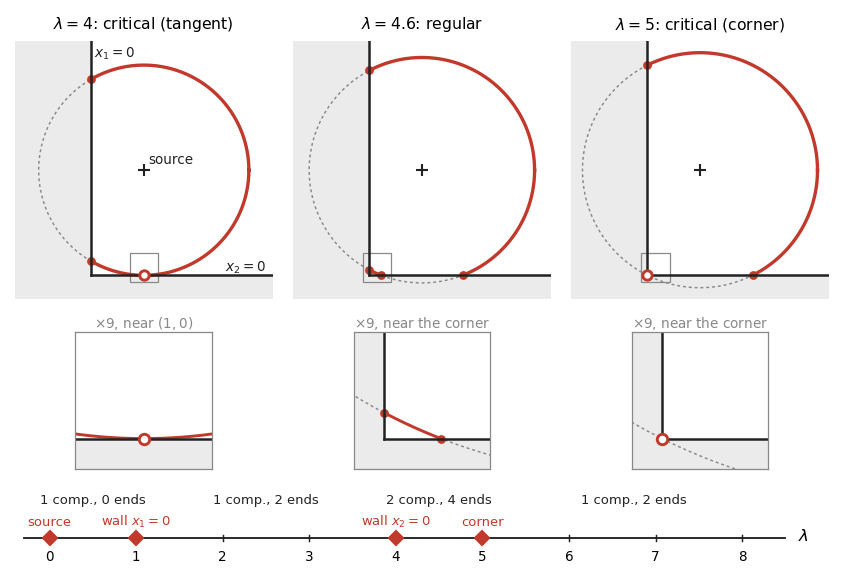

# Chapter 4. When a retract is a manifold: manifolds with boundary with corners (HWZ Part I, Chapter 4, pp. 175–204 (preprint pp. 147–168))

*Hofer–Wysocki–Zehnder, "Polyfold and Fredholm Theory", Part I, Chapter 4 (2014 preprint, arXiv
1407.3185, pp. 147–168), rewritten for a first-year graduate student who wants to know when an
M-polyfold is an ordinary manifold with corners, and why a family of such manifolds has good fibres for
almost every parameter. Every proof is complete; where the Lean formalization found a gap or a shorter
route, the text below follows the Lean. Statement numbers and pages are those of the book (Springer 2021), with the preprint's in parentheses (see `BookConcordance.md`); the slips below were not checked against the book's arXiv version (arXiv
1707.08941). The conventions of Chapters 1–3 are kept. Since $\lambda$ is the
parameter of a family, the coordinates of a partial quadrant are written $\ell_i$:
$C = \{\ell_1\ge0,\dots,\ell_n\ge0\}$ for a presentation $T:E\cong\mathbb R^n\oplus W$, $I(e) = \{i:\ell_i(e) = 0\}$, $d_C(e) = \#I(e)$,
$C_e = \{\ell_i\ge0,\ i\in I(e)\}$, $E_e = \{\ell_i = 0,\ i\in I(e)\}$; for a retract $O = r(U)$,
$T_oO = Dr(o)E$, $T^R_oO = T_oO\cap E_o$, $C_oO = T_oO\cap C_o$.*

---

## 0. Which retracts are manifolds, and which slices are good

Chapter 3 produced manifolds: near a zero in good position, the zero set of an sc-Fredholm section is a
finite-dimensional manifold with boundary with corners (Theorem 3.2.3 (preprint 3.27)). It arrives as a subset of an
M-polyfold, a space glued from images $O = r(U)$ of retractions in sc-Banach spaces. Two questions follow.

The first is a recognition problem: *when is a space presented by retractions secretly an ordinary
manifold with corners?* Smooth points and finite-dimensional tangent spaces are necessary; whether they
suffice, even without boundary, is a question the text leaves open (§6). Theorem 4.1.2 (preprint 4.2) characterizes the
manifolds: the identity $X\to X^1$ is sc-smooth — the retractions gain a level, they are sc$^+$ — and the
tangent spaces sit in good position to the corners.

The second concerns families. In applications the M-polyfold carries parameters (a path of almost complex
structures, a family of perturbations), the solution set $A$ lives in $\mathbb R^m\times X$, and one wants
the slices $A_\lambda = \{x:(\lambda,x)\in A\}$ to be manifolds with corners for almost every $\lambda$. Without
boundary this is Sard's theorem. With corners Sard's theorem must be applied stratum by stratum, and the
reason can be seen in a room. A loudspeaker clicks at the point $(1,2)$ of a floor plan whose walls are the
half-lines $x_1 = 0$ and $x_2 = 0$ (metres). After $t$ ms the direct sound front (reflections ignored) is the
part inside the room of the circle of radius $ct$ around the source, $c = 343$ m/s. With $\lambda = (ct)^2$ and
$g(x) = (x_1-1)^2+(x_2-2)^2$ it is the slice $A_\lambda$ of $A = \{(g(x),x)\}\subset\mathbb R\times[0,\infty)^2$. The
derivative of $p(\lambda,x) = \lambda$ along $A$ vanishes only over the source, so every $\lambda>0$ is a regular value in
the ordinary sense. Yet at $\lambda = 1$ ($t = 2.92$ ms) the front touches the wall $x_1 = 0$ without crossing it,
at $\lambda = 4$ ($5.83$ ms) the wall $x_2 = 0$, and at $\lambda = 5$ ($6.52$ ms) it sweeps through the corner, where a
small arc that had cut off the corner shrinks to a point and vanishes. At these instants the front touches a
wall without ending there, or meets the corner with fewer dimensions than the corner has codimensions. The
right notion of regular value asks $p$ to be a submersion on each stratum of $A$: its interior, its part in
each wall, and its part in the corner — a point, critical for every map to $\mathbb R$. Theorem 4.3.1 (preprint 4.23) is Sard's
theorem in this stratified form.

The formalization changed the text in five places: charts centred at a point are constructed (§3);
Proposition 4.1.9 (preprint 4.9) claims more than the implicit function theorem of Chapter 3 gives and is proved directly
(§4); one step of Lemma 4.2.8 (preprint 4.19) is false and is repaired (§6); Theorem 4.2.11 (4) (preprint 4.22), without proof in the text, is
proved (§7); Theorem 4.3.1 (preprint 4.23) is false with ordinary regular values and its finite cover need not exist, and
both are repaired (§8). §9 states the text's §4.4 (not formalized); §10 works out the sound front.

---

## 1. Manifolds with corners among M-polyfolds (pp. 175–177 (preprint pp. 147–148))

**Definition 4.1.1 (preprint 4.1).** An M-polyfold $X$ has a *compatible smooth manifold structure with boundary with
corners* — a *corner structure* — if it has an atlas of charts $(V,\varphi,(U,C,\mathbb R^n))$, $\varphi$ a homeomorphism
of an open $V\subset X$ onto a relatively open subset $U$ of a partial quadrant $C$ in $\mathbb R^n$ (or a
finite-dimensional vector space) with the constant sc-structure, sc-smoothly compatible with the charts of $X$.

The dimension $n$ may vary from chart to chart; local constancy (invariance of dimension) is neither said nor
needed. The constant structure is no restriction: a finite-dimensional sc-space has all levels equal (Lemma
12.A). The transition maps are sc-smooth maps between relatively open subsets of partial quadrants in
finite-dimensional spaces, which are exactly the $C^\infty$ maps with one-sided derivatives at the boundary
(Chapter 1) — the text's "classically smooth". That is what "a smooth manifold with boundary with corners"
means here; the classical notion with varying models is not formalized beyond it.

*Checked by machine:* `Polyfold.MPolyfold.HasCornerStructure`, `Polyfold.MChart.IsCornerChart`,
`Polyfold.MChart.IsCornerChart.contDiffOn_transition`, `Polyfold.MPolyfold.hasCornerStructure_iff_finiteDimensional`,
`Polyfold.MPolyfold.isManifoldWithCorners_iff` (Chapter 3's fixed-dimensional notion as a special case).

**Theorem 4.1.2 (preprint 4.2) (Characterization).** For a tame M-polyfold $X$ the following are equivalent.

1. $X$ has a corner structure.
2. $X_0 = X_\infty$, the identity $1_0^1:X\to X^1$ is sc-smooth, and every $x\in X$ lies in a tame chart
   $(V,\psi,(O,C,E))$ with $\psi(x) = 0$ whose tangent space $T_0O$ is finite-dimensional and in good position to $C$.

The proof is in §5. Tameness is not used, so the equivalence holds for every M-polyfold.

**Remark 4.1.3 (preprint 4.3).** $X^1$ has the charts $(V_1,\varphi,(O_1,C_1,E^1))$. The identity $1_1^0:X^1\to X$ is always
sc-smooth (in charts, the sc-operator $\iota:E^1\to E$); if $X_0 = X_\infty$ it is inverse to $1_0^1$, which is then an
sc-diffeomorphism when sc-smooth. The text adds, without example, that $X^1\ne X$ is possible although the sets
agree: one would be a retract $O = O_\infty$ that is not sc$^+$ (Proposition 4.1.8 (preprint 4.8)), for instance one with an
infinite-dimensional tangent space (Lemma 4.1.7 (preprint 4.7)), if such a retract exists. For $\mathbb R^n$ with the constant
structure $(\mathbb R^n)^1 = \mathbb R^n$, and every retract in $\mathbb R^n$ is an sc$^+$-retract.

*Checked by machine:* `Polyfold.MPolyfold.remark_4_3_levelVal`, `Polyfold.MPolyfold.remark_4_3_isScDiffeo`,
`Polyfold.remark_4_3_const`; "$X^1\ne X$ is possible" is not formalized.

## 2. sc$^+$-retractions and sc$^+$-retracts (pp. 176–178 (preprint pp. 148–149))

The text defines "sc$^+$" for retractions and operators but uses it for maps. A map $f:U\to F$ on a relatively
open $U$ in a partial quadrant is *sc$^+$* if $f(U)\subset F_1$ and the lift $f^1:U\to F^1$ is sc-smooth; then
$f(U_m)\subset F_{m+1}$. Three rules are used without comment: (a) sc$^+$ ∘ sc-smooth is sc$^+$, as $(f\circ g)^1 = f^1\circ g$;
(b) sc-smooth ∘ sc$^+$ is sc$^+$, as $g:V^1\to G^1$ is sc-smooth (Proposition 1.2.2 (preprint 1.17)) and $(g\circ f)^1 = g\circ f^1$; (c) at a
smooth point, $Df(x) = \iota\circ Df^1(x)$ with $Df^1(x):E\to F^1$ an sc-operator (Proposition 1.2.1 (preprint 1.16)), so $Df(x)$ is an
sc$^+$-operator, compact on every level (Definition 1.1.5 (preprint 1.4)).

**Definition 4.1.4 (preprint 4.4) (sc$^+$-retraction).** An sc-smooth retraction $r:U\to U$ is an *sc$^+$-retraction* if it is
sc$^+$. On an open $V\subset X$: an sc-smooth retraction $r:V\to V$ with $r(V)\subset X_1$ and $1_0^1\circ r:V\to X^1$ sc-smooth.

**Lemma 4.1.5 (preprint 4.5).** If an sc$^+$-retraction $t$ has image $O$, every sc-smooth retraction $s$ with image $O$ is sc$^+$.

*Proof.* $t$ fixes $O$, so $s = t\circ s$, sc$^+$ by (a). $\square$

**Definition 4.1.6 (preprint 4.6).** $(O,C,E)$ is an *sc$^+$-retract* if it is the image of an sc$^+$-retraction; by Lemma 4.1.5 (preprint 4.5) this
does not depend on the retraction.

**Lemma 4.1.7 (preprint 4.7).** For an sc$^+$-retraction $r$ onto $O$: (i) $O = O_\infty$; (ii) $T_oO = Dr(o)E$ is finite-dimensional.

*Proof.* (i) $r(x)\in U_1$, $r(x) = r(r(x))\in U_2$, and so on. (ii) $o$ is smooth, $Dr(o)^2 = Dr(o)$ (chain rule at
$o = r(o)$), and $Dr(o)$ is compact by (c). A compact projection $P$ has finite-dimensional range: $PE = \ker(1-P)$ is
closed and $P$ is the identity on it, so its unit ball is compact (Riesz). $\square$

**Proposition 4.1.8 (preprint 4.8).** $(O,C,E)$ is an sc$^+$-retract iff $O_0 = O_\infty$ and $1_0^1:O\to O^1$ is sc-smooth between the
retracts $(O,C,E)$ and $(O^1,C^1,E^1)$.

*Proof.* (⇒) $O = O_\infty$ by Lemma 4.1.7 (preprint 4.7); $1_0^1\circ r = r^1$ is sc-smooth (Definition 2.1.14 (preprint 2.7)). (⇐) For any retraction
$r$ onto $O$, $r^1$ is the composite $U\to O\xrightarrow{1_0^1}O^1\hookrightarrow E^1$ (Theorem 2.1.15 (preprint 2.8)). $\square$

Theorem 4.1.2 (preprint 4.2) needs the *chart form*, not in the text: the model of a chart $\varphi:V\to O$ is an sc$^+$-retract iff
$V\subset X_\infty$ and $1_0^1$ is sc-smooth on $V$ — in the charts $\varphi$ of $X$ and $(V_1,\varphi,(O_1,C_1,E^1))$ of $X^1$ the
representative of $1_0^1$ is the lift $O\to O^1$. So "$X_0 = X_\infty$ and $1_0^1$ sc-smooth" holds iff every chart is
modelled on an sc$^+$-retract.

*Checked by machine:* `Polyfold.IsScPlus`, `Polyfold.IsScPlus.comp_isScSmooth`, `Polyfold.IsScSmooth.comp_isScPlus`,
`Polyfold.IsScPlus.exists_scPlus_deriv`, `Polyfold.ScRetraction.IsScPlus`, `Polyfold.lemma_4_5`,
`Polyfold.IsScPlusRetract`, `Polyfold.lemma_4_7_i`, `Polyfold.lemma_4_7_ii` (with
`Polyfold.finiteDimensional_range_of_isCompactOperator_of_idem`), `Polyfold.proposition_4_8`,
`Polyfold.MPolyfold.proposition_4_8_chart`, `Polyfold.MPolyfold.isScSmoothMap_toLevelOne_iff`,
`Polyfold.MPolyfold.IsScPlusRetractionOn`.

## 3. Charts centred at a point (not in the text)

Theorems 4.1.2, 4.2.7, 4.2.11 (preprint 4.2, 4.18, 4.22) and Lemma 5.3.3 (preprint 5.11) use charts with $\psi(x) = 0$; the text never constructs them. Translating a
chart $\varphi:V\to O\subset C$ by $e := \varphi(x)$ fails twice: translation preserves every $E_m$ only if $e\in E_\infty$, so *$x$ must be
smooth*; and $C-e$ is not a partial quadrant unless $e\in C\cap(-C)$. Let
$G(e) := \{v:\ell_j(v)>0\ \text{for}\ j\notin I(e)\}$, an open neighbourhood of $e$.

**Lemma 3.A.** For $e\in C$: (1) $C_e$ is a partial quadrant; (2) $C_e-e = C_e$ and $C\cap G(e) = C_e\cap G(e)$; (3) for
$v\in C\cap G(e)$ the vanishing set of $v-e$ for $C_e$ is $I(v)$, so $d_{C_e}(v-e) = d_C(v)$ and the minimal subspace and
partial quadrant of $v-e$ for $C_e$ are $E_v$ and $C_v$.

*Proof.* (1) Reordering coordinates, $E\cong\mathbb R^{I(e)}\oplus(\mathbb R^{I(e)^c}\oplus W)$ maps $C_e$ onto
$[0,\infty)^{I(e)}\oplus(\mathbb R^{I(e)^c}\oplus W)$. (2), (3): $\ell_i(v-e) = \ell_i(v)$ for $i\in I(e)$, and on $G(e)$ the other
coordinates are positive. $\square$

*The re-centred chart.* For a retraction $r$ onto $O$ and smooth $e = \varphi(x)$, $r$ restricted to
$U\cap r^{-1}(G(e))\cap G(e)$ retracts onto $O\cap G(e)$, and $v\mapsto v-e$ is an sc-diffeomorphism of $U\cap G(e)$ onto a
relatively open subset of $C_e$ (Lemma 3.A (2)). So $\varphi_e := \varphi-e$ on $V\cap\varphi^{-1}(G(e))$, modelled on
$(O\cap G(e))-e\subset C_e$ with retraction $r_e(u) = r(u+e)-e$, is a chart of $X$ (its transition maps are those of $\varphi$
composed with translations), $\varphi_e(x) = 0$, and $r_e$ is tame if $r$ is (Lemma 3.A (3)). At the centre every
coordinate of $C_e$ vanishes: $d_{C_e}(0) = d_C(e)$, $(C_e)_0 = C_e$, and $E_0 = \{\ell_i = 0\ \forall i\}$ — the text's
"$\{0\}\oplus W$" — lies in every $E_v$. Strong bundle charts are re-centred in the base only,
$R_e(u,h) = (r(u+e)-e,\Gamma(u+e,h))$; $(e,0)$ is smooth in $E\oplus F$ and $E\oplus F^1$, so the compatibility on $[0]$ and
$[1]$ is kept. Lemma 3.A (1) also proves the claim of Definition 2.5.1 (preprint 2.33) that $C_e$ is a partial quadrant.

*Checked by machine:* `Polyfold.isPartialQuadrant_partialQuadrantAtWith`, `Polyfold.image_sub_partialQuadrantAtWith`,
`Polyfold.recentreNbhd_inter_eq`, `Polyfold.degIndex_sub_recentre`, `Polyfold.isScDiffeoQuadrant_translate`,
`Polyfold.isTameRetract_recentre`, `Polyfold.MChart.recentre`, `Polyfold.MChart.recentre_isChart`,
`Polyfold.MPolyfold.IsTame.exists_centredChart`, `Polyfold.StrongBundle.IsChart.recentre`; no hypothesis beyond
$x\in X_\infty$.

## 4. An sc$^+$-retract is a graph over its tangent space (pp. 178–184 (preprint pp. 150–156))

The text states Proposition 4.1.9 (preprint 4.9) for an sc$^+$-retraction $t:U\to U$ onto $O\ni0$, $T_0O$ in good position, "a good
complement $Y$" and "$p = Dt(0):E = T_0O\oplus Y\to T_0O$ the sc-projection": then $p$ maps a neighbourhood of $0$ in $O$
sc-diffeomorphically onto one in $T_0O\cap C$.

> **What the statement and the proof need.** (a) $Dt(0)$ is a projection onto $T_0O$ along its own kernel, which nothing
> relates to $Y$; the proof needs the projection *along $Y$* (Lemma 4.1.13 (preprint 4.12) writes $t(a+\delta(a)) = p\,t(a+\delta(a))+\delta(a)$ with
> $\delta(a)\in Y$). (b) $Y$ must be closed, or $p$ is not continuous. (c) The text's route — $f(u) = (1-p)(u-t(u))$ is
> sc-Fredholm (Lemma 4.1.11 (preprint 4.10)), so Theorem 3.5.11 (preprint Corollary 3.47) describes its zeros as a graph — does not give the conclusion: Theorem 3.5.11 (preprint Corollary 3.47)
> gives a graph over a complement of its own choosing, sc-smooth only as a *germ*, $C^k$ into $E_m$ on neighbourhoods that
> shrink with $m$ and $k$ (Chapter 3, §3.6). An sc-diffeomorphism between *fixed* open sets needs another argument; the one
> below uses only the sc$^+$ property.

**Proposition 4.1.9 (preprint 4.9).** Let $t:U\to U$ be an sc$^+$-retraction onto $O\ni0$, $N := T_0O = Dt(0)E$ in good position to $C$,
$Y$ a closed good complement of $N$, $p:E\to N$ the projection along $Y$, $q := 1-p$. There are an open $W\ni0$ in
$E_0$, a relatively open neighbourhood $V$ of $0$ in the partial quadrant $N\cap C$, and an sc-smooth $\Gamma:V\to E$ with
$$p\circ\Gamma = 1_V,\quad\Gamma(a)-a\in Y,\quad\Gamma(V) = O\cap W,\quad\Gamma\circ p = 1\ \text{on}\ O\cap W,\quad\Gamma(0) = 0 ;$$
$p$ and $\Gamma$ are mutually inverse sc-smooth maps between the retracts $(O\cap W,C,E)$ and $(V,N\cap C,N)$.
($\Gamma(a)$ is the text's $a+\delta(a)$.)

*Preliminaries.* (P1) $N\subset E_\infty$, as $n = Dt(0)n$ and $Dt(0)E_m\subset E_{m+1}$; so the norms $|\cdot|_m$ are equivalent
on $N$ (say $|n|_1\le c_N|n|_0$), and $p$, $q$ act boundedly on every $E_m$. Let $\Vert\iota\Vert$ be the norm of $E_1\to E_0$.
(P2) $qDt(0) = 0$ and $Dt(0) = 1$ on $N$. (P3) The lift $t^1$ is sc-smooth, so by Proposition 1.2.1 (preprint 1.16)
$t:U_{k+1}\to E_{k+1}$ is $C^1$ with $Dt(x)\in\mathcal L(E_{k+1})$ continuous in the operator norm. (P4) *Mean value estimate*:
for $u_0\in U_{k+1}$ and $\theta>0$ there is $r>0$ with $C_{k+1}\cap B_{k+1}(u_0,r)\subset U_{k+1}$, $\Vert Dt(z)-Dt(u_0)\Vert\le\theta$
there, and
$$|t(z')-t(z)-Dt(u_0)(z'-z)|_{k+1}\le\theta|z'-z|_{k+1}\qquad(z,z'\in C_{k+1}\cap B_{k+1}(u_0,r)),$$
by the mean value inequality on the convex set $C_{k+1}\cap B$ ($U_{k+1}$ itself need not be convex). This is the text's
(76)–(77).

*Step 1 (Lemma 4.1.12 (preprint 4.11), uniqueness).* The text's Lemma 4.1.12 (preprint 4.11) — if $\mathbf f(a+y) = 0$ with $|a|_0,|y|_0$ small, then
$y = \delta(a)$ — presupposes the $\delta$ of Theorem 3.5.11 (preprint Corollary 3.47). What is needed: points of $O$, small on level $1$, with the
same projection coincide. Take $\theta$ with $\Vert q\Vert_1\theta\le\frac12$ and $r$ from (P4) at $u_0 = 0$, $k = 0$. For
$u,u'\in O$ with $|u|_1,|u'|_1<r$, since $u = t(u)$, $u' = t(u')$ and $qDt(0) = 0$,
$$|q(u'-u)|_1 = |q(t(u')-t(u)-Dt(0)(u'-u))|_1\le\tfrac12|u'-u|_1 .$$
If $p(u) = p(u')$ then $u'-u = q(u'-u)$, so $u = u'$.

*Step 2 (Lemma 4.1.13 (preprint 4.12), existence).* The text's Lemma 4.1.13 (preprint 4.12): $a+\delta(a)\in O$ for small $a$. Here the point is
constructed. Let $\varepsilon$ be the constant of $Y$ and $\varepsilon' := \varepsilon/(\Vert\iota\Vert c_N+1)$, so that
$|y|_1\le\varepsilon'|a|_1$ gives $|y|_0\le\varepsilon|a|_0$. Require $\theta<1$ and $\Vert q\Vert_1\theta(1+\varepsilon')\le\varepsilon'$, and take $\rho>0$ with
$\rho(1+\varepsilon')<r$ and $|t(u)|_1<r$ for $u\in U_1$, $|u|_1<\rho(1+\varepsilon')$. For $a\in N\cap C$, $|a|_1<\rho$, the map
$\Phi_a(y) := q\,t(a+y)$ is defined on the complete set $B_a := \{y\in Y\cap E_1:|y|_1\le\varepsilon'|a|_1\}$ ($a+y\in C$ by the good
complement property, so $a+y\in C_1\cap B_1(0,r)\subset U_1$), maps it into itself
($|\Phi_a(y)|_1 = |q(t(a+y)-t(0)-Dt(0)(a+y))|_1\le\Vert q\Vert_1\theta(1+\varepsilon')|a|_1$), and is a $\frac12$-contraction. Let $y$ be its
fixed point, $u := a+y$, $w := t(u)$. Then $q(w-u) = 0$, so $w-u\in N$, and $t(w) = t(u)$; by (P4) and $Dt(0)(w-u) = w-u$,
$|w-u|_1 = |t(w)-t(u)-Dt(0)(w-u)|_1\le\theta|w-u|_1$. So $u = t(u)\in O$, $p(u) = a$, $u-a\in Y$.

*Step 3 ($p$ maps $O$ into $C$ near $0$; not in the text).* For $u\in O$, $|u|_1<r$, Step 1 with $(0,u)$ gives
$|qu|_1\le\kappa|u|_1$, $\kappa := \Vert q\Vert_1\theta$; so $|u|_1\le2|pu|_1$ and $|qu|_0\le2\Vert\iota\Vert\kappa c_N|pu|_0\le\varepsilon|pu|_0$ for $\theta$ small,
and the good complement property gives $p(u)\in C\iff u\in C$.

*Step 4 (the neighbourhoods).* Fix $\theta$ (Steps 1–3 and 5 (b)), then $r$, then $\rho$. As $u = t(u)$ on $O$ and $t:U\to E_1$ is
continuous at $0$ on level $0$, there is $\delta_0$ with $|u|_1<r$ for $u\in O$, $|u|_0<\delta_0$. Let $V' := \{a\in N:|a|_1<\rho'\}$,
$\rho'\le\rho$ with $\Vert\iota\Vert(1+\varepsilon')\rho'<\delta_0$, $W := \{v:|v|_0<\delta_0,\ p(v)\in V'\}$, $V := V'\cap C$, $\Gamma(a) :=$ the $u$ of
Step 2. Then $\Gamma(V)\subset O\cap W$, and for $u\in O\cap W$, $p(u)\in V$ (Step 3) and $\Gamma(p(u)) = u$ (Step 1).

*Step 5 (regularity on the fixed $V$).* (a) By Step 1, $|\Gamma(a')-\Gamma(a)|_1\le2|a'-a|_1$; and if $\Gamma$ is continuous into $E_m$,
so is $\Gamma = t\circ\Gamma$ into $E_{m+1}$, $t:U_m\to E_{m+1}$ being continuous.

(b) *The frame formula.* Fix $a\in V$, $u_0 := \Gamma(a)$. As $\Vert Dt(u_0)-Dt(0)\Vert_{\mathcal L(E_1)}\le\theta$,
$A(u_0) := p\circ Dt(u_0)|_N$ satisfies $|A(u_0)n-n|\le\frac12|n|$ for $\theta$ small and is invertible; put
$B := Dt(u_0)|_N A(u_0)^{-1}$, so $pB = 1$ and $B(N)\subset E_\infty$. Also $T_{u_0}O\cap Y = 0$: if $v = Dt(u_0)v\in Y$, then
$v = q(Dt(u_0)-Dt(0))v$ in $E_1$, so $|v|_1\le\frac12|v|_1$. Hence $(1-Bp)Dt(u_0) = 0$ ($Dt(u_0)h-BpDt(u_0)h$ lies in $T_{u_0}O$ and
in $Y$), and $T_{u_0}O = B(N)$. On level $k+1$, with (P4) at $u_0$ and constant $\theta'$, for $u' := \Gamma(a')$,
$$\Gamma(a')-\Gamma(a)-B(a'-a) = (1-Bp)(u'-u_0) = (1-Bp)\big(t(u')-t(u_0)-Dt(u_0)(u'-u_0)\big).$$
For $\theta'\Vert1-Bp\Vert\le\frac12$ this gives $|u'-u_0|_{k+1}\le2\Vert B\Vert|a'-a|$, and letting $\theta'\to0$,
$$D\Gamma(a) = Dt(\Gamma(a))|_N\circ\big(p\circ Dt(\Gamma(a))|_N\big)^{-1}\quad\text{into every}\ E_{k+1}.$$
The estimate is used at $u_0 = \Gamma(a)$ with $1-Bp$, not at $0$ with $1-p$; this is why the regularity holds on the fixed $V$.

(c) *The bootstrap.* If $\Gamma$ is $C^k$ into every $E_m$: $(x,h)\mapsto Dt(x)h$ is the fibre part of $Tt^1$, hence $C^k$ from
$U_{m+k}\times E_{m+k}$ to $E_m$ (Proposition 1.2.3 (preprint 1.18)); composed with $a\mapsto(\Gamma(a),n_j)$, $(n_j)$ a basis of $N$, it makes
$a\mapsto Dt(\Gamma(a))|_N$ and $a\mapsto A(\Gamma(a))^{-1}$ of class $C^k$, and the frame formula makes $\Gamma$ $C^{k+1}$ into every $E_m$.
Derivatives of $t$ meet only the smooth vectors of $N$, so the level loss of $Tt$ does not accumulate. Thus $\Gamma$ is $C^\infty$
into every $E_m$, and sc-smooth by Proposition 1.2.4 (preprint 1.19) ($V_m = V$ for the constant structure on $N$).

(d) The retraction onto $O\cap W$ is $t$ on $U\cap t^{-1}(W)\cap W$, and $p\circ t$ is sc-smooth; $V$ carries the identity. So $p$,
$\Gamma$ are sc-smooth between the retracts, and $(V,N\cap C,N)$ is a local model by Proposition 3.1.25 (preprint 3.22). $\square$

Inverting $p\circ t$ on $N\cap C$ instead does not work: in $\mathbb R^3$, $C = [0,\infty)^2\times\mathbb R$,
$\Gamma(a) = (a_1,a_2,a_2^2)$, $t(x) = \Gamma(x_1+(x_3-x_2^2)^2,x_2)$ is a retraction with $N = \mathbb R^2\times0$, and
$p\,t(x_1,x_2,0) = (x_1+x_2^4,x_2)$ misses the points $(0,y_2)$, $y_2>0$.

*Checked by machine:* `Polyfold.proposition_4_9` (hypotheses "$Y$ closed", "$p$ the projection along $Y$");
`Polyfold.ScRetraction.IsScPlus.exists_mvt` (P4), `Polyfold.GraphData.exists_contraction_radius`,
`Polyfold.GraphData.eq_of_p_eq` (Step 1), `Polyfold.GraphData.exists_graph_point` (Step 2),
`Polyfold.GraphData.p_mem_C` (Step 3), `Polyfold.GraphData.exists_nbhd` (Step 4),
`Polyfold.GraphData.eq_zero_of_mem_Y_of_scDeriv_eq`, `Polyfold.hasFDerivWithinAt_of_projection`,
`Polyfold.GraphData.Nbhd.hasFDerivWithinAt_Γ_lvl`, `Polyfold.GraphData.contDiffOn_lvlDeriv_apply`,
`Polyfold.GraphData.Nbhd.isScSmooth_Γ` (Step 5).

**Lemma 4.1.11 (preprint 4.10).** In the setting of Proposition 4.1.9 (preprint 4.9), the section $u\mapsto(u,\mathbf f(u))$, $\mathbf f(u) = q(u-t(u))$, of the
trivial strong bundle $U\triangleleft Y$ is sc-Fredholm.

*Proof* (the text's, corrected). $Y$ is an sc-subspace: closed, $Y_m = qE_m$, and $q(E_\infty)$ dense in $Y_m$.
*Regularizing:* if $u = a+y\in U_m$ ($a\in N$, $y\in Y$) and $\mathbf f(u) = y-q\,t(u)\in E_{m+1}$, then $y\in E_{m+1}$ because
$t(u)\in E_{m+1}$, and $u\in U_{m+1}$. *Linearization:* $D\mathbf f(u) = q(1-Dt(u))$ — the text's
"$h-(p(h)-(1-p)Dt(u)h)$" has a sign slip, and the sc$^+$-operator is $Dt(u)$, not $D\mathbf f(u)$. It is sc-Fredholm as the
composite of $1-Dt(u)$ (index $0$, Proposition 1.1.11 (preprint 1.10)) with the sc-surjection $q:E\to Y$ of finite-dimensional kernel $N$ —
not as "a perturbation of the identity", since it maps into $Y$. *Splitting:* present $C = [0,\infty)^n\oplus F$, put
$W := Y\cap F$ (codimension $\le n$ in $Y$) and choose a complement $B$ of $W$ in $Y$ *inside $Y_\infty$* (possible as $Y_\infty$ is
dense and $Y/W$ finite-dimensional; an arbitrary algebraic complement does not give an sc-splitting). Adding vectors of
$F$ does not change membership in $C$, so $C = ((N\oplus B)\cap C)\oplus W$; and $(N\oplus B)\cap C$ has interior points in
$N\oplus B$ — the half of Definition 3.1.24 (preprint 3.21) the text omits — since the projection along $W$ is open and maps $C$ onto it.
*The germ at a smooth $u$:* re-centre at $u$ (§3), put $g(v) := \mathbf f(u+v)$ and the sc$^+$-section
$s(v) := \mathbf f(u)+q[t(u)-t(u+v)]$. Then $(g-s)(v) = qv$, i.e. $(g-s)(a+b+w) = b+w$: through the strong bundle isomorphism
$(u+v,b+w)\mapsto(v,b+w)$ and $Y\cong\mathbb R^{\dim B}\oplus W$, a basic germ over the finite-dimensional partial quadrant
$C_u\cap(N\oplus B)$ with contraction part $0$. $\square$

*Not checked by machine:* Lemma 4.1.11 (preprint 4.10) is not formalized, and Proposition 4.1.9 (preprint 4.9), its only use, does not need it. It would
need $U\triangleleft Y$ as a strong bundle, $Y$, $W$ as sc-subspaces, and the re-centred strong bundle chart, filler and
conjugation above.

## 5. Proof of Theorem 4.1.2 (preprint 4.2) (pp. 183–186 (preprint pp. 156–157))

*(i) ⇒ (ii).* In a corner chart $\varphi:V\to U\subset C\subset\mathbb R^n$ the identity of $U$ is a tame retraction, $U = U_\infty$, and
$U$ is an sc$^+$-retract (Remark 4.1.3 (preprint 4.3)); by the chart form of Proposition 4.1.8 (preprint 4.8), $X_0 = X_\infty$ and $1_0^1$ is sc-smooth. The
centred chart, which the text does not produce, is the corner chart re-centred at $x$ (§3): a relatively open subset of
$C_{\varphi(x)}\subset\mathbb R^n$ with the identity retraction, tame, with $T_0 = \mathbb R^n$ in good position (complement $0$; the
interior of a partial quadrant is nonempty). (i) also makes $X$ tame.

*(ii) ⇒ (i).* For $x\in X$ and the chart $\psi:V\to O$ of (ii), $O$ is an sc$^+$-retract by the chart form of Proposition 4.1.8 (preprint 4.8),
with sc$^+$-retraction $t$. The normal form of Proposition 3.1.25 (preprint 3.22) gives a continuous projection onto $N := T_0O$ whose kernel
$Y$ is a good complement (Chapter 3, §7.1). Proposition 4.1.9 (preprint 4.9) gives $W$, $V_0$, $\Gamma$, and
$$\psi_x := p\circ\psi\ \text{on}\ \psi^{-1}(W),\qquad\text{modelled on}\ (V_0,N\cap C,N),$$
is a corner chart with inverse $\psi^{-1}\circ\Gamma$. It is compatible with every chart $\varphi'$ of $X$: the transition maps
$(\varphi'\circ\psi^{-1})\circ\Gamma$ and $p\circ(\psi\circ\varphi'^{-1})$ are sc-smooth by Theorem 2.1.15 (preprint 2.8), because $p$ and $\Gamma$ are sc-smooth *between
retracts*. Charts compatible with the atlas of $X$ are compatible with each other (test through a chart of $X$ at each point
of the overlap), so the $\psi_x$ form an atlas equivalent to that of $X$. $\square$

The text's "we obtain a smoothly compatible atlas" skips this argument. Neither the tameness of $X$ nor that of $\psi$ was used.

*Checked by machine:* `Polyfold.MPolyfold.theorem_4_2`, `Polyfold.MPolyfold.theorem_4_2_general`,
`Polyfold.MChart.IsCornerChart.exists_centred_tame`, `Polyfold.MPolyfold.HasCornerStructure.isTame`,
`Polyfold.exists_proj_goodComplement`, `Polyfold.CornerChartData.chart_isCornerChart`,
`Polyfold.CornerChartData.chart_isChart`, `Polyfold.MChart.compRetract_isChart`,
`Polyfold.MPolyfold.hasCornerStructure_of_centred`.

## 6. Smooth finite-dimensional submanifolds (pp. 184–190 (preprint pp. 157–161))

**Definition 4.2.1 (preprint 4.13).** $A\subset X$ is a *smooth finite-dimensional submanifold* if every $a\in A$ has an open $V\ni a$ and an
sc$^+$-retraction $s:V\to V$ with $s(V) = A\cap V$.

$A$ is then a sub-M-polyfold with the induced structure (Proposition 2.3.19 (preprint 2.21)). The text never reads the sc$^+$ condition in
charts; all of §6–§8 rests on it.

**Lemma 6.A (chart retraction).** Let $(V,s)$ be as in Definition 4.2.1 (preprint 4.13), $\varphi:V_\varphi\to O$ a chart with retraction $r$ onto $O$,
$W := V\cap V_\varphi\cap s^{-1}(V\cap V_\varphi)$ and $\varphi(W) = O\cap G$, $G$ open. Then $t := \varphi\circ s\circ\varphi^{-1}\circ r$ on $U\cap r^{-1}(G)$ is an
sc$^+$-retraction onto $\varphi(W\cap A)$.

*Proof.* $s(W)\subset W$ and $s(W) = W\cap A$. $t$ maps into $\varphi(W)$, which $r$ fixes, so
$t\circ t = \varphi ss\varphi^{-1}r = t$, with image $\varphi(W\cap A)$; $t$ is sc-smooth (Definition 2.1.14 (preprint 2.7)). Read in the chart $\varphi$ of $X$ and
$(V_1,\varphi,(O_1,C_1,E^1))$ of $X^1$, the sc-smoothness of $1_0^1\circ s$ says that $t^1$ is sc-smooth. $\square$

**Remark 4.2.2 (preprint 4.14).** The text: $T_aA = Ts(a)T_aX$ is the image of the sc$^+$-operator $Ts(a)$, so finite-dimensional; near
$\{d_X = 0\}$, and where $T_aA$ is in good position, $A$ is a classical manifold. As $T_aX$ carries no linear structure in the
formalization (gap G.7), this is read in a chart: the tangent space of $\varphi(W\cap A)$ at $z$ is $Dt(z)E$ — the sc$^+$-operator
is $Dt(z)$ — finite-dimensional by Lemma 4.1.7 (preprint 4.7). The rest refers forward to Theorem 4.2.7 (preprint 4.18); where $d_X = 0$, good position is
automatic ($C_0 = E$ in the re-centred chart), and if $d_X = 0$ on all of $A$, $A$ has a corner structure even for
non-tame $X$. The local form, on the open piece $A\cap\{d_X = 0\}$, is not formalized.

**Proposition 4.2.3 (preprint 4.15).** (1) $A\subset X_\infty$ and $A = A_\infty$ for the induced structure. (2) $A$ is locally closed: each $a$ has an open
$V$ with $V\cap\overline A\subset A$. (3) $\partial A = \{d_A\ge1\}\subset\partial X$. (4) $1_0^1:A\to A^1$ is sc-smooth.

*Proof.* (1) Lemma 4.1.7 (i) (preprint 4.7) for the retractions of Lemma 6.A; the levels of $A$ are traces of those of $X$. (2) For $b\in V\cap\overline A$,
every neighbourhood of $b$ meets $A\cap V$, where $s$ is the identity; by continuity, $X$ being Hausdorff, $s(b) = b$, so $b\in s(V)\subset A$. (3)
$d_A\le d_X$ (Lemma 2.4.6 (preprint 2.26)). (4) The models of the induced charts are sc$^+$-retracts (Lemma 6.A); apply the chart form of
Proposition 4.1.8 (preprint 4.8). $\square$

The text's definition of "locally closed" is garbled (it uses $U$ twice); its proof of (2) uses sequences, needing
metrizability; for (4) it says only that the retraction "is the identity on the retract $A$".

*Checked by machine:* `Polyfold.MPolyfold.IsSmoothSubmanifold`, `Polyfold.MPolyfold.SubmanifoldData.exists_chartRetraction`,
`Polyfold.MPolyfold.SubmanifoldData.remark_4_14`, `Polyfold.MPolyfold.hasCornerStructure_of_degIndex_eq_zero`,
`Polyfold.MPolyfold.IsSmoothSubmanifold.proposition_4_15_1`, `Polyfold.MPolyfold.IsSmoothSubmanifold.proposition_4_15_2`
(Mathlib's `IsLocallyClosed`), `Polyfold.MPolyfold.IsSmoothSubmanifold.proposition_4_15_3`,
`Polyfold.MPolyfold.IsSmoothSubmanifold.proposition_4_15_4`.

**Open question (preprint p. 159).** Is a sub-M-polyfold with $A = A_\infty$ and $\dim T_aA$ finite and locally constant a smooth
finite-dimensional submanifold? HWZ expect not, and ask whether the "T" $\{(x,0):|x|<1\}\cup\{(0,y):0\le y<1\}$ is
homeomorphic to a retract $O = O_\infty$. For sc$^+$-retracts it is not: an sc$^+$-retract with $C = E$ is a manifold
(Remark 4.2.2 (preprint 4.14)), and the "T" is not. *Not formalized.*

**Definition 4.2.5 (preprint 4.16).** For tame $X$, $A$ is *in good position at $a$* if $T_aA$ is in good position to the partial quadrant
$C_aX$ in $T_aX$.

**Definition 4.2.6 (preprint 4.17).** $A$ is *tame* if its induced structure is tame.

**Definition 4.2.10 (preprint 4.21)** (placed by the text after Remark 4.2.9 (preprint 4.20)). $A$ is *in general position at $a$* if $T_aA$ has in $T_aX$ an
sc-complement contained in $T^R_aX$.

In a chart around $a$ with the data of Lemma 6.A, at $z = \varphi(a)$ and with $T_z := Dt(z)E$: good position means $T_z$ in good
position to $C_z$ inside $T_zO$; general position means an sc-subspace $B\subset T^R_zO$ with $(T_zO)_m = (T_z)_m\oplus B_m$ for all
$m$. The text takes for granted that this does not depend on the chart.

**Lemma 6.B (chart independence).** Both conditions hold in one chart iff in every chart.

*Proof.* The transition $\tau$ is a germ of sc-diffeomorphisms carrying $\varphi(H\cap A)$ onto $\varphi'(H\cap A)$. At the smooth $z$,
$D(\tau\circ r)(z):T_zO\to T_{z'}O'$ is an sc-isomorphism mapping $C_zO$ and $T^R_zO$ onto $C_{z'}O'$ and $T^R_{z'}O'$ (Proposition
2.4.10 (preprint 2.30)) and $T_z$ onto $T_{z'}$ (derivatives of maps between retracts map tangent spaces of sub-retracts into each other; use
symmetry). Good position is transported by Lemma 3.5.9 (preprint 3.45), the complement level by level. $\square$

*Checked by machine:* `Polyfold.MPolyfold.IsGoodPositionAt`, `Polyfold.MPolyfold.isGoodPositionAt_iff_forall`,
`Polyfold.MPolyfold.IsGeneralPositionAt`, `Polyfold.MPolyfold.isGeneralPositionAt_iff_forall`,
`Polyfold.IsGoodPositionRetractAt.transport`, `Polyfold.IsGeneralPositionRetractAt.transport`,
`Polyfold.MPolyfold.IsTameSubmanifold`.

**Theorem 4.2.7 (preprint 4.18).** If $X$ is tame and $A$ is in good position at every point, the induced structure on $A$ has a corner
structure, and $A$ is tame.

**Lemma 4.2.8 (preprint 4.19).** Let $\psi$ be a tame chart centred at $a$, with tame retraction $r$, $\pi := Dr(0)$, $T_0O = \pi E$,
$Z := (1-\pi)E$. If $N\subset T_0O$ is in good position to $C\cap T_0O$ inside $T_0O$ with good complement $Y$, then $N$ is in good
position to $C$ with good complement $Y\oplus Z$.

*Proof.* $Z\subset E_0 = \{\ell = 0\}$ (Proposition 2.5.3 (preprint 2.35), centred chart), so adding $z\in Z$ changes no coordinate. Let
$\varepsilon' := \varepsilon/(\Vert\pi\Vert+1)$. If $|y+z|_0\le\varepsilon'|n|_0$, then $|y|_0 = |\pi(y+z)|_0\le\varepsilon|n|_0$ and
$n\in C\iff n+y\in C\iff n+y+z\in C$. And $E = T_0O\oplus Z = N\oplus Y\oplus Z$. $\square$

> **The text's proof makes a false step.** It concludes $n+y\in C$ from $n+y+z\in C$ "since $z\in Z\subset C$", which needs
> $-z\in C$: in $C = [0,\infty)$, $z = 1$ and $n+y = -\frac12$ give $n+y+z\in C$, $n+y\notin C$. What holds is $Z\subset E_0\subset C\cap(-C)$,
> by Proposition 2.5.3 (preprint 2.35) at the corner of the centred chart. The text's norm $|y|_0+|z|_0$ on $Y\oplus Z$ is not that of $E$;
> $\varepsilon'$ compares them.

*Proof of Theorem 4.2.7 (preprint 4.18).* Apply §5's (ii) ⇒ (i) to the M-polyfold $A$. For $a\in A$ take a tame chart $\psi$ centred at $a$ (§3).
The induced chart of $A$ is modelled on the sc$^+$-retract $\psi(W\cap A)$ (Lemma 6.A), with $N := Dt(0)E$
finite-dimensional; good position at $a$, read in $\psi$ (Lemma 6.B), and Lemma 4.2.8 (preprint 4.19) put $N$ in good position to $C$ in $E$.
§5 gives corner charts $p\circ\psi$, $p$ the projection along a closed good complement, forming a tame corner structure. $\square$

The text cites "Proposition 4.2", takes $p = Dt(0)$ with the complement $Y\oplus Z$, assumes "$V = \varphi^{-1}(O)$" where the $W$ of
Lemma 6.A is needed, and writes $\varphi^{-1}(V_0)\cap A$ for $(p\circ\varphi)^{-1}(V_0)\cap A$.

*Checked by machine:* `Polyfold.lemma_4_19`, `Polyfold.isGoodComplement_sup_range`, `Polyfold.MPolyfold.theorem_4_18`,
`Polyfold.MPolyfold.IsGoodPositionAt.isInGoodPosition_of_tame`; no hypothesis added.

**Remark 4.2.9 (preprint 4.20).** For tame $X$, good position at $a$ holds on a neighbourhood of $a$ in $A$.

*Proof.* In the chart of Theorem 4.2.7 (preprint 4.18) take $Y = \ker\pi$ from the normal form. Proposition 4.1.9 (preprint 4.9) gives $\Gamma = 1+\sigma$,
$\sigma := (1-\pi)\Gamma:V\to Y$, $C^1$ into $E_1$, $\sigma(0) = 0$, $D\sigma(0) = 0$ (the frame formula at $0$ is $1$, as $Dt(0) = 1$ on $N$). By
Step 5 (b) of §4, $T_{\Gamma(v)} = N_v := \{n+D\sigma(v)n\}$. Lemma 3.6.9 (preprint 3.55) ($Y$ closed) puts $N_v$ in good position to $C_{\Gamma(v)}$ with
complement $Y$ for small $v$ — with interior points, as $n\mapsto n+D\sigma(v)n$ maps interior points of $N\cap C$ into
$C\subset C_{\Gamma(v)}$ once $\Vert D\sigma(v)\Vert\le\varepsilon$ — and the modular law gives good position inside $T_{\Gamma(v)}O$, with
complement $Y\cap T_{\Gamma(v)}O$. $\square$

The text omits "tame" and justifies the remark by "the tangent spaces of $A$ move only slowly", which is $D\sigma(0) = 0$.

*Checked by machine:* `Polyfold.MPolyfold.remark_4_20`, `Polyfold.tangentSpace_eq_range_graph`, `Polyfold.lemma_3_55_relOpen`.

## 7. The local structure in general position: Theorem 4.2.11 (preprint 4.22) (pp. 190–193 (preprint pp. 162–164))

**Theorem 4.2.11 (preprint 4.22).** Let $X$ be tame, $A$ a smooth finite-dimensional submanifold, in general position at $x\in A$. There are a
tame chart $\psi$ centred at $x$, $C = \{\ell_1,\dots,\ell_n\ge0\}$, and an open $U\ni x$ with:

1. $d_X(x) = n$, all $\ell_i$ vanish at $0$, and $x$ lies in exactly $d_X(x)$ faces of the chart model;
2. $d_X(a) = d_A(a)$ for $a\in A\cap U$;
3. $A$ is in general position at every $a\in A\cap U$;
4. for $\sigma\subset\{1,\dots,n\}$, $F_\sigma := \psi^{-1}(G\cap\bigcap_{i\in\sigma}F_i)\subset U$ ($F_i$ the faces of $O$ through $0$, $G\ni0$ open)
   is a tame sub-M-polyfold with $d_{F_\sigma}+\#\sigma = d_X$, and $A\cap F_\sigma$ is a tame smooth finite-dimensional submanifold
   of $F_\sigma$, in general position in $F_\sigma$ at each of its points.

*Proof.* Take $\psi$ re-centred at $x$ (§3) with tame retraction $r$, $t$ from Lemma 6.A, $N := Dt(0)E$. At the centre
$E_0 = \{\ell = 0\}\subset E_y$ for all $y$, and adding vectors of $E_0$ changes no $\ell_i$. (1) is the choice of chart and
Corollary 2.5.13 (preprint 2.41); it does not involve $A$.

*$N+E_0 = E$.* General position gives $T_0O = N+\tilde A$, $\tilde A\subset T^R_0O\subset E_0$; tameness gives $E = T_0O+(1-\pi)E$ with
$(1-\pi)E\subset E_0$. So $\ell|_N:N\to\mathbb R^n$ is onto.

*A closed good complement in $E_0$.* Let $Y\subset E_0$ be a closed complement of $N\cap E_0$ in $E_0$. Then $E = N\oplus Y$, $Y$ is
good for every $\varepsilon$, and $N\cap C = \{\ell|_N\ge0\}$ has interior points. Proposition 4.1.9 (preprint 4.9) gives $\Gamma:V\to\psi(A)$ with
$\ell\circ\Gamma = \ell$, as $\Gamma(v)-v\in Y\subset E_0$. (The text builds $Y$ from $\tilde A\oplus Z$ and a splitting of $T_0A$; only $N+E_0 = E$
is needed, and $Y$ must be closed.)

*(2).* The corner chart $p\circ\psi$ of $A$ (§5, with this $Y$) is modelled on $(V,N\cap C,N)$ with the tame identity retraction, so
it realizes $d_A$: $d_A(a) = d_{N\cap C}(v)$, $v = p\psi(a)$. Presenting $N\cap C$ by $v\mapsto(\ell(v),v-s\ell(v))$, $s$ a linear section of
$\ell|_N$, gives $d_{N\cap C}(v) = \#\{i:\ell_i(v) = 0\} = d_C(\psi(a)) = d_X(a)$, the chart being tame.

*(3).* At $y = \Gamma(v)$, $T_yA = D\Gamma(v)N$ and $D\Gamma(v)h-h\in\ker p = Y\subset E_0$, so $T_yA+E_0 = E$ and, by the modular law,
$T_yO = T_yA+(T_yO\cap E_0)\subset T_yA+T^R_yO$. Lemma 7.A, with $T^R_yO$ an sc-subspace (Proposition 2.5.6 (preprint 2.36)), gives the
sc-complement. The text's "by means of the particular form of the map $\alpha$" is $D\Gamma(v)h-h\in Y$.

*(4)* has no proof in the text ("the previous arguments, but now applied to $A\cap F_\sigma$"). Let $f_\sigma := \{\ell_i = 0,\ i\in\sigma\}$.
(a) $F_\sigma$ is a tame sub-M-polyfold with $d_{F_\sigma}+\#\sigma = d_X$ by the second sentence of Proposition 2.5.16 (preprint 2.44) (proved in
Chapter 2's formalization), in the centred chart restricted to $G$, with face chart $\pi_\sigma\circ\psi$ onto a tame retract in
$f_\sigma\cap C$, whose minimal subspace at $0$ is again $E_0$. (b) Let $\kappa_\sigma(v) := v-s(m_\sigma\ell(v))$, $m_\sigma$ keeping the coordinates in
$\sigma$: a projection of $N$ with $\ell_i\kappa_\sigma = 0$ ($i\in\sigma$), $\ell_j\kappa_\sigma = \ell_j$ ($j\notin\sigma$). Then
$$t_\sigma := \Gamma\circ\kappa_\sigma\circ p\circ t,$$
on a neighbourhood of $0$ on which $\kappa_\sigma pt$ lands in $V$ ($\kappa_\sigma$ maps $N\cap C$ into $N\cap C\cap f_\sigma$), is sc$^+$ (rule (b) of §2), a retraction ($t\Gamma = \Gamma$, $p\Gamma = 1$, $\kappa_\sigma^2 = \kappa_\sigma$), with image $\Gamma(V\cap f_\sigma) = \psi(A)\cap f_\sigma$ near
$0$, since $\ell\circ\Gamma = \ell$. Transported to the face model it stays sc$^+$, and an sc$^+$-retraction in a chart is one on an open
subset of the M-polyfold; so $A\cap F_\sigma$ is a smooth finite-dimensional submanifold of $F_\sigma$. (c) $T_y(A\cap F_\sigma)\supset T_yA\cap f_\sigma$:
for such $h$, $k := ph$ has $\ell(k) = \ell(h)$, so $\kappa_\sigma k = k$ and $Dt_\sigma(y)h = D\Gamma(w)\kappa_\sigma pDt(y)h = D\Gamma(w)k = h$, $w := p(y)$. As $E_0\subset f_\sigma$, the modular law
turns $T_yA+E_0 = E$ into $(T_yA\cap f_\sigma)+E_0 = f_\sigma$, and the argument of (3) in the face model gives general position. (d)
Tameness of $A\cap F_\sigma$ is Theorem 4.2.7 (preprint 4.18) in $F_\sigma$, with good position from Lemma 7.B — a step the text never states. $\square$

**Lemma 7.A.** For $N\subset E_\infty$ finite-dimensional and an sc-subspace $R$, $N$ has in $N+R$ an sc-complement contained in $R$.
(Proof in §12.2.)

**Lemma 7.B (general position implies good position).** In a tame retract, if $T_zO = T_zQ+B$ with $B\subset T^R_zO$, then $T_zQ$ is in
good position to $C_z$ inside $T_zO$.

*Proof.* $B\subset E_z$ changes no $\ell_i$, $i\in I(z)$, so it is a good complement for every $\varepsilon$. $\ell_{I(z)}$ has kernel $T^R_zO$ in
$T_zO$, of codimension $\#I(z)$ (Proposition 2.5.6 (preprint 2.36)), so it maps $T_zO$, hence $T_zQ$ (it kills $B$), onto $\mathbb R^{I(z)}$, and
$T_zQ\cap C_z$ has interior points. $\square$

The proof of Theorem 4.3.1 (preprint 4.23) also uses $\dim(A\cap F_\sigma) = \dim A-\#\sigma$, which Theorem 4.2.11 (preprint 4.22) does not state: $T_0(A\cap F_\sigma) = N\cap f_\sigma$
has codimension $\#\sigma$, $\ell|_N$ being onto.

*Checked by machine:* `Polyfold.MPolyfold.theorem_4_22` ((1)–(4), no hypothesis added), `Polyfold.theorem_4_22_chart`,
`Polyfold.sup_minimalSubspaceWith_eq_top`, `Polyfold.exists_goodComplement_le_zero`, `Polyfold.degIndex_slice`,
`Polyfold.sup_minimalSubspaceWith_eq_top_graph`, `Polyfold.MPolyfold.theorem_4_22_four_of_chart`,
`Polyfold.exists_scPlus_retraction_corner`, `Polyfold.MPolyfold.isScPlusRetractionOn_of_chart`,
`Polyfold.exists_scComplement_le` (7.A), `Polyfold.IsGeneralPositionRetractAt.isGoodPositionRetractAt` (7.B),
`Polyfold.finrank_stratSub`. Not formalized: the identification of local faces of the chart with germs of global faces.

## 8. Families and Sard's theorem (pp. 191–194 (preprint pp. 164–166))

For tame $X$, $Z := \mathbb R^m\times X$ is tame with the product charts; $P(\lambda,x) = \lambda$, $p := P|_A$,
$A_\lambda := \{x:(\lambda,x)\in A\}$. In a product chart $\chi = (\mu\mapsto\mu-\lambda_0)\times\varphi$ around $z\in A$ the minimal subspace is
$E_z = \mathbb R^m\times(E_X)_{\varphi(z_2)}$, and $T_zA\cap E_z$ is the tangent space of the stratum of $A$ through $z$. $z$ is a *stratified
regular point* if the projection to $\mathbb R^m$ maps $T_zA\cap E_z$ onto $\mathbb R^m$; $\lambda$ is a *stratified regular value* if every
$z\in A$ over $\lambda$ is one. This is the text's "regular value of every $p_\sigma$".

**Theorem 4.3.1 (preprint 4.23).** Let $X$ be tame and $A\subset Z$ a smooth finite-dimensional submanifold with tame induced structure and compact
closure, and $\varepsilon>0$ with (1) $p^{-1}(\lambda)$ compact and non-empty for $|\lambda|\le\varepsilon$, (2) $A$ in general position at every point.
Then there is $\Sigma\subset\{|\lambda|<\varepsilon\}$ of full measure, consisting of stratified regular values, such that for $\lambda\in\Sigma$, $A_\lambda$ is
compact, a smooth finite-dimensional submanifold of $X$ in general position at each point, and a tame manifold with boundary
with corners (Definition 4.1.1 (preprint 4.1)).

The text says "regular values of $p$", and misprints (2) as "a sc-complement $T_zA$ in $T_zZ$ ... contained in $T^R_zZ$".

> **Ordinary regular values do not suffice.** In $\mathbb R\times[0,\infty)$ let $A = \{(x,x):0\le x<1\}\cup(-1,1)\times\{5\}$, $\varepsilon = \frac12$.
> The hypotheses hold (at $(0,0)$, $T_zA = \mathbb R(1,1)$ has the complement $\mathbb R\times0 = T^R_zZ$), and $Dp$ is onto everywhere. But
> $A_0 = \{0,5\}$ is zero-dimensional and meets $\partial X$, so it is not in general position (Remark 4.3.2 (preprint 4.24)). At $(0,0)$,
> $T_zA\cap E_z = \mathbb R(1,1)\cap(\mathbb R\times0) = 0$: the point is stratified-critical.

**Remark 4.3.2 (preprint 4.24).** For tame $X$ and smooth $x$, $\operatorname{codim}T^R_xX = d_X(x)$ (Proposition 2.5.6 (preprint 2.36)), so general position at $a$ gives
$d_X(a)\le\dim T_aA$. For $\lambda\in\Sigma$: zero-dimensional $A_\lambda$ avoid $\partial X$, one-dimensional ones meet only $\{d_X = 1\}$, and so on.

*Checked by machine:* `Polyfold.MPolyfold.remark_4_24_codim`, `Polyfold.MPolyfold.remark_4_24`,
`Polyfold.MPolyfold.remark_4_24_not_mem_boundary`.

*Proof of Theorem 4.3.1 (preprint 4.23).* *Step 1 (the chart).* For $z_0 = (\lambda_0,x_0)\in A$, take $\varphi$ tame and centred at the smooth $x_0$ (§3), so
$\chi$ is a tame chart of $Z$ centred at $z_0$ with coordinates $\ell$ (those of $C$; $\mathbb R^m$ has none). By (2) at $z_0$, the proof of
Theorem 4.2.11 (preprint 4.22) gives $N := T_0(\chi A)$ with $\ell|_N$ onto, a closed good complement $Y\subset E_0 = \mathbb R^m\times\{\ell = 0\}$, and
$\Gamma:V\to\chi(A)$ over $V\subset N\cap\{\ell\ge0\}$ with $\ell\circ\Gamma = \ell$. Put $f := \operatorname{pr}_{\mathbb R^m}\circ\Gamma$, $C^\infty$ on $V$ — $p$ in the chart.

*Step 2 (stratified critical points).* For $v\in V$ let $\sigma(v) := \{i:\ell_i(v) = 0\}$, $f_\sigma := N\cap\{\ell_i = 0,\ i\in\sigma\}$. As
$\ell(D\Gamma(v)h) = \ell(h)$, $D\Gamma(v)$ maps $f_{\sigma(v)}$ onto $T_yA\cap E_y$, $y = \Gamma(v)$; so $y$ is stratified regular iff $Df(v)|_{f_{\sigma(v)}}$ is
onto. Let $\mathrm{SC}$ be the set where it is not.

*Step 3 (Sard on the strata).* $S_\sigma := \{v\in V:\ell_i(v) = 0\ (i\in\sigma),\ \ell_j(v)>0\ (j\notin\sigma)\}$ is open in $f_\sigma$, of dimension
$\dim N-\#\sigma$, and $\mathrm{SC}\cap S_\sigma$ is the critical set of the $C^\infty$ map $f|_{S_\sigma}$. Sard's theorem in all dimensions (§12.3)
makes its image null; $V = \bigcup_\sigma S_\sigma$, so $\mathrm{CV} := f(\mathrm{SC})$ is null.

*Step 4 (the fibre near a stratified regular point).* Let $v_0\in V\setminus\mathrm{SC}$, $c := f(v_0)$, $\sigma := \sigma(v_0)$, $K := \ker Df(v_0)$.
(a) *$K$ is in good position to $C_{v_0} = \{\ell_i\ge0,\ i\in\sigma\}$* — the argument of Lemma 5.26 (preprint; not in the 2021 edition), not given here by the text:
$K+f_\sigma = N$; a complement $Y'$ of $K\cap f_\sigma$ in $f_\sigma$ is a complement of $K$, good for every $\varepsilon$ ($Y'\subset f_\sigma$); and
$\ell_\sigma(K) = \ell_\sigma(N) = \mathbb R^\sigma$, as $\ell_\sigma$ kills $f_\sigma$, so $K\cap C_{v_0}$ has interior points. (b) *Implicit function theorem at a
corner.* Near $0$, $v_0+C_{v_0}$ and $\{\ell\ge0\}$ agree (Lemma 3.A). Theorem 3.8.22 (preprint 3.78) for $w\mapsto f(v_0+w)-c$ gives $\tau:V''\to Y'$ on a
relatively open $V''\subset K\cap C_{v_0}$, $\tau(0) = 0$, $D\tau(0) = 0$, whose graph is the zero set near $0$; Theorem 3.8.22 (preprint 3.78) is stated for
one $j$, but for $C^\infty$ data its contraction radii do not depend on $j$, so $\tau$ is $C^\infty$. (c) With $\kappa$ the projection onto
$K$ along $Y'$ (it changes no $\ell_i$, $i\in\sigma$), $\rho(v) := v_0+\kappa(v-v_0)+\tau(\kappa(v-v_0))$ is, on $U' := U_1\cap\rho^{-1}(U_1)$ for a small
$U_1\ni v_0$, a $C^\infty$ retraction onto $f^{-1}(c)\cap U'$ (uniqueness clause), with $D\rho(v_0) = \kappa = 1$ on $K$. (d) *An
sc$^+$-retraction onto $A_\lambda$*, $\lambda := \lambda_0+c$, which Definition 4.2.1 (preprint 4.13) requires and the text does not construct. Let
$z = (\lambda,x)$ be the point with $\chi(z) = \Gamma(v_0)$, and put
$$\tau_X(e) := \big(\Gamma(\rho(p(t(c,e))))\big)_2$$
near $\varphi(x)$. It is sc$^+$ (rules (a), (b) of §2), and a retraction: for $e' = \tau_X(e)$, $\Gamma(w) = (c,e')$ with $w$ on the fibre, so
$t(c,e') = \Gamma(w)$, $p\Gamma(w) = w = \rho(w)$, $\tau_X(e') = e'$. Its image is the chart image of $A_\lambda$ near $x$, so $A_\lambda$ is a smooth
finite-dimensional submanifold there; and by the chain rule its tangent space contains the second components of the vectors
of $T_zA$ with first component $0$. (e) *General position of $A_\lambda$.* For $h\in T_xX$ write $(0,h) = a+b$, $a\in T_zA$,
$b\in T^R_zZ = \mathbb R^m\times T^R_xX$ (hypothesis (2)). Stratified regularity gives $a_2\in T_zA\cap E_z$ with the first component of $a$;
then $(a-a_2)_2\in T_xA_\lambda$ and $(b+a_2)_2\in T^R_xX$, as $a_2\in T^R_zZ$. So $T_xX = T_xA_\lambda+T^R_xX$, and Lemma 7.A gives the
sc-complement. This is the text's "$T_{z'}(A\cap F_\sigma^\circ) = T_{z'}((\{\lambda\}\times A_\lambda)\cap F^\circ_\sigma)\oplus\xi_{z'}$ ... in view of (2)", made
precise: regularity on the stratum is what puts $a_2$ in $E_z$.

So each $z_0$ has an open $U(z_0)$ and a null $\mathrm{CV}(z_0)$ such that the conclusions hold near every $z\in A\cap U(z_0)$ with
$z_1\notin\lambda_0+\mathrm{CV}(z_0)$.

*Step 5 (the cover).* The text covers $\{z\in A:|p(z)|\le\varepsilon\}$ by "finitely many such neighborhoods", but that set need not be
compact: in $\mathbb R\times\mathbb R$, $A = (-2\varepsilon,2\varepsilon)\times\{2\}\cup\{(\varepsilon(1-x),x):0<x<1\}$ satisfies the hypotheses (§12.3), and
$\{|p|\le\varepsilon\}$ contains the open segment, which accumulates at $(\varepsilon,0)\notin A$; with neighbourhoods $U(z)$ of radius less than
half the distance to $(\varepsilon,0)$, no finite subfamily covers it. A countable one suffices: $Z$ is metrizable (Theorem 2.3.10 (preprint 2.16)), so
the compact $\overline A$ and hence $A$ are second countable, and countably many $U(z_i)$ cover $A$. Let
$\Sigma := \{|\lambda|<\varepsilon\}\setminus\bigcup_i(\lambda_{0,i}+\mathrm{CV}(z_i))$, of full measure. For $\lambda\in\Sigma$, Step 4 applies at every point of $A$ over
$\lambda$; $A_\lambda$, the projection of the compact $p^{-1}(\lambda)$, is compact; Lemma 7.B and Theorem 4.2.7 (preprint 4.18) give the tame corner
structure. $\square$

Not used: the tameness of $A$, the non-emptiness in (1), $\varepsilon>0$; any parameter set $S$ may replace the ball.

*Checked by machine:* `Polyfold.theorem_4_23` (no hypothesis added), `Polyfold.theorem_4_23_of_subset`,
`Polyfold.IsStratRegularPoint`, `Polyfold.IsStratRegularValue`, `Polyfold.exists_local_family`, `Polyfold.stratCritSet`,
`Polyfold.measure_image_stratCritSet`, `Polyfold.exists_goodComplement_stratSub`, `Polyfold.theorem_3_78_smooth`,
`Polyfold.exists_fibre_retraction`, `Polyfold.exists_slice_retraction`, `Polyfold.isGeneralPositionRetractAt_slice`.
Not formalized: the chart independence of stratified regularity (true by the argument of Lemma 6.B).

### An interactive look at the fibres of a family near a corner

The figure shows the family of §0 and §10: $X = [0,\infty)^2$, $g(x) = (x_1-1)^2+(x_2-2)^2$, and the fibres $A_\lambda$, the arcs inside
the quadrant of the circle of radius $\sqrt\lambda$ around $(1,2)$ (accent; the rest of the circle dashed), with stratified critical
values $0$, $1$, $4$, $5$. *Top:* $\lambda = 4$, critical, tangent to the wall $x_2 = 0$ at $(1,0)$; $\lambda = 4.6$, regular, two arcs, the small
one cutting off the corner transversally to both walls; $\lambda = 5$, critical, the small arc shrunk to an isolated point of $A_5$ at
the corner, where $d_X = 2>\dim A_5$. *Middle:* the grey boxes magnified nine times. *Bottom:* the parameter line with the
critical values and, on each regular interval, the number of components and endpoints. In the interactive version a slider
moves $\lambda$ (buttons jump to the critical values), the magnified view follows the nearest critical value, and a line of text
says whether $\lambda$ is regular and, if not, which stratum is responsible.

*(In the printed version this figure is a still image; the interactive version is in the web
edition.)*

## 9. sc-differential forms and de Rham cohomology (pp. 195–199 (preprint pp. 167–168); not formalized)

**None of this section is formalized**, except Proposition 4.4.5 (preprint 4.26) in its 2021 form (§13). It needs the Whitney sum $\oplus^kTX$ as an M-polyfold, a linear $T_xX$ (gap G.7), the
M-polyfolds $X^i$ for $i\ge2$ with $(TX)^i\cong T(X^i)$ (gap G.6, now closed, §13), and integration on manifolds with corners of varying dimension, which Mathlib lacks;
and Theorem 4.4.7 (preprint 4.28) has no proof in the text.

**Definition 4.4.1 (preprint 4.25).** An *sc-differential $k$-form* is an sc-smooth $\omega:\oplus^kTX\to\mathbb R$, linear in each argument and
skew-symmetric; they form $\Omega^k(X)$. Pull-back along $X^{i+1}\to X^i$ gives a directed system $\Omega^k(X)\to\Omega^k(X^1)\to\cdots$ with
limit $\Omega^k_\infty(X)$, and $\Omega^*_\infty(X) := \bigoplus_k\Omega^k_\infty(X)$ (the text writes $\Omega^*_\infty$ for both).

**Proposition 4.4.5 (preprint 4.26)** (HWZ, Math. Ann. 346 (2010), Proposition 4.4; no proof here). For sc-smooth vector fields $A$, $B$ the usual
formula defines an sc-smooth vector field $[A,B]$ on $X^1$, a section of $T(X^1)\to X^2$.

*The exterior derivative* is the usual formula,
$$d\omega(A_0,\dots,A_k) = \sum_i(-1)^iD\big(\omega(\dots,\widehat{A_i},\dots)\big)A_i+\sum_{i<j}(-1)^{i+j}\omega([A_i,A_j],\dots,\widehat{A_i},\dots,\widehat{A_j},\dots).$$
The bracket lives one level up. The text writes $d:\Omega^k(X^{i+1})\to\Omega^{k+1}(X^i)$; by Proposition 4.4.5 (preprint 4.26) the arrow should presumably
run $\Omega^k(X^i)\to\Omega^{k+1}(X^{i+1})$. Either way $d$ commutes with the directed system and induces $d$ on $\Omega^*_\infty(X)$; $d^2 = 0$ is
asserted, and $(\Omega^*_\infty(X),d)$ is the *de Rham complex*.

**Definition 4.4.6 (preprint 4.27).** $H^*_{sc}(X) := \ker d/\operatorname{im}d$.

*The relative complex.* For tame $X$ the inclusions of local faces are sc-smooth and the faces and their intersections are tame
(Proposition 2.5.16 (preprint 2.44)), so forms on $\partial X$ are meant face by face — which the text does not define further. With $j:\partial X\to X$,
$\Omega^*_\infty(X,\partial X) := \Omega^*_\infty(X)\oplus\Omega^{*-1}_\infty(\partial X)$ and $d(\omega,\tau) := (d\omega,j^*\omega-d\tau)$. "One easily verifies
$d\circ d = 0$": $d(d\omega,j^*\omega-d\tau) = (d^2\omega,\ j^*d\omega-dj^*\omega+d^2\tau) = 0$, by $d^2 = 0$ and $dj^* = j^*d$, both unproved. The
cohomology is written $H^*_{dR}(X,\partial X)$. A form restricts to a classical smooth form on a smooth finite-dimensional
submanifold, sc-smooth being $C^\infty$ in the charts of Theorem 4.2.7 (preprint 4.18).

**Theorem 4.4.7 (preprint 4.28) (Stokes).** For an oriented compact tame smooth $n$-dimensional submanifold $N$ of $X$ whose boundary is a union of
faces $F$ with the induced orientations, and an sc-differential $(n-1)$-form $\omega$, $\int_Nd\omega = \sum_F\int_F\omega$.

The text writes $\int_M$ for $\int_N$, allows $N$ not face-structured (a face may then meet itself along a corner), and gives no proof.
Pull-backs and a Poincaré lemma "formulated and proved in [23]" are mentioned without statements.

## 10. Application: a wavefront in the corner of a room

The example of §0 in an infinite-dimensional M-polyfold; the numbers were checked by a script (sympy, sampled circles).

**The family.** Let $W$ be the sequence space of Chapter 3, §0 ($|w|_m^2 = \sum_ke^{2mk}|w_k|^2$) and $X := [0,\infty)^2\times W$, a
partial quadrant, hence a tame M-polyfold. The passenger $w(x)_k := x_1x_2e^{-k^2}$ lies in every $W_m$
($|w(1,1)|_m = 0.368,\ 1.009,\ 2.90,\ 10.5,\ 61.6$ for $m = 0,\dots,4$; $\sum_ke^{2mk-2k^2}<\infty$) and is $C^\infty$ in $x$ into every level. Let
$$A := \{(g(x),x,w(x)):x\in[0,\infty)^2,\ g(x)<9\}\subset\mathbb R\times X .$$
$s(\mu,x,v) := (g(x),x,w(x))$ on $\{g<9\}$ depends only on the finite-dimensional $x$, through a map $C^\infty$ into every level, so it
is sc$^+$; $s\circ s = s$ and $s$ has image $A$. $\overline A$ is compact, and so is every $A_\lambda$. *General position:*
$T_zA = \{(Dg\,h,h,Dw\,h)\}$; subtracting $(Dg\,k,k,Dw\,k)$ from $(\mu,k,v)$ leaves a vector of $\mathbb R\times0\times W$, which lies in
$T^R_zZ$ at every point and is an sc-complement of $T_zA$. Theorem 4.3.1 (preprint 4.23) (for the parameter set $S = (0,9)$) applies.

**The stratified critical values.** $p$ sees only $g$:

| Stratum | Condition | Point | Value |
|---|---|---|---|
| interior | $\nabla g = 0$ | $(1,2)$ | $0$ |
| wall $x_1 = 0$ | $\partial_2g(0,x_2) = 2(x_2-2) = 0$ | $(0,2)$ | $1$ |
| wall $x_2 = 0$ | $\partial_1g(x_1,0) = 2(x_1-1) = 0$ | $(1,0)$ | $4$ |
| corner (dimension $0$) | every point | $(0,0)$ | $5$ |

So the stratified regular values in $(0,9)$ are $(0,9)\setminus\{1,4,5\}$. At the last three points $\nabla g = (-2,0),\ (0,-4),\ (-2,-4)\ne0$: ordinary regular values would have
certified all three.

**The fibres over regular values.** $A_\lambda$ meets $x_1 = 0$ at $x_2 = 2\pm\sqrt{\lambda-1}$ and $x_2 = 0$ at $x_1 = 1\pm\sqrt{\lambda-4}$, where real
and positive:

| $\lambda$ | Components | Ends on $x_1 = 0$ | Ends on $x_2 = 0$ | $\chi(A_\lambda)$ | Time $\sqrt\lambda/c$ |
|---|---|---|---|---|---|
| $(0,1)$ | 1 closed curve | 0 | 0 | 0 | $0$–$2.92$ ms |
| $(1,4)$ | 1 arc | 2 | 0 | 1 | $2.92$–$5.83$ ms |
| $(4,5)$ | 2 arcs | 2 | 2 | 2 | $5.83$–$6.52$ ms |
| $(5,9)$ | 1 arc | 1 | 1 | 1 | $6.52$–$8.75$ ms |

Each $A_\lambda$ is a compact $1$-manifold crossing the walls transversally at its ends, where $d_X = 1$, and missing the corner
($d_X = 2>1$, Remark 4.3.2 (preprint 4.24)). For $\lambda = 4.6$ the ends are at $x_2 = 0.103,\ 3.897$ and $x_1 = 0.225,\ 1.775$; the small arc from $(0,0.103)$
to $(0.225,0)$ cuts off the corner.

**At the critical values.** $\lambda = 0$: $A_0$ is the point $(1,2)$, of dimension $0$. $\lambda = 1$: a closed curve touching $x_1 = 0$ at $(0,2)$,
where $d_X = 1$ but $d_{A_1} = 0$ — Theorem 4.2.11 (2) (preprint 4.22) fails — and $T_xA_1 = 0\times\mathbb R\subset T^R_xX$, so general position fails. $\lambda = 4$: the
same at $(1,0)$; the arc splits in two. $\lambda = 5$: the circle passes the corner with tangent $(2,-1)\perp(1,2)$, leaving the quadrant on both
sides, so $A_5$ is an arc plus the isolated point $(0,0)$ with $d_X = 2>\dim A_5$; the small arc has shrunk to the corner and is gone
for $\lambda>5$. The stratified critical values are exactly the instants, $2.92$, $5.83$ and $6.52$ ms at $c = 343$ m/s (air at
$20\,^\circ$C), at which the direct sound front changes topology in the corner.

## 11. Summary of what was silently assumed, now made explicit

| Where (preprint) | HWZ say | What is actually needed |
|---|---|---|
| p. 175 (preprint p. 147), Def. 4.1.1 (preprint 4.1) | charts "with the constant sc-structure" | varying dimension; only one sc-structure on a finite-dimensional space, by density (Lemma 12.A) |
| p. 176 (preprint p. 147), Thm. 4.1.2 (preprint 4.2) | "for a tame M-polyfold" | tameness unused; (i) makes $X$ tame |
| preprint pp. 147, 159, 162 | charts with $\psi(x) = 0$ | re-centring at a smooth point, model in $C_{\varphi(x)}$ on $G(\varphi(x))$ (§3) |
| p. 176 (preprint p. 148), Rem. 4.1.3 (preprint 4.3) | "$X^1\ne X$ is possible"; "$= X_i$" | no example; $X_0$; levels of $X^1$ (G.6, closed) |
| p. 177 (preprint p. 148), Lemma 4.1.5 (preprint 4.5) | "$s(V) = 0$" | $s(V) = O$ |
| p. 177 (preprint p. 149), Lemma 4.1.7 (preprint 4.7) | "$Dr(o)$ is a sc$^+$-operator ... finite-dimensional" | sc$^+$-maps, the lift's derivative; Riesz for compact projections |
| p. 177 (preprint p. 149), Prop. 4.1.8 (preprint 4.8) | retract form; "the lemma is proved" | the chart form; "proposition" |
| p. 178 (preprint p. 150), Prop. 4.1.9 (preprint 4.9) | "$p = Dt(0)$", "a good complement $Y$" | $p$ the projection along $Y$; $Y$ closed |
| pp. 178–184 (preprint pp. 150–156) | proof via Lemma 4.1.11 (preprint 4.10) and Thm. 3.5.11 (preprint Cor. 3.47) | a germ over another complement; direct proof on fixed sets (§4) |
| pp. 180–184 (preprint pp. 153–156) | $p(U_0)\subset T_0O\cap C$ | not automatic (Step 3 of §4) |
| pp. 179–181 (preprint pp. 151–153), Lemma 4.1.11 (preprint 4.10) | $Df(u)$; "$L(T_0O) = B'\oplus W'$"; any $B$ | sign; $L(Y)$; $B\subset Y_\infty$; interior of $(N\oplus B)\cap C$ |
| p. 184 (preprint p. 157), Thm. 4.1.2 (preprint 4.2) | "a smoothly compatible atlas" | compatibility through $p$, $\Gamma$ sc-smooth between retracts |
| p. 184 (preprint p. 157), Rem. 4.2.2 (preprint 4.14) | "$Ts(a)$ is a sc$^+$-operator" | $Dt(z)$ for the chart retraction (Lemma 6.A) |
| p. 186 (preprint p. 158), Prop. 4.2.3 (preprint 4.15) | "locally closed" (garbled); (4) "identity on $A$" | $V\cap\overline A\subset A$; Lemma 6.A and Prop. 4.1.8 (preprint 4.8) in charts |
| p. 188 (preprint p. 159), Defs. 4.2.5, 4.2.10 (preprint 4.16, 4.21) | in $T_aX$ | chart form and chart independence (Lemma 6.B) |
| p. 188 (preprint p. 160), Lemma 4.2.8 (preprint 4.19) | "$z\in Z\subset C$" | $Z\subset E_0\subset C\cap(-C)$ (Prop. 2.5.3 (preprint 2.35)) |
| preprint p. 160, Thm. 4.2.7 (preprint 4.18) | "Proposition 4.2"; $p = Dt(0)$; "$\varphi^{-1}(V_0)\cap A$" | Thm. 4.1.2 (preprint 4.2); closed complement; $(p\circ\varphi)^{-1}(V_0)\cap A$ |
| p. 189 (preprint p. 161), Rem. 4.2.9 (preprint 4.20) | no "tame"; "Theorem 4.9" | tame $X$; Prop. 4.1.9 (preprint 4.9); closed complement for Lemma 3.6.9 (preprint 3.55) |
| pp. 190–193 (preprint pp. 162–164), Thm. 4.2.11 (preprint 4.22) | complement $\tilde A\oplus Z$; "particular form of $\alpha$" | closed complement in $E_0$; $D\Gamma(v)h-h\in Y$; Lemma 7.A |
| preprint p. 164, Thm. 4.2.11 (4) (preprint 4.22) | "the previous arguments ... conclude the proof" | $t_\sigma$, face charts, Lemma 7.B (§7) |
| p. 193 (preprint p. 165), Thm. 4.3.1 (preprint 4.23) | "regular values of $p$"; hypothesis (2) | stratified regular values; Def. 4.2.10 (preprint 4.21) |
| p. 193 (preprint p. 165), proof | "finitely many such neighborhoods" | countable subcover, $A$ second countable |
| p. 194 (preprint p. 166), proof | "By Theorem 4.23 ... dimension $\dim A-\#\sigma$" | Thm. 4.2.11 (preprint 4.22); the count is not in 4.22 |
| p. 194 (preprint p. 166), proof | "$A_\lambda$ is a smooth compact manifold" | sc$^+$-retraction onto $A_\lambda$; IFT at corners (Lemma 5.26's (preprint; not in the 2021 edition) argument); Thm. 3.8.22 (preprint 3.78) in $C^\infty$ form |
| preprint p. 167, §4.4 | forms on $\oplus^kTX$, $X^i$, $\partial X$ | these as M-polyfolds (G.6 closed: $X^i$ is; G.7); forms on $\partial X$ defined |
| preprint p. 167, $d$ | "$d:\Omega^k(X^{i+1})\to\Omega^{k+1}(X^i)$"; $d^2 = 0$ | presumably $\Omega^k(X^i)\to\Omega^{k+1}(X^{i+1})$; unproved |
| p. 199 (preprint p. 168), Thm. 4.4.7 (preprint 4.28) | "$\int_Md\omega$", no proof | $\int_N$; integration on manifolds with corners |

## 12. Appendix: routine proofs

### 12.1 Finite-dimensional sc-spaces

**Lemma 12.A.** If $E_0$ is finite-dimensional, all levels of $E$ are equal and $E\cong E_0$ with the constant structure.

*Proof.* $E_m\to E_0$ is injective with finite-dimensional, hence closed, range containing the dense $E_\infty$ (Definition 1.1.1 (2) (preprint 1.1)), so
it is onto, and a continuous bijection of finite-dimensional spaces is an isomorphism. $\square$

Density is needed: $E_0 = \mathbb R$, $E_m = 0$ ($m\ge1$) has compact injective inclusions. *Checked by machine:*
`Polyfold.ScBanach.toBase_surjective`, `Polyfold.ScBanach.scIsoConst`.

### 12.2 Proof of Lemma 7.A

$K := N\cap R$ is finite-dimensional and smooth; by Proposition 1.1.7 (preprint 1.6) it has an sc-complement $G$, with sc-projection $P$ onto $K$. Put
$B := R\cap G$. Then $R = K\oplus B$ (as $PR\subset K\subset R$), $N+R = N+B$, $N\cap B\subset K\cap G = 0$, and $(N+R)_m = N\oplus B_m$ because $N\subset E_\infty$. $B$ is
closed with $B_m = (1-P)R_m$, and $(1-P)R_\infty$ is dense in it, so $B$ is an sc-subspace. $\square$

### 12.3 The examples of §8, and Sard's theorem

In the covering example the fibre over $\lambda$ is $\{(\lambda,2)\}$, plus $(\lambda,1-\lambda/\varepsilon)$ for $0<\lambda<\varepsilon$; $\overline A$ adds $(\pm2\varepsilon,2)$, $(\varepsilon,0)$,
$(0,1)$; $A$ is two disjoint open segments (retractions by orthogonal projection), and $X = \mathbb R$ has no boundary. Here the theorem
holds with $\Sigma$ the whole ball; only the text's argument fails.

Sard's theorem is used as: *for $f$ of class $C^\infty$ on an open subset of a finite-dimensional $V$ into a finite-dimensional $F$, the
image of $\{Df\ \text{not onto}\}$ is Haar-null.* Mathlib has only $\dim V\le\dim F$; the general case (Milnor's induction, with a
Hausdorff-dimension estimate for the cube count) is proved in our Milnor project (`math_faithful`; exposition, Chapter 3, Theorem 1.1)
and copied unchanged except for the namespace: `Polyfold.MilnorSard.sard`.

## 13. The Springer 2021 edition (pp. 176, 190–208)

The 2021 edition changes Theorems 4.2.11 and 4.3.1 (preprint 4.22 and 4.23), rewrites §4.4 around sc-smooth vector fields, and
proves Proposition 4.4.5 (preprint 4.26) in a new Appendix 4.5. Remark 4.1.3 (preprint 4.3) now has an example.

**Theorem 4.2.11 (preprint 4.22), 2021 form.** In (1) the $d = d_X(x)$ local faces in $U$ also *contain $x$*. In the reading of §7
(faces of the chart model) this is already so: (1) counts the faces through $\psi(x)$, and (4) with $\sigma = \{i\}$ gives for each
coordinate face $F_i$ a germ $\psi^{-1}(G\cap F_i)$ that contains $x$ and lies in $U$. The identification with faces of $U$ itself
remains open, as in §7.

*Checked by machine:* `Polyfold.MPolyfold.theorem_4_2_11_2021`.

**Theorem 4.3.1 (preprint 4.23), 2021 form.** Hypothesis (1) asks only that $p^{-1}(\lambda)$ be compact for $|\lambda|\le\varepsilon$; the
set $\Sigma$ is *measurable*. Non-emptiness was never used (§8). The countable cover of §8 gives some $\Sigma_0$ with null
complement; removing a measurable null set $N\supseteq B\setminus\Sigma_0$, $B = \{|\lambda|<\varepsilon\}$, leaves the measurable
$\Sigma = B\setminus N\subseteq\Sigma_0$ with all the conclusions, and (1) makes each $A_\lambda$, $\lambda\in\Sigma$, compact.

*Checked by machine:* `Polyfold.theorem_4_3_1_2021`.

**Definition 4.4.3.** An *sc-smooth vector field* on $X$ is an sc-smooth section $A$ of $p:TX\to X^1$: it is defined on $X^1$, not on
$X$. In a local model $O = r(U)$ its principal part is a map $A:E_1\to E_0$ with $x\mapsto(x,A(x))$ sc-smooth from $O^1$ to $TO$;
then $A(x) = Dr(x)A(x)$ on $O_1$ (formula (4.8)), and $\tilde A := A\circ r^1$ is sc-smooth on $U^1$. The zero section, $(\psi(x),0)$
in every chart, is one.

**Lemma 4.4.4.** The index of a vector field can be raised: $A^{(i)}$ is a vector field on $X^i$, a section of $T(X^i)\to X^{i+1}$,
"by the natural identification" of $(TX)^i$ with $T(X^i)$. In a local model, for $i = 1$, the identification is
$T(O^1) = (TO)^1$ — both are the points $(x,h)\in E_2\oplus E_1$ with $Dr(x)h = h$, because the derivative of $r^1$ is the
level-$1$ restriction of $Dr$ — and the level map $A_1:E_2\to E_1$ is a vector field on $O^1$. On an M-polyfold the identification
of $T(X^1)$ and $(TX)^1$, and of $T(X^i)$ and $(TX)^i$ for every $i$, is Part I's Proposition 2.3.17 (gap G.6, closed), and the
lemma is proved below.

*The second derivative.* For an sc$^2$ map $f$, $z\in U_2$ and $a,b\in E_1$, let $D^2f(z)(a,b)$ be the second component of
$D(Tf)(z,a)(b,0)$, the derivative of $z\mapsto Df(z)a$ in the direction $b$. It is needed because $A(x)$, $B(x)$ lie only in $E_1$,
while $f$ is twice differentiable only in directions of $E_2$. On a relatively open subset of a partial quadrant it is
**symmetric**: for $a,b\in E_2$ this is the classical symmetry of second derivatives within a set whose points lie in the closure
of its interior, and it extends to $E_1$ by density of $E_2$ and continuity of $D(Tf)$.

*The bracket in a local model* (§4.5.1). For $x\in E_2$ let
$$[A,B](x) := D\tilde A(x)B(x)-D\tilde B(x)A(x),\qquad \tilde A = A\circ r^1,$$
the text's $DA(x)$ being read as the derivative of $\tilde A$ (the principal part lives only on $O^1$). Since $(r^1,\tilde A)$ maps
$U^1$ into $TO$, the fixed set of $Tr$, differentiating $Tr\circ(r^1,\tilde A) = (r^1,\tilde A)$ at $x\in O_2$ in a direction $b$ with
$Dr^1(x)b = b$ gives
$$D^2r(x)(A(x),b)+Dr(x)D\tilde A(x)b = D\tilde A(x)b .$$
With $b = B(x)$, then with $A$, $B$ exchanged and $b = A(x)$ (both fixed by Lemma 4.4.4), subtracting and using the symmetry:
$Dr(x)[A,B](x) = [A,B](x)$, so $[A,B](x)\in T_xO$ for $x\in O_2$.

**Proposition 4.4.5 (preprint 4.26), 2021 form.** For sc-smooth vector fields $A$, $B$ the usual formula defines an sc-smooth section
$[A,B]$ of $TX|X^2\to X^2$ (proof in Appendix 4.5; the earlier texts quote it, as a vector field on $X^1$). *In a local model:*
$x\mapsto(x,[A,B](x))$ is an sc-smooth map from $O^2$ to $TO$. Its second component extends to $U^2$ as
$y\mapsto D\tilde A(r^2y)\tilde B_1(y)-D\tilde B(r^2y)\tilde A_1(y)$, the tangent map of $\tilde A$ (sc-smooth since $\tilde A$ is)
composed with the sc-smooth pair $(r^2,\tilde B_1)$, minus the same with $A$, $B$ exchanged.

*The level of the bracket.* The text says that the bracket lies in $(T_xO)_1$ whenever $x\in O_2$ (p. 200) and that it "belongs to
the level 1" (p. 201). Read as $[A,B](x)\in E_1$ this does not hold as we read it. On the weighted sequence space with
$|x|_m = \sup_k(k+1)^m|x_k|$, with $O = E$ and $r = \mathrm{id}$, the sc-operators $(Sx)_k = (-1)^k(k+1)x_k$ and $(Tx)_k = (k+1)x_{k+1}$
are vector fields, their bracket is the commutator,
$$[S,T]x = \big((-1)^k(k+1)(2k+3)x_{k+1}\big)_k ,$$
and for $x_k = (k+1)^{-3}\in E_2$ the level-$1$ coordinates $(k+1)[S,T](x)_k$ have absolute value $P^3+P^2\ge\tfrac14$,
$P = \tfrac{k+1}{k+2}$, so $[S,T]x\notin E_1$. What holds is the shifted statement $x\in O_{m+2}\Rightarrow[A,B](x)\in E_m$: $[A,B](x)$ is
a tangent vector at the point $x$ of level $1$ of $X^1$, which is what the proposition says.

**Lemma 4.5.1 and the independence of the chart.** If an sc-smooth map relates two pairs of vector fields, it relates their
brackets. In a local model, for $f$ sc-smooth between the retracts $O$, $O'$, $g = f\circ r$, and $Dg(x)A(x) = A'(f(x))$,
$Dg(x)B(x) = B'(f(x))$ on $O_1$: differentiating the first relation at $x\in O_2$ in the direction $B(x)$ gives
$$D^2g(x)(A(x),B(x))+Dg(x)D\tilde A(x)B(x) = D\tilde A'(f(x))\,Dg(x)B(x) = D\tilde A'(f(x))B'(f(x)),$$
the second relation used on level $1$; the same with $A$, $B$ exchanged, subtracted, with the symmetry of $D^2g$, gives
$Dg(x)[A,B](x) = [A',B'](f(x))$. This is the computation of §4.5.2 (which ends with "The proof of Proposition 4.5.1 is complete", a
possible misprint for Lemma 4.5.1); the text states the lemma with the relations at points of $X_2$, but the computation
differentiates them, so they are needed on an open set of level $1$. The same holds for $f$ defined only on an open part $O\cap W$,
the shape of a transition map of charts. Hence the *principal parts* $A_\varphi$ of a vector field in charts, given by
$T\varphi(A(y)) = (\varphi(y),A_\varphi(\varphi(y)))$, are vector fields on the models, related by the transition maps, and so are the
brackets $[A_\varphi,B_\varphi]$: the definition of $[A,B]$ does not depend on the chart, as p. 201 says.

**Proposition 4.4.5 on an M-polyfold.** At $x\in X^2$ let $[A,B](x)\in T_xX$ be the vector represented by
$[A_\varphi,B_\varphi](\varphi(x))$ in a chart $\varphi$ around $x$; in every chart $\psi$ it reads $(\psi(x),[A_\psi,B_\psi](\psi(x)))$. In the
charts $(\psi^1)^1$ of $X^2$ and $T\psi$ of $TX$ the map $[A,B]$ is the local section $z\mapsto(z,[A_\psi,B_\psi](z))$, so $[A,B]$ is an
sc-smooth map $X^2\to TX$ over the inclusion $X^2\to X^1$ — our reading of "an sc-smooth section of $TX|X^2\to X^2$"; the pull-back
bundle itself is not built. The earlier statement, a vector field on $X^1$, would put $[A,B](x)$ in $E_1$ for $x\in X_2$, which the
example above excludes; the 2021 statement is the one that holds as we read it.

**Lemma 4.5.1 on M-polyfolds, and Lemma 4.4.4.** For an sc-smooth $f:X\to Y$ with level maps $f_1$, $f_2$ and
$Tf\circ A = A'\circ f_1$, $Tf\circ B = B'\circ f_1$ on $X^1$, also $Tf\circ[A,B] = [A',B']\circ f_2$ on $X^2$: in charts this is the local
form for $\psi\circ f\circ\varphi^{-1}$. It is more general in the map than the text's local sc-diffeomorphism $X\to X$; one between
open subsets of $X$ is covered only through such an $f$, since open subsets are not built as M-polyfolds. Finally, with
$\Phi:T(X^1)\to(TX)^1$ the sc-diffeomorphism of Proposition 2.3.17, $A^{(1)} = \Phi^{-1}\circ A_1$ is an sc-smooth vector field on $X^1$ with
$\Phi(A^{(1)}(x)) = A(x)$: Lemma 4.4.4 for $i = 1$. Iterating, $A^{(i+1)} = (A^{(i)})^{(1)}$ is an sc-smooth vector field on $X^i$
for every $i$, its value at $x$ is $A(x)$ under the inclusion $T(X^i)\to TX$, and through the identifications
$\Phi_i:T(X^i)\to(TX)^i$ of Proposition 2.3.17 it is the $i$-th index raise of $A$: Lemma 4.4.4 as stated.

*Checked by machine:* `Polyfold.retractLieBracket_natural`, `Polyfold.retractLieBracket_natural_inter` (Lemma 4.5.1 in a local
model); `Polyfold.MPolyfold.principalPart`, `Polyfold.MPolyfold.IsScVectorField.chartLieBracket_change` (independence of the chart);
`Polyfold.MPolyfold.lieBracket`, `Polyfold.MPolyfold.tangentChartMap_lieBracket`, `Polyfold.proposition_4_4_5_2021` (Proposition
4.4.5); `Polyfold.lemma_4_5_1_2021` (Lemma 4.5.1); `Polyfold.MPolyfold.raiseIndex`, `Polyfold.lemma_4_4_4_2021` (Lemma 4.4.4,
$i = 1$); `Polyfold.BundledMPolyfold.raiseIndexAll`, `Polyfold.lemma_4_4_4_all_2021` (Lemma 4.4.4, every $i$). The findings are `Exposition/Findings.md`, "Chapter 4", items 160–164.

*Not formalized.* The pull-back bundle $TX|X^2\to X^2$ as a bundle, Lemma 4.5.1 for a local sc-diffeomorphism between open
subsets of $X$ (gap G.92).
Definitions 4.4.1–4.4.2, the exterior derivative $d:\Omega^k(X^i)\to\Omega^{k+1}(X^{i+1})$ — now running in the direction §9
proposes — and $d^2 = 0$, Definition 4.4.6, Theorem 4.4.7 (now with $\int_N$) and the Poincaré Lemmas 4.4.8 and 4.5.2 (gap G.80). In
the formula for $d\omega$ (p. 197) the sign $(-1)^{\ell+k}$ and the summation index $i$ are possible misprints for $(-1)^{\ell+j}$ and $j$.

*Remark 4.1.3 (preprint 4.3), the 2021 example.* The text recalls the space $X = \{(s,0)\}\cup\{(s,t):s>0\}\subset\mathbb R^2$ of its
Subsection 1.4.4, made an M-polyfold with $X_\infty = X$; if $1_0^1$ were sc-smooth, Theorem 4.1.2 (preprint 4.2) would make the connected
$X$ a manifold of constant local dimension, which it is not. The argument holds as we read it (here $C = E$, and an
sc$^+$-retract has finite-dimensional tangent spaces); it is not formalized. The project proves "$X^1\ne X$ is possible" with a
different example, added after §1 was written: `Polyfold.remark_4_3_example`, a retract $O = O_\infty$ whose retraction loses a level in
its first derivative (Findings, Chapter 4, items 140–146).

*Checked by machine:* `Polyfold.IsRetractVectorField`, `Polyfold.isRetractVectorField_zero`,
`Polyfold.IsRetractVectorField.scDeriv_apply`, `Polyfold.MPolyfold.IsScVectorField`, `Polyfold.MPolyfold.isScVectorField_zero`
(Definition 4.4.3); `Polyfold.retractTangent_shift`, `Polyfold.IsRetractVectorField.shift` (Lemma 4.4.4, $i = 1$);
`Polyfold.scSecondDeriv`, `Polyfold.scSecondDeriv_symm`; `Polyfold.retractLieBracket`, `Polyfold.IsRetractVectorField.diff_identity`,
`Polyfold.retractLieBracket_mem_tangent` (§4.5.1); `Polyfold.proposition_4_4_5_local_2021` (Proposition 4.4.5 in a local model);
`Polyfold.lieBracket_level_counterexample_2021`, `Polyfold.not_forall_lieBracket_mem_level_one_2021` (the level of the bracket).
The findings are `Exposition/Findings.md`, "Chapter 4", items 150–159.

---

**Checked by machine.** The chapter is formalized in Lean 4 against Mathlib (`Polyfold/Chapter4/`, from `ScPlus.lean` to
`Families.lean`, with Sard's theorem in `Polyfold/Vendor/MilnorSard/`); the paragraphs "*Checked by machine*" name the
declarations. Formalized: Definition 4.1.1 (preprint 4.1), Theorem 4.1.2 (preprint 4.2) (also for non-tame $X$), Remark 4.1.3 (preprint 4.3) except "$X^1\ne X$ is possible",
Definitions 4.1.4, 4.1.6 (preprint 4.4, 4.6), Lemmas 4.1.5, 4.1.7 (preprint 4.5, 4.7), Proposition 4.1.8 (preprint 4.8) with its chart form, the re-centred charts, Proposition 4.1.9 (preprint 4.9) with Lemmas 4.1.12
and 4.1.13 (preprint 4.11
and 4.12), Definition 4.2.1 (preprint 4.13), Remark 4.2.2 (preprint 4.14) in a chart, Proposition 4.2.3 (preprint 4.15), Definitions 4.2.5, 4.2.6, 4.2.10 (preprint 4.16, 4.17, 4.21) with chart independence, Theorem
4.2.7 (preprint 4.18), Lemma 4.2.8 (preprint 4.19), Remark 4.2.9 (preprint 4.20), Theorem 4.2.11 (1)–(4) (preprint 4.22), Theorem 4.3.1 (preprint 4.23), Remark 4.3.2 (preprint 4.24), and Lemmas 3.A, 6.A, 6.B, 7.A, 7.B, 12.A.
**Theorems 4.1.2, 4.2.7, 4.2.11 and 4.3.1 (preprint 4.2, 4.18, 4.22 and 4.23) are proved with the text's hypotheses.** Proposition 4.1.9 (preprint 4.9) is proved with two hypotheses the
text leaves implicit ($Y$ closed, $p$ the projection along $Y$) by a direct argument, the text's route giving only a germ (§4);
where it is used the closed complement is chosen, so nothing is added there. In Theorem 4.3.1 (preprint 4.23) "regular value" is the stratified
notion, without which the theorem is false, and the finite cover is countable. Proved although the text gives no proof:
Theorem 4.2.11 (4) (preprint 4.22), the sc$^+$-retraction onto $A_\lambda$ and its general position, Theorem 3.8.22 (preprint 3.78) in $C^\infty$ form. One step of the text
is false (Lemma 4.2.8 (preprint 4.19)) and is repaired. Not formalized: Lemma 4.1.11 (preprint 4.10) (no longer used), the open question, the local form of Remark
4.2.2 (preprint 4.14), local constancy of dimension, chart independence of stratified regularity, the identification of local and global faces,
all of §4.4 (§9) except, in its 2021 form, Definition 4.4.3, Lemmas 4.4.4 and 4.5.1 and Proposition 4.4.5 (§13), and the application (§10), whose numbers were checked by a script. The findings behind this chapter are
`Exposition/Findings.md`, "Chapter 4", items 1–108.
