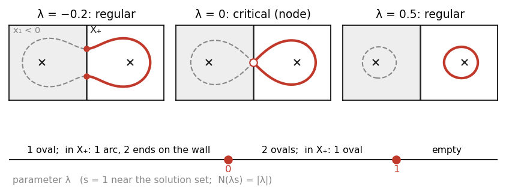

# Chapter 5. Perturbing a Fredholm problem: auxiliary norms, compactness and transversality (HWZ Part I, Chapter 5, pp. 205–236 (preprint pp. 169–199))

*Hofer–Wysocki–Zehnder, "Polyfold and Fredholm Theory", Part I, Chapter 5 (2014 preprint, arXiv
1407.3185, pp. 169–199), rewritten for a first-year graduate student who wants to know why a small
generic perturbation turns a Fredholm problem into one whose solutions form a compact manifold. Every
formalized statement is proved completely; Theorem 5.3.15 (preprint 5.22) and Theorem 5.27 (preprint; not in the 2021 edition) and the cited Theorems 5.5.5, 5.5.13, 5.5.16 (preprint 5.32, 5.40, 5.43) are stated and
marked. Where the Lean formalization found a gap or a shorter route, the text follows the Lean. Statement numbers and
pages are those of the book (Springer 2021), with the preprint's in parentheses (see `BookConcordance.md`). Conventions of Chapters
1–4: $P:Y\to X$ a strong bundle, $Y_{0,1}$ its points of biregularity $(0,1)$, $S_f = f^{-1}(0)$, $\operatorname{Lin}(z)$ the linearization of a
section in a strong bundle chart at $z$, $T_zO = Dr(z)E$, $T^R_zO = T_zO\cap E_z$; the coordinates of a partial quadrant are $\ell_i$,
since $\lambda$ is a parameter.*

---

## 0. When is an equipotential a curve?

Two long parallel wires, $2$ cm apart, carry equal charge per unit length. With the wires at $(\pm1,0)$ (unit $1$ cm) the
potential is $-\frac{q}{2\pi\varepsilon_0}(\ln r_1+\ln r_2)$, $r_i$ the distances to the wires, so the equipotentials are the Cassini ovals
$r_1r_2 = \text{const}$. The field vanishes at the midpoint, and through it passes the lemniscate $r_1r_2 = 1$, a figure eight
with a node. As an equation $f(x) = 0$,
$$f(x) = r_1^2r_2^2-1 = (x_1^2+x_2^2)^2-2(x_1^2-x_2^2),$$
and the defect is $f'(0) = 0$. Perturbing $f$ by $\lambda$ cures it: $f+\lambda = 0$ is two ovals for $0<\lambda<1$ and one for $\lambda<0$; only
$\lambda = 0$ and $\lambda = 1$ (the points $(\pm1,0)$), the critical values of $-f$, are bad. This is Sard's theorem.

Chapter 5 does this for sc-Fredholm sections over M-polyfolds, where three things automatic in the plane need work.
*Compactness*: perturbations must be measured so that small ones cannot let solutions escape — auxiliary norms (§1),
Theorem 5.2.2 (preprint 5.5) (§2). *Supply*: perturbations are sc$^+$-sections, made from sc-smooth bump functions (§3, §7). *Genericity*:
Sard's theorem is applied to a finite family $f+\sum\lambda_it_i$, whose solution set is finite-dimensional by Chapter 3's
implicit function theorem (§4, §5).

At a boundary more can go wrong. In the half-plane $X_+ = \{x_1\ge0\}$ the node is a boundary point, and a perturbation
vanishing near the wall cannot remove it, since there $f+s = f$; so Theorem 5.3.12 (preprint 5.19), which perturbs away from the boundary,
must assume good position at the boundary zeros. The level shift $\lambda$, not vanishing at the wall, cures it: for $\lambda<0$ the
solution set in $X_+$ is an arc crossing the wall transversally. Subtler: where $f$ is in good position at a boundary
zero, the family $f+\sum\lambda_it_i$ with $t_i$ vanishing there need not be, and the text's proof of Theorem 5.3.12 (preprint 5.19) uses it there (§5).

The formalization changed the text: Definition 5.3.1 (preprint 5.9) is read with $f(x)\ne0$ (§3); a first, vacuous tameness hypothesis was
repaired (§4); "dense" in Theorems 5.3.5, 5.3.10 (preprint 5.13, 5.18) is made precise as "outside a null set" (§4, §5); Theorem 5.3.10 (preprint 5.18) needs $X$ tame
and a proof that the parametrized solution set is a submanifold (§5); the proofs of Theorems 5.3.12, 5.5.7, 5.5.10 (preprint 5.19, 5.34, 5.37) are
repaired (§5, §7); Theorem 5.3.15 (preprint 5.22) has a hidden hypothesis (§6); Corollary 5.2.5 (preprint 5.8) is formalized in a chart only (§2). §8 treats
the two wires as an sc-Fredholm problem.

---

## 1. Auxiliary norms (pp. 205–209 (preprint pp. 169–171))

$Y[1]$ is the M-polyfold with underlying set $Y_{0,1}$ and charts $\Phi[1]$ (§2.6 (preprint §2.5)). The fibre $(Y_{0,1})_x$ is the set of points of $P^{-1}(x)$
in $Y_{0,1}$, a linear subspace since charts are fibrewise linear. In a chart, $|w|_1 := |h|_1$ for $\Phi[1](w) = (p,h)$.

**Definition 5.1.1 (preprint 5.1).** An *auxiliary norm* is a continuous $N:Y_{0,1}\to\mathbb R$ such that (1) on each fibre $(Y_{0,1})_x$, $N$ is a norm for
which the fibre is complete; (2) if $P(w_k)\to x$ and $N(w_k)\to0$, then $w_k\to0_x$ in $Y_{0,1}$.

> **The text leaves the fibres without structure.** "Complete norm" needs the linear fibre above. "The fibers have the
> structure of Banach spaces" is a lemma: $w\mapsto h$ is linear and injective onto the slice $\{h:(\varphi(x),h)\in K[1]\}$, the closed
> fixed point set of $h\mapsto R[1](\varphi(x),h)$. The norms of two charts are equivalent, locally uniformly in the base point.

**Lemma 5.1.2 (preprint 5.2).** Let $N$ be continuous and fibrewise a complete norm. Equivalent: (i) $N$ is an auxiliary norm; (ii) every $x$
has a strong bundle chart $\Phi$, a neighbourhood $V\subset\operatorname{dom}\varphi$ and constants $0<c<C$ with $cN(w)\le|h|_1\le CN(w)$ for
$w\in P^{-1}(V)\cap Y_{0,1}$.

*Proof.* (i) ⇒ (ii), in every chart around $x$. By continuity at $0_x$ there is $\varepsilon>0$ with $N(w)<1$ when $|p-\varphi(x)|_0+|h|_1<\varepsilon$. For
$|p-\varphi(x)|_0<\varepsilon/2$ and $h\ne0$, $w' = \frac{\varepsilon}{2|h|_1}w$ gives $N(w)\le\frac2\varepsilon|h|_1$. If no $C$ existed, there would be $w_k$ with $|h_k|_1 = 1$,
$N(w_k)\to0$, $P(w_k)\in\varphi^{-1}(B(\varphi(x),1/(k+1)))$, so $P(w_k)\to x$ ($\varphi^{-1}$ is continuous on $O$; no metrizability needed); by (2) $w_k\to0_x$
and $|h_k|_1\to0$, a contradiction. (ii) ⇒ (i), "obvious" in the text: if $P(w_k)\to x$, $N(w_k)\to0$, then $|h_k|_1\le CN(w_k)\to0$, so
$\Phi[1](w_k)\to(\varphi(x),0)$, and $w_k\to0_x$ because $\Phi[1]$ is a homeomorphism onto $K[1]$ — also for a chart merely compatible with
the atlas, for which Chapter 2 had not built $\Phi[1]$. $\square$

The text asks for the bounds on all of $P^{-1}(\operatorname{dom}\Phi)$; its proof gives them only near $x$.
*Checked by machine:* `Polyfold.StrongBundle.oneFiber`, `Polyfold.StrongBundle.complete_liftOneFiber`,
`Polyfold.StrongBundle.IsAuxNorm`, `Polyfold.StrongBundle.oneChartOf`, `Polyfold.StrongBundle.IsAuxNorm.exists_bounds`,
`Polyfold.lemma_5_2`.

**Proposition 5.1.3 (preprint 5.3).** Auxiliary norms exist; for two of them there is a continuous $f:X\to(0,\infty)$ with
$f(x)N_0(w)\le N_1(w)\le f(x)^{-1}N_0(w)$ on $(Y_{0,1})_x$.

*Proof.* $X$ is paracompact Hausdorff (Theorem 2.3.10 (preprint 2.16)); take a partition of unity $(\rho_i)$ subordinate to the atlas charts $\Phi_i$
and $N(w) = \sum_i\rho_i(P(w))|\Phi_i[1](w)_2|_1$. Each term is continuous on $Y[1]$, vanishing off the closed $P^{-1}(\operatorname{supp}\rho_i)$ inside the
domain of $\Phi_i[1]$; the sum is locally finite. Near $x$ finitely many terms survive, uniformly comparable with $|\cdot|_1$ of one
chart, so Lemma 5.1.2 (ii) (preprint 5.2) holds. For the comparison, Lemma 5.1.2 (preprint 5.2) in one chart around $y$ gives $r_y>0$ with $r_yN_0\le N_1$, $r_yN_1\le N_0$
near $y$; the admissible constants at each point form an interval, so $f = \sum_j\sigma_jr_{y_j}$, for a partition of unity $(\sigma_j)$, works. $\square$

Tameness, assumed in §5.1, is not used. *Checked by machine:* `Polyfold.StrongBundle.gluedNorm`,
`Polyfold.StrongBundle.exists_uniform_comparison`, `Polyfold.proposition_5_3_exists`, `Polyfold.proposition_5_3_compare`.

## 2. Compactness (pp. 206–217 (preprint pp. 171–173) and §5.2 (preprint Appendix 5.4.1), preprint pp. 189–191)

**Definition 5.2.1 (preprint 5.4).** For an sc-smooth section $f$ ($\operatorname{supp}s = \operatorname{cl}\{s\ne0\}$): (1) $f$ has a *compact solution set* if $S_f$ is compact in
$X_0$; (2) $f$ is *weakly proper* if (1) holds and for every auxiliary norm $N$ some open $U\supset S_f$ makes $\{f = s\}$ compact for
every sc$^+$-section $s$ with $\operatorname{supp}s\subset U$, $N(s)\le1$; (3) $f$ is *proper* if (1) holds and for every $N$ some open $U\supset S_f$ has
$\operatorname{cl}_{X_0}\{x\in U:N(f(x))\le1\}$ compact, with $N(f(x)) = \infty$ off $Y_{0,1}$.

"Obviously proper implies weakly proper": $\{f = s\}$ is closed; a solution outside $U$ has $s(x) = 0$, so lies in $S_f\subset U$; inside $U$,
$N(f(x)) = N(s(x))\le1$.

**Theorem 5.2.2 (preprint 5.5).** An sc-Fredholm section with compact solution set is proper; for sc-Fredholm sections the three notions
coincide. (The text assumes $X$ tame; it is not used.)

*Proof.* It suffices that every zero $x_0$ has an open $V$ with $\operatorname{cl}_X\{x\in V:N(f(x))\le1\}$ compact: finitely many $V_j$ cover $S_f$.

*Step 1: from $N$ to the basic germ.* Take the germ data at $x_0$ (Definition 3.1.11 (preprint 3.11)): in a chart $\Phi$, a filled version $g$ and an
sc$^+$-germ $s$ with $g-s$ conjugated by $\Psi$ to a basic germ $h$. Lemma 5.1.2 (preprint 5.2) in $\Phi$ turns $N(f(x))\le1$ into $|g(u)|_1\le A$; then
$|g(u)-s(u)|_1\le A+|s(0)|_1+1$ near $0$; and $|\Psi[1](u,k)_2|_1\le M|k|_1$ near $u = 0$ (continuity of $\Psi[1]$ at $(0,0)$, fibrewise linearity).
So $|h(a,w)|_1\le c$ with $c$ independent of $x$. The text's "without loss of generality $f = h+t$" hides these bounds; subtracting $s$
first makes its $t$ and estimates (83), (85) unnecessary.

*Step 2: the basic germ.* $Ph(a,w) = w-B(a,w)$ on $\tilde C\oplus W$, $\tilde C$ a closed partial quadrant, $B$ an sc$^0$-contraction germ:
after shrinking, $|B(a,w)-B(a,w')|_0\le\frac14|w-w'|_0$ for $|a|,|w|_0,|w'|_0\le\tau'$, and $|B(a,0)|_0\le\tau'/8$ for $|a|\le\tau\le\tau'$. For $a\in\tilde C$, $|a|\le\tau$,
$|z|_0\le\tau'/2$, the map $w\mapsto B(a,w)+z$ is a $\frac14$-contraction of $\bar B(\tau')\subset W_0$, with fixed point $\delta(a,z)$ continuous in $(a,z)$. On
$O = \{|a|<\tau,|w|_0<\tau'/4\}$, $|h(a,w)|_1\le c$ gives $z = Ph(a,w)$ with $|z|_1\le\|P\|c$ and $|z|_0\le\frac54|w|_0+\tau'/8<\tau'/2$, so $w = \delta(a,z)$. As $W_1\to W_0$
is compact, these points lie in the compact image of $\{a\in\tilde C:|a|\le\tau\}\times K_c$, $K_c$ the $W_0$-closure of $\{|z|_1\le\|P\|c,|z|_0\le\tau'/2\}$.

*Step 3: back to $X$.* That compact set lies in the domain $U$ of the filled version, which contains points outside the
retract $O = r(U)$. Shrinking $V$, the compact set may be cut down to a closed ball inside $U$; then the closure of
$\varphi\{x\in V:N(f(x))\le1\}$ lies in it and in $O = \{r(u) = u\}$, which is closed in $U$. The intersection is compact, and $\varphi^{-1}$ is
continuous on $O$. $\square$

> **Slips in §5.2 (preprint Appendix 5.4.1).** "$z' = h(a,w)$" for $(h+t)(a,w)$; "$\mathbb R^n\oplus Y_1$" for $\mathbb R^N\oplus W_1$; "(2) and (3)" for (84), (86);
> "$a\in\mathbb R^n$" in $\Sigma$ for $a\in\tilde C$; the ball "in $Y_0$" for $W_0$; in (89) mixed components ($z = Pz'-Pt(a,w)$).

*Checked by machine:* `Polyfold.StrongBundle.IsProper.isWeaklyProper`, `Polyfold.IsStrongBundleMap.exists_fiber_bound_one`,
`Polyfold.IsBasicGerm.exists_isCompact_bdd`, `Polyfold.exists_nbhd_isCompact_closure_bdd`, `Polyfold.theorem_5_5`,
`Polyfold.theorem_5_5_iff`.

**Theorem 5.2.3 (preprint 5.6) (local compactness).** For sc-Fredholm $f$ and a zero $x$ there are open $x\in U(i+1)\subset U(i)$ with
$\operatorname{cl}_{X_0}\{y\in U(i):f(y) = 0\}$ compact in $X_i$.

*Proof.* A zero is smooth, and $(f,x)$ is an sc-Fredholm germ there; apply Theorem 3.1.13 (preprint 3.12). $\square$ *Checked by machine:*
`Polyfold.theorem_5_6`, from `Polyfold.theorem_3_12`.

**Theorem 5.2.4 (preprint 5.7).** If $f$ is sc-Fredholm and $S_f$ is compact in $X_0$, then $S_f\subset X_\infty$ is compact in $X_\infty$.

> **$X_\infty$ has no topology in the text.** It gets the initial topology of the inclusions $X_\infty\to X_m$: convergence on every
> level; it is metrizable.

*Proof.* $S_f\subset X_\infty$ by regularity. A sequence in $S_f$ has a subsequence converging in $X_0$ to some $x\in S_f$. The text says "by
Theorem 5.6" it converges on every level; Theorem 5.2.3 (preprint 5.6) gives compactness, not convergence. Corollary 3.1.15 (preprint 3.13) at $x$ does: zeros
converging to $x$ in $X_0$ converge on every level, $(f,x)$ being a germ at the smooth zero $x$. $\square$
*Checked by machine:* `Polyfold.MPolyfold.tendsto_smoothLevel_iff`, `Polyfold.corollary_3_13_section`, `Polyfold.theorem_5_7`,
`Polyfold.isCompact_solutionSet_level` (compact in every $X_i$).

**Corollary 5.2.5 (preprint 5.8).** For $f$ sc-Fredholm over a tame $X$ with $S_f$ compact, $f^i$ is an sc-Fredholm section of $P^i:Y^i\to X^i$ with
compact solution set.

*What is proved:* compactness on every level (Theorem 5.2.4 (preprint 5.7)) and, for $i = 1$, the chart-level content: the shift $h^1$ of a basic
germ is a basic germ, $(g-s)^1$ is conjugated to $h^1$ by the index raise $\Psi^1$, and $s^1$ is sc$^+$. *Not formalized:* the bundle
$P^1:Y^1\to X^1$ (the text defines $Y[i]$ only for $i\le1$; the natural $Y^1 = Y_{1,1}$ over $X_1$ is not built) and $i\ge2$ (gap G.6;
the levels of the iterated base are those of $X$ since, Chapter 2, §9.8, gap G.6 closed).

> **"It is a priori clear that $f^i$ is sc-Fredholm" is not clear.** The filler of $f^1$ needs Definition 3.1.4 (3) (preprint 3.4) on level $1$:
> $L = (1-\rho(0))Dg(0)$ must map $\ker Dr(0)\cap E_1$ onto $\ker\rho(0)\cap F_1$. Level $0$ does not give it: on $E_m = \{\sum_ke^{2mk}x_k^2<\infty\}$ the shift
> $T$ has $|T|_m = e^m$, $1-T/2$ is invertible on $E_0$, but $(1-T/2)^{-1}e_0 = \sum_n2^{-n}e_n\notin E_1$ since $e^2/4>1$. For an sc-Fredholm germ
> it holds by an argument the text lacks: subtract $y\mapsto R(y,\hat f(0))$ (Lemma 3.1.20 (preprint 3.17)) to get $g(0) = 0$; then $Dg(0)$ is regularizing
> ($Dg(0)-Ds(0)$ is conjugated to $Dh(0)$, $Dh(0)(a,w)_W = w-D_aB(0)a$, $D_aB(0)a\in W_\infty$); for $k\in\ker\rho(0)\cap F_1$, $\kappa = L^{-1}k$, the
> Fredholm property gives $t\in T_0O$ with $Dg(0)(t+\kappa)\in F_1$, so $t+\kappa\in E_1$ and $\kappa = (1-Dr(0))(t+\kappa)\in E_1$. Not formalized.

*Checked by machine:* `Polyfold.IsBasicGerm.shift`, `Polyfold.IsConjugateToBasicGerm.shift`, `Polyfold.corollary_5_8_chart`.

## 3. Bump functions and sc$^+$-sections (pp. 213–218 (preprint pp. 173–174))

An sc-smooth function is an sc-smooth map into the M-polyfold $\mathbb R$ (constant structure, identity chart); sc-smoothness
may be checked in one pair of charts around each point.

**Definition 5.3.1 (preprint 5.9).** $X$ *admits sc-smooth bump functions* if for every $x$ and open $U\ni x$ there is an sc-smooth $f:X\to\mathbb R$ with
$f(x)\ne0$ and $\operatorname{supp}f\subset U$.

> **Read with $f(x)\ne0$.** The text writes "$f\ne0$", Definition 5.5.2 (preprint 5.29) "not identically zero". Proposition 5.5.3's (preprint 5.30) proof
> starts from $g(x) = 1$; an M-polyfold has no translations, and on an sc-Banach space translation by a non-smooth vector
> breaks the levels. The strong reading implies the weak; the converse is not settled.

**Proposition 5.3.2 (preprint 5.10) (= Proposition 5.5.3 (preprint 5.30)).** With bump functions, for $x\in U$ open there is an sc-smooth $f:X\to[0,1]$, $f(x) = 1$,
$\operatorname{supp}f\subset U$, $f\equiv1$ near $x$.

*Proof.* Take a bump $g$, $g(x)\ne0$, $\operatorname{supp}g\subset U$, and the smooth transition $\tau$ ($0$ on $(-\infty,0]$, $1$ on $[1,\infty)$). Then
$f = \tau(3g/g(x)-1)$ is sc-smooth, $f(x) = \tau(2) = 1$, $f\equiv1$ on $\{g/g(x)>2/3\}$, and $f\ne0$ only where $g/g(x)>1/3$. $\square$ (The text's $\sigma$,
"$0$ for $s\le1$ and $1$ for $s\ge1$", is misprinted.)

The text uses without statement that the sc$^+$-sections $\Gamma^+(P)$ contain $0$ and are closed under sums and multiplication
by sc-smooth functions (the product rule in a chart).

**Lemma 5.3.3 (preprint 5.11).** Let $X$ admit sc-smooth bump functions and $N$ be an auxiliary norm. For smooth $x$, smooth $e\in P^{-1}(x)$, $\varepsilon>0$,
open $U\ni x$, there is $s\in\Gamma^+(P)$ with $s(x) = e$, $\operatorname{supp}s\subset U$ and $N(s(y))<N(e)+\varepsilon$ *for all $y$*.

The text's bound at $x$ alone is trivial; tameness, normality and a centred chart are not needed.

*Proof.* In a strong bundle chart around $x$ with retraction $R$, $\Phi(e) = (\varphi(x),\tilde e)$, $\tilde e\in F_\infty$; $t(z) = R(z,\tilde e)$ is an sc$^+$-section
($z\mapsto(z,\tilde e)$ is sc-smooth into level $1$, $R[1]$ sc-smooth) with $t(\varphi(x)) = \Phi(e)$; let $\hat t$ be its transport to $X$. The open
$W = \{N(\hat t)<N(e)+\varepsilon\}$ contains $x$; Proposition 5.3.2 (preprint 5.10) gives $\beta$, $\beta(x) = 1$, $\operatorname{supp}\beta\subset U\cap W$. Then $s = \beta\hat t$, extended by $0$, is
sc$^+$ on the chart domain and on $X\setminus\operatorname{supp}\beta$, and $N(s) = \beta N(\hat t)<N(e)+\varepsilon$. $\square$

*Checked by machine:* `Polyfold.realPolyfold`, `Polyfold.MPolyfold.AdmitsBumpFunctions`, `Polyfold.proposition_5_30`,
`Polyfold.proposition_5_10`, `Polyfold.StrongBundle.IsScPlusSection.smul_left`,
`Polyfold.StrongBundle.isScPlusSection_cutoffSection`, `Polyfold.lemma_5_11`.

**Allowable sections.** $\Gamma^{+,1}_U(P)$: the $s\in\Gamma^+(P)$ with $\operatorname{supp}s\subset U$ and $N(s)\le1$. The text's metric $\rho(s,s') = \sup N(s-s')$ is not
formalized; "dense" is read pointwise.

**Remark 5.3.4 (preprint 5.12).** For $U$ as in Theorem 5.2.2 (preprint 5.5) and $s$ in the completion of $\Gamma^{+,1}_U(P)$, $S_{f+s}$ is compact.

*Proof, and what is missing.* $s = 0$ off $U$ and $N(s)\le1$ survive uniform limits and put the solutions of $f+s = 0$ in
$\{x\in U:N(f(x))\le1\}$, of compact closure. For $s\in\Gamma^+(P)$, $f+s$ is sc-Fredholm (Theorem 3.1.18 (preprint 3.15)), so $S_{f+s}$ is closed. For a limit
section closedness needs continuity, which the remark does not address. $\square$
*Checked by machine:* `Polyfold.StrongBundle.allowableSections`, `Polyfold.remark_5_12`, `Polyfold.isClosed_solutionSet`.

## 4. Transversality without boundary: Theorem 5.3.5 (preprint 5.13) (pp. 217–220 (preprint pp. 174–177))

**Definition 5.3.7 (preprint 5.15).** An sc-Fredholm $g$ is *transversal to the zero section* if $g'(x)$ is onto at every zero; in a chart,
$\operatorname{Lin}(z):T_zO\to K_z$ onto, independently of the chart.

**Theorem 5.3.5 (preprint 5.13).** Let $\partial X = \emptyset$, $X$ admit sc-smooth bump functions, $f$ be sc-Fredholm with tame germ data (Definition 3.6.4 (preprint 3.51))
and $S_f$ compact, $N$ an auxiliary norm. There is an open $U\supset S_f$ with:

1. $S_{f+s}$ compact for $s\in\Gamma^{+,1}_U(P)$;
2. *(generic form)* for every sc$^+$-section $s_0$ with $\operatorname{supp}s_0\subset U$, $N(s_0)\le1-\varepsilon$, there are $t_1,\dots,t_m\in\Gamma^{+,1}_U(P)$, $\delta>0$ and a null
   set $CV\subset\mathbb R^m$ such that for $|\lambda|<\delta$ (maximum norm), $\lambda\notin CV$: $s_\lambda = s_0+\sum\lambda_it_i$ is allowable, $f+s_\lambda$ is transversal,
   and $S_{f+s_\lambda}$ is compact and, if non-empty, a sub-M-polyfold with tame induced structure, a manifold without boundary
   of dimension the Fredholm index;
3. *(dense form)* for $s'\in\Gamma^{+,1}_U(P)$, $\varepsilon>0$ there is $s\in\Gamma^{+,1}_U(P)$ with $N(s-s')\le\varepsilon$ everywhere and the properties of (2).

The text writes "$N(f(x))\le1$" for $N(s(x))\le1$ and "$(f,x)$" for $(f+s,x)$.

> **A vacuous first version.** The theorem assumes no tameness, but §5.3 starts from a tame strong bundle, and the proof
> uses Theorems 3.1.21, 3.1.22, 3.6.8 (preprint 3.18, 3.19, 3.54), proved in Chapter 3 for tame charts. A first formalization assumed that *every*
> compatible chart of $P$ and of the pull-backs $\pi^*P\to\mathbb R^k\times X$ has a tame retraction. That never holds: a chart can be
> re-equipped with another retraction onto the same image, e.g. $r'(a,u) = (1,r(u))$ on $[0,\infty)\times U$, which does not preserve
> $d_C$ (not machine-checked). As restated, $f$ has tame germ data — the text's tame bundle — and the parametrized sections
> inherit it, product charts of tame charts being tame. No hypothesis beyond the text's remains.

*Proof.* (1) is Theorem 5.2.2 (preprint 5.5) with Remark 5.3.4 (preprint 5.12). *(3) from (2):* $s_0 = (1-\varepsilon/2)s'$ has $N(s_0)\le1-\varepsilon/2$, $N(s'-s_0)\le\varepsilon/2$; apply (2)
and take $\lambda\notin CV$ with $|\lambda|<\min(\delta,\varepsilon/2m)$. *(2):* $g = f+s_0$ is sc-Fredholm with tame germ data (Theorem 3.1.18 (preprint 3.15)), $S_g$ compact.

*Step A: spanning sections.* At a zero $x$ of $g$, in a chart centred at $x$, $\operatorname{Lin}(0):T_0O\to K_0 = \rho(0)F$ is Fredholm (Proposition
3.6.5 (preprint 3.52)). The smooth vectors $\rho(0)F_\infty$ are dense in $K_0$ ($\rho(0)$ preserves levels at the smooth point $0$), so by Lemma 10.A
finitely many span a complement of the range — the point the text omits. Each is $\Phi(e)_2$ for a smooth $e$; Lemma 5.3.3 (preprint 5.11) and a
rescaling by $1/(N(e)+1)$ give allowable sections through them.

*Step B: the parametrized section.* $F(\lambda,y) = g(y)+\sum\lambda_it_i(y)$ is sc-Fredholm with tame germ data on the pull-back bundle over
$\mathbb R^k\times X$ (Theorem 3.1.21 (preprint 3.18)), with $\operatorname{Lin}_F(0)(a,u) = \operatorname{Lin}_g(0)u+\sum a_i\hat t_i(0)$, onto at $(0,x)$. As $d_{\mathbb R^k\times X}\le d_{\mathbb R^k}+d_X = 0$, good position is
surjectivity, and Theorem 3.6.8 (1) (preprint 3.54) makes it hold at the zeros $(0,y)$, $y\in U(x)$.

*Step C: finite subcover.* Finitely many $U(x_j)$ cover $S_g$; unite the families into $t_1,\dots,t_m$. By Theorem 3.6.8 (1) (preprint 3.54) there is an open
$V\supset\{0\}\times S_g$ of zeros of $F$ where $\operatorname{Lin}_F$ is onto.

*Step D: the omitted step.* For $|\lambda|\le\delta_1 = \varepsilon/2m$, $N(s_\lambda)\le1-\varepsilon+m|\lambda|\le1$, so the zeros of $F$ over $|\lambda|\le\delta_1$ form a compact $Z$
(Remark 5.3.4 (preprint 5.12)), and Lemma 10.B gives $\delta_0$ with $Z\cap\{|\lambda|<\delta_0\}\subset V$. The text asserts "$V\subset\{|\lambda|<\delta_0\}\oplus X$" without this.

*Step E: Sard.* At $z_0\in V$, Theorem 3.6.8 (2) (preprint 3.54) gives a $C^\infty$ parametrization $\Gamma$ of $F^{-1}(0)$ from a finite-dimensional partial
quadrant, with derivative in $\ker\operatorname{Lin}_F$. The critical values of $q = \operatorname{pr}_{\mathbb R^m}\circ\Gamma$ are null (Sard). At a regular value $\lambda$,
$\ker\operatorname{Lin}_F(\lambda,y)$ projects onto $\mathbb R^m$, so by Lemma 10.C $\operatorname{Lin}_{g+\sum\lambda_it_i}(y)$ is onto: the text's "easily verified", needing only
"regular value ⟹ transversal". Finitely many charts cover $Z\cap\{|\lambda|\le\delta/2\}$, $\delta = \min(\delta_0,\delta_1)$; $CV$ is the union of their null sets.

*Step F.* For $|\lambda|<\delta/2$, $\lambda\notin CV$, $f+s_\lambda$ is transversal, $S_{f+s_\lambda}$ compact, and Theorem 3.6.10 (preprint 3.56) gives the manifold. $\square$

Sard is used in its stratified form (Chapter 4, §8), which spares showing that the chart models are open. Remarks 5.3.6 (preprint 5.14; on [21]) and 5.3.8 (preprint 5.16; a cobordism sketch) are not formalized.
*Checked by machine:* `Polyfold.StrongBundle.IsTransversal`, `Polyfold.exists_spanning_sections`,
`Polyfold.exists_isOpen_isLinSurjAt_zero_near`, `Polyfold.exists_isOpen_goodPosition_of_isLinSurjAt`,
`Polyfold.exists_null_isLinSurjAt_paramSlice_near`, `Polyfold.StrongBundle.SolutionSetIsManifold`,
`Polyfold.theorem_5_13_generic`, `Polyfold.theorem_5_13`, with `Polyfold.theorem_3_18_tame`,
`Polyfold.theorem_3_56_of_surjective`, `Polyfold.measure_image_stratCritSet`.

### An interactive look at a perturbation that removes a node

The figure shows the solution set of $f+\lambda s$ for the two wires of §0 and §8 (crosses), $s = 1$ near the solution sets, so
$N(\lambda s) = |\lambda|$. *Top:* $\lambda = -0.2$, one oval; $\lambda = 0$, the lemniscate, critical; $\lambda = 0.5$, two ovals. The wall $x_1 = 0$ bounds $X_+$;
the part in $X_+$ is in the accent colour, the rest dashed. For $\lambda = -0.2$ it is an arc with ends $(0,\pm0.309)$ crossing the wall; for
$\lambda = 0.5$ an oval clear of it. *Bottom:* the critical values $0$, $1$ and the solution sets between them. In the interactive
version a slider moves $\lambda$, buttons jump to the critical values, a box switches the wall, and a line of text says
whether $\lambda$ is regular and the perturbation allowable.

*(In the printed version this figure is a still image; the interactive version is in the web
edition.)*

## 5. General position, good position (preprint pp. 177–180, 186–188)

**Definition 5.3.9 (preprint 5.17).** $(f,x)$, $f(x) = 0$, is *in general position* if $f'(x)$ is onto and $\ker f'(x)$ has an sc-complement in $T^R_xX$. In
a tame chart: $\operatorname{Lin}(z)$ onto, and for each presentation of the quadrant an sc-complement $B\subset T^R_zO$ of $\ker\operatorname{Lin}(z)$ in $T_zO$. (The
chart must be tame for Proposition 2.5.6 (preprint 2.36).)

**Lemma 5.26 (preprint; not in the 2021 edition) ("clearly general position implies good position").** For sc-Fredholm $f$, general position at $y$ implies
good position (Definition 3.6.6 (preprint 3.53)).

*Proof.* $B\subset E_z$ changes no $\ell_i$, $i\in I(z)$, so it is a good complement for every $\varepsilon$. By Proposition 2.5.6 (preprint 2.36), $\ell_{I(z)}$ maps $T_zO$
onto $\mathbb R^{I(z)}$ with kernel $T^R_zO$; it kills $B$, so maps $K = \ker\operatorname{Lin}(z)$ onto $\mathbb R^{I(z)}$, and $K\cap C_z$ has interior points in $K$ — the
interior condition of Definition 3.1.24 (preprint 3.21), which the text omits. $\square$

Three facts used in Theorem 5.3.10 (preprint 5.18) and never stated:

**Lemma 5.A.** If every zero of $f$ (tame germ data) in an open $V$ is in good position, $S_f\cap V$ is a smooth
finite-dimensional submanifold (Definition 4.2.1 (preprint 4.13)) whose tangent space at $y$ is $\ker\operatorname{Lin}(y)$ in every chart.

*Proof.* Theorem 3.6.8 (2) (preprint 3.54) gives regular tangent germ data $\Gamma$ on an open subset of $N\cap C$, $N$ finite-dimensional. With a
retraction $r$ onto the chart model and the projection $\pi$ to $N$, $\tau = \Gamma\circ\pi\circ r$ (the retraction of Theorem 3.2.3 (preprint 3.27)) is sc$^+$: $\pi\circ r$ is
sc-smooth into $N$, and an sc-smooth map on a finite-dimensional space with constant structure is sc$^+$, its levels being
equal. Tangent spaces: "$\subset$" by the chain rule; "$\supset$" since $\dim\ker\operatorname{Lin}(y)$ is the index $d$ in every chart and the tangent
space contains $d$ independent vectors $D\Gamma(v)b_i$, transported by the transition maps. $\square$

**Corollary 5.B.** Near a zero in good position, Definition 5.3.9 (preprint 5.17) at $y$ is equivalent to general position of the solution set
(Definition 4.2.10 (preprint 4.21)); so it is chart independent, and for $X$ tame it is open along $S_f$ (Theorem 4.2.11 (3) (preprint 4.22)).

*Checked by machine:* `Polyfold.StrongBundle.IsGeneralPositionGerm`,
`Polyfold.StrongBundle.IsGeneralPositionGerm.isGoodPositionGerm`, `Polyfold.isScPlus_of_isScSmooth_const`,
`Polyfold.StrongBundle.isSmoothSubmanifold_solutionSet_inter`, `Polyfold.exists_tangentSpace_eq_linKer` (Lemma 5.A),
`Polyfold.exists_isGeneralPositionGerm_iff`, `Polyfold.exists_isOpen_isGeneralPositionGerm` (Corollary 5.B).

**Theorem 5.3.10 (preprint 5.18).** Let $X$ be **tame** (added: the proof uses Theorems 4.2.11, 4.3.1 (preprint 4.22, 4.23)) and admit bump functions, $f$ sc-Fredholm
with tame germ data and $S_f$ compact, $N$ an auxiliary norm. There is $U$ as in Theorem 5.3.5 (preprint 5.13), and for every $s_0$ as there, allowable
$t_1,\dots,t_m$, $\delta>0$ and a null set $CV$ such that for $|\lambda|<\delta$, $\lambda\notin CV$: $s_\lambda$ is allowable, $f+s_\lambda$ is transversal and in general
position at every zero, and $S_{f+s_\lambda}$ is compact, a smooth submanifold in general position, a tame manifold with boundary
with corners, with $d_{S_{f+s_\lambda}} = d_X$. The dense form follows as in Theorem 5.3.5 (preprint 5.13).

*Proof.* Let $g = f+s_0$ (the text's reduction to $s_0 = 0$ "by replacing $N$ by $cN$" is not needed). At a zero $x$, in a tame
chart centred at $x$, the text's properties read: (i) $\operatorname{Lin}_g(0)(T_0O)+\operatorname{span}\{\hat t_i(0)\} = K_0$; (ii) every $w\in T_0O$ is $u+e$, $e\in E_0$,
with $\operatorname{Lin}_g(0)u+\sum a_i\hat t_i(0) = 0$ for some $a$.

*Achieving them.* (i) is Step A of Theorem 5.3.5 (preprint 5.13). For (ii), $\ell_{I(0)}$ maps the dense smooth vectors of $T_0O$ onto $\mathbb R^{I(0)}$; pick smooth
$l_j$ with $\ell(l_j) = e_j$, and allowable $t$ (Lemma 5.3.3 (preprint 5.11)) with $\hat t(0)$ a negative multiple of the smooth $\operatorname{Lin}_g(0)l_j$; then $w = \sum\ell_j(w)l_j+e$.
The text's complement $L$ of $T^R_xX$ must be smooth for Lemma 5.3.3 (preprint 5.11). Adding sections keeps (i)–(ii).

*(i)–(ii) is general position of $F$ at $(0,x)$.* An algebraic complement of $\ker\operatorname{Lin}_F$ in $\mathbb R^m\oplus T^R_0O$ is a good complement (with
interior points, as in Lemma 5.26 (preprint)), so $F$ is in good position; by Lemma 5.A $\ker\operatorname{Lin}_F$ is finite-dimensional and smooth, and
Lemma 7.A of Chapter 4 gives an sc-complement in $\mathbb R^m\oplus T^R_0O$. By Corollary 5.B it persists at nearby $(0,y)$, the text's
"they will also hold"; a finite subcover gives (i)–(ii) along $\{0\}\times S_g$.

*The family.* Corollary 5.B gives an open $V\supset\{0\}\times S_g$ of zeros of $F$ in general position; $\delta_0$ comes from Step D. By Lemma
5.A, $\tilde S = F^{-1}(0)\cap V\cap\{|\lambda|<\delta_0\}$ is a submanifold of $\mathbb R^m\times X$ in general position, with compact closure (the text's
"$\tilde S = \{(\lambda,y)\mid|\lambda|<2\varepsilon\}$" omits the equation). Theorem 4.3.1 (preprint 4.23) (countable-cover form) gives a null set off which $S_\lambda$ is a
submanifold in general position, a tame manifold with corners, $d_{S_\lambda} = d_X$. At such $\lambda$ the stratum tangent spaces project onto
$\mathbb R^m$, so $f+s_\lambda$ is transversal (Lemma 10.C), in good position (as in Lemma 5.26 (preprint)), and in general position (Corollary 5.B). $\square$

*Checked by machine:* `Polyfold.StrongBundleChart.IsParamGP` ((i)–(ii)), `Polyfold.exists_sections_isParamGP`,
`Polyfold.isGeneralPositionGerm_paramSection_of_isParamGP`, `Polyfold.isGoodPositionGermTame_of_isGeneralPositionAt`,
`Polyfold.StrongBundle.SolutionSetInGeneralPosition`, `Polyfold.theorem_5_18_of_family`, `Polyfold.theorem_5_18`,
`Polyfold.theorem_5_18_dense`, with `Polyfold.theorem_4_23_of_subset`, `Polyfold.exists_scComplement_le`.

**Theorem 5.25 (preprint; not in the 2021 edition).** For $X$ tame with bump functions, $f$ proper with tame germ data, $N$, and $U$ as in Theorem 5.2.2 (preprint 5.5), some
$s\in\Gamma^{+,1}_U(P)$ puts $(f+s,x)$ in good position at every zero; $S_{f+s}$ is a compact manifold with boundary with corners.

*Proof.* Theorem 5.3.10 (preprint 5.18) with $s_0 = 0$; the ball $\{|\lambda|<\delta\}$ is not null, so some $\lambda\notin CV$ exists; Lemma 5.26 (preprint). $\square$ The text's proof says "in
view of Theorem 3.54 ... in general position", which needs Corollary 5.B. *Checked by machine:* `Polyfold.theorem_5_25`.

**Theorem 5.3.12 (preprint 5.19).** Let $X$ admit bump functions, $f$ be sc-Fredholm with tame germ data and $S_f$ compact, $N$ an auxiliary norm,
and $(f,x)$ in good position at every zero $x\in\partial X$. There are $U$, allowable $t_1,\dots,t_m$ with supports disjoint from $\partial X$, $\delta>0$
and a null set $CV$ such that for $|\lambda|<\delta$, $\lambda\notin CV$: $s_\lambda = \sum\lambda_it_i$ is allowable, vanishes near $\partial X$, $f+s_\lambda$ is transversal and in
good position at every zero, and $S_{f+s_\lambda}$ is compact, a manifold with boundary with corners. (The text's tameness of $X$ is
not used; its "$(f,x)$" means $(f+s,x)$.)

> **"As before" fails at the boundary** (not verified in Lean). At a zero $(0,x)$, $x\in\partial X$, where the $t_i$ vanish,
> $\ker F'(0,x) = \mathbb R^m\times K$, $K = \ker f'(x)$. If $Y$ were a good complement for $\mathbb R^m\times C_x$ with constant $\varepsilon$, then for $a\ne0$ and $y\in Y$,
> $|y|\le\varepsilon|a|$, $(a,0)+y\in\mathbb R^m\times C_x$; scaling $a$, every $y_2\in C_x\cap-C_x = E_x$, so $K+E_x\supset T_xX$, a general position condition. Good
> position does not imply it: in $[0,\infty)^2$, $K = \mathbb R(1,1)$ is in good position but $K+E_0 = K$. So Theorem 3.6.8 (preprint 3.54) cannot be applied to $F$
> there, as the text does.

*Proof.* By Theorem 3.6.8 (1) (preprint 3.54) the zeros of $f$ in an open $V_{bd}\supset S_f\cap\partial X$ are in good position; take open $V_1\supset S_f\cap\partial X$, $\operatorname{cl}V_1\subset V_{bd}$.
At the zeros outside $V_{bd}$ — interior, away from $\operatorname{cl}V_1$ — take spanning sections supported in $U\setminus(\partial X\cup\operatorname{cl}V_1)$. Then $\operatorname{Lin}_F$ is onto
along $\{0\}\times S_f$. The zeros of $f$ outside $V_1$ are interior ($d = 0$), so Steps B–E of Theorem 5.3.5 (preprint 5.13) apply there and make $f+s_\lambda$
transversal, hence in good position, at its zeros outside $V_1$. On $V_1$, $f+s_\lambda = f$, and good position depends only on the
germ of the section. Theorem 3.6.11 (preprint 3.57) gives the manifold structure. $\square$
*Checked by machine:* `Polyfold.StrongBundle.IsGoodPositionGermTame.congr_nhds`, `Polyfold.theorem_5_19` (generic form; no
dense form).

**Theorem 5.27 (preprint; not in the 2021 edition) (cobordism between good position perturbations).** For a proper homotopy $f_t$ over a tame $X$ with bump
functions, $N$ on $Y\to X\times[0,1]$, $U$ adapted to it, and $s_i$ supported in $U_i$, $N_i(s_i)<1$, $f_i+s_i$ in good position ($i = 0,1$), there is an
sc$^+$-section $s(x,t)$, $N(s)<1$, supported in $U$, $s(\cdot,i) = s_i$, with $f+s$ in good position at all smooth points; its solution
set is a compact manifold with corners bounded by $S_0$, $S_1$. **Not formalized:** the proof is "left to the reader".

## 6. Homotopies and Morse functions (pp. 222–228 (preprint pp. 180–186))

**Definition 5.3.13 (preprint 5.20).** A *generalized compact homotopy* between compact sc-Fredholm problems is a strong bundle $P:Y\to X$, $X$
tame, an sc-Fredholm $f$ with tame germ data and $S_f$ compact, and an sc-smooth $t:X\to\mathbb R$ with $t(X) = [0,1]$, each $X_\tau = t^{-1}(\tau)$ a
sub-M-polyfold with tame induced structure on which $a\mapsto(a,f(a))$, a section of the pull-back along the inclusion (Proposition
2.6.8 (preprint 2.54)), is sc-Fredholm with tame germ data. The end problems are the restrictions to $X_0$, $X_1$; their compactness follows,
$S_f\cap X_\tau$ being closed in $S_f$. The text does not say what $Y|X_t$ is, and its "$(f|X_i,P|Y_i) = (f_i,P_i)$" needs an isomorphism, as
**Remark 5.3.14 (preprint 5.21)** says (not formalized). *Checked by machine:* `Polyfold.restrictSection`,
`Polyfold.StrongBundle.IsGenCompactHomotopy`, `Polyfold.StrongBundle.IsGenCompactHomotopy.isCompact_solutionSet_restrict`.

**Theorem 5.3.15 (preprint 5.22) (Morse-type structure).** Let all M-polyfolds admit bump functions, $f$ be a generalized compact homotopy with
$\partial X_i = \emptyset$, $(f_i,x)$ in general position at all zeros, $\partial X = X_0\sqcup X_1$, $N$ an auxiliary norm. Then there is $U$ with $S_{f+s}$ compact for
$s\in\Gamma^{+,1}_U(P)$, and an arbitrarily small $s_0\in\Gamma^{+,1}_U(P)$ vanishing near $\partial X$ with (1) $(f+s_0,x)$ in general position at every zero and
(2) $t|S_{f+s_0}$ Morse. **Not formalized.** The proof also needs **$dt(x)\ne0$** at the critical points $x$ of $t|_S$.

> **A hidden hypothesis.** The proof takes a one-dimensional smooth $Z$ with $T_xX = Z\oplus\ker dt(x)$. It exists iff $dt(x)\ne0$; if
> $dt(x) = 0$, $\ker dt(x) = T_xX$ and Lemma 5.3.16 (preprint 5.23) yields $b_\tau$ only for $\tau = 0$ (Lemma 10.D). Nothing makes $t$ a submersion there.

Besides, the proof needs Morse theory on manifolds with boundary, the section $(\lambda,y)\mapsto d(t|S_\lambda)(y)$ of the cotangent bundle, a
parametric Sard theorem, and embeddings $\Phi_\lambda:S\to\tilde S$ onto $\{\lambda\}\times S_\lambda$ — an Ehresmann-type trivialization, not "the classical
standard implicit function theorem". None is in Mathlib or the project. Slips: "$\partial X = X_0X_1$"; "$T_yS_\lambda$" in (79) and "$T^*_yM_\lambda$"
for $T^*_yS_\lambda$; "good position" for "general position" in the proof.

**Lemma 5.3.16 (preprint 5.23).** If $T = Z\oplus\ker\ell$ with $\ell$ linear, $\dim Z = 1$, and $S\subset T$, then each linear $\tau:S\to\mathbb R$ has a unique linear $b_\tau:S\to Z$ with
$\ell\circ b_\tau = \tau$, and $\ell\circ(b_\tau+a) = \tau$ for $a:S\to\ker\ell$. Such $Z$ exists iff $\ell\ne0$, and can be spanned by a vector of any spanning set.
(Proof: Lemma 10.D.) *Checked by machine:* `Polyfold.lemma_5_23`, `Polyfold.ne_zero_of_isCompl_ker`,
`Polyfold.exists_isCompl_ker_of_ne_zero`.

**Lemma 5.3.17 (preprint 5.24).** Let $f$ be sc-Fredholm, $x$ a zero, $z = \varphi(x)$ in a chart, $K\subset T_zO$ finite-dimensional (the text's $T_xS$), $b:K\to T_zO$
linear (its $b_\tau$), with $\operatorname{Lin}_f(z)(bv) = \mu(v)\Phi(e)_2$ for linear $\mu$ and a smooth $e$. For open $U\ni x$ there is $s\in\Gamma^+(P)$, $s(x) = 0$,
$\operatorname{supp}s\subset U$, with $\operatorname{Lin}_f(z)(bv)+\operatorname{Lin}_s(z)v = 0$ on $K$. (The one-dimensional image is a hypothesis; the text's justification is not
formalized.)

*Proof.* Extend $-\mu$ to a continuous linear $\ell$ on the model space. With $s_e$ from Lemma 5.3.3 (preprint 5.11) and a bump $\beta\equiv1$ near $x$, put
$s = \beta\,\ell(\varphi(\cdot)-z)\,s_e$. Then $s(x) = 0$ and, by the product rule ($Dr(z) = 1$ on $T_zO$), $\operatorname{Lin}_s(z)v = \ell(v)\Phi(e)_2 = -\mu(v)\Phi(e)_2$. $\square$
The text's graph of $S$, its $j:L\to\mathbb R$ and its case distinction are not needed. *Checked by machine:*
`Polyfold.scDeriv_smul_apply`, `Polyfold.exists_scPlusSection_linAt`, `Polyfold.lemma_5_24`.

## 7. Partitions of unity and bump functions (§5.5 (preprint Appendix 5.4.2), pp. 229–235 (preprint pp. 192–199))

**Definition 5.5.1 (preprint 5.28).** $X$ *admits sc-smooth partitions of unity* if every open cover has a subordinate partition of unity
(locally finite, $\operatorname{supp}\rho_i\subset U_i$) by sc-smooth functions. **Definition 5.5.2 (preprint 5.29)** is Definition 5.3.1 (preprint 5.9) with "not identically zero";
**Proposition 5.5.3 (preprint 5.30)** is Proposition 5.3.2 (preprint 5.10). **Definition 5.5.4 (preprint 5.31).** A Banach space has a $C^k$-*bump* if some $C^k$ $f\ne0$ has bounded
support. **Theorem 5.5.5 (preprint 5.32) (Bonic–Frampton; cited, not formalized):** the $p$-th power of the $L^p$-norm is $C^\infty$ for even $p$, $C^{p-1}$
for odd $p$, $C^{[p]}$ otherwise. The ensuing remarks (Sobolev norms; sc-smooth bumps on $W^{1,4}(\Omega)$ with $E_m = W^{1+m,4}(\Omega)$; only
sc$^1$ for $W^{1,3/2}$) are **not formalized**: they need Sobolev sc-structures (gap G.1).

**Definition 5.5.6 (preprint 5.33).** $(O,C,E)$ has the *bump property* if for $x\in O$ and open $U(x)\subset O$ with $\operatorname{cl}_E(U(x))\subset O$ there is an sc-smooth
$f:O\to\mathbb R$, $f(x)\ne0$, $\operatorname{supp}f\subset U(x)$.

**Theorem 5.5.7 (preprint 5.34).** $X$ admits sc-smooth bump functions iff it has an atlas whose local models have the bump property.

*Proof.* ⇒ for every chart: compose a bump supported in $\varphi^{-1}(U(x))$ with $\varphi^{-1}$. ⇐ ("clearly"): extending $f_0\circ\varphi$ by $0$ can fail. For
$X = E$, $E_0$ Hilbert, $V$ the unit ball and $\varphi(u) = u/(1-|u|_0^2)$ onto $O = E$ (Lemma 10.E), $U(x) = O$ and $f_0\equiv1$ are admissible, but the
extension is $1$ on $V$ and $0$ outside. Repair: take $U_1\ni x$ with $\operatorname{cl}_XU_1\subset U\cap V$ ($X$ regular), $B(\varphi(x),r)\cap O\subset\varphi(U_1)$, and the local bump
for $B(\varphi(x),r/2)\cap O$ — admissible since a retract is closed near its points ($O\cap\bar B(\varphi(x),r/2)$ is in the fixed set of a retraction
continuous on $C\cap B(\varphi(x),r)$, $C$ closed). Then $\operatorname{supp}f\subset\operatorname{cl}_XU_1\subset U$, and $f$ is sc-smooth on $V$ and zero on $X\setminus\operatorname{supp}f$. $\square$

**Proposition 5.5.8 (preprint 5.35).** If $|v|^2 = b(v,v)$ on $E_0$ for a continuous bilinear $b$, every local model on $E$ has the bump property.

*Proof.* $f(v) = \tau(1-b(v-x,v-x)/\rho)$, $\rho$ small, is $C^\infty$ on $E_0$, hence sc-smooth (Corollary 1.2.5 (preprint 1.20)), with $f(x) = 1$, $\operatorname{supp}f\subset\bar B(x,\sqrt\rho)$.
"Translating" is legitimate only because $f$ is $C^\infty$ on $E_0$. $\square$ So M-polyfolds on sc-Hilbert spaces admit bump functions.

*Checked by machine:* `Polyfold.MPolyfold.AdmitsBumpFunctionsWeak`, `Polyfold.HasContDiffBump`,
`Polyfold.MPolyfold.AdmitsScPartitionsOfUnity`, `Polyfold.LocalModel.HasBumpProperty`, `Polyfold.closure_inter_ball_subset`,
`Polyfold.theorem_5_34`, `Polyfold.proposition_5_35`, `Polyfold.MPolyfold.admitsBumpFunctions_of_hilbert`.

**Definition 5.5.9 (preprint 5.36).** $(O,C,E)$ has the *approximation property* if for open $V = O\cap W$ with $\operatorname{cl}_{E_0}V\subset O$, continuous $f:O\to[0,1]$
supported in $V$, and $\varepsilon>0$, some sc-smooth $g:O\to[0,1]$ supported in $V$ has $|f-g|\le\varepsilon$.

**Theorem 5.5.10 (preprint 5.37).** $X$ admits sc-smooth partitions of unity iff it has an atlas whose local models have the approximation
property.

*Proof of ⇒.* The text calls $f\circ\varphi$ "sc-smooth" (it is continuous) and asserts $\operatorname{cl}_X(\varphi^{-1}V)\subset U$; the chart of Theorem 5.5.7 (preprint 5.34) with
$V = O$, $f\equiv1$ refutes this. As (ii) asks for *an* atlas, restrict charts to open $s$ with $\operatorname{cl}_Xs\subset\operatorname{dom}\varphi$; then $\varphi^{-1}(A)$ is closed for
closed $A\subset\varphi(s)$, and $g = f\circ\varphi$ extended by $0$ is continuous. Cover $X$ by $U_0 = \{g<\varepsilon/2\}$ and open $U_x\subset\varphi^{-1}(V)$ on which $|g-g(x)|<\varepsilon/2$;
with a subordinate sc-smooth partition of unity $(\beta_0,\beta_x)$, $\hat g = \sum\beta_xg(x)$ is sc-smooth, $g-\hat g = \beta_0g+\sum\beta_x(g-g(x))$ has modulus
$\le\varepsilon/2$, and $\operatorname{supp}\hat g\subset\varphi^{-1}(V)$. Whether *every* chart has the property is not settled.

*Proof of ⇐.* The text's refinement "with the same index set" and $\operatorname{cl}_XW_\lambda\subset U_{\tau(\lambda)}$ need not exist (the cover $\{X\}$); it applies (ii)
without $\operatorname{cl}_C\varphi(W_\lambda)\subset O$; its extension by $0$ needs $\operatorname{cl}_XW_\lambda\subset\operatorname{dom}\varphi$. Repaired route: *sc-smooth Urysohn functions*. For disjoint
closed $A,B$, cover $A$ by small $N_x\subset X\setminus B$ with $\operatorname{cl}_XN_x\subset\operatorname{dom}\varphi$; refine locally finitely, take continuous $f_x$ equal to $1$ on a shrinking
$Q_x$, supported in $N_x$, and by (ii) sc-smooth $\hat g_x$ supported in $N_x$, $|\hat g_x-f_x|\le1/2$. Then $G = \sum\hat g_x$ is $\ge1/2$ on $A$ and $0$ on $B$,
and $\tau(4G-1)$ separates $A$ and $B$. Urysohn functions give, for any open cover, a subordinate bump covering $(f_i)$ by
sc-smooth functions, and $\rho_i = f_i\prod_{j<i}(1-f_j)$ (well-ordered index, locally a finite product) is the partition of unity,
replacing the text's $\hat g_\lambda/\sum\hat g$. Metrizability, used twice in the text, is not needed. $\square$

*Checked by machine:* `Polyfold.LocalModel.HasApproxProperty`, `Polyfold.isScSmoothMap_real_finsum`,
`Polyfold.MChart.isClosed_inter_preimage`, `Polyfold.hasApproxProperty_restrict`, `Polyfold.exists_isScSmoothMap_urysohn`,
`Polyfold.admitsScPartitionsOfUnity_of_approx`, `Polyfold.theorem_5_37`, with Mathlib's
`BumpCovering.exists_isSubordinate_of_prop`, `BumpCovering.toPartitionOfUnity`.

**Proposition 5.5.11 (preprint 5.38).** If $E_0$ admits $C^\infty$ partitions of unity, every local model on $E$ has the approximation property.

*Proof.* Not "an immediate consequence of Theorem 5.37", which yields some atlas. Repeat its argument in $E_0$:
$A = \{f\ge\varepsilon/2\}$ is closed in $E_0$ as $\operatorname{cl}V\subset O$; $E_0\setminus A$ and balls $B(x,r_x)\subset W$ on which $f$ varies by $<\varepsilon/2$ cover $E_0$; then
$g = \sum\beta_xf(x)$ is $C^\infty$, hence sc-smooth, supported in $V$, with $|f-g|\le\varepsilon/2$. $\square$

**Definition 5.5.12 (preprint 5.39).** $c_0(\Gamma)$: the $f:\Gamma\to\mathbb R$ with $\{|f|>\varepsilon\}$ finite for all $\varepsilon>0$, sup norm; an embedding into it is *coordinatewise
$C^k$* if each coordinate is. **Theorem 5.5.13 (preprint 5.40) (Toruńczyk; cited, not formalized):** $E$ admits $C^k$ partitions of unity iff it
has a coordinatewise $C^k$ homeomorphic embedding into some $c_0(\Gamma)$. **Definition 5.5.14 (preprint 5.41).** $E$ is *WCG* if $E = \operatorname{cl}\operatorname{span}K$ for a
weakly compact $K$.

**Proposition 5.5.15 (preprint 5.42).** Reflexive and separable spaces are WCG.

*Proof.* (i) The unit ball of a reflexive space is weakly compact (Banach–Alaoglu in $E''$) and spans. (ii) For a dense $(y_n)$,
$\{0\}\cup\{y_n/((n+1)(|y_n|+1))\}$ is norm compact, hence weakly compact, and spans a dense subspace. $\square$

**Theorem 5.5.16 (preprint 5.43) (Godefroy–Troyanski–Whitfield–Zizler; cited, not formalized).** A WCG space with a $C^k$-bump admits $C^k$
partitions of unity.

**Corollary 5.5.17 (preprint 5.44).** If $|v|^2 = b(v,v)$ on $E_0$ and Theorem 5.5.16 (preprint 5.43) holds for $E_0$, $k = \infty$ (an explicit hypothesis), every local model
on $E$ has the approximation property.

*Proof.* The parallelogram law gives an inner product, so $E_0$ is reflexive (Riesz), hence WCG; $\tau(1-|v|^2)$ is a $C^\infty$-bump;
Theorem 5.5.16 (preprint 5.43) and Proposition 5.5.11 (preprint 5.38) — not Theorem 5.5.10 (preprint 5.37), as the text says — conclude. $\square$ With Theorem 5.5.10 (preprint 5.37), M-polyfolds on
sc-Hilbert spaces then admit sc-smooth partitions of unity. Conversely partitions of unity give bump functions (take one
subordinate to $\{U,X\setminus\{x\}\}$); whether bump functions give partitions of unity is open in the text.

*Checked by machine:* `Polyfold.proposition_5_38`, `Polyfold.cZero`, `Polyfold.TorunczykStatement` (not used),
`Polyfold.IsWCG`, `Polyfold.proposition_5_42_reflexive`, `Polyfold.proposition_5_42_separable`,
`Polyfold.GodefroyTroyanskiWhitfieldZizlerStatement`, `Polyfold.isReflexive_of_hilbert`, `Polyfold.corollary_5_44`,
`Polyfold.MPolyfold.admitsScPartitionsOfUnity_of_hilbert`, `Polyfold.MPolyfold.AdmitsScPartitionsOfUnity.admitsBumpFunctions`.

## 8. Application: the two wires as an sc-Fredholm problem

The numbers below were checked by a script (sympy; matplotlib contouring for the component counts).

**The problem.** Let $W$ be the sequence space of Chapter 3, §0 ($|w|_m^2 = \sum_ke^{2mk}|w_k|^2$) and $X = [0,\infty)\times\mathbb R\times W$, a partial
quadrant, hence a tame M-polyfold, with bump functions by Proposition 5.5.8 (preprint 5.35). On $Y = X\triangleleft(\mathbb R\oplus W)$ let
$$f(x,w) = (F(x),\,w),\qquad F(x) = (x_1^2+x_2^2)^2-2(x_1^2-x_2^2) = r_1^2r_2^2-1 .$$
$f$ is regularizing, and at a smooth point $(x_0,w_0)$, minus the constant sc$^+$-section $(F(x_0),w_0)$, it is the basic germ
$(a,w)\mapsto(F(x_0+a)-F(x_0),w)$ with $B = 0$: sc-Fredholm. Its linearization $(h,v)\mapsto(DF(x)h,v)$ has index $2-1 = 1$ everywhere. $S_f$ is the
right lobe of the lemniscate.

**Norm and perturbations.** $N((x,w),(a,v)) = |a|+|v|_1$ is an auxiliary norm. With $\beta:\mathbb R^2\to[0,1]$ smooth, $1$ on $|x|\le2$, $0$ for $|x|\ge3$,
$s_\lambda = (\lambda\beta,0)$ is sc$^+$ with $N(s_\lambda)\le|\lambda|$. For $U = \{|x|<3\}\times W$, $\{N(f)\le1\}\cap U$ has $|w|_1\le1$ and compact closure ($W_1\to W_0$
compact), as Theorem 5.2.2 (preprint 5.5) promises. Since $F\ge|x|^4-2|x|^2$, zeros of $f+s_\lambda$ with $|\lambda|\le1$ have $|x|\le(1+\sqrt2)^{1/2} = 1.554<2$, so
$S_{f+s_\lambda} = \{(x,0):F(x) = -\lambda,\ x_1\ge0\}$.

**Critical values, stratum by stratum.** Interior: $\nabla F = 0$ at $(1,0)$, $F = -1$, Hessian $8\cdot\mathrm{id}$: bad $\lambda = 1$. Wall:
$F(0,x_2) = x_2^2(x_2^2+2)$ is critical only at $x_2 = 0$, $F = 0$: bad $\lambda = 0$. (The saddle of $F$, Hessian eigenvalues $\pm4$, lies on the
wall.) Among the allowable $|\lambda|\le1$ the bad set is $\{0,1\}$: Theorem 5.3.10's (preprint 5.18) null set, made explicit.

**The solution sets.** On $x_2 = 0$, $x_1^2 = 1\pm\sqrt{1-\lambda}$; on the wall, $x_2^2 = \sqrt{1-\lambda}-1$, positive iff $\lambda<0$.

| $\lambda$ | In the plane | In $X_+$ | Ends on the wall |
|---|---|---|---|
| $(-1,0)$ | 1 oval | 1 arc | 2 |
| $(0,1)$ | 2 ovals | 1 oval | 0 |
| $(1,\infty)$ | empty | empty | 0 |

For $\lambda = -0.2$ the arc crosses the axis at $x_1 = 1.4476$ and meets the wall at $(0,\pm0.3089)$, where $\nabla F = (0,\pm1.354)$: the tangent is
horizontal, so $T_xS$ has a complement in $T^R_xX = 0\times\mathbb R\times W$ — general position, $d_S = d_X = 1$. For $\lambda = 0.5$ the oval crosses the axis
at $x_1 = 0.5412$, $1.3066$. At $\lambda = 0$ the node lies on the wall with $f'(0) = 0$: Theorem 5.3.12 (preprint 5.19) does not apply, and no perturbation
vanishing near the wall helps. Each regular $S_{f+s_\lambda}$ is a compact $1$-manifold with boundary, of dimension the index. In the
language of §0: the equipotentials $r_1r_2 = (1-\lambda)^{1/4}$ near the one through the field-free midpoint are smooth curves meeting
the symmetry plane transversally.

## 9. Summary of what was silently assumed, now made explicit

| Where (preprint) | HWZ say | What is actually needed |
|---|---|---|
| p. 205 (preprint p. 169), Def. 5.1.1 (preprint 5.1) | "complete norm"; "Banach spaces" | the linear fibre; completeness of the slice |
| p. 205 (preprint p. 169), Lemma 5.1.2 (preprint 5.2) | bounds on all of $P^{-1}(V)$; "obvious" | bounds near $x$; $\Phi[1]$ for compatible charts |
| p. 206 (preprint p. 171), Prop. 5.1.3 (preprint 5.3) | "a partition of unity argument" | local uniform comparison; convex selection |
| preprint pp. 172, 189, Thm. 5.2.2 (preprint 5.5) | "WLOG $f = h+t$"; tame $X$ | fibre bounds of $\Psi[1]$; return to the retract; tameness unused |
| p. 213 (preprint p. 172), Thm. 5.2.4 (preprint 5.7) | "by Theorem 5.6"; "$X_\infty$ metric" | Corollary 3.1.15 (preprint 3.13); a topology on $X_\infty$ |
| p. 213 (preprint p. 173), Cor. 5.2.5 (preprint 5.8) | "a priori clear" | $Y^i$ undefined; level-$1$ filler condition |
| p. 216 (preprint p. 173), Def. 5.3.1 (preprint 5.9) | "$f\ne0$" | $f(x)\ne0$ |
| p. 217 (preprint p. 173), Lemma 5.3.3 (preprint 5.11) | bound at $x$; tame, normal, centred | bound at every $y$; none of these |
| p. 217 (preprint p. 174), Rem. 5.3.4 (preprint 5.12) | completion of $\Gamma^{+,1}_U$ | continuity of $s$ for closedness |
| pp. 217–219 (preprint pp. 174–176), Thm. 5.3.5 (preprint 5.13) | no tameness; "dense"; spanning sections | tame germ data; outside a null set; density of smooth vectors |
| preprint p. 176 | $V\subset\{|\lambda|<\delta_0\}\oplus X$; "easily verified" | Lemma 10.B; Lemma 10.C and Sard |
| pp. 220–222 (preprint pp. 177–179), Thm. 5.3.10 (preprint 5.18) | no tameness; "apply Theorem 4.23"; $L$ | $X$ tame; Lemma 5.A, Corollary 5.B; smooth $L$ |
| p. 222 (preprint p. 180), Thm. 5.3.12 (preprint 5.19) | "as before" | $F$ not in good position at boundary zeros |
| preprint p. 181, Def. 5.3.13 (preprint 5.20) | "$Y|X_t$" | the pull-back bundle |
| preprint p. 182, Thm. 5.3.15 (preprint 5.22) | "$T_xX = Z\oplus\ker dt(x)$" | $dt(x)\ne0$ |
| preprint p. 187, Lemma 5.26 (preprint; not in the 2021 edition) | "clearly" | interior condition; Proposition 2.5.6 (preprint 2.36) |
| preprint p. 188, Thm. 5.25 (preprint; not in the 2021 edition) | "in view of Theorem 3.54" | Corollary 5.B |
| p. 231 (preprint p. 194), Thm. 5.5.7 (preprint 5.34) | "clearly" | supports inside the chart domain |
| pp. 232–234 (preprint pp. 195–197), Thm. 5.5.10 (preprint 5.37) | $f\circ\varphi$ "sc-smooth"; same index set | restricted charts; sc-smooth Urysohn functions |
| preprint pp. 197, 199, Prop. 5.5.11 (preprint 5.38), Cor. 5.5.17 (preprint 5.44) | "immediate"; "Theorem 5.37" | the argument in $E_0$; Proposition 5.5.11 (preprint 5.38), Theorem 5.5.16 (preprint 5.43) assumed |

## 10. Appendix: routine proofs

**Lemma 10.A.** If $R\subset E$ is closed of finite codimension and $D\subset E$ a dense subspace, finitely many vectors of $D$ span a
complement of $R$. *Proof.* With $Q$ the projection onto a finite-dimensional complement $G$, $Q(D)$ is dense in $G$, hence $= G$;
take $d_i\in D$ with $Qd_i$ a basis. $\square$ *Checked by machine:* `Polyfold.exists_fin_mem_of_dense_of_closedComplemented`.

**Lemma 10.B.** If $Z\subset\mathbb R^m\times X$ is compact and $V$ open contains $Z\cap(\{0\}\times X)$, then $Z\cap\{|\lambda|<\delta_0\}\subset V$ for some $\delta_0>0$. *Proof.* The
projection of the compact $Z\setminus V$ is compact and misses $0$. $\square$ *Checked by machine:*
`Polyfold.exists_pos_forall_mem_of_isCompact`.

**Lemma 10.C.** If $M(a,u) = Lu+\sum a_ie_i$ is onto, the projection $\ker M\to\mathbb R^m$ is onto iff $L$ is. *Proof.* If $L$ is onto, $(b,u)$ with
$Lu = -\sum b_ie_i$ lies in $\ker M$. Conversely, for $y$ take $M(a,u) = y$ and $(a,u')\in\ker M$; then $L(u-u') = y$. $\square$ *Checked by machine:*
`Polyfold.surjective_of_forall_exists_ker_fst`, `Polyfold.forall_exists_ker_fst_of_surjective`.

**Lemma 10.D (Lemma 5.3.16 (preprint 5.23)).** If $\ell = 0$, $\ker\ell = T$ has only the complement $0$. If $\ell\ne0$, any $z$ with $\ell(z)\ne0$ (one lies in every
spanning set) spans a complement, $b_\tau(v) = \tau(v)z/\ell(z)$ works, it is unique as $\ell|_Z$ is injective, and $a$ with values in $\ker\ell$
changes nothing. $\square$

**Lemma 10.E.** For a Hilbert norm, $\varphi(u) = u/(1-|u|_0^2)$ is an sc-diffeomorphism of the unit ball onto $E$. *Proof.* With $t = |u|_0^2$,
$\psi(v) = 2v/(1+\sqrt{1+4|v|_0^2})$ gives $\psi(\varphi(u)) = 2\varphi(u)/\big(1+\frac{1+t}{1-t}\big) = (1-t)\varphi(u) = u$. Both maps are a $C^\infty$ function of $|\cdot|_0^2$, which is
$C^\infty$ on every $E_m$, times the identity, hence sc-smooth. $\square$

## 11. The Springer 2021 edition (pp. 209–224, 230)

The 2021 edition adds two compactness properties to Definition 5.2.1 (preprint 5.4), proves Theorem 5.2.2 (preprint 5.5) for them,
concludes in Theorem 5.3.5 (preprint 5.13) that the perturbed solution sets are compact sub-M-polyfolds, and rewrites Definition
5.3.13 (preprint 5.20). Chapter 5 has no item that is new in the 2021 edition.

**Definition 5.2.1 (preprint 5.4), 2021 form.** (2) now bounds $N(s(y))\le1$ only for $y\in U$; since $s$ vanishes off $U$ and $N(0_x) = 0$,
this is the notion of §2. New: (4) *weakly proper$_{<\infty}$*, as (2) for every sc$^+$-section $s$ supported in $U$ with $\sup_UN(s)<\infty$;
(5) *proper$_{<\infty}$*, as (3) with $\operatorname{cl}_{X_0}\{x\in U:N(f(x))\le C\}$ compact for every constant $0<C<\infty$. The text lists the
a priori dependencies: proper$_{<\infty}\Rightarrow$ proper and weakly proper$_{<\infty}$, weakly proper$_{<\infty}\Rightarrow$ weakly proper.
Two of the arrows, from a properness to a weak properness, use that $\{f = s\}$ is closed, so $f$ continuous, as in §2: a solution
of $f = s$ lies in $U$, where $N(f(x)) = N(s(x))\le C$. That the notions differ for general sc-smooth sections is a remark of the text,
not formalized.

*Checked by machine:* `Polyfold.StrongBundle.IsWeaklyProperOnU`, `Polyfold.StrongBundle.IsWeaklyProperLtInfty`,
`Polyfold.StrongBundle.IsProperLtInfty`, `Polyfold.StrongBundle.isWeaklyProperOnU_iff`,
`Polyfold.StrongBundle.IsProperLtInfty.isProper`, `Polyfold.StrongBundle.IsWeaklyProperLtInfty.isWeaklyProperOnU`,
`Polyfold.StrongBundle.IsProper.isWeaklyProperOnU`, `Polyfold.StrongBundle.IsProperLtInfty.isWeaklyProperLtInfty`.

**Theorem 5.2.2 (preprint 5.5), 2021 form.** An sc-Fredholm section with compact solution set is proper$_{<\infty}$; so for sc-Fredholm
sections the five properties are equivalent. The proof of §2 gives this: near a zero the chart norm is at most $A\cdot N$, so the
closure of $\{N(f)\le C\}$ lies in the compact set of the local step for the level-$1$ bound $A\cdot C$, on a neighbourhood that does not
depend on $C$. (In the text's first display, "$N(f(x))\le d$" for the points $z$ of the set is a possible misprint for $N(f(z))\le d$.)

*Checked by machine:* `Polyfold.theorem_5_2_2_2021`, `Polyfold.theorem_5_2_2_2021_tfae`.

**Theorem 5.3.5 (preprint 5.13), 2021 form.** For $s$ in the dense set, $S_{f+s}$ is a *compact sub-M-polyfold* with the structure of a
compact manifold without boundary. In §4 it is compact and, if non-empty, a manifold; the empty set is a sub-M-polyfold. The
bound printed as "$N(f(x))\le1$" is read, as in §4, as $N(s(x))\le1$ (possible misprint).

*Checked by machine:* `Polyfold.theorem_5_3_5_2021`, `Polyfold.isSubMPolyfold_solutionSet_of_manifold`.

**Definition 5.3.13 (preprint 5.20), 2021 form.** A generalized compact homotopy is now: a tame strong bundle, an sc-Fredholm $f$ with
compact solution set and an sc-smooth $t:X\to[0,1]$ with (1) $t^{-1}(i) = X_i$, (2) $(f|X_i,P|Y_i) = (f_i,P_i)$ for $i = 0,1$, and (3) $dt(x):T_xX\to\mathbb R$
onto at every smooth $x$. Gone are the surjectivity of $t$ and the conditions on the fibres $X_\tau$, $0<\tau<1$. Read as in §6: the ends are
the restrictions to $t^{-1}(0)$, $t^{-1}(1)$ (Remark 5.3.14 (preprint 5.21) not formalized), and (3) is read in a chart $\varphi$ with a retraction
$R$ onto its model and the level-$1$ point $z$ over $\varphi(x)$: $D(t\circ\varphi^{-1}\circ R)(z)$ is onto $\mathbb R$ on $T_zO = DR(z)(E_0)$. The data of §6
together with (3) give the new data, and every fibre still has a compact solution set. The converse fails: on $\mathbb R\times\mathbb R\to\mathbb R$ the
graph section of the identity and
$$t(x) = \tfrac12+\tfrac1\pi\arctan x,\qquad t'(x) = \frac1{\pi(1+x^2)}\ne0,$$
form a generalized compact homotopy in the 2021 sense, between empty problems ($t$ takes values in $(0,1)$), but not in the earlier
one, since $t$ is not onto $[0,1]$.

*Checked by machine:* `Polyfold.MPolyfold.HasSurjDerivAt`, `Polyfold.StrongBundle.IsCompactFredholmRestriction`,
`Polyfold.StrongBundle.IsSubmersiveGenCompactHomotopy`, `Polyfold.StrongBundle.IsGenCompactHomotopy.isSubmersiveGenCompactHomotopy`,
`Polyfold.StrongBundle.IsSubmersiveGenCompactHomotopy.isCompact_solutionSet_restrict`,
`Polyfold.StrongBundle.isCompactFredholmRestriction_of_eq_empty`,
`Polyfold.GenCompactHomotopyWitness.isSubmersiveGenCompactHomotopy_witness`,
`Polyfold.GenCompactHomotopyWitness.not_isGenCompactHomotopy_witness`.

**Lemma 5.3.16 (preprint 5.23), 2021 reading.** Condition (3) answers the hidden hypothesis of §6: if $dt(x)$ is onto, then $dt(x)\ne0$, so
a one-dimensional complement $Z$ of $\ker dt(x)$ exists and Lemma 5.3.16 applies. Theorem 5.3.15 (preprint 5.22) itself, and the choice
of a smooth $Z$, remain unformalized (gap G.48).

*Checked by machine:* `Polyfold.lemma_5_3_16_2021`.

*Theorem 5.5.5 (preprint 5.32).* The 2017 and 2021 statements print the exponent $p$ in (1) and (2), which the preprint omits; it is
still cited and not stated (gap G.50).

The findings are `Exposition/Findings.md`, "Chapter 5", items 170–179.

---

**Checked by machine.** The chapter is formalized in Lean 4 against Mathlib in `Polyfold/Chapter5/` (`AuxNorm.lean`,
`Compactness.lean`, `BumpFunctions.lean`, `Transversality.lean`, `GeneralPosition.lean`, `Homotopy.lean`,
`PartitionsOfUnity.lean`); the paragraphs "*Checked by machine*" name the declarations. Formalized: Definitions 5.1.1, 5.2.1,
5.3.1, 5.3.7, 5.3.9, 5.3.13, 5.5.1, 5.5.2, 5.5.4, 5.5.6, 5.5.9, 5.5.12, 5.5.14 (preprint 5.1, 5.4,
5.9, 5.15, 5.17, 5.20, 5.28, 5.29, 5.31, 5.33, 5.36, 5.39, 5.41); Lemma 5.1.2 (preprint 5.2), Proposition 5.1.3 (preprint 5.3), Theorems 5.2.2–5.2.4 (preprint 5.5–5.7); Corollary 5.2.5 (preprint 5.8)
for the solution set on every level and in a chart for $i = 1$; Proposition 5.3.2 (preprint 5.10), Lemma 5.3.3 (preprint 5.11), Remark 5.3.4 (preprint 5.12); Theorems 5.3.5 and
5.3.10 (preprint 5.13 and
5.18) in generic and dense forms, Theorem 5.3.12 (preprint 5.19) in generic form, Theorem 5.25 (preprint; not in the 2021 edition); Lemmas 5.3.16, 5.3.17 (preprint 5.23, 5.24) and Lemma 5.26 (preprint; not in the 2021 edition); Proposition 5.5.3 (preprint 5.30),
Theorem 5.5.7 (preprint 5.34), Proposition 5.5.8 (preprint 5.35), Theorem 5.5.10 (preprint 5.37), Propositions 5.5.11, 5.5.15 (preprint 5.38, 5.42), Corollary 5.5.17 (preprint 5.44) (Theorem 5.5.16 (preprint 5.43) an explicit hypothesis);
Lemma 5.A, Corollary 5.B, Lemmas 10.A–10.D. **Theorems 5.2.2–5.2.4, 5.3.5, 5.3.12 (preprint 5.5–5.7, 5.13, 5.19) and Theorem 5.25 (preprint; not in the 2021 edition) are proved with the text's hypotheses**,
the tame strong bundle read as tame germ data; the first, vacuous formalization of Theorem 5.3.5 (preprint 5.13) was replaced. Added: $X$
tame in Theorem 5.3.10 (preprint 5.18); Definition 5.3.1 (preprint 5.9) read with $f(x)\ne0$. Repaired: the proofs of Theorems 5.3.12, 5.5.7, 5.5.10 (preprint 5.19, 5.34, 5.37). Not formalized:
the bundle $P^i$ and the level-$1$ filler condition of Corollary 5.2.5 (preprint 5.8); the metric $\rho$ (density is pointwise); Remarks 5.3.6, 5.3.8,
5.3.14 (preprint 5.14, 5.16,
5.21); Theorems 5.3.15 (preprint 5.22; hidden hypothesis $dt(x)\ne0$) and 5.27 (preprint; not in the 2021 edition); the cited Theorems 5.5.5, 5.5.13, 5.5.16 (preprint 5.32, 5.40, 5.43); the $L^p$ and Sobolev remarks;
the counterexample to "as before" in Theorem 5.3.12 (preprint 5.19); the unsatisfiability of the first tameness hypothesis; Lemma 10.E; and §8,
checked by a script. The findings are `Exposition/Findings.md`, "Chapter 5", items 1–120.
